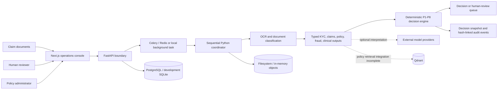
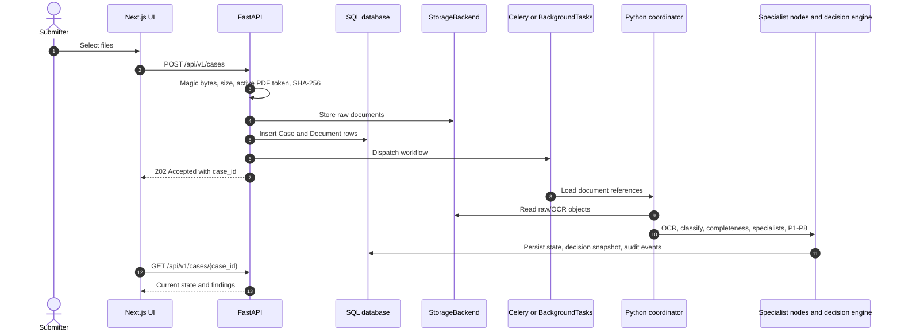
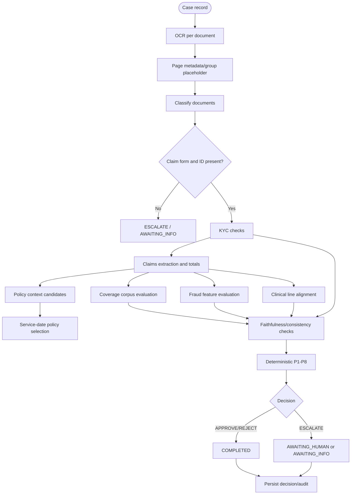
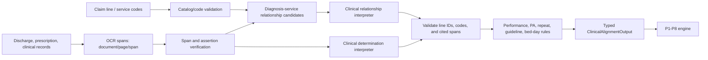
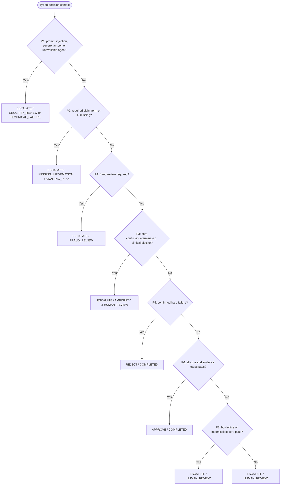
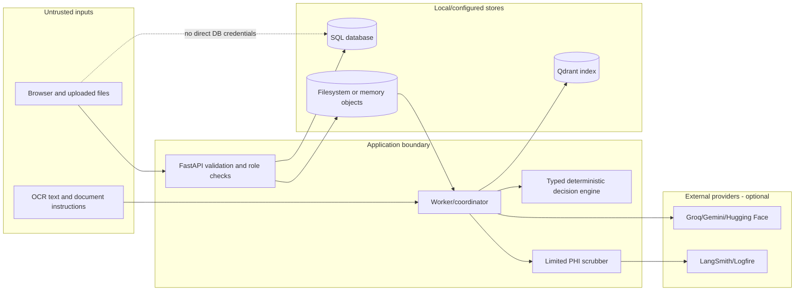

# MediShield

**From scattered claim documents to traceable review decisions.**

MediShield is a prototype claims-intake and review platform. It turns a packet of forms, identity documents, bills, and clinical records into extracted evidence, specialist findings, and an auditable `APPROVE`, `REJECT`, or `ESCALATE` recommendation for an operations reviewer.

**The core idea:** probabilistic AI interprets ambiguous documents; verified evidence, governed policy context, and deterministic application rules control the business decision. An LLM does not decide a claim.

| Intake | Evidence | Decision and review |
|---|---|---|
| Multi-document upload, OCR, classification, and typed claim/KYC extraction. | Page/span provenance, policy citations, clinical findings, and cross-document checks. | Deterministic P1-P8 recommendation, explainable escalation, version-checked human actions, and audit history. |

> [!IMPORTANT]
> **Prototype and data boundary.** The checked-in benchmark is synthetic. MediShield does not execute payments and is not HIPAA-certified. Do not send real PHI to external model or tracing providers until the organization has completed privacy/security review, executed required BAAs, and verified provider configurations. Several controls described in design documents remain deployment responsibilities or known implementation gaps.

## Contents

- [1. Overview](#1-overview)
- [2. Implementation Status](#2-implementation-status)
- [3. Key Capabilities](#3-key-capabilities)
- [4. Technology Stack](#4-technology-stack)
- [5. Architecture](#5-architecture)
- [6. End-to-End Lifecycle](#6-end-to-end-lifecycle)
- [7. Agentic AI Design](#7-agentic-ai-design)
- [8. Clinical Evidence Grounding](#8-clinical-evidence-grounding)
- [9. Policy RAG and Governance](#9-policy-rag-and-governance)
- [10. Decision Engine](#10-decision-engine)
- [11. Security and Privacy](#11-security-and-privacy)
- [12. Governance and Compliance Readiness](#12-governance-and-compliance-readiness)
- [13. Observability and Explainability](#13-observability-and-explainability)
- [14. Data Architecture](#14-data-architecture)
- [15. Evaluation and Quality Assurance](#15-evaluation-and-quality-assurance)
- [16. Reliability and Performance](#16-reliability-and-performance)
- [17. API and Integration Overview](#17-api-and-integration-overview)
- [18. Setup and Development](#18-setup-and-development)
- [19. Roadmap and Known Gaps](#19-roadmap-and-known-gaps)
- [20. Contribution and Release Readiness](#20-contribution-and-release-readiness)

## 1. Overview

### The problem and the design choice

Claim packets mix inconsistent scans, structured forms, policy language, and clinical evidence. A conventional OCR pipeline can extract text without establishing whether a fact is supported; an LLM-only adjudicator can produce fluent answers without reliable authority or provenance. MediShield separates those jobs: OCR and specialist agents propose structured interpretations, source spans and typed contracts constrain what can be used, and deterministic rules select the workflow outcome.

The product scope is **intake, validation, evidence review, and recommendation**. It does not execute payments, calculate final member cost share, provide production enrollment/network integrations, or establish medical necessity as a clinical authority.

### Architecture snapshot



The diagram describes current code, not a production deployment topology. The coordinator is sequential; Redis/Celery is optional, and the policy publishing/index path is not fully connected to the default coverage corpus.

### Run the demo

Prerequisites: Python 3.11+ and Node.js/npm. No hosted model key is required to start the API and UI; model-dependent findings may remain indeterminate without a configured provider. From the repository root:

```bash
python -m venv .venv
source .venv/bin/activate
python -m pip install -e ".[dev]"
.venv/bin/uvicorn medishield.api.main:app --host 0.0.0.0 --port 8000 --reload
```

In a second terminal:

```bash
cd frontend
npm ci
npm run dev
```

Open `http://localhost:3000`. The login screen provides preset demo personas; these are static development accounts, not production identities. Development can fall back to SQLite and local filesystem storage. See [Setup and Development](#18-setup-and-development) for migrations, optional services, checks, and troubleshooting. Demo authentication is not suitable for real claims or deployment.

### First-minute evidence

| What to know | Current evidence |
|---|---|
| What is distinctive? | AI extracts and interprets; provenance checks and deterministic rules govern the outcome. |
| What runs today? | FastAPI, Next.js, OCR, a sequential Python coordinator, typed specialists, review actions, and decision/audit persistence. |
| What do the saved full-workflow runs show? | Oct 21 artifact: 1 approved, 4 rejected, 25 escalated. Oct 20 artifact: 30 escalated. These are separate runs/configurations, not an accuracy score. |
| What is not established? | Independent case-level truth, clinical validation, production security/compliance, and real-claim readiness. |

## 2. Implementation Status

Labels below describe the inspected source tree. An accepted ADR or canonical contract is not, by itself, evidence that a feature is shipped.

| Status | Meaning |
|---|---|
| **Implemented** | Runtime code and relevant tests exist. This does not imply production readiness. |
| **Partially implemented** | A working slice exists, but integration, authoritative data, completeness, security, or verification is missing. |
| **Planned / specified** | Described in a canonical contract, ADR, SDD, or roadmap but not confirmed in executable code. |
| **Known limitation** | A verified gap, conflicting contract, or unresolved decision is documented. |

| Capability | Status | Evidence and boundary |
|---|---|---|
| Case API and operations console | **Implemented, prototype security** | FastAPI routers and Next.js UI exist. Authentication still includes static demo accounts and development bypasses. |
| Raster OCR and provenance spans | **Implemented, accuracy varies** | RapidOCR, PDF text parsing, geometry, and optional VLM paths exist; no complete field-level gold transcription set is available. |
| Document classification | **Partially implemented** | Heuristic classifier and optional fallback exist; audits report category confusion and composite-document limits. |
| KYC and claims extraction | **Partially implemented** | OCR-backed fields, member lookup, code candidates, line extraction, and arithmetic exist; reference catalogs and production data sources are incomplete. |
| Policy context and coverage | **Partially implemented** | Enrollment candidates, date barrier, policy evaluation, and admin publishing exist; runtime corpus is not fully wired to published Qdrant content. |
| Fraud screening | **Implemented as deterministic screening; signals incomplete** | Seven binary feature detectors exist; any detected feature sets `fraud_review_required`. History/benchmark context is optional; the compatibility value is not a probability. |
| Clinical alignment | **Partially implemented** | Per-line contracts, catalog checks, bed-day reconciliation, and constrained LLM proposals exist; guideline authority and competing ADR designs remain unresolved. |
| Deterministic decisions | **Implemented; approval policy is configurable** | P1-P8 engine and tests exist. ADR-028 adds an opt-in/configurable clinical-discrepancy approval path, enabled by default in the current settings. |
| Human review and overrides | **Implemented; recovery incomplete** | Locks, confirmation, override, request-info, and audit records exist. Supplementary document upload/resume is not complete end-to-end. |
| Audit events | **Partially implemented** | SHA-256-linked event generation and verification exist; this is not WORM storage or a digital signature service. |
| Evaluation | **Partially implemented** | Synthetic generators, a simulated harness, and a dataset diagnostic endpoint exist; no validated real-world decision accuracy is established. |
| CI/CD | **Not present in inspected repository** | No `.github/workflows/` pipeline was found. |

## 3. Key Capabilities

| Capability | Current behavior | Important limitation |
|---|---|---|
| Document intake | Multiple JPEG, PNG, PDF, and TIFF uploads; magic-byte validation, 25 MB per-file and 100 MB aggregate checks, selected PDF active-content token checks, SHA-256 checksum. | Static inspection is not antivirus scanning or PDF sandboxing. |
| OCR and classification | Local RapidOCR spans/boxes; PDF text parsing; classifier maps claim, ID, discharge, prescription, policy amendment, unknown. | Full document splitting/segmentation and recognition accuracy are not guaranteed. |
| KYC | Synthetic member/enrollment lookup, ID field extraction, expiry checks, JPEG ELA signal. | No production enrollment, dependent relationship, identity-provider, or government registry integration. |
| Claims validation | Claims header, diagnosis/procedure candidates, service lines, units and amounts, total-vs-line arithmetic. | NPI is not checked against a provider registry; authoritative CPT/ICD releases and all billing invariants are not integrated. |
| Policy evaluation | Candidate policy context, service-date matching helper, coverage/exclusion/authorization outputs, clause citations. | Runtime defaults to built-in in-memory chunks; admin-published index synchronization is incomplete. No patient cost-share accumulator. |
| Fraud analysis | Deterministic duplicate, tamper, velocity, provider outlier, date, arithmetic, and frequency feature functions; any detected factor requires human fraud review. | Historical claim counts/provider distributions are not always supplied; detectors are not calibrated fraud probabilities. |
| Clinical alignment | Per-line performance, diagnosis relationship, necessity, authorization, repeat-service, and bed-day status. | Depends on available evidence and configured catalogs; LLM provider failure leaves uncertainty. |
| Human review | Review locks, optimistic version checks, confirm/override/request-info, audit records. | Requesting information does not provide a complete supplementary upload/resume loop. |
| Case reports and live events | PDF report endpoint and per-case WebSocket lifecycle events exist. | WebSocket replay is in-memory/process-local; event history is not a durable stream. |
| Multilingual support | Devanagari/Spanish helpers, locale-aware date/currency parsing, and optional VLM transcription. | Coverage is partial; external VLM use requires data-governance approval. |

## 4. Technology Stack

| Layer | Verified components |
|---|---|
| Frontend | Next.js 14 App Router, React 18, TypeScript, Tailwind CSS, Lucide React. See [`frontend/package.json`](frontend/package.json). |
| API | Python 3.11+, FastAPI, Uvicorn, Pydantic v2, `pydantic-settings`. |
| Database | SQLAlchemy 2, Alembic, PostgreSQL drivers (`asyncpg`, `psycopg2-binary`), SQLite/aiosqlite development fallback. |
| Background jobs | Celery 5 and Redis 7, with FastAPI in-process background dispatch when Redis is unavailable. |
| Workflow | Typed `CaseState` and sequential Python `CaseWorkflowCoordinator`. **LangGraph is not a declared dependency and no compiled `StateGraph` was found.** |
| OCR/documents | `rapidocr-onnxruntime`, Pillow, NumPy, `pypdf`. |
| LLM/VLM | `httpx`-based Groq-compatible gateway; optional Cerebras/Gemini fallbacks; Gemini, Hugging Face, and Groq vision clients. |
| Policy index | `qdrant-client`, embedded or configured Qdrant Cloud; optional Gemini hosted embeddings. No Chroma/BM25 dependency is declared. |
| Storage | Local filesystem and in-memory storage implementations. `boto3` is declared but no concrete S3 backend class was found. |
| Telemetry/reporting | Optional Logfire instrumentation, optional LangSmith tracing, ReportLab PDF generator, process-local LLM telemetry. |
| Test/tooling | Pytest, pytest-asyncio, pytest-cov, Ruff, mypy configuration; frontend TypeScript/lint/build scripts. |

## 5. Architecture

### Current layered architecture

The architecture snapshot above is the current runtime path. Its separation of interpretation, evidence, and authority is intentional; its dispatch and retrieval integrations remain prototype-grade.

| Boundary | Responsibility | Current implementation note |
|---|---|---|
| Web console | Intake, case queue, document/OCR inspection, reviewer actions, and admin screens. | Next.js 14/React 18; talks to FastAPI over HTTP and case WebSockets. |
| API | Validate requests/uploads, enforce route dependencies, persist case metadata, return status/report/audit data. | FastAPI; demo auth and development bypasses are not deployment controls. |
| Dispatch | Move case processing off the request path. | Celery/Redis when available; in-process `BackgroundTasks` fallback is not durable. |
| Workflow | OCR/classify, completeness, run typed specialists, combine findings. | `CaseWorkflowCoordinator` is sequential Python, not compiled LangGraph. |
| Decision | Apply P1-P8 to typed outputs and route to completion or human review. | Deterministic application logic owns the final business decision; rule/spec conflicts remain. |
| Persistence | Store relational case/claim/review/audit records and document objects. | PostgreSQL or dev SQLite; local filesystem/in-memory object backends. |
| Policy retrieval | Retrieve clauses and return citation-bearing coverage findings. | Admin publication can write SQL/Qdrant, but default runtime corpus synchronization is incomplete. |

### Data and trust boundaries

1. Browser sends API requests; it does not connect directly to SQL.
2. Uploaded documents are untrusted input and stored through `StorageBackend`.
3. OCR payloads are referenced by URI and loaded by processing nodes.
4. Optional model/VLM calls can send selected extracted or clinical content to external services when configured.
5. The deterministic decision engine consumes typed specialist outputs, not raw prompts, and produces the business decision.
6. Policy customer uploads remain case evidence; only administrator policy routes can publish policy versions/index content.

The boundary model does not claim that TLS, encrypted storage, access logging, or BAA configuration is deployed; those require environment and organizational controls.

## 6. End-to-End Lifecycle

### Current processing lifecycle



### Agent orchestration and routing



The diagram shows data dependencies; runtime currently executes the steps sequentially rather than concurrently.

## 7. Agentic AI Design

| Specialist | Inputs | Outputs | Verification / failure handling |
|---|---|---|---|
| OCR/preprocessor | Raw bytes, MIME | OCR pages, spans, bounding boxes, quality | Local RapidOCR and PDF text parsing; optional VLM; unavailable/poor evidence must remain visible. |
| Document classifier | Filename and OCR text/spans | Type, confidence, tags | Heuristic scores with optional LLM for ambiguity; classification errors can affect completeness. |
| KYC | ID/claim spans, member repository, optional raw image | Member/DOB/expiry/tamper findings | Member lookup and expiry checks; repository data is synthetic in this repository. |
| Claims | Claim spans and code catalog | Claim amount/date/NPI, code candidates, lines, totals | Deterministic parsing/math with optional LLM/VLM fallback; fields require source/provenance checks. |
| Policy context | Member ID and enrollment source | Candidate policy/version/date ranges | Service-date selection helper; SQL/no-enrollment semantics need source review. |
| Policy coverage | Policy ID/version, codes, retrieved chunks | Coverage, exclusions, citations, auth fields | Default corpus is in memory; published policy runtime wiring is incomplete. |
| Fraud | Claims, KYC tamper, optional history/benchmarks | Binary feature flags, `fraud_review_required`, compatibility 0/1 value | Deterministic feature calculations; historical data context may be absent. |
| Clinical alignment | Claim lines, clinical spans, diagnosis candidates, catalogs | Per-line evidence and bed-day output | Relationship and necessity LLM proposals are schema/span-checked; deterministic code maps results. |
| Decision engine | Typed findings, consistency report | Decision, P-rule ID, confidence, justification | Deterministic rule order; the LLM has no final-decision authority. |

The coordinator maintains `CaseState`, a TypedDict containing IDs, references, summaries, verdicts, and scores. It does not compile a LangGraph graph. The current node sequence is bounded by task retry settings and some local LLM retry/failover logic; it is not a general cyclic graph or durable checkpoint/replay engine.

## 8. Clinical Evidence Grounding



Implemented evidence structures include `FieldProvenance`, `LineClinicalEvidence`, `ClinicalAlignmentOutput`, reason codes, and `BedDayReconciliation`. Clinical relationship proposals are restricted to supplied diagnoses/services/evidence IDs; necessity determinations accept only supported outputs with supplied evidence IDs. Performance status, code validation, guideline rows, prior authorization, bed days, and final decision remain application responsibilities.

**Known clinical design conflict:** ADR-031 describes LLM assistance for previously unassessed guideline criteria. ADR-032 (accepted) proposes replacing catalog-driven necessity with one evidence-only determination per case, then records a resolution to retain the tables but stop using them for necessity. Current `clinical_alignment_node` calls both the relationship interpreter and `ClinicalDeterminationEngine`; `NecessityCriterionInterpreter` remains in source but is not called by that path. The node still reads guidelines for prior-authorization requirements. Clinical governance must ratify this final boundary.

**Approval caveat:** `CLINICAL_UNCERTAINTY_APPROVAL_ENABLED` defaults to `true`. With the reason-code allowlist, valid schema/OCR, no failed/contradicted/unavailable lines, and no bed-day conflict, a clinical `INDETERMINATE` can satisfy P6 even when no lines are fully supported. The approval justification displays a discrepancy notice and explicitly does not claim performance was verified. This behavior is controlled by [ADR-028](docs/adr/ADR-028_CLINICAL_UNCERTAINTY_APPROVAL_WITH_CONTRADICTION_ESCALATION.md); validate the setting with clinical/legal owners before operational use.

## 9. Policy RAG and Governance

```mermaid
flowchart TD
    subgraph Customer[Customer submission boundary]
        Upload[Policy amendment or claim attachment] --> Evidence[Case-level OCR/evidence]
        Evidence -. prohibited .-> NoPublish[No authoritative corpus write]
    end
    subgraph Admin[Administrator publishing boundary]
        AdminUser[ADMINISTRATOR] --> Draft[POST /api/v1/policies]
        Draft --> StorePDF[Store policy PDF and version]
        StorePDF --> Publish[POST /api/v1/policies/{policy_id}/publish]
        Publish --> Parse[PyPDF section/paragraph extraction]
        Parse --> Qdrant[(Qdrant local/cloud index)]
        Parse --> SQLChunks[(policy_chunks table)]
    end
    subgraph Runtime[Current coverage runtime]
        Member[Member/enrollment] --> Context[Candidate policy context]
        ClaimDate[Claim service date] --> Barrier[Date window resolver]
        Context --> Barrier
        Codes[Claim CPT/revenue codes] --> DefaultCorpus[Default in-memory corpus]
        Barrier --> DefaultCorpus
        DefaultCorpus --> Output[Coverage/citation output]
    end
    Qdrant -. not fully synchronized to runtime .-> DefaultCorpus
```

Policy publishing is role-gated and separate from customer uploads. The admin route parses PDFs into paragraph chunks and stores them in SQL/Qdrant. The runtime coverage agent by default uses a separate in-memory corpus with exact-code and token-overlap scoring; it does not demonstrate a complete dense+BM25 hybrid path to the published index. Citation verification proves that text exists in the corpus; it does not by itself prove legal/clinical applicability to every billed line. No financial accumulator calculates remaining deductible or patient responsibility. Riders and patient rider applications are stored, but waiting-period adjudication is not implemented.

## 10. Decision Engine

`WorkflowState`, `AgentVerdict`, and `BusinessDecision` are separate axes. Business decisions are `APPROVE`, `REJECT`, and `ESCALATE`; workflow states include `AWAITING_INFO`, `AWAITING_HUMAN`, and `COMPLETED`.



**Runtime/spec discrepancy:** P4 now precedes P3 in both the runtime engine and Canonical Spec 02 so a detected fraud factor is not masked by a separate ambiguity. P5 runtime performs `REJECT` for confirmed hard failures, while ADR-010/Spec 02 table describe `ESCALATE(RECOMMEND_DENIAL)`; ADR-002 describes `REJECT`. This remains unresolved and requires legal/product alignment.

| Priority | Runtime role |
|---|---|
| P1 | Prompt injection, severe tamper, or unavailable specialist -> security/technical escalation. |
| P2 | Required claim form/ID incomplete -> `ESCALATE(MISSING_INFORMATION)` / `AWAITING_INFO`. |
| P3 | Material conflict or non-exempt indeterminate evidence -> `ESCALATE(AMBIGUITY/HUMAN_REVIEW)`. |
| P4 | Fraud review required -> `ESCALATE(FRAUD_REVIEW)`. |
| P5 | Confirmed hard failure -> current runtime `REJECT` / `COMPLETED`, with recommendation tag. |
| P6 | All core, claim-line, policy-scope, fraud, clinical, consistency, and confidence gates pass -> `APPROVE`. ADR-028 can allow listed clinical uncertainty with a notice. |
| P7 | Borderline confidence or inadmissible all-core-pass evidence -> `ESCALATE(HUMAN_REVIEW)`. |
| P8 | Catch-all -> `ESCALATE(HUMAN_REVIEW)`. |

Fraud semantics are governed by [ADR-033](docs/adr/ADR-033_BINARY_FRAUD_INDICATORS_AND_ANY_FACTOR_REVIEW.md), which supersedes ADR-005's weighted aggregation. The engine computes seven binary indicators; any one detected factor sets `fraud_review_required=true` and routes to P4 fraud review. `fraud_score` is retained only as a binary compatibility value (`1.0` or `0.0`), not a probability or severity measure.

## 11. Security and Privacy

### Implemented controls

- Upload type is determined from magic bytes, not only the extension; size limits are enforced; selected dangerous PDF tokens and executable signatures are rejected.
- API dependencies enforce role allowlists; review requests use optimistic case-version checks.
- OCR/model prompts can delimit untrusted document text; typed schemas constrain model responses.
- Logfire and LangSmith are optional; LangSmith tracing is disabled by default. A narrow recursive sanitizer masks selected PHI keys and SSN-like values.
- Audit chain uses canonical JSON and SHA-256 over event ID, prior hash, payload, and timestamp.

### Known limitations and deployment responsibilities

- Login identities/passwords are static demo values in source; development/test can accept `X-User-Role` and default to a reviewer when auth is absent. JWT persistence in the browser is not a managed identity system.
- `allow_origins=["*"]` is configured with credentials. Production origins must be explicitly restricted.
- No external IDP, secrets manager, key rotation, anti-malware service, production TLS/reverse proxy, encryption-at-rest setup, network segmentation, backup/restore policy, or verified BAA configuration was found.
- Local object storage is not S3/MinIO; MinIO is in Compose but no concrete S3 storage class was found.
- PHI scrubbers are narrow and do not prove all text/log/trace paths are safe. A security audit records unresolved LangSmith validation/wire-payload tasks.
- Hash chaining is not WORM storage, digital signing, or protection against an administrator who can rewrite the database.

### Trust boundaries



This diagram describes current components and boundaries; it does not imply that deployment encryption, hosted-provider compliance, or real-PHI approval has been completed.

## 12. Governance and Compliance Readiness

| Area | Repository evidence | Remaining decision/work |
|---|---|---|
| Requirements and ownership | 12 canonical specs, source BRD/SOP/TTD, 32 ADRs, SDD features/audits. | Some documents conflict or describe target architecture; code remains authoritative for shipped behavior. |
| Policy publication | Admin-only policy upload/publish route, version and actor fields, separate customer evidence. | Runtime index link, clinical approval workflow, effective-date/version semantics, rider applicability, and source verification need end-to-end validation. |
| Human actions | `HumanReview`, locks, reason codes, remarks, version checks, decision history. | Human authorization, retention, appeal handling, and deployment identity are organizational requirements. |
| Audit | Decision snapshots and SHA-256-linked audit events; audit route verifies chain. | No WORM/retention/legal-hold capability or external audit control is established. |
| Model governance | Provider/model configuration, typed contracts, prompt versions for some clinical paths, synthetic tests. | No comprehensive model registry, clinical signoff, continuous drift review, or production dataset approval. |
| Privacy/compliance | HIPAA-oriented design language and some scrubbing/boundary code. | No certification or end-to-end evidence of compliance. Requires organization/vendor review, BAAs, workforce procedures, retention, key control, and infrastructure safeguards. |

### Human review and override lifecycle

```mermaid
sequenceDiagram
    actor Reviewer
    participant UI as Operations UI
    participant API as Review API
    participant DB as SQL database
    participant Audit as Audit chain
    participant Worker as Resume worker

    Reviewer->>UI: Open escalated case
    UI->>API: POST /review/lock
    API->>DB: Create or refresh review lock
    API-->>UI: Lock owner and expiry
    Reviewer->>UI: Confirm, override, or request information
    UI->>API: Submit reason, remarks, expected_case_version
    API->>API: Check version; reject stale request with 409
    API->>DB: Append HumanReview and decision/state update
    API->>Audit: Append hash-linked event
    opt Override resume dispatch
        API->>Worker: Resume task when broker is available
    end
    API-->>UI: Updated workflow state and version
```

The request-information action records `AWAITING_INFO`; a complete supplementary-document upload endpoint is not present in the current OpenAPI surface.

## 13. Observability and Explainability

- Workflow state carries `trace_id` and `run_id`; case-event sequences are scoped by case/run. LangSmith tracing is optional and disabled by default. Its root trace ID is ephemeral by default; a keyed HMAC case pseudonym is opt-in and is not legal de-identification.
- `trace_span` wraps workflow nodes, OCR, LLM calls, storage, and selected repository operations. Inputs are frequently empty and summaries are constrained, but an audit found allowlist and end-to-end wire-capture gaps.
- LLM telemetry tracks call/provider attempts, failures, stage latency percentiles, and token totals in process-local counters since startup. Token totals remain null/incomplete when providers do not report usage; these counters are not a durable distributed metrics backend.
- The event broadcaster is process-local and replay is bounded/in-memory.
- Decision explanations are deterministic from specialist outputs and the decision justification (`ADR-024` supersedes LLM-authored reviewer explanations in ADR-011).
- Operational and calibration endpoints exist; calibration calculations over the simulated harness are not equivalent to validated production calibration.

## 14. Data Architecture

### Relational entities

| Domain | Tables / models |
|---|---|
| Case intake | `cases`, `documents`, `document_pages`, `idempotency_keys` |
| Claims | `claims`, `claim_lines` |
| Specialist/audit | `agent_runs`, `decisions`, `audit_events` |
| Human review | `human_reviews`, `review_locks` |
| Member and policy | `members`, `policies`, `policy_versions`, `enrollments`, `policy_chunks` |
| Catalogs | `medical_codes`, `clinical_guidelines`, `guideline_criteria`, `diagnosis_indications` |
| Rider data | `policy_riders`, `enrollment_rider_applications` |

### Key relationships

Cases own documents, extracted claims/lines, specialist runs, decisions, human reviews, and audit events. Policies own versions and chunks; enrollments bind members to policy versions; rider applications connect enrollments to configured riders. `DiagnosisIndication.service_code` is a catalog key, not a declared relational foreign key to `MedicalCode`.

The schema includes normalized Claim/ClaimLine models, but audit evidence found persistence gaps in some workflow revisions; the current coordinator contains a persistence method. Validate actual database rows for the workflow under test. Member and enrollment rows are synthetic/read-only adapters. OCR payloads and originals are stored separately by URI/object key. Qdrant is a separate index and SQL policy chunks are also retained.

### Migrations

The current migration directory includes revisions `001` through `007`: initial schema, policy chunk provenance, medical code catalog, clinical guidelines/indications, clinical criterion evidence, policy riders/enrollment applications, and verified catalog code coverage. Always test a migration chain against PostgreSQL; SQLite fallback does not validate PostgreSQL enum/index behavior.

## 15. Evaluation and Quality Assurance

### Observed full-workflow runs

| Run | Saved result | Interpretation |
|---|---:|---|
| **Oct 21 latest saved artifact** (`scripts/diagnostic_summary.json`) | 30 cases: 1 `APPROVE`, 4 `REJECT`, 25 `ESCALATE`; first rule: P3=21, P4=4, P5=4, P6=1; duration 1,506.88 seconds. | Synthetic workflow observation. Labels are 0/30 reviewed; accuracy, FAR, and FDR are `N/A`. |
| **Oct 20 earlier artifact** (`scripts/diagnostic_summary_20261020_full_workflow.json`) | 30 cases: 0 `APPROVE`, 0 `REJECT`, 30 `ESCALATE`; all first matched P3; duration 337.42 seconds. | Separate run and configuration. Do not combine with the Oct 21 result or treat the difference as a controlled improvement measurement. |
| Dataset | 155 manifest documents across 30 patient clusters | Synthetic documents; one duplicate claim image is included. |
| Clinical/policy grounding | Not independently scored | No reviewed span-level clinical truth or clause-applicability labels are available. |
| Human overrides | Not included in either artifact | No reviewed override cohort is attached. |

**Do not interpret legacy label comparisons as ground truth.** A separate Oct 20 summary reports 24 expected approvals and 24 false denials, but those expectations are not backed by independently reviewed case-level labels in the current manifest. The four document-level `expected_decision` values belong to `unknown` documents and are not patient-cluster adjudication labels. Fraud metadata is also not a claim decision label.

### Token economics

The saved 30-case evaluation artifacts contain **no per-case token fields**, so this repository cannot currently substantiate tokens-per-case or dollars-per-case for either run.

One local `/api/v1/metrics/operational` snapshot on **2026-10-21** reported 4 successful logical LLM spans, 5,961 prompt tokens, and 1,710 completion tokens (7,671 total); usage was complete for those 4 spans. This telemetry has `scope=process_since_start`: it is process-local, may include tests or other requests, is not associated with a case/execution ID, and is **not** a 30-case or per-case measurement.

Use provider-reported usage and the applicable provider/model rate card to calculate cost:

```text
cost = prompt_tokens / 1,000,000 * input_rate_per_million
    + completion_tokens / 1,000,000 * output_rate_per_million
```

Rates vary by provider, model, region, modality, and pricing date; no rate card is configured in this repository. A defensible per-case figure requires usage records keyed to a non-PHI execution ID, all text and vision calls, retries/fallbacks, and a recorded rate-card version. Until then, per-case token economics are **unmeasured**, not zero.

### Canonical assignment rubric (targets, not results)

The repository's [evaluation specification](docs/canonical/12_EVALUATION_AND_SYNTHETIC_DATA_FRAMEWORK.md) defines the following assignment targets. This README does not claim that any gate has been met:

| Dimension | Weight | Target | Current result |
|---|---:|---:|---|
| Document classification | 20% | At least 85% | Unavailable: no trusted complete classification gold set. |
| Extraction completeness | 20% | At least 80% | Unavailable: no complete field-level gold truth. |
| Policy retrieval quality | 15% | Recall@5 at least 75% | Unavailable: no reviewed applicability/expected-clause labels. |
| Decision correctness | 25% | At least 60% gate | Unavailable: 0/30 independently reviewed case labels. |
| UI functionality | 10% | 100% test pass rate | Not reported as a competition E2E score. |
| Code structure and quality | 10% | 100% static-analysis gate | No CI gate; local checks must be run and recorded. |
| Weighted composite | 100% | At least 70% overall gate | Not computed from valid ground truth. |

### Synthetic dataset facts

`dataset/metadata.json` contains 155 document entries: 151 patient documents across 30 clusters and four `unknown` documents. The 31 claim images include a duplicate claim file; other categories have 30 each. Only four unknown-document entries have `expected_decision`; the 30 patient clusters lack independently reviewed case-level expected decisions. Some fraud labels conflict with source evidence, as recorded in `docs/sdd/audits/decision_quality_audit.md` and `docs/sdd/reviews/claims_validation_root_cause_remediation_plan.md`.

### Metadata fraud-label report

The benchmark reports the document-level `fraud_label` values as supplied by `dataset/metadata.json`. They describe metadata coverage only; the benchmark does not currently compare these labels with per-document model predictions, so these counts are **not** fraud-detection accuracy.

| Supplied metadata label | Documents |
|---|---:|
| Fraud-positive | 6 |
| Fraud-negative | 149 |
| Unlabelled | 0 |
| **Total** | **155** |

| Positive label reason | Documents |
|---|---:|
| `readmission_30d` | 1 |
| `date_conflict` | 1 |
| `proc_diag_mismatch` | 1 |
| `amount_under_10k` | 1 |
| `duplicate_claim` | 1 |
| `name_mismatch` | 1 |

These are document labels, not claim adjudications. The review register currently identifies three disputed records; preserve the supplied labels for provenance, but do not use them to claim model accuracy or infer `APPROVE`, `REJECT`, or `ESCALATE` outcomes.

### Evaluation code

- `src/medishield/eval/generator.py`, `harness.py`, and `metrics.py` generate typed synthetic cases and compute metrics. `BenchmarkHarness.evaluate_case_simulated` copies expected document fields and uses category-based decisions; it does not execute the actual OCR/agent workflow.
- `/api/v1/metrics/benchmark` uses `src/medishield/benchmarks/evaluator.py`, which runs classification over dataset filenames, samples a few claims for OCR, resolves synthetic members, and constructs fraud test contexts. It is a diagnostic, not end-to-end adjudication accuracy.
- If the dataset is unavailable, the benchmark endpoint returns a fallback baseline with example values. Those values are not measured runtime results.
- The metrics dashboard shows a Brier/ECE reliability curve from 100 generated synthetic decision scenarios: 50 cases fit Platt scaling and a disjoint 50-case subset is evaluated. It uses generated `expected_business_decision` correctness labels, not `dataset/metadata.json` fraud labels or independently reviewed case outcomes. Treat it as a simulation diagnostic, not a calibrated production decision model.

To reproduce the full workflow, point `DATABASE_SYNC_URL` at a **disposable evaluation database** before running the script. It clears case, document, review, decision, and audit rows in the configured database, writes local objects, and updates generated summary files. Do not point it at a development database containing work you need to keep:

```bash
.venv/bin/python scripts/run_full_workflow_all_cases.py
```

The repository's canonical evaluation rubric defines target thresholds, not achieved results. A competition scorecard requires a reviewed case-label register, field/span truth, and held-out evaluation before accuracy or clinical claims can be made.

### Recommended evaluation metrics

Do not publish a single accuracy score until gold truth is reviewed. Track separate metrics:

| Dimension | Needed evidence |
|---|---|
| Classification | Per-class confusion matrix, precision/recall, composite-page cases. |
| Extraction | Field exactness/normalization, per-field provenance, service-line/quantity completeness. |
| Policy | Retrieval recall@K plus code/setting applicability, exclusion citation precision, effective-version selection. |
| Clinical | Line relationship, performance, necessity, bed-day, and span-citation correctness. |
| Decisions | Case-level reviewer labels; false approvals/denials and escalation-by-reason. Fraud labels are not decision labels. |
| Calibration | Brier/ECE and reliability by class and decision, on held-out reviewed cases. |
| Operations | Latency percentiles, retries, provider failures, token usage completeness, rework, and human overrides. |

## 16. Reliability and Performance

### Current mechanisms

- Celery tasks use late acknowledgements, worker-loss rejection, and bounded retries for selected transient connection/timeout/OS errors.
- The API dispatches to Celery if Redis responds to a ping; otherwise it uses an in-process `BackgroundTasks` path. If broker availability changes between ping and enqueue, the failure is logged; a durable outbox is absent.
- Development/test database access probes PostgreSQL and can fall back to file-backed SQLite. Staging/production require PostgreSQL reachability.
- LLM clients apply configured timeouts, key/model/provider fallback, and deterministic explanation behavior. Failure in clinical interpretation yields indeterminate output, not a clinical pass.
- OCR VLM fallback is bounded by feature flags/provider availability; normal raster OCR uses RapidOCR locally.

### Not verified or not implemented

- No measured production latency/SLO, throughput/load test, autoscaling configuration, circuit breaker, durable event log, or queue recovery guarantee is established.
- SQLite has different locking and concurrency properties than PostgreSQL.
- The project includes no CI workflow. Local tests/lint do not establish a production release gate.
- Qdrant Cloud, embeddings, hosted model rates, credentials, and provider privacy terms require environment-specific setup.

### Reliability work to evaluate

Content checksums and persisted OCR payloads create a basis for carefully invalidated OCR reuse, but no complete cache contract is claimed. Request deduplication, quota-aware backoff/circuit breakers, transactional outbox delivery, durable event replay, and PostgreSQL failure/recovery tests are future work; introduce them only with explicit idempotency, invalidation, and safe-degradation semantics.

## 17. API and Integration Overview

Current OpenAPI route inventory was obtained from the application at `/api/openapi.json`. Swagger UI is `/api/docs`.

| Method | Route | Purpose / access note |
|---|---|---|
| `POST` | `/api/v1/auth/login` | Demo login; do not use static account design in production. |
| `GET` | `/api/v1/auth/me` | Resolve current user context. |
| `POST`, `GET` | `/api/v1/cases` | Multipart intake and paginated case listing. |
| `GET` | `/api/v1/cases/{case_id}` | Case detail and active decision. |
| `GET` | `/api/v1/cases/{case_id}/status` | Claimer-facing status. |
| `POST` | `/api/v1/cases/{case_id}/process` | Request processing/resumption. |
| `POST` | `/api/v1/cases/{case_id}/rerun` | Re-run workflow. |
| `GET` | `/api/v1/cases/{case_id}/documents/{document_id}/ocr` | Retrieve OCR payload and spans. |
| `GET` | `/api/v1/cases/{case_id}/documents/{document_id}/content` | Retrieve document bytes. |
| `POST` | `/api/v1/cases/{case_id}/explain` | Refresh deterministic explanation. |
| `GET` | `/api/v1/cases/{case_id}/events` | Case event/reconstructed timeline. |
| WebSocket | `/api/v1/cases/{case_id}/ws` | Agent execution lifecycle events. |
| `GET` | `/api/v1/cases/{case_id}/report` | PDF report. |
| `POST`, `DELETE` | `/api/v1/cases/{case_id}/review/lock` | Acquire/release reviewer lock. |
| `POST` | `/api/v1/cases/{case_id}/review/override` | Human override. |
| `POST` | `/api/v1/cases/{case_id}/review/confirm` | Human confirmation. |
| `POST` | `/api/v1/cases/{case_id}/review/request-info` | Set missing-information state. |
| `GET`, `POST` | `/api/v1/policies` | Admin list and draft upload. |
| `POST` | `/api/v1/policies/{policy_id}/publish` | Admin publish/index. |
| `GET`, `POST` | `/api/v1/admin/codes` | Search/create code catalog records. |
| `POST` | `/api/v1/admin/codes/upload` | CSV code catalog upload. |
| `GET` | `/api/v1/admin/dashboard` | Admin/manager dashboard. |
| `GET` | `/api/v1/audit/cases/{case_id}` | Verify/export audit chain. |
| `GET` | `/api/v1/metrics/operational` | Operational counters and latencies. |
| `GET`, `POST` | `/api/v1/metrics/benchmark`, `/api/v1/metrics/benchmark/run` | Dataset diagnostics. |
| `GET` | `/api/v1/metrics/calibration` | Simulated calibration metrics. |
| `GET` | `/api/v1/health`, `/health` | Liveness endpoints. |

There is **no** `POST /api/v1/cases/{case_id}/documents` supplementary-upload route in the current OpenAPI inventory, despite the canonical specification. The request-info state exists, but the evidence-recovery loop is incomplete.

## 18. Setup and Development

### Prerequisites

- Python 3.11+.
- Node.js/npm for the frontend.
- Optional Docker Compose for PostgreSQL 16, Redis 7, and MinIO.
- Optional external provider credentials for Groq, Gemini, or Hugging Face paths. Use synthetic documents only unless external processing is approved.

### Install

From the repository root:

```bash
python -m venv .venv
source .venv/bin/activate
python -m pip install --upgrade pip
python -m pip install -e ".[dev]"
cp .env.example .env
```

On Windows, activate with `.venv\\Scripts\\activate`. `pyproject.toml` uses setuptools; `uv.lock` is present, but the commands above avoid assuming `uv` is installed.

### Local services and database

```bash
docker compose up -d postgres redis minio minio-init
```

Compose does not include Qdrant, a Celery worker, or the frontend. Development `.env.example` credentials are placeholders/defaults and must not be reused in external environments.

With PostgreSQL available and `DATABASE_SYNC_URL` configured:

```bash
.venv/bin/alembic upgrade head
```

In `development`/`test`, if PostgreSQL is unreachable, the application may use `SQLITE_DB_PATH` and bootstrap/seed SQLite. This fallback does not verify PostgreSQL migrations or native enum behavior. In staging/production the database probe expects PostgreSQL to be reachable.

### Start services

Terminal 1, repository root:

```bash
.venv/bin/uvicorn medishield.api.main:app --host 0.0.0.0 --port 8000 --reload
```

Terminal 2, if using Redis/Celery rather than the in-process fallback:

```bash
.venv/bin/celery -A medishield.worker.tasks:celery_app worker --loglevel=INFO
```

Terminal 3:

```bash
cd frontend
npm ci
npm run dev
```

Open `http://localhost:3000`. The API client defaults to `http://localhost:8000/api/v1`; configure `NEXT_PUBLIC_API_URL` to override.

### Environment variables

Use `.env.example` as the variable-name reference; do not copy its sample secrets into a real deployment.

| Group | Variables |
|---|---|
| Runtime/database | `ENVIRONMENT`, `LOG_LEVEL`, `SECRET_KEY`, `API_V1_STR`, `DATABASE_URL`, `DATABASE_SYNC_URL`, `SQLITE_DB_PATH`. |
| Queue/storage | `REDIS_URL`, `STORAGE_DIR`, `S3_ENDPOINT_URL`, `S3_ACCESS_KEY`, `S3_SECRET_KEY`, `S3_BUCKET_NAME`, `S3_REGION`, `S3_USE_SSL`. S3 fields exist in configuration; the current storage class is local/in-memory. |
| Policy index | `QDRANT_URL`, `QDRANT_PATH`, `QDRANT_CLOUD_URL`, `QDRANT_CLOUD_API_KEY`, `QDRANT_COLLECTION_NAME`, `QDRANT_VECTOR_NAME`, `EMBEDDING_MODEL`, `EMBEDDING_DIMENSIONS`. |
| Models | `GROQ_API_KEY`, `GROQ_MODEL`, `GROQ_FALLBACK_MODEL(S)`, `GROQ_BASE_URL`, `GROQ_TIMEOUT_SECONDS`, `GEMINI_API_KEY`, Gemini model/fallback variables, `CEREBRAS_API_KEY` and model variables, `HF_API_KEY` and model variables, `ENABLE_MODEL_FALLBACK`, `FORCE_VLM_EXTRACTION`. |
| Clinical decision | `CLINICAL_SUPPORT_APPROVAL_MIN_RATIO`, `CLINICAL_UNCERTAINTY_APPROVAL_ENABLED`. The latter defaults true in current settings; review ADR-028 before changing in a real payer environment. |
| Telemetry | `LOGFIRE_TOKEN`, `LOGFIRE_SEND_TO_LOGFIRE`, `LOGFIRE_SERVICE_NAME`, `LANGSMITH_TRACING`, `LANGSMITH_API_KEY`, `LANGSMITH_PROJECT`, `LANGSMITH_ENDPOINT`, `LANGSMITH_INCLUDE_CASE_PSEUDONYM`, `LANGSMITH_AGENTS_ONLY`. |

### Tests and checks

From repository root:

```bash
.venv/bin/pytest -q
.venv/bin/ruff check src tests
.venv/bin/mypy src/medishield
```

Frontend:

```bash
cd frontend
npm run typecheck
npm run lint
npm run build
```

No CI workflow was found under `.github/workflows/`; these are local checks, not an enforced release gate. Some older tests and benchmark reports contain stale or disputed assumptions; examine test provenance rather than changing runtime behavior simply to satisfy a questionable fixture.

### Troubleshooting

| Symptom | Check |
|---|---|
| Frontend queue cannot load | Ensure API listens on port 8000 or configure `NEXT_PUBLIC_API_URL`. |
| PostgreSQL connection refused | For development, inspect SQLite fallback and `SQLITE_DB_PATH`; for migrations, start PostgreSQL and verify `DATABASE_SYNC_URL`. |
| Workflow remains queued | Check Redis reachability and Celery worker; local fallback is in-process and not durable. |
| Uploaded policy is not reflected in coverage | Confirm publish succeeded; runtime corpus synchronization is a known integration gap. |
| Clinical/OCR result is indeterminate | Inspect OCR span provenance and specialist reason codes; hosted models are optional and cannot replace missing source evidence. |

## 19. Roadmap and Known Gaps

### Prioritized gaps

| Priority | Gap | Why it matters / next work |
|---|---|---|
| **Critical safety** | Policy runtime corpus is not the admin-published index; quote authenticity is not sufficient semantic applicability for each billed line. | Connect a single authoritative published policy/version path and require code/setting-scoped positive coverage. |
| **Critical governance** | P5 autonomous `REJECT` conflicts with ADR-010/Spec 02 table `ESCALATE(RECOMMEND_DENIAL)`; PostgreSQL enum/migration compatibility needs verification. | Obtain legal/product decision and test on PostgreSQL before adverse-decision deployment. |
| **Critical clinical governance** | Clinical uncertainty approval defaults enabled and can allow zero fully supported lines when only allowlisted uncertainty remains. | Validate ADR-028 with legal/clinical owners and reviewed holdout outcomes; consider disabling until accepted. |
| **High** | Synthetic member/code/guideline catalogs are not production enrollment, provider, licensed code, network, or benefit systems. | Define authoritative sources, data ownership, versioning, update cadence, and outage semantics. |
| **High** | No independently reviewed case-level truth across the 30 clusters; metadata fraud labels are not decision labels and some conflict with source docs. | Create an evaluator-owned adjudication register and field-level gold evidence. |
| **High** | Supplementary-document upload/resume is incomplete; queue fallback is not durable. | Implement and test `AWAITING_INFO -> upload -> resume -> adjudication` with audit/version handling. |
| **High** | Demo authentication, development role bypass, wildcard CORS, local token storage, and incomplete PHI wire audits. | Add managed identity, per-case authorization, restricted origins, secret management, and independent privacy/security validation. |
| **High** | No allowed-amount, deductible accumulator, OOP maximum, network, or member/insurer payment calculation. | Define financial sources and ordering/rounding rules before implementing cost share. |
| **Medium** | Sequential Python coordinator differs from canonical LangGraph parallel DAG; split/group is not full composite-page segmentation. | Align implementation/specification through ADR-governed changes and test routing/recovery. |
| **Medium** | Fraud history/statistical context is optional; provider outlier features may have no benchmark data. | Wire approved claims history/reference distributions and evaluate on reviewed data. |
| **Medium** | No CI/CD pipeline, production deployment/backup/retention plan, or measured load/performance SLO. | Build release automation and operational validation, without copying target numbers into measured claims. |

### Feature roadmap and current status

| Feature | Status | Evidence / next step |
|---|---|---|
| Real-time case progress | **Partially implemented** | WebSocket lifecycle events exist; replay is process-local and not a durable event stream. |
| Clinical confidence calibration | **Planned** | Brier/ECE utilities exist, but there is no independently reviewed held-out cohort to calibrate against. |
| Multilingual documents | **Partially implemented** | Locale/date/currency helpers and optional VLM paths exist; language-specific OCR quality is not benchmarked. |
| Tamper analysis | **Partially implemented** | ELA and deterministic tamper indicators exist; signals are not a validated fraud probability and history context is incomplete. |
| Reviewer evidence overlays | **Partially implemented** | OCR spans/boxes and document viewing exist; comprehensive discrepancy-to-source overlays and blocking workflows remain incomplete. |
| Downloadable case reports | **Implemented, prototype** | PDF report endpoint exists; validate content/privacy and retention before deployment. |
| Supplementary upload and recovery | **Planned / incomplete** | `AWAITING_INFO` and request-info action exist; the upload/resume API loop is absent. |
| Policy publication-to-runtime synchronization | **Partially implemented** | Admin publication and indexing exist; connect one authoritative, versioned corpus to runtime coverage evaluation. |
| Durable queue recovery and safe degraded mode | **Partially implemented** | Celery retries and in-process fallback exist; outbox, durable event history, and recovery guarantees do not. |
| Production identity, provider data, and cost share | **Planned** | Requires authoritative integrations, payer policy decisions, privacy/security controls, and financial rule definitions. |

Historical reports under [`docs/sdd/audits/`](docs/sdd/audits/) and [`docs/sdd/reviews/`](docs/sdd/reviews/) are useful evidence, but their timestamps and evaluation paths differ. Use source code and current tests to decide implementation status; do not treat older benchmark narratives as current measured truth.

## 20. Contribution and Release Readiness

Follow [`agents.md`](agents.md): canonical requirements and ADRs govern architecture; add tests for production features; update API/database/workflow contracts for corresponding changes; preserve evidence/provenance; and keep business decisions in deterministic code. Do not hardcode catalogs or introduce dependencies silently.

### Change checklist

- [ ] Identify the source requirement and label behavior as implemented, partial, planned, or a known limitation.
- [ ] Add focused unit and integration tests for both expected and failure paths.
- [ ] Update API contracts when routes or response schemas change.
- [ ] Add an Alembic migration for relational changes; test against PostgreSQL and supported SQLite fallback.
- [ ] Update workflow specs for node/routing changes.
- [ ] Test prompt injection, cited-span validation, and provider outages when model paths change.
- [ ] Preserve prior decision history when rerunning or applying human review.
- [ ] Run Python tests, Ruff, mypy, and frontend checks; record evaluation dataset/label provenance.
- [ ] Obtain clinical, payer/legal, security/privacy, and operational approvals before real-PHI or adverse-decision deployment.

### Release readiness

**Not ready for real-claim production based on repository evidence.** The project contains substantial prototype functionality, but policy corpus integration, authoritative external data, supplementary evidence recovery, production identity/security, evaluation truth, and compliance operations are incomplete or unresolved. No compliance certification, model accuracy, fraud accuracy, SLA, or real-world performance figure is claimed here.

### Target CI/CD and release validation (planned)

There is no CI workflow in the repository. A future release gate should run static checks, tests, PostgreSQL migration/compatibility checks, reviewed synthetic regressions, security review, and an explicit human release approval; none of this automation is currently established.

## License and publication

No root `LICENSE` file was found. Do not assume reuse rights; add and review a license before publishing the repository as open source. The checked-in benchmark is synthetic, but the README intentionally reproduces no case-level narratives, credentials, or internal absolute paths.

## Documentation map

- Canonical contracts: [`docs/canonical/`](docs/canonical/)
- ADRs: [`docs/adr/`](docs/adr/)
- Proposed business/source documents: [`docs/source/`](docs/source/)
- SDD feature specifications, audits, and reviews: [`docs/sdd/`](docs/sdd/)
- Engineering rules: [`agents.md`](agents.md)
- [Binary fraud review decision](docs/adr/ADR-033_BINARY_FRAUD_INDICATORS_AND_ANY_FACTOR_REVIEW.md)
*** End Patch