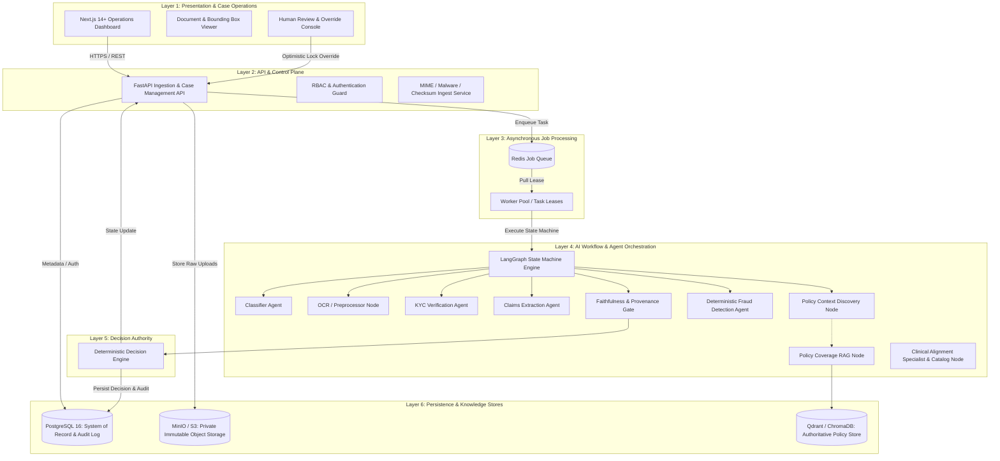
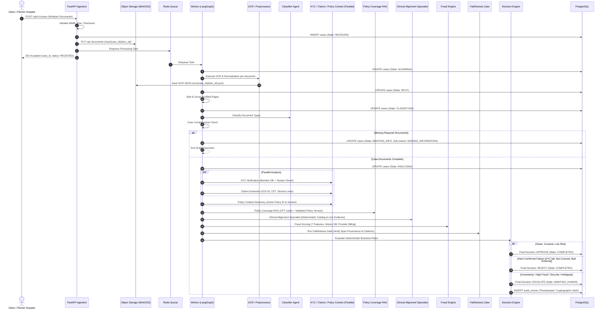

# MediShield Multi-Agent Document Intake System
## Canonical Architecture Specification

**Status:** Authoritative Engineering Contract  
**Version:** 1.0.0 (Canonical Baseline)  
**Governing Documents:** Assignment 02 Functional Specification; Reviewer Response V2  
**Target Root:** `D:\projects\medishield`

---

## 1. Executive Architectural Overview

The MediShield Multi-Agent Document Intake System is an enterprise-grade, HIPAA-oriented document understanding and claims triage platform. It processes multi-page, multi-document insurance submissions (claim forms, government IDs, discharge summaries, prescriptions, and policy amendments), extracts verified facts, grounds findings in authoritative insurance policies, scores fraud and billing anomalies, and produces a deterministic business outcome: **APPROVE**, **REJECT**, or **ESCALATE**.

### The Core Architectural Tenet:
> **"Agentic" does not mean "LLM everywhere."**
> Large Language Models are applied exclusively to tasks where probabilistic language and visual understanding provide superior value: messy document extraction, classification of ambiguous layouts, and natural language policy interpretation. Deterministic software, relational databases, cryptographic integrity checks, deterministic rule engines, and hybrid retrieval systems are used for all validations, calculations, identity checks, and business decision authority.

---

## 2. System Architecture Layers

The platform is strictly organized into six decoupled architectural layers:



### Layer Breakdown & Responsibilities

1. **Layer 1: Presentation & Case Operations (Next.js)**
   - Case Intake Dashboard: Real-time queues, ingestion metrics, Straight-Through Processing (STP) tracking.
   - Case Detail & Evidence Viewer: Dual-pane UI rendering original document alongside extracted fields with clickable OCR text-span bounding highlights.
   - Human Review & Exception Console: Dedicated queue for cases in `AWAITING_HUMAN` or `AWAITING_INFO`, supporting optimistic-locking human overrides with mandatory reason codes.
   - *Security Constraint:* Browser clients never hold database credentials or direct object storage write credentials; document viewing is mediated via short-lived pre-signed URLs (maximum 15-minute TTL).

2. **Layer 2: API & Control Plane (FastAPI)**
   - Multipart document intake validating MIME magic bytes and file size caps.
   - Unique `case_id` generation (`CASE-YYYYMMDD-XXXXXX`).
   - Role-Based Access Control (RBAC): `OPERATIONS_REVIEWER`, `OPERATIONS_MANAGER`, `ADMINISTRATOR`.
   - Idempotency guard via `Idempotency-Key` header and SHA-256 payload checksums.
   - *Execution Constraint:* API handlers never execute LLM calls or OCR synchronously in HTTP request threads. Intake returns HTTP 202 Accepted with case reference within 200ms.

3. **Layer 3: Asynchronous Job Processing (Redis & Celery/RQ)**
   - Queue-backed execution preventing request timeouts.
   - Job leasing and worker heartbeats: Stale tasks reclaimed if worker crashes mid-graph.
   - Bounded retries: Retries strictly isolated to transient network, database, or LLM-provider rate-limit errors; permanent errors fail fast into `FAILED` or `ESCALATE(TECHNICAL_FAILURE)`.

4. **Layer 4: AI Workflow & Multi-Agent Pipeline (LangGraph)**
   - State-machine coordination using typed IDs and references (no large OCR text or binary payloads in state).
   - Document-level classification and OCR; case-level KYC, Claims, Policy, and Fraud synthesis.
   - High-throughput parallel execution branches: KYC, Claims extraction, and Policy Context resolution execute concurrently.
   - Faithfulness Gate: Validates schema adherence, provenance references, and verifies that claimed values physically exist in cited OCR spans.

5. **Layer 5: Decision Authority (Deterministic Decision Engine)**
   - The **single component** authorized to emit a final business decision (`APPROVE`, `REJECT`, `ESCALATE`).
   - Pure, deterministic, versioned rule evaluation—zero LLM inference in the decision rule evaluator.
   - Hard business failures trigger auto-reject; clean eligible cases trigger auto-approve; uncertainty, fraud, or material ambiguity trigger escalate.

6. **Layer 6: Persistence & Knowledge Stores**
   - **PostgreSQL 16:** Relational system of record for cases, documents, extracted claims, agent runs, decisions, human reviews, and append-only audit events.
   - **Object Storage (S3 / MinIO):** Private immutable bucket storing original uploads (`/raw/{case_id}/{doc_id}`) and derived artifacts (`/ocr/{case_id}/{doc_id}`).
   - **Vector Database (Qdrant / ChromaDB):** Dedicated, admin-published vector collections storing authoritative, versioned policy chunks embedded via dense embeddings with lexical BM25 indexing.

---

## 3. Trust Boundaries & Security Architecture

```text
┌────────────────────────────────────────────────────────────────────────┐
│ TRUST ZONE A: Client Browser (Public Internet / VPN)                   │
│   - Next.js UI                                                         │
│   - Authenticated Session Token (JWT / HttpOnly Cookie)                │
└───────────────────────────────────┬────────────────────────────────────┘
                                    │ HTTPS (TLS 1.3)
┌───────────────────────────────────▼────────────────────────────────────┐
│ TRUST ZONE B: API Ingestion & Control Plane (FastAPI)                  │
│   - Endpoint Rate Limiting & Payload Inspection                        │
│   - RBAC Enforcement & Token Validation                                │
│   - Checksum Generation & Idempotency Check                            │
└───────────────────┬───────────────────────────────┬────────────────────┘
                    │                               │
    Enqueues Job    │                               │ Pre-signed Read (15m TTL)
┌───────────────────▼───────────────┐   ┌───────────▼────────────────────┐
│ TRUST ZONE C: Processing Workers  │   │ TRUST ZONE E: Object Storage   │
│   - Celery / Redis Worker Pool    │   │   - MinIO / AWS S3             │
│   - LangGraph State Machine       │   │   - Private Bucket             │
│   - Agents (Classifier, KYC, etc) │   │   - Server-Side AES-256        │
└───────────┬───────────────────────┘   └────────────────────────────────┘
            │
            ├───────────────────────────────┐
            │ SQL Queries & Audit           │ Semantic Retrieval
┌───────────▼───────────────────────┐   ┌───▼────────────────────────────┐
│ TRUST ZONE D: System of Record    │   │ TRUST ZONE F: Vector Store     │
│   - PostgreSQL 16                 │   │   - Qdrant / ChromaDB          │
│   - Encrypted at Rest            │   │   - Read-Only to Workers       │
│   - Append-Only Audit Table       │   │   - Admin-Only Indexing Pipe   │
└───────────────────────────────────┘   └────────────────────────────────┘
```

### Security Controls Summary
1. **Zero Raw Text in Decision Prompts:** Document content is treated as untrusted data. The Decision Engine never ingests raw text or LLM prompts; it consumes typed, schema-validated Pydantic models.
2. **Prompt Injection Defense:** All agent prompts demarcate untrusted document text with immutable boundary tokens (`<<<UNTRUSTED_DOCUMENT_CONTENT_START>>>` and `<<<UNTRUSTED_DOCUMENT_CONTENT_END>>>`), accompanied by system instructions explicitly forbidding directive overrides.
3. **HIPAA-Oriented Data Isolation:** All document access is authenticated and audited. PII/PHI in application logs is masked; raw OCR transcripts are kept in storage and database tables with restricted access, not passed through graph state or log sinks.

---

## 4. End-to-End Processing Sequence



---

## 5. Architectural Quality Attributes

| Quality Attribute | Architectural Implementation | Verification Method |
|---|---|---|
| **Faithfulness** | Span-level provenance verification; policy citations verified against retrieved chunks before decisioning. | Automated Faithfulness Gate unit and regression test suite. |
| **Deterministic Control** | All business outcomes (`APPROVE`, `REJECT`, `ESCALATE`) decided strictly by deterministic code, not LLM prompts. | 100% path-coverage unit tests of `DecisionEngine`. |
| **Cost & Latency Optimization** | Minimum necessary LLM calls (1–3 calls in normal path); parallel branch execution; OCR & embedding caching. | Token usage tracking, latency benchmarks in evaluation harness. |
| **Auditability** | Append-only audit table with SHA-256 event chaining; full separation of AI decisions from human override events. | Tamper-evidence validation test; database trigger test. |
| **Fault Isolation** | Queue-decoupled workers; per-agent error boundaries returning typed `UNAVAILABLE` verdicts rather than crashing graph. | Failure injection tests (mocking vector DB drop, model timeout). |
