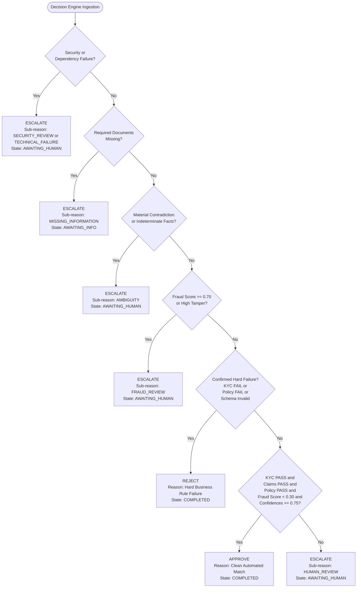

# MediShield Multi-Agent Document Intake System
## Canonical Decision Engine & State Machine Specification

**Status:** Authoritative Engineering Contract  
**Version:** 1.0.0 (Canonical Baseline)  
**Governing Principle:** Workflow State is strictly decoupled from Business Decision.

---

## 1. Architectural Philosophy & Separation of Concerns

A critical failure in document processing systems is conflating operational pipeline state with final business adjudication. MediShield enforces a strict three-tier semantic taxonomy:

1. **Workflow State:** Indicates where the case currently resides within the operational processing lifecycle.
2. **Agent Verdict:** The local factual determination emitted by an individual specialist agent.
3. **Business Decision:** The binding, legally relevant business outcome emitted solely by the deterministic Decision Engine.

```text
┌────────────────────────────────────────────────────────────────────────┐
│                        WORKFLOW STATE                                  │
│  RECEIVED ──► SCANNING ──► SPLIT ──► CLASSIFYING ──► ANALYZING        │
│                                                            │           │
│             ┌──────────────────────┬───────────────────────┘           │
│             ▼                      ▼                       ▼           │
│       AWAITING_INFO         AWAITING_HUMAN             COMPLETED       │
│                                    ▲                       ▲           │
│                                    └────── Override ───────┘           │
└────────────────────────────────────────────────────────────────────────┘

┌────────────────────────────────────────────────────────────────────────┐
│                        AGENT VERDICTS                                  │
│   Each specialist (KYC, Claims, Policy, Fraud) emits:                  │
│   • PASS          - Verified fact meets all affirmative criteria       │
│   • FAIL          - Confirmed hard negative fact                       │
│   • INDETERMINATE - Inconclusive evidence / inability to establish fact│
│   • CONFLICT      - Conflicting data between documents / systems       │
│   • UNAVAILABLE   - Upstream dependency or service failed              │
└────────────────────────────────────────────────────────────────────────┘

┌────────────────────────────────────────────────────────────────────────┐
│                       BUSINESS DECISION                                │
│   Emitted SOLELY by the Decision Engine:                               │
│   • APPROVE       - Clean, validated, covered, low-risk claim          │
│   • REJECT        - Confirmed hard business failure                    │
│   • ESCALATE      - Exception requiring information or human judgment  │
│                     (Sub-reasons: MISSING_INFORMATION, HUMAN_REVIEW,   │
│                      FRAUD_REVIEW, SECURITY_REVIEW, TECHNICAL_FAILURE, │
│                      AMBIGUITY)                                        │
└────────────────────────────────────────────────────────────────────────┘
```

---

## 2. Canonical Enumerations

These exact strings must be used across all Python schemas (Pydantic), TypeScript interfaces, PostgreSQL ENUMs, and REST APIs.

### 2.1 Workflow State (`WorkflowState`)

```python
from enum import Enum

class WorkflowState(str, Enum):
    RECEIVED = "RECEIVED"              # Initial upload accepted and persisted
    SCANNING = "SCANNING"              # Running OCR and pre-processing
    SPLIT = "SPLIT"                    # Splitting/grouping document pages
    CLASSIFYING = "CLASSIFYING"        # Document-type classifier executing
    ANALYZING = "ANALYZING"            # Running parallel specialists (KYC, Claims, Policy, Fraud)
    AWAITING_INFO = "AWAITING_INFO"    # Case incomplete; paused waiting for required documents
    AWAITING_HUMAN = "AWAITING_HUMAN"  # Escalated; waiting in human reviewer queue
    COMPLETED = "COMPLETED"            # Final business decision reached (auto or overridden)
    FAILED = "FAILED"                  # Fatal unrecoverable infrastructure crash
```

### 2.2 Agent Verdict (`AgentVerdict`)

```python
class AgentVerdict(str, Enum):
    PASS = "PASS"                      # Deterministically verified positive outcome
    FAIL = "FAIL"                      # Deterministically confirmed hard negative outcome
    INDETERMINATE = "INDETERMINATE"    # Evidence insufficient or ambiguous
    CONFLICT = "CONFLICT"              # Evidence directly contradicts another source
    UNAVAILABLE = "UNAVAILABLE"        # Agent could not execute due to dependency fault
```

### 2.3 Business Decision (`BusinessDecision`)

```python
class BusinessDecision(str, Enum):
    APPROVE = "APPROVE"                # Claim is approved for reimbursement/intake
    REJECT = "REJECT"                  # Claim is formally denied based on confirmed failure
    ESCALATE = "ESCALATE"              # Claim requires manual exception intervention
```

### 2.4 Escalation Sub-Reason (`EscalationSubReason`)

When `BusinessDecision == ESCALATE`, exactly one primary sub-reason code must be assigned:

```python
class EscalationSubReason(str, Enum):
    MISSING_INFORMATION = "MISSING_INFORMATION"  # Required document or critical field omitted
    HUMAN_REVIEW = "HUMAN_REVIEW"                # Borderline confidence or policy nuance
    FRAUD_REVIEW = "FRAUD_REVIEW"                # Elevated fraud risk or suspicious anomaly
    SECURITY_REVIEW = "SECURITY_REVIEW"          # Tamper detected, prompt injection attempt
    TECHNICAL_FAILURE = "TECHNICAL_FAILURE"      # OCR timeout, model failure, DB downtime
    AMBIGUITY = "AMBIGUITY"                      # Contradictory evidence between documents
```

> **Mandatory Rule Regarding Reviewer Proposals:**  
> Reviewer feedback suggested alternative top-level decision outcomes like `NEEDS_HUMAN`, `REQUEST_INFO`, and `RECOMMEND_DENIAL`. To preserve the authoritative Assignment 02 contract, these are **strictly forbidden** as top-level business decisions.  
> - `REQUEST_INFO` is represented as `BusinessDecision.ESCALATE` with `EscalationSubReason.MISSING_INFORMATION` and `WorkflowState.AWAITING_INFO`.  
> - `NEEDS_HUMAN` is represented as `BusinessDecision.ESCALATE` with `EscalationSubReason.HUMAN_REVIEW` and `WorkflowState.AWAITING_HUMAN`.  
> - `RECOMMEND_DENIAL` is an internal recommendation tag on the decision record, but if confirmed hard business rules fail, the decision is `REJECT`; if uncertain, it is `ESCALATE`.

---

## 3. Decision Precedence Rules (Deterministic Engine)

The Decision Engine evaluates upstream outputs in strict priority order using a **first-match-wins** deterministic algorithm. Under no circumstances is an LLM invoked to make this business judgment.



### Precise Priority Specification

| Priority | Evaluation Condition | Verdicts & Thresholds | Final Decision | Escalation Sub-Reason | Resulting Workflow State |
|:---:|---|---|---|---|---|
| **P1** | **Security or System Fault** | Prompt injection detected `== True`<br>Tamper score `> 0.80`<br>Any agent verdict `== UNAVAILABLE` | `ESCALATE` | `SECURITY_REVIEW` or `TECHNICAL_FAILURE` | `AWAITING_HUMAN` |
| **P2** | **Case Incompleteness** | Required document missing (`CLAIM_FORM` or `ID_DOCUMENT`) | `ESCALATE` | `MISSING_INFORMATION` | `AWAITING_INFO` |
| **P3** | **Material Ambiguity / Conflict** | Any agent verdict `== CONFLICT`<br>Any critical field verdict `== INDETERMINATE` | `ESCALATE` | `AMBIGUITY` | `AWAITING_HUMAN` |
| **P4** | **High Fraud Risk** | `fraud_score >= 0.70` OR severe anomaly flag triggered | `ESCALATE` | `FRAUD_REVIEW` | `AWAITING_HUMAN` |
| **P5** | **Confirmed Hard Failure Recommendation** | `kyc_verdict == FAIL` (e.g. member not found)<br>OR `claims_verdict == FAIL` (corrupted/invalid schema)<br>OR `policy_verdict == FAIL` **and** a verbatim authoritative exclusion citation is verified for the selected policy/version and explicitly applies to a billed service code | `ESCALATE` | `RECOMMEND_DENIAL` | `AWAITING_HUMAN` |
| **P6** | **Clean Straight-Through Pass** | `kyc_verdict == PASS`<br>AND `claims_verdict == PASS`<br>AND `policy_verdict == PASS`<br>AND `fraud_score < 0.30`<br>AND min agent confidence `>= 0.75` | `APPROVE` | *None* | `COMPLETED` |
| **P7** | **Borderline / Nuanced Case** | `0.30 <= fraud_score < 0.70`<br>OR min agent confidence `< 0.75` (with all verdicts PASS) | `ESCALATE` | `HUMAN_REVIEW` | `AWAITING_HUMAN` |
| **P8** | **Default Catch-All Guard** | Any unclassified state | `ESCALATE` | `HUMAN_REVIEW` | `AWAITING_HUMAN` |

---

## 4. Uncertainty vs. Rejection Principle

The architecture strictly enforces: **Uncertainty must never become a false negative.**

1. **Weak OCR is NOT a Reject:** If an image is blurry or OCR yields poor recognition, the OCR node returns `verdict = INDETERMINATE`. Under Rule P3, this triggers `ESCALATE(AMBIGUITY)` for human inspection.
2. **Missing Documents are NOT a Reject:** If an intake upload contains a claim form but lacks a government ID, the completeness checker emits `verdict = INDETERMINATE`. Under Rule P2, this pauses the workflow into `AWAITING_INFO` (`ESCALATE(MISSING_INFORMATION)`), allowing the member or hospital to upload the missing attachment.
3. **Downstream Dependency Outages are NOT a Reject:** If the vector database or model provider is unreachable, the agent returns `verdict = UNAVAILABLE`. Under Rule P1, this triggers `ESCALATE(TECHNICAL_FAILURE)`.
4. **Generic Policy FAIL is NOT a Denial Recommendation:** Empty retrieval, unknown codes, missing clauses, or unverified quotations are `INDETERMINATE`/`UNAVAILABLE` and route to review. See ADR-010.

---

## 5. Decision Record Schema & Human Override Lifecycle

To preserve a complete, tamper-proof audit trail and measure Straight-Through Processing (STP) versus Human Override rates, decisions are stored in an append-only relational history.

### 5.1 Decision Schema (`DecisionRecord`)

```python
from datetime import datetime
from typing import List, Optional
from pydantic import BaseModel, Field
from uuid import UUID

class DecisionRecord(BaseModel):
    id: UUID
    case_id: str
    decision: BusinessDecision
    escalation_sub_reason: Optional[EscalationSubReason] = None
    actor_type: str = Field(..., description="'SYSTEM' for automated AI, 'HUMAN' for reviewer")
    actor_id: str = Field(..., description="'decision-engine-v1' or user UUID")
    decision_confidence: float = Field(..., ge=0.0, le=1.0)
    rule_id_matched: str = Field(..., description="E.g., 'RULE-P6-CLEAN-PASS'")
    justification: str
    agent_summary_snapshot: dict
    case_version_at_decision: int
    is_active: bool = True
    created_at: datetime
```

### 5.2 Human Review & Override Protocol

When a case enters `AWAITING_HUMAN`:
1. **Queue Assignment & Locking:** A human reviewer opens the case in the Next.js UI, acquiring a short-lived row lock (`review_locks` table, TTL 15 minutes) to prevent concurrent collision.
2. **Optimistic Concurrency:** The reviewer submits an override with `expected_case_version`. If the case was modified concurrently, the update is rejected with HTTP 409 Conflict.
3. **Mandatory Audit Payload:**
   - Overriding action: `APPROVE`, `REJECT`, or `REQUEST_INFO`.
   - Mandatory reason code: E.g., `MANUAL_DOCUMENT_VERIFIED`, `FRAUD_FALSE_POSITIVE`, `POLICY_EXCEPTION_GRANTED`.
   - Mandatory human remarks (minimum 10 characters).
4. **Historical Preservation:** The automated AI decision record is **never mutated**. Its `is_active` flag is set to `False`, and a new `DecisionRecord` with `actor_type = 'HUMAN'` is appended.
5. **State Transition:** Case transitions to `COMPLETED` (or `AWAITING_INFO` if requesting additional documents).
