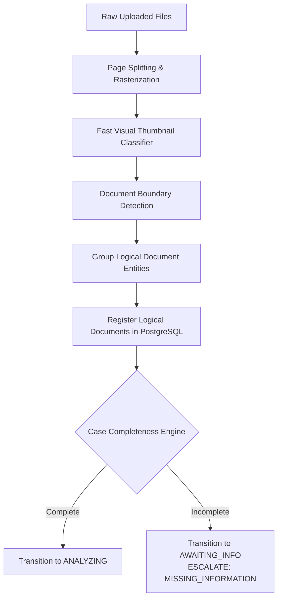

# MediShield Multi-Agent Document Intake System
## Canonical Multi-Document Intake & Document Splitting Specification

**Status:** Authoritative Engineering Contract  
**Version:** 1.0.0 (Canonical Baseline)  
**Governing Principle:** Cases are 1:N aggregates over documents; OCR and classification operate at document level, specialist synthesis operates at case level.

---

## 1. Case vs. Document Hierarchy

In commercial health insurance claims, submissions rarely consist of a single isolated page. Submissions typically arrive as multi-page PDFs or bundled image sets containing a claim form, a government ID card, a discharge summary, hospital itemized bills, and doctor prescriptions.

The MediShield platform establishes a strict hierarchical entity relationship:

```text
┌────────────────────────────────────────────────────────────────────────┐
│ CASE (Root Aggregate: case_id = "CASE-20261002-000421")                │
│   ├── Case Status: ANALYZING                                           │
│   ├── Case Completeness: COMPLETE                                      │
│   ├── Case-Level Results: (KYC, Claims, Policy, Fraud, Decision)       │
│   │                                                                    │
│   └── 1:N DOCUMENTS                                                    │
│         ├── Document 1: "DOC-001" (File: claim_form_pg1_2.pdf)         │
│         │     ├── Pages: [Page 1, Page 2]                              │
│         │     ├── OCR Payload Reference: "s3://.../ocr/DOC-001.json"  │
│         │     └── Classification: CLAIM_FORM (Confidence: 0.96)        │
│         │                                                              │
│         ├── Document 2: "DOC-002" (File: driver_license.jpg)           │
│         │     ├── Pages: [Page 1]                                      │
│         │     ├── OCR Payload Reference: "s3://.../ocr/DOC-002.json"  │
│         │     └── Classification: ID_DOCUMENT (Confidence: 0.94)       │
│         │                                                              │
│         └── Document 3: "DOC-003" (File: discharge_summary.pdf)        │
│               ├── Pages: [Page 1, Page 2, Page 3]                      │
│               ├── OCR Payload Reference: "s3://.../ocr/DOC-003.json"  │
│               └── Classification: DISCHARGE_SUMMARY (Confidence: 0.91) │
└────────────────────────────────────────────────────────────────────────┘
```

---

## 2. Ingestion Validation Contract

The intake endpoint `POST /api/v1/cases` accepts multipart file uploads representing 1 to 20 documents per case.

### 2.1 File Validation Constraints

| Parameter | Specification | Enforcement Mechanism |
|---|---|---|
| **Allowed MIME Types** | `image/jpeg`, `image/png`, `application/pdf`, `image/tiff` | Magic byte inspection (e.g., `python-magic`), never trusting file extensions. |
| **Max Individual File Size** | 25 MB per document | Streaming byte counter during upload; aborts upload on breach. |
| **Max Aggregate Case Size** | 100 MB per submission | Sum of multipart body parts. |
| **Max Page Count per PDF** | 50 pages per PDF | PDF header/trailer tree inspection via `pypdf` prior to OCR. |
| **Integrity Verification** | Cryptographic SHA-256 hash | Computed in-stream during upload, stored as `checksum`. |
| **Malware Defense** | Static header & macro inspection | Reject files with embedded executables, JavaScript, or macro streams. |

---

## 3. The SPLIT & GROUP Engine

When a multi-page PDF or a bundled document archive is uploaded, individual pages may represent entirely different document types (e.g., Page 1: Claim Form; Page 2: Government ID; Page 3–4: Discharge Summary).

The **SPLIT & GROUP Engine** executes in workflow state `SPLIT` before specialist agents run:



### 3.1 Boundary Detection & Grouping Algorithm

1. **Page Rasterization:** Each page of a multi-page PDF is converted to a 200 DPI normalized PNG in object storage (`/scratch/{case_id}/page_{n}.png`).
2. **Page-Level Feature Extraction:** Fast vision model extracts layout embeddings, header text, and form identifiers.
3. **Boundary Transition Logic:**
   - If Page $N$ contains a distinct document header (e.g., "State of California - Driver License" or "CMS-1500 Health Insurance Claim Form"), a new logical document boundary is created.
   - If Page $N$ contains "Page 2 of 2" or consecutive medical narrative continuation from Page $N-1$, it is grouped into the same `document_id`.
4. **Output Registration:** Each grouped logical unit is assigned an immutable `document_id` (`DOC-{case_id}-{seq}`) and indexed in PostgreSQL table `documents`.

---

## 4. Case Completeness Engine

Once all documents in a case are split and classified, the system evaluates case completeness against the claim intake standard before initiating expensive specialist reasoning.

### 4.1 Required Document Rules by Submission Category

```python
REQUIRED_DOCUMENTS_MATRIX = {
    "STANDARD_REIMBURSEMENT_CLAIM": {
        "required": ["CLAIM_FORM", "ID_DOCUMENT"],
        "supporting": ["DISCHARGE_SUMMARY", "PRESCRIPTION"],
        "min_required_count": 2
    },
    "HOSPITAL_CASHLESS_PREAUTH": {
        "required": ["CLAIM_FORM", "ID_DOCUMENT", "DISCHARGE_SUMMARY"],
        "supporting": ["PRESCRIPTION"],
        "min_required_count": 3
    },
    "POLICY_AMENDMENT_REQUEST": {
        "required": ["POLICY_AMENDMENT", "ID_DOCUMENT"],
        "supporting": [],
        "min_required_count": 2
    }
}
```

### 4.2 Completeness Evaluation Logic

```python
def evaluate_case_completeness(case_documents: list[DocumentRecord], claim_type: str) -> CaseCompletenessResult:
    present_types = {doc.doc_type for doc in case_documents if doc.classification_confidence >= 0.70}
    rules = REQUIRED_DOCUMENTS_MATRIX.get(claim_type, REQUIRED_DOCUMENTS_MATRIX["STANDARD_REIMBURSEMENT_CLAIM"])
    
    missing_required = set(rules["required"]) - present_types
    
    if not missing_required:
        return CaseCompletenessResult(
            is_complete=True,
            missing_types=[],
            verdict=AgentVerdict.PASS
        )
    else:
        return CaseCompletenessResult(
            is_complete=False,
            missing_types=list(missing_required),
            verdict=AgentVerdict.INDETERMINATE,
            recommended_state=WorkflowState.AWAITING_INFO,
            recommended_decision=BusinessDecision.ESCALATE,
            recommended_sub_reason=EscalationSubReason.MISSING_INFORMATION
        )
```

---

## 5. Document & Page Provenance Data Contract

To guarantee that the Decision Engine and Next.js UI can locate the physical evidence behind every extracted field, the OCR preprocessor outputs a canonical JSON document structure.

### 5.1 OCR Normalized Document Schema (`OCRDocumentPayload`)

```python
from typing import List, Optional
from pydantic import BaseModel, Field

class OCRBoundingBox(BaseModel):
    x_min: float = Field(..., description="Normalized 0.0-1.0 left coordinate")
    y_min: float = Field(..., description="Normalized 0.0-1.0 top coordinate")
    x_max: float = Field(..., description="Normalized 0.0-1.0 right coordinate")
    y_max: float = Field(..., description="Normalized 0.0-1.0 bottom coordinate")

class OCRTextSpan(BaseModel):
    span_id: str = Field(..., description="Unique span ID, e.g., 'span-p1-042'")
    page_number: int
    text: str
    confidence: float = Field(..., ge=0.0, le=1.0)
    bbox: OCRBoundingBox

class OCRPage(BaseModel):
    page_number: int
    width_px: int
    height_px: int
    raw_text: str
    spans: List[OCRTextSpan]

class OCRDocumentPayload(BaseModel):
    case_id: str
    document_id: str
    ocr_engine: str = Field(..., description="Tesseract-5 / Docling / Vision-OCR")
    total_pages: int
    pages: List[OCRPage]
    created_at: str
```

### 5.2 Storage Separation Principle

> **Critical Constraint:** `OCRDocumentPayload` objects are saved directly to Object Storage at:  
> `s3://medishield-artifacts/ocr/{case_id}/{document_id}.json`  
> They are **NEVER** stored directly inside the LangGraph workflow state or the PostgreSQL `cases` row. LangGraph state maintains only the URI reference (`ocr_uri`), preventing memory exhaustion and PHI leakage into workflow logs.
