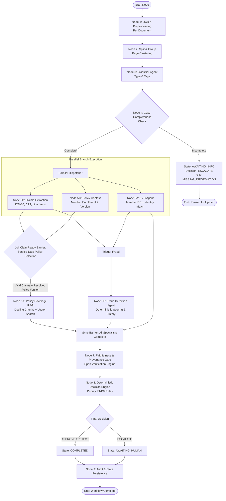

# MediShield Multi-Agent Document Intake System
## Canonical LangGraph State & Orchestration Specification

**Status:** Authoritative Engineering Contract  
**Version:** 1.0.0 (Canonical Baseline)  
**Governing Principle:** Graph state maintains light identifiers and execution references; heavy binary and text payloads remain in external stores. High-throughput parallelism is preserved across independent branches.

---

## 1. Graph State Model

LangGraph state is managed via Python `TypedDict` and Pydantic models. It is strictly constrained to structural references, metadata, verdicts, and evidence pointers.

### 1.1 `CaseState` Definition

```python
from typing import TypedDict, List, Dict, Optional, Any
from docs.canonical.decision_engine import WorkflowState, BusinessDecision, EscalationSubReason, AgentVerdict

class DocumentReference(TypedDict, total=False):
    document_id: str
    object_key: str
    mime_type: str
    checksum: str
    ocr_payload_uri: str               # S3 URI to OCR JSON
    doc_type: str                      # CLAIM_FORM, ID_DOCUMENT, etc.
    classification_confidence: float
    routing_tags: List[str]
    split_source_page_indices: List[int]

class CaseState(TypedDict, total=False):
    # Core Case Identifiers
    case_id: str
    workflow_version: str
    execution_id: str
    trace_id: str
    created_at: str

    # Workflow Progression
    workflow_state: str                # WorkflowState string
    completed_nodes: List[str]
    errors: List[Dict[str, Any]]

    # 1:N Document Inventory
    documents: List[DocumentReference]
    is_complete: bool
    missing_required_documents: List[str]

    # Specialist Execution References & Outcomes (Pointers + Summary Verdicts)
    kyc_execution_id: Optional[str]
    kyc_verdict: Optional[str]          # AgentVerdict string
    kyc_confidence: Optional[float]
    kyc_summary: Optional[Dict[str, Any]]

    claims_execution_id: Optional[str]
    claims_verdict: Optional[str]       # AgentVerdict string
    claims_confidence: Optional[float]
    claims_summary: Optional[Dict[str, Any]]

    policy_context_id: Optional[str]
    policy_context_verdict: Optional[str]
    candidate_policies: Optional[List[Dict[str, Any]]]  # From Policy Context discovery
    policy_id: Optional[str]             # Resolved at JoinClaimReady barrier
    policy_version: Optional[str]        # Resolved at JoinClaimReady barrier
    policy_effective_date_valid: Optional[bool]  # Set by JoinClaimReady

    # Missing documents tracking (B-3)
    missing_documents: Optional[List[str]]  # Doc types still required, e.g. ["ID_DOCUMENT"]

    policy_coverage_execution_id: Optional[str]
    policy_coverage_verdict: Optional[str]
    policy_coverage_summary: Optional[Dict[str, Any]]

    fraud_execution_id: Optional[str]
    fraud_verdict: Optional[str]
    fraud_score: Optional[float]
    fraud_risk_level: Optional[str]     # LOW, MEDIUM, HIGH
    fraud_summary: Optional[Dict[str, Any]]

    # Faithfulness & Integrity Gate
    faithfulness_gate_passed: bool
    provenance_integrity_score: float
    unsupported_claims_count: int

    # Final Business Decision Output
    decision: Optional[str]             # BusinessDecision string
    escalation_sub_reason: Optional[str]# EscalationSubReason string
    decision_confidence: float
    justification: str
    rule_id_matched: str
    is_auto_decided: bool
```

---

## 2. Orchestration DAG & Parallel Execution Flow

The LangGraph directed acyclic graph (DAG) maximizes processing throughput by executing independent tasks in parallel while respecting true technical data dependencies:



---

## 3. Detailed Node Contracts & Transition Logic

### Node 1: OCR & Preprocessing (`ocr_preprocessor_node`)
- **Input:** Case document storage paths.
- **Action:** Generates OCR bounding boxes and text spans. Writes full OCR JSON to private object storage.
- **State Mutation:** Updates `documents[i]["ocr_payload_uri"]`. Transitions `workflow_state` to `SCANNING`.

### Node 2: Split & Group (`split_group_node`)
- **Input:** OCR payloads and page bounding boxes.
- **Action:** Clusters logical pages into distinct `DocumentReference` objects.
- **State Mutation:** Updates `documents` array. Transitions `workflow_state` to `SPLIT`.

### Node 3: Classifier Agent (`classifier_node`)
- **Input:** Document text snippets and page features.
- **Action:** Assigns document type and confidence.
- **State Mutation:** Updates `doc_type`, `classification_confidence`, `routing_tags`. Transitions `workflow_state` to `CLASSIFYING`.

### Node 4: Case Completeness Check (`case_completeness_node`)
- **Conditional Branch:**
  - If required documents are missing: Mutates `workflow_state = "AWAITING_INFO"`, `decision = "ESCALATE"`, `escalation_sub_reason = "MISSING_INFORMATION"`. Routes directly to `AuditPersist` and pauses graph.
  - If complete: Transitions `workflow_state = "ANALYZING"`. Dispatches parallel branches.

### Node 5A: KYC Agent (`kyc_agent_node`)
- **Input:** Member details extracted from `ID_DOCUMENT` and `CLAIM_FORM`.
- **Action:** Performs deterministic member DB lookup, DOB matching, policy status check, and tamper detection.
- **Output:** Emits `kyc_verdict` (`PASS`, `FAIL`, `INDETERMINATE`, `CONFLICT`, `UNAVAILABLE`).

### Node 5B: Claims Extraction Agent (`claims_extraction_node`)
- **Input:** OCR spans from `CLAIM_FORM` and bills.
- **Action:** Extracts diagnosis codes (ICD-10), procedure codes (CPT), provider NPI, service dates, line items, and itemized amounts. Validates against schema.
- **Output:** Emits `claims_verdict` and structured claim payload.

### Node 5C: Policy Context Discovery (`policy_context_node`)
- **Input:** Member ID only. Does **not** require `service_date` at dispatch time.
- **Action:** Queries relational database to discover all candidate enrollments and policy versions for the member. Returns the set of candidate policies and their effective date windows without filtering by service date.
- **Output:** Emits `candidate_policies` (list of policy_id, version, effective date range), `member_enrollment_id`, and context readiness.
- **Service-Date Filtering:** Deferred to the `JoinClaimReady` barrier (see below), where validated `service_date` from Claims is used to select the exact active policy version.

### JoinClaimReady Barrier (`join_claim_ready`)
- **Precondition:** Triggered when both Node 5B (Claims) and Node 5C (Policy Context) have completed.
- **Action:** Uses validated `service_date` from Claims output to filter the candidate policies from Policy Context. Selects the exact policy version where `effective_start_date ≤ service_date ≤ effective_end_date`. If no active enrollment matches the service date, emits `policy_context_verdict = FAIL` with reason `POLICY_NOT_ACTIVE_ON_SERVICE_DATE`.
- **State Mutation:** Sets `policy_id`, `policy_version`, `policy_effective_date_valid` on CaseState.
- **Output:** Routes to Node 6A (Policy Coverage RAG) with resolved `policy_id`, `policy_version`, and validated CPT/ICD codes from Claims.

### Node 6A: Policy Coverage RAG (`policy_coverage_rag_node`)
- **Precondition:** Requires validated CPT codes from Node 5B and **resolved** policy version from `JoinClaimReady` barrier.
- **Action:** Retrieves matching policy clauses using hybrid lexical/dense search. Evaluates coverage percentage and exclusions.
- **Output:** Emits `policy_coverage_verdict` (`PASS`, `FAIL`, `INDETERMINATE`).

### Node 6B: Fraud Detection Agent (`fraud_agent_node`)
- **Concurrency Advantage:** Executes immediately once claims amounts and provider NPI are available, without waiting for the Policy RAG node.
- **Action:** Evaluates 7 deterministic fraud features against historical claims DB.
- **Output:** Emits `fraud_score` (0.0 to 1.0), `fraud_risk_level`, and `fraud_verdict`.

### Node 7: Faithfulness Gate (`faithfulness_gate_node`)
- **Action:** Cross-verifies all extracted fields against physical OCR text spans and verifies all cited policy clauses against retrieved vector texts.
- **Output:** Sets `faithfulness_gate_passed = True/False`. Flags any ungrounded assertions.

### Node 8: Decision Engine (`decision_engine_node`)
- **Action:** Purely deterministic execution of priority rules P1–P8. Emits binding `BusinessDecision`. Generates rich clinical and financial `detailed_explanation` (via Groq LLM or deterministic fallback per ADR-011).
- **State Mutation:** Updates `decision`, `escalation_sub_reason`, `workflow_state` (`COMPLETED` or `AWAITING_HUMAN`), `justification`, and `detailed_explanation`.

### Node 9: Audit & State Persistence (`audit_persistence_node`)
- **Action:** Writes immutable audit entry to PostgreSQL with SHA-256 hash chaining. Updates `cases` table. Releases job lease.

---

## 4. Human Review Decoupling Principle

The architecture guarantees: **The Celery/Redis worker thread never blocks waiting for human intervention.**

1. When a case escalates, Node 8 transitions `workflow_state` to `AWAITING_HUMAN`, and Node 9 persists the exact checkpoint in PostgreSQL.
2. The LangGraph worker run immediately terminates with status `SUCCESS`. The compute thread is released back to the worker pool.
3. When an Operations Reviewer submits an override via the Next.js UI, the API updates the case directly or dispatches an event-driven resumption task.
