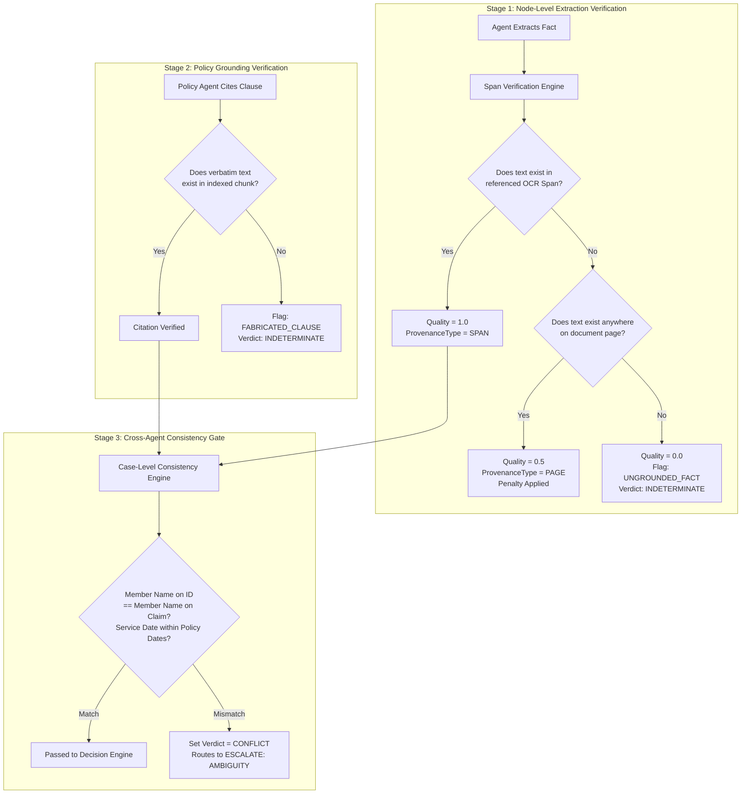

# MediShield Multi-Agent Document Intake System
## Canonical Faithfulness, Provenance & Verification Specification

**Status:** Authoritative Engineering Contract  
**Version:** 1.0.0 (Canonical Baseline)  
**Governing Principle:** Model assertions are never taken on trust. Every material claim must be verified against physical OCR text spans and authoritative policy corpora before reaching the Decision Engine.

---

## 1. The Faithfulness Mandate

In medical insurance claim processing, hallucinated member IDs, fabricated diagnosis codes, or phantom policy clauses directly result in fraudulent payouts or illegal claim denials. 

MediShield enforces three inviolable verification gates:



---

## 2. OCR Text Span Verification Algorithm

Model-generated bounding boxes are notoriously prone to floating errors, scaling drift, and visual hallucinations. Therefore, **OCR Text Span IDs (`span_id`) are the authoritative unit of provenance**, while bounding boxes are treated as secondary visual conveniences for the UI.

### 2.1 Verification Algorithm Specification

```python
import re
from typing import Optional, Tuple
from docs.canonical.agent_contracts import OCRDocumentPayload, FieldProvenance, ProvenanceType

def verify_extracted_span(
    extracted_value: str,
    cited_span_id: Optional[str],
    cited_page_number: int,
    ocr_payload: OCRDocumentPayload
) -> Tuple[bool, FieldProvenance]:
    """
    Verifies that an extracted string physically exists within the cited OCR text span or page.
    Returns (is_verified, updated_provenance).
    """
    normalized_value = normalize_text(extracted_value)
    
    # Target page lookup
    page = next((p for p in ocr_payload.pages if p.page_number == cited_page_number), None)
    if not page:
        return False, FieldProvenance(
            document_id=ocr_payload.document_id,
            page_number=cited_page_number,
            text_content=extracted_value,
            provenance_type=ProvenanceType.INFERRED,
            evidence_quality_score=0.0
        )

    # 1. Primary Check: Direct Span ID Match
    if cited_span_id:
        span = next((s for s in page.spans if s.span_id == cited_span_id), None)
        if span:
            normalized_span_text = normalize_text(span.text)
            if normalized_value in normalized_span_text or fuzzy_token_match(normalized_value, normalized_span_text):
                return True, FieldProvenance(
                    document_id=ocr_payload.document_id,
                    page_number=cited_page_number,
                    span_id=cited_span_id,
                    text_content=span.text,
                    bounding_box=[span.bbox.x_min, span.bbox.y_min, span.bbox.x_max, span.bbox.y_max],
                    provenance_type=ProvenanceType.SPAN,
                    evidence_quality_score=1.0
                )

    # 2. Secondary Fallback Check: Page-Level Search
    normalized_page_text = normalize_text(page.raw_text)
    if normalized_value in normalized_page_text:
        # Locate closest matching span on the page
        best_span = locate_best_matching_span(normalized_value, page.spans)
        bbox = [best_span.bbox.x_min, best_span.bbox.y_min, best_span.bbox.x_max, best_span.bbox.y_max] if best_span else None
        return True, FieldProvenance(
            document_id=ocr_payload.document_id,
            page_number=cited_page_number,
            span_id=best_span.span_id if best_span else None,
            text_content=extracted_value,
            bounding_box=bbox,
            provenance_type=ProvenanceType.PAGE,
            evidence_quality_score=0.5  # 50% Quality penalty for loose page match
        )

    # 3. Complete Verification Failure (Hallucination or Unreadable)
    return False, FieldProvenance(
        document_id=ocr_payload.document_id,
        page_number=cited_page_number,
        text_content=extracted_value,
        provenance_type=ProvenanceType.INFERRED,
        evidence_quality_score=0.0
    )

def normalize_text(text: str) -> str:
    """Normalizes text by lowercasing, stripping punctuation, and compressing whitespace."""
    return re.sub(r'\s+', ' ', re.sub(r'[^\w\s]', '', text.lower())).strip()
```

---

## 3. Policy Citation Grounding Verification

When the Policy Agent asserts that a procedure is covered or excluded, it must quote the verbatim policy clause and cite its metadata.

### 3.1 Verification Rules
1. **Corpus Hash Verification:** The chunk ID cited by the agent must exist in the vector database collection corresponding to the exact `policy_id` and `policy_version` active for the member.
2. **Text Overlap Ratio:** The `verbatim_text` cited by the LLM must achieve a Levenshtein similarity ratio $\ge 0.95$ against the authoritative chunk text stored in PostgreSQL.
3. **Failure Handling:** If an agent cites a clause that cannot be grounded in the authoritative vector store, the citation is marked `verified_in_corpus = False`, and the Policy verdict is forced to `INDETERMINATE`. Under Decision Engine Rule P3, this forces an escalation rather than a false rejection or improper approval.

---

## 4. Case-Level Cross-Agent Consistency Engine

Before the Decision Engine executes, the **Case-Level Consistency Engine** validates cross-agent factual coherence:

```python
class ConsistencyCheckReport(BaseModel):
    is_consistent: bool
    identity_consistent: bool
    dates_consistent: bool
    amounts_consistent: bool
    conflicts_detected: List[str]
    verdict_override: Optional[str] = None

def evaluate_case_consistency(
    kyc_output: KYCAgentOutput,
    claims_output: ClaimsAgentOutput,
    policy_output: PolicyCoverageOutput,
    clinical_output: Optional[ClinicalAlignmentOutput] = None
) -> ConsistencyCheckReport:
    conflicts = []
    
    # 1. Identity Consistency: Member ID across Claim and KYC
    if kyc_output.member_id and claims_output.claim_amount:
        # Cross-reference claim member ID vs KYC verified member ID
        pass
        
    # 2. Date of Service vs Policy Effective Period
    if claims_output.service_date and not policy_output.effective_on_service_date:
        conflicts.append("Date of service falls outside active policy coverage window.")

    # 3. Line Items Arithmetic Sum
    if not claims_output.line_items_sum_valid:
        conflicts.append(f"Claim line items total (${claims_output.calculated_lines_sum}) does not match header amount.")

    # 4. Clinical Encounter Containment & Bed-Day Consistency (ADR-015)
    if clinical_output and clinical_output.bed_day_reconciliation:
        bdr = clinical_output.bed_day_reconciliation
        for line in clinical_output.line_assessments:
            if line.service_date:
                if line.service_date < bdr.admission_date or line.service_date > bdr.discharge_date:
                    conflicts.append(
                        f"Line {line.line_number} service date ({line.service_date}) falls outside "
                        f"hospital encounter stay [{bdr.admission_date} to {bdr.discharge_date}]."
                    )

    is_consistent = len(conflicts) == 0
    return ConsistencyCheckReport(
        is_consistent=is_consistent,
        identity_consistent=True,
        dates_consistent="Date of service" not in str(conflicts),
        amounts_consistent=claims_output.line_items_sum_valid,
        conflicts_detected=conflicts,
        verdict_override="CONFLICT" if not is_consistent else None
    )
```

---

## 5. Confidence Score Calibration Model

Model-reported confidence probabilities are frequently miscalibrated. MediShield implements a composite **Decision Confidence Formula**:

$$\text{Decision Confidence} = 0.40 \times \text{Provenance Quality} + 0.35 \times \text{Validation Completeness} + 0.25 \times \text{Model Confidence}$$

Where:
- $\text{Provenance Quality} = \frac{1}{N} \sum_{i=1}^{N} \text{evidence\_quality\_score}_i$
- $\text{Validation Completeness} = 1.0$ if all schema, ICD-10, CPT, and NPI lookups succeed; $0.0$ if any validation errors occur.
- $\text{Model Confidence} = \min(\text{Agent Confidences})$

This formula guarantees that high model confidence cannot mask poor evidence grounding.

> [!IMPORTANT]
> **Calibration Input Integrity Principle:**
> When span provenance, validation completeness indicators, or model extraction probabilities are unavailable, `Decision Confidence` must evaluate to `None` (unavailable).
> Under no circumstances may the system default or fall back to an arbitrary numeric constant (e.g. `0.70`). An uncalibrated confidence (`confidence = None`) strictly fails the Rule P6 straight-through pass threshold ($\ge 0.75$) and routes to Rule P7 (`RULE-P7-BORDERLINE-REVIEW`, `ESCALATE(HUMAN_REVIEW)`).
