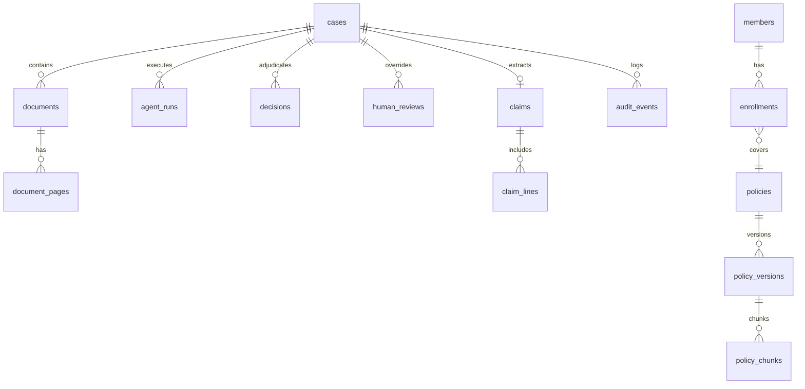

# MediShield Multi-Agent Document Intake System
## Canonical Database & Storage Contracts

**Status:** Authoritative Engineering Contract  
**Version:** 1.0.0 (Canonical Baseline)  
**Governing Principle:** Production-grade PostgreSQL 16 schema with strict referential integrity, optimistic concurrency, and tamper-evident audit hashing. Object storage cleanly separates original uploads from derived artifacts.

---

## 1. Relational Database Architecture (PostgreSQL 16)



---

## 2. PostgreSQL DDL Specification

```sql
-- PostgreSQL 16 Canonical Schema Definition

CREATE EXTENSION IF NOT EXISTS "uuid-ossp";
CREATE EXTENSION IF NOT EXISTS "pgcrypto";

-- 1. ENUM DEFINITIONS
CREATE TYPE workflow_state_enum AS ENUM (
    'RECEIVED', 'SCANNING', 'SPLIT', 'CLASSIFYING', 
    'ANALYZING', 'AWAITING_INFO', 'AWAITING_HUMAN', 
    'COMPLETED', 'FAILED'
);

CREATE TYPE business_decision_enum AS ENUM (
    'APPROVE', 'REJECT', 'ESCALATE'
);

CREATE TYPE escalation_sub_reason_enum AS ENUM (
    'MISSING_INFORMATION', 'HUMAN_REVIEW', 'FRAUD_REVIEW', 
    'SECURITY_REVIEW', 'TECHNICAL_FAILURE', 'AMBIGUITY'
);

CREATE TYPE agent_verdict_enum AS ENUM (
    'PASS', 'FAIL', 'INDETERMINATE', 'CONFLICT', 'UNAVAILABLE'
);

CREATE TYPE document_type_enum AS ENUM (
    'CLAIM_FORM', 'ID_DOCUMENT', 'DISCHARGE_SUMMARY', 
    'PRESCRIPTION', 'POLICY_AMENDMENT', 'UNKNOWN'
);

CREATE TYPE actor_type_enum AS ENUM (
    'SYSTEM', 'HUMAN'
);

-- 2. CASE MANAGEMENT AGGREGATE
CREATE TABLE cases (
    id UUID PRIMARY KEY DEFAULT uuid_generate_v4(),
    case_id VARCHAR(32) NOT NULL UNIQUE,
    workflow_state workflow_state_enum NOT NULL DEFAULT 'RECEIVED',
    workflow_version VARCHAR(16) NOT NULL DEFAULT 'v1.0.0',
    current_decision business_decision_enum,
    current_sub_reason escalation_sub_reason_enum,
    decision_confidence NUMERIC(4, 3),
    is_complete BOOLEAN NOT NULL DEFAULT FALSE,
    missing_documents JSONB NOT NULL DEFAULT '[]'::jsonb,  -- List of required doc types still missing, e.g. ["ID_DOCUMENT"]
    version INTEGER NOT NULL DEFAULT 1, -- Optimistic concurrency lock
    created_at TIMESTAMPTZ NOT NULL DEFAULT CURRENT_TIMESTAMP,
    updated_at TIMESTAMPTZ NOT NULL DEFAULT CURRENT_TIMESTAMP
);

CREATE INDEX idx_cases_state ON cases(workflow_state);
CREATE INDEX idx_cases_created ON cases(created_at DESC);

-- 3. 1:N DOCUMENTS & PAGES
CREATE TABLE documents (
    id UUID PRIMARY KEY DEFAULT uuid_generate_v4(),
    document_id VARCHAR(36) NOT NULL UNIQUE,
    case_id UUID NOT NULL REFERENCES cases(id) ON DELETE CASCADE,
    file_name VARCHAR(255) NOT NULL,
    object_key TEXT NOT NULL,
    mime_type VARCHAR(64) NOT NULL,
    checksum VARCHAR(64) NOT NULL, -- SHA-256
    size_bytes BIGINT NOT NULL,
    doc_type document_type_enum NOT NULL DEFAULT 'UNKNOWN',
    classification_confidence NUMERIC(4, 3),
    ocr_payload_uri TEXT,
    created_at TIMESTAMPTZ NOT NULL DEFAULT CURRENT_TIMESTAMP
);

CREATE INDEX idx_documents_case ON documents(case_id);

CREATE TABLE document_pages (
    id UUID PRIMARY KEY DEFAULT uuid_generate_v4(),
    document_id UUID NOT NULL REFERENCES documents(id) ON DELETE CASCADE,
    page_number INTEGER NOT NULL,
    object_key TEXT NOT NULL,
    width_px INTEGER NOT NULL,
    height_px INTEGER NOT NULL,
    created_at TIMESTAMPTZ NOT NULL DEFAULT CURRENT_TIMESTAMP,
    UNIQUE(document_id, page_number)
);

-- 4. MEMBERS & ENROLLMENTS (SYNTHETIC / READ-ONLY ADAPTER DATA)
-- NOTE: In a production deployment, member and enrollment data would be
-- sourced from an external system of record (e.g., enrollment platform, EHR).
-- For this project, these tables are seeded with synthetic data and treated
-- as read-only by the MediShield application. No MediShield agent or API
-- writes to these tables during claim processing.
CREATE TABLE members (
    id UUID PRIMARY KEY DEFAULT uuid_generate_v4(),
    member_id VARCHAR(32) NOT NULL UNIQUE,
    first_name VARCHAR(64) NOT NULL,
    last_name VARCHAR(64) NOT NULL,
    date_of_birth DATE NOT NULL,
    ssn_last4 CHAR(4),
    status VARCHAR(16) NOT NULL DEFAULT 'ACTIVE',
    created_at TIMESTAMPTZ NOT NULL DEFAULT CURRENT_TIMESTAMP
);

CREATE TABLE policies (
    id UUID PRIMARY KEY DEFAULT uuid_generate_v4(),
    policy_id VARCHAR(32) NOT NULL UNIQUE,
    plan_name VARCHAR(128) NOT NULL,
    policy_type VARCHAR(32) NOT NULL,
    is_active BOOLEAN NOT NULL DEFAULT TRUE,
    created_at TIMESTAMPTZ NOT NULL DEFAULT CURRENT_TIMESTAMP
);

CREATE TABLE policy_versions (
    id UUID PRIMARY KEY DEFAULT uuid_generate_v4(),
    policy_id UUID NOT NULL REFERENCES policies(id) ON DELETE RESTRICT,
    version_tag VARCHAR(16) NOT NULL,
    effective_start_date DATE NOT NULL,
    effective_end_date DATE,
    source_pdf_key TEXT NOT NULL,
    vector_collection_name VARCHAR(64) NOT NULL,
    is_published BOOLEAN NOT NULL DEFAULT FALSE,
    published_by VARCHAR(64),
    published_at TIMESTAMPTZ,
    created_at TIMESTAMPTZ NOT NULL DEFAULT CURRENT_TIMESTAMP,
    UNIQUE(policy_id, version_tag)
);

CREATE TABLE enrollments (
    id UUID PRIMARY KEY DEFAULT uuid_generate_v4(),
    member_id UUID NOT NULL REFERENCES members(id) ON DELETE RESTRICT,
    policy_version_id UUID NOT NULL REFERENCES policy_versions(id) ON DELETE RESTRICT,
    coverage_start_date DATE NOT NULL,
    coverage_end_date DATE,
    status VARCHAR(16) NOT NULL DEFAULT 'ACTIVE',
    created_at TIMESTAMPTZ NOT NULL DEFAULT CURRENT_TIMESTAMP
);

CREATE TABLE policy_riders (
    id UUID PRIMARY KEY DEFAULT uuid_generate_v4(),
    policy_version_id UUID NOT NULL REFERENCES policy_versions(id) ON DELETE CASCADE,
    rider_code VARCHAR(32) NOT NULL,
    name VARCHAR(128) NOT NULL,
    waiting_period_value INTEGER NOT NULL CHECK (waiting_period_value >= 0),
    waiting_period_unit VARCHAR(16) NOT NULL CHECK (waiting_period_unit IN ('DAY', 'MONTH')),
    waiting_period_start_event VARCHAR(64) NOT NULL,
    benefit_limit_text VARCHAR(256),
    covered_services JSONB NOT NULL,
    exclusions JSONB NOT NULL,
    source_section VARCHAR(32) NOT NULL,
    source_page INTEGER,
    source_pdf_key VARCHAR(512) NOT NULL,
    source_text TEXT NOT NULL,
    source_verified BOOLEAN NOT NULL DEFAULT FALSE,
    created_at TIMESTAMPTZ NOT NULL DEFAULT CURRENT_TIMESTAMP,
    UNIQUE(policy_version_id, rider_code)
);

CREATE TABLE enrollment_rider_applications (
    id UUID PRIMARY KEY DEFAULT uuid_generate_v4(),
    enrollment_id UUID NOT NULL REFERENCES enrollments(id) ON DELETE CASCADE,
    policy_rider_id UUID NOT NULL REFERENCES policy_riders(id) ON DELETE RESTRICT,
    status VARCHAR(20) NOT NULL DEFAULT 'REQUESTED'
        CHECK (status IN ('REQUESTED', 'APPROVED', 'DENIED', 'WITHDRAWN')),
    requested_on DATE,
    requested_effective_date DATE,
    effective_start_date DATE,
    effective_end_date DATE,
    source_document_ref VARCHAR(128) UNIQUE,
    approval_reference VARCHAR(128),
    approved_by VARCHAR(64),
    approved_at TIMESTAMPTZ,
    created_at TIMESTAMPTZ NOT NULL DEFAULT CURRENT_TIMESTAMP,
    CHECK (status != 'APPROVED' OR
        (approved_by IS NOT NULL AND approved_at IS NOT NULL AND effective_start_date IS NOT NULL))
);

CREATE TABLE policy_chunks (
    id UUID PRIMARY KEY DEFAULT uuid_generate_v4(),
    policy_version_id UUID NOT NULL REFERENCES policy_versions(id) ON DELETE CASCADE,
    chunk_index INTEGER NOT NULL,
    section_number VARCHAR(32),
    section_title VARCHAR(255),
    chunk_text TEXT NOT NULL,
    page_number INTEGER NOT NULL,
    vector_id VARCHAR(64) NOT NULL,
    created_at TIMESTAMPTZ NOT NULL DEFAULT CURRENT_TIMESTAMP
);

-- 5. EXTRACTED CLAIMS & SERVICE LINES
CREATE TABLE claims (
    id UUID PRIMARY KEY DEFAULT uuid_generate_v4(),
    case_id UUID NOT NULL UNIQUE REFERENCES cases(id) ON DELETE CASCADE,
    claim_number VARCHAR(32) NOT NULL UNIQUE,
    member_id VARCHAR(32),
    provider_npi VARCHAR(10) NOT NULL,
    service_date DATE NOT NULL,
    total_amount NUMERIC(12, 2) NOT NULL,
    icd10_codes JSONB NOT NULL DEFAULT '[]'::jsonb,
    cpt_codes JSONB NOT NULL DEFAULT '[]'::jsonb,
    schema_valid BOOLEAN NOT NULL DEFAULT TRUE,
    validation_errors JSONB NOT NULL DEFAULT '[]'::jsonb,
    created_at TIMESTAMPTZ NOT NULL DEFAULT CURRENT_TIMESTAMP
);

CREATE TABLE claim_lines (
    id UUID PRIMARY KEY DEFAULT uuid_generate_v4(),
    claim_id UUID NOT NULL REFERENCES claims(id) ON DELETE CASCADE,
    line_number INTEGER NOT NULL,
    cpt_code VARCHAR(16) NOT NULL,
    description TEXT,
    service_date DATE NOT NULL,
    quantity NUMERIC(6, 2) NOT NULL DEFAULT 1.0,
    unit_charge NUMERIC(10, 2) NOT NULL,
    total_charge NUMERIC(10, 2) NOT NULL,
    provenance_span_id VARCHAR(64),
    created_at TIMESTAMPTZ NOT NULL DEFAULT CURRENT_TIMESTAMP,
    UNIQUE(claim_id, line_number)
);

-- 2.5A LINE-LEVEL ADJUDICATION DDL SCOPE & DEFERRAL (PHASE 3)
-- In Phase 1 and Phase 2, `claim_lines` stores extracted billing data exclusively.
-- Granular clinical assessments for each line item are persisted within `agent_runs.output_json`
-- and `decisions.agent_summary_snapshot`.
-- Relational DDL schema modifications to `claim_lines` (e.g. adding columns `clinical_verdict`,
-- `medical_necessity_status`, `guideline_id`, `denial_reason`) or introducing a dedicated
-- `claim_line_adjudications` table are formally DEFERRED to Phase 3, pending stakeholder resolution
-- of Governance Decision 4 (Claim-Level vs. Partial Line-Item Adjudication).

-- 6. AGENT EXECUTION TRACKING
CREATE TABLE agent_runs (
    id UUID PRIMARY KEY DEFAULT uuid_generate_v4(),
    case_id UUID NOT NULL REFERENCES cases(id) ON DELETE CASCADE,
    execution_id UUID NOT NULL,
    agent_name VARCHAR(64) NOT NULL,
    verdict agent_verdict_enum NOT NULL,
    confidence NUMERIC(4, 3) NOT NULL,
    output_json JSONB NOT NULL,
    error_code VARCHAR(64),
    latency_ms INTEGER NOT NULL,
    started_at TIMESTAMPTZ NOT NULL,
    completed_at TIMESTAMPTZ NOT NULL
);

CREATE INDEX idx_agent_runs_case ON agent_runs(case_id);

-- 2.6A CLINICAL ALIGNMENT SPECIALIST PERSISTENCE CONTRACT (ADR-015)
-- 1. Agent Registration: The specialist executes under `agent_name = 'clinical_alignment'`.
--    The `verdict` column stores the composite verdict mapped to `agent_verdict_enum`
--    ('PASS', 'FAIL', 'INDETERMINATE', 'CONFLICT', 'UNAVAILABLE').
--    The `confidence` column stores calibrated composite confidence as NUMERIC(4, 3) (or NULL if uncalibrated).
--    The `output_json` column stores complete serialized `ClinicalAlignmentOutput` JSONB.
-- 2. Retrieval Semantics: Traces are queried by (case_id, agent_name = 'clinical_alignment')
--    ordered by started_at DESC. Endpoint GET /api/v1/cases/{case_id}/agents reconstructs
--    clinical summary from latest successful agent_runs record or decisions snapshot.

-- 7. ADJUDICATION DECISION HISTORY (1:N FOR AI & HUMAN DECISIONS)
CREATE TABLE decisions (
    id UUID PRIMARY KEY DEFAULT uuid_generate_v4(),
    case_id UUID NOT NULL REFERENCES cases(id) ON DELETE CASCADE,
    decision business_decision_enum NOT NULL,
    escalation_sub_reason escalation_sub_reason_enum,
    actor_type actor_type_enum NOT NULL,
    actor_id VARCHAR(64) NOT NULL,
    decision_confidence NUMERIC(4, 3) NOT NULL,
    rule_id_matched VARCHAR(64) NOT NULL,
    justification TEXT NOT NULL,
    agent_summary_snapshot JSONB NOT NULL,
    case_version_at_decision INTEGER NOT NULL,
    is_active BOOLEAN NOT NULL DEFAULT TRUE,
    created_at TIMESTAMPTZ NOT NULL DEFAULT CURRENT_TIMESTAMP
);

CREATE INDEX idx_decisions_case_active ON decisions(case_id, is_active);

-- 2.7A DECISION SNAPSHOT CONTRACT FOR CLINICAL ALIGNMENT
-- In `decisions.agent_summary_snapshot JSONB`, the immutable snapshot of specialist inputs
-- at the moment of adjudication must include the "clinical" key alongside "kyc", "claims", "policy", "fraud".
-- This ensures complete evidentiary provenance (Engineering Rule 12) across re-runs.

-- 8. HUMAN REVIEW & CONCURRENCY LOCKS
CREATE TABLE review_locks (
    case_id UUID PRIMARY KEY REFERENCES cases(id) ON DELETE CASCADE,
    reviewer_id VARCHAR(64) NOT NULL,
    locked_at TIMESTAMPTZ NOT NULL DEFAULT CURRENT_TIMESTAMP,
    expires_at TIMESTAMPTZ NOT NULL
);

CREATE TABLE human_reviews (
    id UUID PRIMARY KEY DEFAULT uuid_generate_v4(),
    case_id UUID NOT NULL REFERENCES cases(id) ON DELETE CASCADE,
    reviewer_id VARCHAR(64) NOT NULL,
    action VARCHAR(32) NOT NULL, -- OVERRIDE, CONFIRM, REQUEST_INFO
    new_decision business_decision_enum,  -- Nullable: NULL for REQUEST_INFO; required for OVERRIDE/CONFIRM (app-level constraint)
    reason_code VARCHAR(64) NOT NULL,
    remarks TEXT NOT NULL,
    expected_case_version INTEGER NOT NULL,
    created_at TIMESTAMPTZ NOT NULL DEFAULT CURRENT_TIMESTAMP
);

-- 9. TAMPER-EVIDENT AUDIT TRAIL (CRYPTOGRAPHIC EVENT CHAIN)
CREATE TABLE audit_events (
    id UUID PRIMARY KEY DEFAULT uuid_generate_v4(),
    case_id UUID NOT NULL REFERENCES cases(id) ON DELETE CASCADE,
    execution_id UUID,
    event_type VARCHAR(64) NOT NULL,
    actor_type actor_type_enum NOT NULL,
    actor_id VARCHAR(64) NOT NULL,
    event_payload JSONB NOT NULL,
    prev_hash VARCHAR(64) NOT NULL, -- SHA-256 of prior event row
    current_hash VARCHAR(64) NOT NULL, -- SHA-256 of (id + prev_hash + payload + created_at)
    created_at TIMESTAMPTZ NOT NULL DEFAULT CURRENT_TIMESTAMP
);

CREATE INDEX idx_audit_case ON audit_events(case_id, created_at ASC);

-- 10. IDEMPOTENCY STORE
CREATE TABLE idempotency_keys (
    key VARCHAR(128) PRIMARY KEY,
    case_id VARCHAR(32) NOT NULL,
    response_code INTEGER NOT NULL,
    response_payload JSONB NOT NULL,
    created_at TIMESTAMPTZ NOT NULL DEFAULT CURRENT_TIMESTAMP,
    expires_at TIMESTAMPTZ NOT NULL
);
```

---

## 3. Object Storage Hierarchy (MinIO / S3)

Object storage is provisioned as an encrypted, private bucket (`medishield-storage`) with server-side AES-256 encryption.

```text
medishield-storage/
├── raw/                               # Immutable original customer uploads
│   └── {case_id}/
│       ├── {document_id_1}.pdf
│       └── {document_id_2}.jpg
├── ocr/                               # Full OCR text, bounding boxes, and span indices
│   └── {case_id}/
│       ├── {document_id_1}.json
│       └── {document_id_2}.json
├── rendered/                          # Rasterized 200 DPI PNG page images for UI display
│   └── {case_id}/
│       ├── {document_id_1}_p1.png
│       └── {document_id_1}_p2.png
├── policies/                          # Authoritative published policy PDFs
│   └── {policy_id}/
│       └── {version_tag}.pdf
└── reports/                           # Generated evaluation & audit CSV/JSON reports
    └── {evaluation_run_id}.json
```
