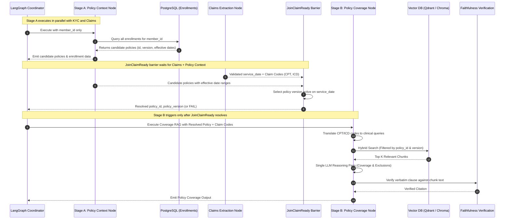

# MediShield Multi-Agent Document Intake System
## Canonical Policy RAG & Administration Specification

**Status:** Authoritative Engineering Contract  
**Version:** 1.0.0 (Canonical Baseline)  
**Governing Principle:** Authoritative policy corpora are admin-managed and immutable to customer uploads. Coverage reasoning executes in two decoupled phases using hybrid lexical and dense semantic retrieval.

---

## 1. Separation of Policy Roles

A fundamental flaw in naive RAG systems is allowing customer-submitted documents (e.g., a scanned document labeled "Policy Amendment Form") to directly update or pollute the authoritative vector store used to adjudicate other claims.

MediShield strictly segregates customer submissions from corporate knowledge:

```text
┌────────────────────────────────────────────────────────────────────────┐
│ CUSTOMER / HOSPITAL INTAKE PATH (UNTRUSTED)                            │
│   • Customer uploads document of type POLICY_AMENDMENT                │
│   • Processed as standard case-level evidence for review               │
│   • CANNOT write to or modify the vector store collections             │
└────────────────────────────────────────────────────────────────────────┘

┌────────────────────────────────────────────────────────────────────────┐
│ CORPORATE POLICY PUBLISHING PATH (ADMIN-CONTROLLED)                    │
│   • Corporate Actuarial / Legal Admin uploads authoritative PDF        │
│   • Triggered strictly via POST /api/v1/admin/policies                │
│   • Validated for version, effective dates, and plan identifiers       │
│   • Ingested via Docling -> Vector Store (Qdrant / ChromaDB)           │
└────────────────────────────────────────────────────────────────────────┘
```

Published rider definitions are stored as children of an effective `policy_version`, including rider code, waiting-period value and unit, the clause-defined start event, benefit/exclusion text, and source clause/PDF provenance.
Member-specific rider applications are stored separately and linked to an `enrollment` and policy rider. A customer-submitted amendment is evidence of a **request**, not evidence that coverage was approved or activated.
Application status defaults to `REQUESTED`. Only an authorized enrollment-system record with approver, approval timestamp, and effective start date may set status to `APPROVED`.
OCR may extract a requested rider and dates into a pending application, retaining source-document provenance. It cannot publish policy terms or mark the rider approved.
Seeded/generated policy text remains `source_verified = false` until verified against the authoritative policy artifact. No coverage decision may rely on unverified rider text.
This persistence contract does not itself adjudicate waiting periods. Deterministic applicability and calendar-boundary semantics must be specified and tested before rider terms are used to approve or deny a claim.
    AdminUpload[Admin Uploads Master Policy PDF] --> DoclingParser[Docling Document Parser]
    DoclingParser --> LayoutExtract[Layout, Table & Header Extraction]
    LayoutExtract --> SemanticChunking[Hierarchical Semantic Chunking]
    SemanticChunking --> TextMeta[Add Chunk Metadata:<br/>Policy ID, Version, Section, Page]
    TextMeta --> VectorEmbed[Generate Dense Embeddings<br/>e.g., text-embedding-3-small]
    TextMeta --> BM25Index[Build BM25 Lexical Inverted Index]
    VectorEmbed --> VectorStore[(Qdrant / ChromaDB Collections)]
    BM25Index --> VectorStore
    TextMeta --> PgChunks[(PostgreSQL policy_chunks)]
```

### 2.1 Docling Layout Parsing Specification
- Rather than naive fixed-character chunking (which breaks tables and separates exclusions from benefits), policies are ingested using **Docling**.
- Docling extracts logical hierarchical headers (`# 1. Surgical Benefits`, `## 1.2 Inpatient Co-Insurance`), preserving tabular deductibles and bulleted lists of exclusions intact.
- Target chunk size: 500–800 tokens with 100-token semantic overlap, strictly bound within section boundaries.

### 2.2 Metadata Attributes Required per Chunk
Every chunk indexed in Qdrant/ChromaDB must store:
- `policy_id`: String (e.g., `POL-CA-GOLD-2026`)
- `version_tag`: String (e.g., `v2026.1`)
- `effective_start_date`: ISO Date (`2026-01-01`)
- `effective_end_date`: ISO Date or `null`
- `section_number`: String (`Section 4.2`)
- `section_title`: String (`Dermatological Exclusions`)
- `page_number`: Integer (physical PDF page)
- `chunk_hash`: SHA-256 of verbatim text snippet

---

## 3. Two-Stage Policy Execution Architecture



### 3.1 Stage A: Policy Context Resolution
- Runs in parallel with KYC and Claims extraction.
- Accepts **only `member_id`** as input. Does not require `service_date` at dispatch.
- Discovers all candidate enrollments and policy versions for the member:
  - Returns the set of `(policy_id, version_tag, effective_start_date, effective_end_date)` tuples.
- **Service-date-aware version selection** occurs at the `JoinClaimReady` barrier after Claims provides validated `service_date`. The barrier selects the exact policy version where:
  $$\text{effective\_start\_date} \le \text{service\_date} \le \text{effective\_end\_date}$$
- If no active enrollment exists on `service_date` (evaluated at `JoinClaimReady`), verdict is set to `FAIL` (`Reason: POLICY_NOT_ACTIVE_ON_SERVICE_DATE`).

### 3.2 Stage B: Hybrid Retrieval & Medical Code Expansion
Medical codes in claim forms (e.g., `CPT 47562`) rarely match exact policy wording (e.g., "Laparoscopic Cholecystectomy"). 
1. **Code Expansion:** The retrieval engine expands CPT codes using an internal medical dictionary before querying:
   - Input: `CPT 47562`
   - Expanded Query: `CPT 47562 Laparoscopic cholecystectomy gallbladder surgical removal inpatient coverage`
2. **Hybrid Search Equation:**
   $$\text{Score} = \alpha \times \text{Score}_{\text{Dense}} + (1 - \alpha) \times \text{Score}_{\text{BM25}}$$
   Where $\alpha = 0.65$, and the search space is hard-filtered by `{"policy_id": policy_id, "version_tag": version_tag}`.
3. **Top-$K$ Selection:** Retrieves the top $K=5$ most relevant chunks.

---

## 4. Grounded Coverage Adjudication & Clause Verification

The Policy Coverage LLM consumes strictly retrieved chunks and returns a typed JSON payload:

```json
{
  "covered": true,
  "coverage_percentage": 80.0,
  "policy_deductible_limit": 500.0,
  "policy_copay_percentage": 20.0,
  "cited_clauses": [
    {
      "section_number": "Section 4.1",
      "clause_title": "Diagnostic Radiology and Imaging",
      "verbatim_text": "Diagnostic imaging including chest X-rays (CPT 71045) are covered at 80% after deductible.",
      "page_number": 14,
      "chunk_id": "chunk-pol-ca-gold-v2026.1-p14-03"
    }
  ],
  "exclusions": [],
  "prior_authorization_required": false
}
```

### 4.1 Clause Verification Check
The Faithfulness Gate verifies that `verbatim_text` is present inside `chunk_id` in PostgreSQL:
- If string match fails: Citation is rejected, `verified_in_corpus = False`.
- If an agent marks a claim "NOT COVERED" but cites no exclusion clause, verdict is forced to `INDETERMINATE`. A claim is never marked `FAIL` without an authoritative cited exclusion.
- The exclusion must explicitly apply to a billed CPT/HCPCS/revenue code. An empty corpus, unknown code, missing clause, or unverified citation is `INDETERMINATE` (or `UNAVAILABLE` for a dependency failure), never a denial recommendation.
