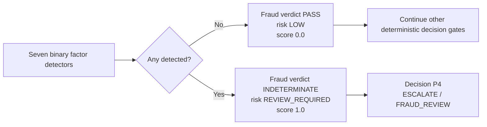
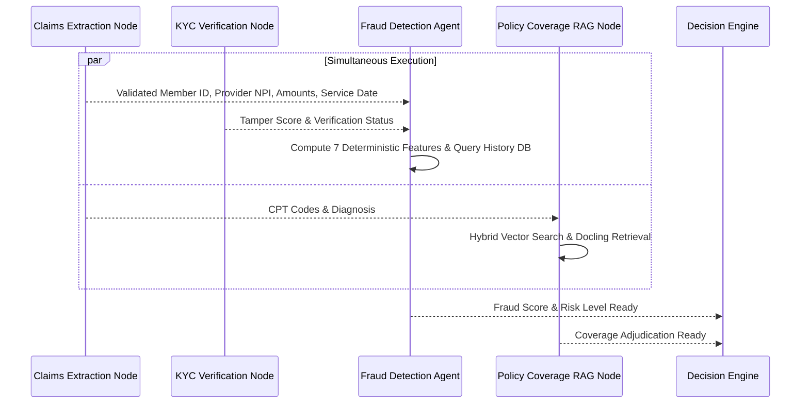

# MediShield Multi-Agent Document Intake System
## Canonical Fraud Detection Engine Specification

**Status:** Authoritative Engineering Contract (Binary Review Semantics: ADR-033)  
**Version:** 1.0.0 (Canonical Baseline)  
**Governing Principle:** Deterministic yes/no fraud indicators. Any detected factor requires human fraud review; factors are not weighted into a severity score. Strict exclusion of protected personal attributes.

---

## 1. Principles of Fraud Adjudication

1. **Deterministic & Explainable Scoring:** In healthcare and insurance compliance, every fraud flag must be traceable to concrete, auditable anomalies. Generative LLMs must **not** be used to invent fraud probabilities. The MVP relies on deterministic rule algorithms and statistical outlier scoring.
2. **Synthetic Data Disclaimer:** The system explicitly acknowledges that models trained or evaluated solely on synthetic datasets **do not represent real-world clinical fraud patterns**. The fraud scoring architecture is designed for structural demonstrability, testability, and rule calibration.
3. **Strict Exclusion of Protected Attributes:** Under federal regulations (Affordable Care Act Section 1557, HIPAA, Equal Credit Opportunity Act), the fraud engine is strictly prohibited from consuming or correlating against protected demographic attributes:
   - Prohibited attributes: Race, ethnicity, sex, gender identity, sexual orientation, age, religion, national origin, disability status, or marital status.
   - Allowed attributes: Transactional claim metadata, provider billing frequency, mathematical line-item variances, image tamper signals, and chronological claim submission intervals.

---

## 2. Binary Feature Suite

Each factor has a deterministic detector that returns `detected: true` or `false`. The raw value and description are retained for audit and reviewer context; they are not multiplied by weights or summed into a risk probability.

| Feature | Evidence checked | Detector emits `true` when |
|---|---|---|
| Duplicate claim key | Claim tuple compared with available historical claims | A matching duplicate is found |
| Image tamper anomaly | ELA/image forensic signal | The tamper detector reports a positive signal |
| Rapid resubmission velocity | Member submission count in the configured time window | The configured excess-submission condition is met |
| Provider billing outlier | Available CPT/provider charge distribution | The outlier criterion is crossed |
| Service-date inconsistency | Service, submission, and reconciled discharge dates | The date detector establishes an inconsistency |
| Line-total arithmetic drift | Declared total and service-line sum | Complete, verified extraction has a non-zero mismatch |
| Member claim frequency | Member claim count in the configured 30-day window | The configured excess-frequency condition is met |

---

## 3. Any-Factor Review Rule

`fraud_score` is retained temporarily for data/API compatibility and is strictly binary (`1.0` if any detector is true, otherwise `0.0`). It is not a percentage, probability, or severity tier. New consumers should use `fraud_review_required`.

Fraud findings cause **review, not rejection**. The fraud engine emits no final business decision. A fraud indicator is evaluated after P1 security/dependency checks and P2 required-document checks, and before P3 ambiguity and P5 confirmed-denial rules. Therefore any flagged factor reaches a reviewer as `ESCALATE(FRAUD_REVIEW)`; it does not independently establish fraud or justify claim denial.

Incomplete bill extraction is not a positive arithmetic fraud finding. If rows or charges are missing or ambiguous, the claims result remains indeterminate; line-total drift is a fraud indicator only when extraction is complete and the verified totals disagree.

---

## 4. Execution Timing & Concurrency Advantage

A major performance optimization in MediShield is that **the Fraud Detection Agent does not need to wait for Policy Coverage RAG**.

By decoupling Fraud from Policy RAG, the system saves 800–1,500ms of graph critical-path latency per case.
