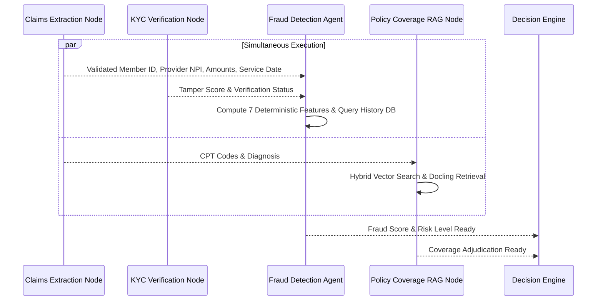

# MediShield Multi-Agent Document Intake System
## Canonical Fraud Detection Engine Specification

**Status:** Authoritative Engineering Contract  
**Version:** 1.0.0 (Canonical Baseline)  
**Governing Principle:** Deterministic, explainable, rule-and-statistical feature scoring for MVP. Zero black-box hallucinations. Strict exclusion of all legally protected personal attributes.

---

## 1. Principles of Fraud Adjudication

1. **Deterministic & Explainable Scoring:** In healthcare and insurance compliance, every fraud flag must be traceable to concrete, auditable anomalies. Generative LLMs must **not** be used to invent fraud probabilities. The MVP relies on deterministic rule algorithms and statistical outlier scoring.
2. **Synthetic Data Disclaimer:** The system explicitly acknowledges that models trained or evaluated solely on synthetic datasets **do not represent real-world clinical fraud patterns**. The fraud scoring architecture is designed for structural demonstrability, testability, and rule calibration.
3. **Strict Exclusion of Protected Attributes:** Under federal regulations (Affordable Care Act Section 1557, HIPAA, Equal Credit Opportunity Act), the fraud engine is strictly prohibited from consuming or correlating against protected demographic attributes:
   - Prohibited attributes: Race, ethnicity, sex, gender identity, sexual orientation, age, religion, national origin, disability status, or marital status.
   - Allowed attributes: Transactional claim metadata, provider billing frequency, mathematical line-item variances, image tamper signals, and chronological claim submission intervals.

---

## 2. Feature Suite & Scoring Mathematics

The fraud engine extracts 7 explicit, normalized features ($f_i \in [0.0, 1.0]$) and computes a composite weighted fraud score:

$$\text{Fraud Score} = \sum_{i=1}^{7} w_i \times f_i \quad \text{where} \quad \sum_{i=1}^{7} w_i = 1.0$$

### 2.1 Canonical Fraud Features

| Feature ID | Feature Name | Weight ($w_i$) | Extraction & Calculation Logic | Normalized Score Range |
|---|---|:---:|---|:---:|
| **F-01** | `duplicate_claim_key` | **0.30** | Hash collision of `(member_id, provider_npi, service_date, total_amount)` against historical claims table. | $1.0$ if exact match exists;<br>$0.0$ if unique. |
| **F-02** | `image_tamper_anomaly` | **0.20** | Visual tamper score from Error Level Analysis (ELA) and font inconsistency check on invoice amounts or dates. | $0.0$ (clean) to $1.0$ (heavy copy-move / splice). |
| **F-03** | `rapid_resubmission_velocity` | **0.15** | Count of claims submitted by the same member within the past 48 hours ($N_{48h}$). | $\min(1.0, \frac{N_{48h} - 1}{4})$ if $N_{48h} > 1$, else $0.0$. |
| **F-04** | `provider_billing_outlier` | **0.15** | $Z$-score of provider claim amount relative to median charge for the same CPT code across all providers: $Z = \frac{\text{Amount} - \mu_{\text{CPT}}}{\sigma_{\text{CPT}}}$. | $\min(1.0, \frac{\max(0, Z - 2.0)}{3.0})$. |
| **F-05** | `service_date_inconsistency` | **0.10** | Date of service occurs in the future relative to submission date, or precedes policy inception by $> 365$ days. | $1.0$ if future date;<br>$0.5$ if $> 1$ year stale;<br>$0.0$ if valid. |
| **F-06** | `line_total_arithmetic_drift` | **0.05** | Percentage discrepancy between declared total claim amount and sum of itemized line charges: $\Delta = \frac{|\text{Total} - \sum \text{Lines}|}{\text{Total}}$. | $\min(1.0, \frac{\Delta}{0.10})$. |
| **F-07** | `member_claim_frequency_30d` | **0.05** | Total claim count for member in past 30 days ($N_{30d}$) exceeding standard utilization baseline. | $\min(1.0, \frac{\max(0, N_{30d} - 3)}{5})$. |

---

## 3. Risk Tiering & Escalation Thresholds

The resulting composite fraud score maps to three risk tiers:

```text
       0.00                      0.30                      0.70                      1.00
Fraud    │                         │                         │                         │
Score    ├─────────────────────────┼─────────────────────────┼─────────────────────────┤
Tier     │        LOW RISK         │       MEDIUM RISK       │        HIGH RISK        │
Action   │       Auto-Eligible     │   Conditional Escalate  │    Mandatory Escalate   │
         └─────────────────────────┴─────────────────────────┴─────────────────────────┘
```

### 3.1 Threshold Definitions

1. **LOW RISK (`0.00 <= fraud_score < 0.30`):**
   - The claim exhibits standard billing characteristics and clean image integrity.
   - Fraud verdict: `PASS`.
   - Action: Eligible for automated Straight-Through Processing (auto-approval) if KYC and Policy criteria pass.

2. **MEDIUM RISK (`0.30 <= fraud_score < 0.70`):**
   - Exhibits mild statistical variance (e.g., slightly elevated billing frequency or provider charges).
   - Fraud verdict: `INDETERMINATE`.
   - Action: **Do not blanket escalate every medium risk case.**
     - If all other agents (KYC, Claims, Policy) report high confidence ($\ge 0.85$) with verified span provenance and no tamper flags, the case proceeds through auto-adjudication.
     - If accompanied by any secondary borderline confidence ($< 0.75$) or material uncertainty, it escalates to `AWAITING_HUMAN` (`ESCALATE(HUMAN_REVIEW)`).

3. **HIGH RISK (`fraud_score >= 0.70`):**
   - Severe anomaly detected (e.g., cumulative fraud score $\ge 0.70$ resulting from multiple compounding features: duplicate collision F-01 weight $0.30$ combined with image tamper F-02, velocity F-03, or provider outlier F-04).
   - *Duplicate Collision Note:* Standalone duplicate tuple collision F-01 ($0.30$) without secondary anomalies falls into Medium Risk and definitively triggers Rule P7 (`RULE-P7-BORDERLINE-REVIEW`). Overriding standalone F-01 to High Risk (Rule P4) is subject to formal SIU Director governance approval (Decision 5).
   - Fraud verdict: `FAIL`.
   - Action: **Mandatory Escalation** under Decision Rule P4 to `AWAITING_HUMAN` (`ESCALATE(FRAUD_REVIEW)`).

---

## 4. Execution Timing & Concurrency Advantage

A major performance optimization in MediShield is that **the Fraud Detection Agent does not need to wait for Policy Coverage RAG**.



By decoupling Fraud from Policy RAG, the system saves 800–1,500ms of graph critical-path latency per case.
