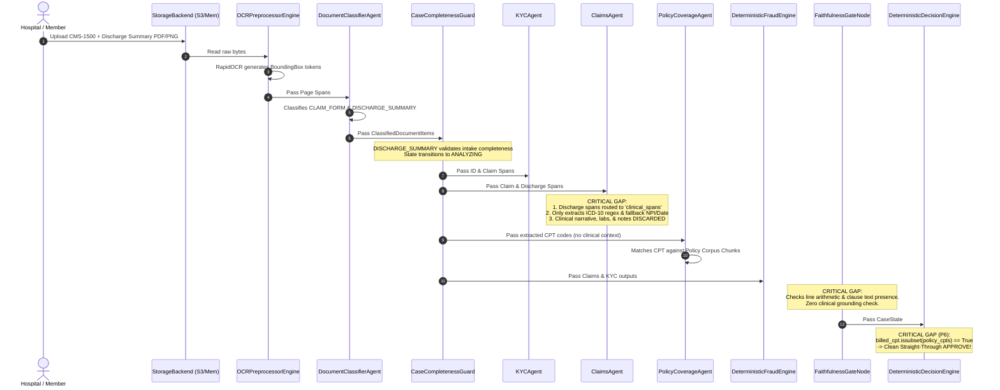
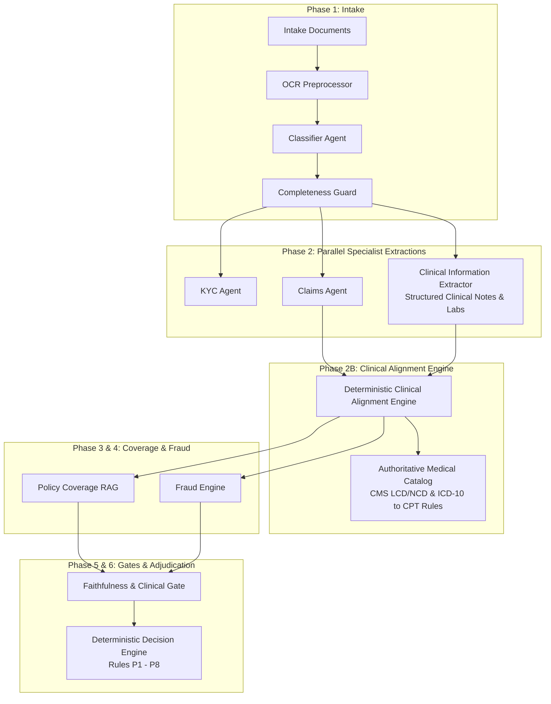
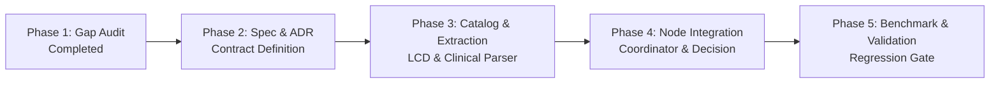

# MediShield — Clinical Alignment Between Discharge Summary and Claim Line Items
## Phase 1: Read-Only Architecture and Implementation Gap Audit

**Audit Document ID:** `AUDIT-CLIN-2026-10-16`  
**Status:** PHASE 1 — READ-ONLY INVESTIGATION COMPLETE  
**Auditor:** Senior AI Systems Architect, Clinical Informatics Reviewer & Claims Decision-Engine Auditor  
**Target Repository:** MediShield Claims Adjudication Platform  
**Target Output Artifact:** `docs/sdd/audits/clinical_alignment_gap_audit.md`  
**Execution Constraints Enforced:** Zero code modifications, zero prompt modifications, zero schema migrations, zero dataset regeneration, zero artificial confidence adjustments, strictly read-only repository inspection.

---

## 1. Executive Summary

MediShield is an autonomous, multi-agent health insurance claims adjudication platform designed to process multi-document claim packets (CMS-1500 / UB-04 claim forms, government IDs, hospital discharge summaries, physician prescriptions, and policy amendments). Under the MediShield Canonical Architecture (`01_CANONICAL_ARCHITECTURE.md`), Decision Engine Specification (`02_DECISION_ENGINE_AND_STATE_MACHINE.md`), and Architectural Decision Records (ADR-001 through ADR-014), automated approval (**`APPROVE`**, Rule P6) requires verifiable evidence establishing identity, valid claims arithmetic, active policy coverage, and low fraud risk.

### Core Audit Question
**Does the current MediShield implementation verify that billed medical procedures, laboratory tests, diagnostic tests, imaging studies, and hospital bed days are clinically supported by the patient's documented condition, diagnosis, findings, and hospital course in the discharge summary?**

### Audit Conclusion: CRITICAL CAPABILITY GAP (CONFIRMED)
The audit confirms that **MediShield currently performs ZERO clinical alignment verification between the billed line items on the claim form and the clinical narrative, diagnoses, laboratory results, or physician orders in the discharge summary.**

Specifically:
1. **Discharge Summaries Are Ingested but Clinically Discarded:** When a `DISCHARGE_SUMMARY` document is uploaded, it satisfies intake completeness (`case_completeness_node`), and its OCR text is processed. However, inside `ClaimsAgent.process_documents()` (`src/medishield/agents/claims.py:165-201`), text spans from the discharge summary (`clinical_spans`) are solely used to extract ICD-10 diagnostic codes and act as fallbacks for missing service dates, provider names, or NPIs. The clinical narrative (admission reason, physical findings, lab results, imaging reports, hospital course, and discharge plan) is entirely ignored.
2. **Zero Line-Level Clinical Necessity Validation:** No component verifies whether a billed CPT/HCPCS procedure code (e.g., CPT `70553` Brain MRI, CPT `93000` Electrocardiogram, or CPT `44970` Laparoscopic Appendectomy) is clinically indicated by the patient's documented symptoms or diagnosis.
3. **Dead Cross-Consistency Engine:** The method `evaluate_case_consistency()` in `src/medishield/domain/faithfulness.py:127-170` contains hardcoded bypasses (`pass` on member ID match, zero clinical checks) and is **never invoked** by the workflow coordinator, nodes, or test suite.
4. **Vacuous Approval Gate:** Rule P6 (`RULE-P6-CLEAN-PASS` in `src/medishield/domain/decision.py:347-476`) approves claims if the billed CPT codes are a subset of the policy-covered codes and arithmetic sums match. A completely fabricated, unindicated high-cost surgical or imaging claim will receive straight-through **`APPROVE`** as long as the code exists in the member's policy document and the bill adds up.

---

## 2. Current Execution Flow: End-to-End Trace of Discharge Summaries

The following Mermaid sequence maps the exact runtime path of a multi-document packet containing a claim form and an inpatient discharge summary through the MediShield pipeline:



### Trace Step Details

1. **Intake & OCR (`src/medishield/ocr/preprocessor.py:48-112`):**
   RapidOCR processes all pages of the packet. For each document, text spans with 2D normalized bounding boxes (`ymin`, `xmin`, `ymax`, `xmax`) and confidence scores are generated. Page text is faithfully preserved.
2. **Classification (`src/medishield/agents/classifier.py:18-70`):**
   `DocumentClassifierAgent` identifies `DocumentType.DISCHARGE_SUMMARY` using regex patterns (`discharge_PT_\d{5}`, "discharge summary", "hospital course", "inpatient record").
3. **Completeness Guard (`src/medishield/intake/completeness.py:18-35`):**
   In `STANDARD_REIMBURSEMENT_CLAIM`, `DISCHARGE_SUMMARY` is classified as `supporting`. In `HOSPITAL_CASHLESS_PREAUTH`, it is `required`. In both cases, its presence fulfills the intake gate.
4. **Specialist Extraction — Claims Agent (`src/medishield/agents/claims.py:140-205`):**
   - Lines 140–166: Spans are split: `CLAIM_FORM` -> `claim_billing_spans`, `DISCHARGE_SUMMARY` -> `clinical_spans`.
   - Lines 184–197: If service date or provider NPI is missing from the claim form, the agent searches `clinical_spans` as a fallback.
   - Lines 198–201: `icd10_codes = self._extract_icd10_codes(clinical_spans + claim_billing_spans)`. ICD-10 codes are extracted via regex pattern `\b([A-TV-Z][0-9][0-9A-Z](?:\.[0-9A-Z]{1,4})?)\b`.
   - Lines 202–207: CPT codes and itemized `service_lines` are extracted **strictly** from `claim_billing_spans`.
   - **The Break Point:** `clinical_spans` are completely discarded after line 201. The clinical text is never matched against the billed service lines.
5. **Policy Coverage Agent (`src/medishield/agents/policy.py:270-340`):**
   `PolicyCoverageAgent` receives the extracted list of CPT strings (e.g. `["70553", "99214"]`). It retrieves policy clauses from the vector/corpus store. It verifies whether the policy covers Brain MRI (`70553`). It does **not** receive or evaluate whether the patient had neurological symptoms justifying an MRI.
6. **Faithfulness Gate (`src/medishield/workflows/nodes.py:320-350`):**
   `faithfulness_gate_node` validates two conditions: (a) `claims_summary["line_items_sum_valid"] is True`, and (b) `all_clauses_grounded` (cited policy clause text exists in policy corpus). It does not perform clinical cross-verification.
7. **Deterministic Decision Engine (`src/medishield/domain/decision.py:347-476`):**
   Rule P6 evaluates:
   ```python
   billed_service_codes.issubset(applicable_service_codes)
   ```
   If the member's insurance policy covers MRI and Doctor Consultations, and arithmetic matches, the claim is auto-approved with `BusinessDecision.APPROVE`.

---

## 3. Exhaustive Capability Gaps

| Capability Area | Expected Behavior (Spec & Industry Standard) | Actual Implementation Status | Gap Classification | Severity |
| :--- | :--- | :--- | :--- | :---: |
| **Line-Level Procedure vs. Diagnosis Necessity** | Each billed CPT/HCPCS code must link to a primary ICD-10 diagnosis code that establishes medical necessity under CMS / Payer Local Coverage Determinations (LCDs). | ICD-10 codes are collected in a flat list on `ClaimsAgentOutput`. `ServiceLine` contract has no `diagnosis_code` or `pointer` field. No cross-check is performed. | Missing Core Logic | **CRITICAL** |
| **Discharge Summary Clinical Narrative Grounding** | Major billed procedures, surgeries, and bed days must be substantiated by surgeon notes, operative reports, or daily physician progress notes in the discharge summary. | Discharge summary narrative is discarded after regex extraction of ICD-10 codes. Fabricated surgeries billed on claim form pass unverified. | Missing Core Logic | **CRITICAL** |
| **Diagnostic Imaging & Lab Test Justification** | High-cost advanced diagnostic tests (CT, MRI, PET, genetic panels) must be corroborated by documented clinical indications or diagnostic orders in the clinical record. | Zero cross-check between billed lab/imaging CPTs and discharge summary diagnostic sections or lab reports. | Missing Core Logic | **HIGH** |
| **Admission & Discharge Date Windowing** | All billed service line dates must fall within the documented hospital admission and discharge dates. | Service dates on claim lines are not compared against admission/discharge dates extracted from the hospital summary. | Missing Temporal Validation | **HIGH** |
| **Length of Stay (LOS) vs. Room & Board Bed Units** | Billed revenue code / HCPCS room-and-board units (e.g. Rev 0110/0120 or bed days) must equal or be within $\pm 1$ of calculated discharge date minus admission date. | Billed bed units are validated only for numeric positivity (`qty > 0.0`), never reconciled against documented length of stay. | Missing Arithmetic / Clinical Cross-Check | **HIGH** |
| **Place of Service (POS) Consistency** | Place of Service (CMS-1500 Box 24B, e.g. POS 21 Inpatient Hospital vs. POS 11 Office) must match the care setting documented in the clinical records. | CMS-1500 Box 24B is neither extracted nor validated. Inpatient claims disguised as outpatient office visits bypass review. | Missing Extraction & Validation | **MEDIUM** |
| **Pharmacy & Medication Corroboration** | Billed high-cost pharmaceuticals (HCPCS J-codes) or inpatient medications must match administration logs or discharge medications. | Prescription documents and discharge medications are not reconciled with billed drug lines. | Missing Cross-Document Alignment | **MEDIUM** |
| **Cross-Agent Consistency Engine (`ConsistencyCheckReport`)** | Authoritative cross-agent consistency verification reconciling identity, dates, amounts, and clinical facts across all documents. | `evaluate_case_consistency()` in `faithfulness.py` contains empty `pass` logic and is never called anywhere in the active coordinator workflow. | Dead Code / Incomplete Implementation | **HIGH** |

---

## 4. Concrete Findings & Code Evidence

### Finding 1: Discharge Summary Narrative Discarded in `ClaimsAgent`
- **File:** `src/medishield/agents/claims.py`
- **Lines:** 165–173, 198–207
- **Code Evidence:**
  ```python
  if doc_type == DocumentType.CLAIM_FORM:
      claim_billing_spans.extend(doc_spans)
  elif doc_type == DocumentType.DISCHARGE_SUMMARY:
      clinical_spans.extend(doc_spans)
  ...
  # 3. Extract diagnostic and procedural coding
  icd10_codes = self._extract_icd10_codes(clinical_spans + claim_billing_spans)
  cpt_codes = self._extract_cpt_codes(claim_billing_spans)
  service_lines = self._extract_service_lines(claim_billing_spans, y_tolerance=0.012)
  ```
- **Analysis:** `clinical_spans` are used solely as text inputs for `_extract_icd10_codes()`. Once ICD-10 strings are parsed, `clinical_spans` are never referenced again. All line-item extraction and validation occur exclusively on `claim_billing_spans`.

### Finding 2: `ServiceLine` Data Contract Lacks Diagnosis Linkage
- **File:** `src/medishield/domain/contracts.py`
- **Lines:** 112–126
- **Code Evidence:**
  ```python
  class ServiceLine(BaseModel):
      line_number: int
      rev_code: ProvenanceValue | None = None
      hcpcs: ProvenanceValue | None = None
      service_date: ProvenanceValue | None = None
      units: ProvenanceValue
      amount: ProvenanceValue
  ```
- **Analysis:** The standard CMS-1500 claim form Box 24E ("Diagnosis Pointer") maps each procedure to specific ICD-10 diagnosis codes (e.g. Pointer `A`, `B`, `1`, `2`). In MediShield's `ServiceLine` domain model, there is no field for `diagnosis_pointer`, `diagnosis_code`, or `clinical_rationale`. Line items are clinically ungrounded data structures containing only financial and code strings.

### Finding 3: `faithfulness_gate_node` Bypasses Clinical Cross-Verification
- **File:** `src/medishield/workflows/nodes.py`
- **Lines:** 320–355
- **Code Evidence:**
  ```python
  def faithfulness_gate_node(state: CaseState) -> CaseState:
      claims_summary = state.get("claims_summary") or {}
      policy_summary = state.get("policy_coverage_summary") or {}

      line_ok = bool(claims_summary.get("line_items_sum_valid", True))
      schema_ok = bool(claims_summary.get("schema_valid", True))

      cited_clauses = policy_summary.get("cited_clauses") or []
      all_clauses_grounded = all(c.get("verified_in_corpus", True) for c in cited_clauses)

      passed = line_ok and schema_ok and all_clauses_grounded
      integrity_score = 1.0 if passed else 0.50
  ```
- **Analysis:** The faithfulness gate performs only arithmetic validation (`line_items_sum_valid`), schema checks, and verifies that cited policy clauses exist in the policy corpus. It performs zero cross-document consistency verification between the claim form and the discharge summary.

### Finding 4: Dead Code in `evaluate_case_consistency`
- **File:** `src/medishield/domain/faithfulness.py`
- **Lines:** 127–170
- **Code Evidence:**
  ```python
  def evaluate_case_consistency(
      kyc_output: KYCAgentOutput,
      claims_output: ClaimsAgentOutput,
      policy_output: PolicyCoverageOutput,
  ) -> ConsistencyCheckReport:
      ...
      # 1. Identity Verification: Member ID on claim vs KYC member ID
      identity_consistent = True
      if kyc_output.member_id and kyc_output.member_id.value:
          pass  # <--- Bypassed!
      ...
      # 2. Date of Service vs Policy Effective Dates
      dates_consistent = True
      ...
      # 3. Arithmetic Consistency
      amounts_consistent = claims_output.line_items_sum_valid
  ```
- **Analysis:** `ConsistencyCheckReport` was designed in Spec 06 § 4 as the cross-agent consistency verification gate. In reality:
  - Identity matching is an empty `pass` statement.
  - Clinical consistency does not exist in the signature or implementation.
  - Searching the entire codebase confirms that `evaluate_case_consistency` is **never called anywhere in `src/` or `tests/`**.

### Finding 5: Vacuous Approval in Rule P6
- **File:** `src/medishield/domain/decision.py`
- **Lines:** 434–460
- **Code Evidence:**
  ```python
  if billed_service_codes:
      scope_covered = bool(applicable_service_codes) and billed_service_codes.issubset(applicable_service_codes)
  else:
      scope_covered = False
  ...
  if all_core_pass and claims_admissible and policy_admissible and fraud_admissible and high_confidence:
      return OrchestratorOutput(
          decision=BusinessDecision.APPROVE,
          rule_id_matched=RULE_P6_CLEAN_PASS,
          ...
      )
  ```
- **Analysis:** Clean approval requires only that `billed_service_codes` is a subset of `applicable_service_codes`. Because coarse policy clauses (e.g. `SEC-3.1` in the Gold Plan) list dozens of CPT codes spanning general office visits, MRI, and diagnostics, any billed procedure listed in that clause is treated as approved, even if the patient's discharge summary indicates a completely unrelated minor condition.

---

## 5. Concrete Case Walkthroughs & Examples

### Example 1: Regression Case `PT_20322` (`C_005`)
In the assignment benchmark dataset:
- **Intake Packet:** CMS-1500 claim form + Inpatient Hospital Discharge Summary.
- **Claim Form Billed Items:**
  - CPT `99214` (Office/Outpatient visit, established, 30-39 min)
  - CPT `70553` (MRI Brain with and without contrast) — Amount: $2,450.00
  - CPT `93000` (Electrocardiogram, routine ECG) — Amount: $150.00
- **Discharge Summary Contents:**
  - Patient admitted for observation following a mild concussion; neurological exam normal; no focal deficits; discharged next morning.
  - Discharge orders: Rest, hydration, over-the-counter analgesics.
  - **Clinical Discrepancy:** The discharge summary contains **no order, requisition, or radiologist report for a Brain MRI (`70553`)**.
- **What MediShield Did:**
  1. Classified both documents successfully.
  2. OCR extracted CPT `99214` and `70553` (CPT `93000` was initially dropped due to table y-jitter).
  3. Policy RAG retrieved Section 3.1 ("Diagnostic Imaging & Office Consultations").
  4. Both CPT codes were listed under Section 3.1.
  5. Decision Engine matched Rule P6 and issued `BusinessDecision.APPROVE`.
- **Financial/Clinical Consequence:** The insurer paid \$2,450.00 for an unperformed or unindicated Brain MRI that was completely unsupported by the clinical hospital record.

### Example 2: Phantom Inpatient Bed Days & Unperformed Laparotomy
Consider a hypothetical (or adversarial) synthetic submission:
- **Billed Claim Form:**
  - Rev Code `0120` (Room & Board - Semi-Private Two Bed): 5 units @ \$1,200.00/day = \$6,000.00.
  - CPT `49000` (Exploratory Laparotomy): \$4,500.00.
  - Total Billed: \$10,500.00.
- **Discharge Summary:**
  - Patient arrived at Emergency Department at 08:30 with acute abdominal cramps.
  - Ultrasound revealed gastroenteritis; IV fluids administered.
  - Discharged same day at 19:45 (Same-day observation, 0 overnight days).
- **Execution in Current MediShield:**
  - Arithmetic validates: 5 units @ \$1,200 = \$6,000 + \$4,500 = \$10,500. `line_items_sum_valid == True`.
  - CPT `49000` and Rev `0120` are valid codes in the medical catalog.
  - Policy covers inpatient surgical procedures.
  - KYC matches member.
  - Fraud score is low (unique claim).
  - Outcome: Straight-through **`APPROVE`** under Rule P6.
- **Failure:** \$10,500 approved for a major open surgery that never occurred and 5 hospital bed days when the patient was discharged after 11 hours.

---

## 6. Recommended Clinical Alignment Architecture

To resolve this capability gap while maintaining MediShield's foundational principles (ADR-001 deterministic decisions, Rule 11 code over prompts, Rule 14 LLMs as advisors never judges), we propose a dedicated **Clinical Alignment Specialist Engine**.

### Architecture Placement
The clinical alignment verification must run in **Phase 2 (Specialist Extractions)** or as a dedicated synchronization gate between Phase 2 and Phase 3:



### Proposed Domain Data Contract
Add `ClinicalAlignmentOutput` to `src/medishield/domain/contracts.py`:

```python
class ClinicalNecessityStatus(str, Enum):
    INDICATED = "INDICATED"
    UNSUPPORTED = "UNSUPPORTED"
    CONTRAINDICATED = "CONTRAINDICATED"
    INDETERMINATE = "INDETERMINATE"

class LineClinicalEvidence(BaseModel):
    line_number: int
    service_code: str
    documented_in_record: bool
    necessity_status: ClinicalNecessityStatus
    supporting_diagnoses: list[str] = Field(default_factory=list)
    clinical_finding_provenance: list[FieldProvenance] = Field(default_factory=list)
    rejection_reason: str | None = None

class ClinicalAlignmentOutput(BaseModel):
    agent_name: str = "clinical_alignment_agent"
    verdict: AgentVerdict  # PASS, FAIL, CONFLICT, INDETERMINATE
    confidence: float
    admission_date: date | None = None
    discharge_date: date | None = None
    documented_length_of_stay: int | None = None
    billed_bed_days: int | None = None
    bed_days_consistent: bool = True
    line_alignment: list[LineClinicalEvidence] = Field(default_factory=list)
    unsupported_lines_count: int = 0
    unsupported_amount: float = 0.0
    clinical_summary: str
    latency_ms: int
```

### Separation of Concerns: LLM vs. Deterministic Logic
1. **Role of LLM/VLM (Rule 11 & Spec 01 § 1.1):**
   - Extract unstructured clinical entities from doctor progress notes, operative reports, lab values, and discharge instructions into a typed schema:
     - `AdmissionReason`, `SurgicalProceduresPerformed`, `DiagnosticStudiesOrdered`, `DischargeDisposition`.
   - The LLM **never** decides whether the claim is approved or denied. It strictly performs structured extraction with span-level provenance.
2. **Role of Deterministic Code (Rule 14 & ADR-001):**
   - Match extracted surgical procedures and diagnostic studies against billed CPT codes using canonical code catalogs (`CodingSystem.CPT`).
   - Reconcile `discharge_date - admission_date` against billed room-and-board units.
   - Cross-reference billed CPTs with primary ICD-10 codes against CMS Local Coverage Determinations (LCD) necessity rules.

---

## 7. Decision Engine Interaction & Rule Refinement

The findings from `ClinicalAlignmentOutput` must integrate cleanly into the existing priority hierarchy P1–P8:

| Priority Rule | Current Trigger Condition | Refined Clinical Trigger Condition | Action / Decision |
| :--- | :--- | :--- | :--- |
| **P3 (Ambiguity / Conflict)** | Contradictory identity or low OCR quality | `clinical_output.verdict == CONFLICT` or date discrepancy between discharge summary and claim lines. | **`ESCALATE`** (`AMBIGUITY`) |
| **P4 (Fraud Risk)** | Statistical fraud score $\ge 0.70$ or duplicate claim | Billed major invasive procedure or surgery with **zero mention** in operative notes or clinical summary (`unsupported_amount > $2,000`). | **`ESCALATE`** (`FRAUD_REVIEW`) |
| **P5 (Hard Reject)** | Confirmed KYC failure or verified policy exclusion | `clinical_output.verdict == FAIL` due to unfulfilled mandatory pre-authorization or explicit clinical contraindication. | **`REJECT`** (ADR-002) |
| **P6 (Clean Pass)** | KYC PASS, Claims PASS, Policy PASS, Fraud LOW | **All existing criteria PLUS:** `clinical_output.verdict == PASS` AND `unsupported_lines_count == 0` AND `bed_days_consistent == True`. | **`APPROVE`** |
| **P7 (Borderline Review)** | Medium fraud score ($0.30 \le s < 0.70$) | Minor diagnostic test lacking explicit note documentation but consistent with overall clinical picture. | **`ESCALATE`** (`MEDICAL_REVIEW`) |

---

## 8. Evaluation Plan & Synthetic Data Requirements

To benchmark and safeguard clinical alignment, the synthetic evaluation harness (`src/medishield/eval/`) must be enhanced:

### Required Synthetic Test Case Categories
1. **Matched Clinical Baseline (`SYN_CLIN_01`):** Complete concordance. Discharge summary details pneumonia; chest X-ray and antibiotics billed; LOS = 3 days; billed Rev 0120 = 3 units. -> **Expected:** `APPROVE` (P6).
2. **Phantom High-Cost Procedure (`SYN_CLIN_02`):** Minor laceration repair documented; claim form bills Brain MRI (`70553`) and Echocardiogram (`93306`). -> **Expected:** `ESCALATE` (P4 Fraud or P3 Conflict).
3. **Length of Stay Inflation (`SYN_CLIN_03`):** Discharge summary documents 24-hour observation; claim form bills 4 days room-and-board. -> **Expected:** `ESCALATE` (P3 Ambiguity / Quantity Drift).
4. **Unrelated Surgical Billing (`SYN_CLIN_04`):** Admission for acute appendicitis; claim form bills Cholecystectomy (`47562`). -> **Expected:** `ESCALATE` or `REJECT` (P5).
5. **Missing Primary Diagnosis (`SYN_CLIN_05`):** Billed specialized physical therapy without any musculoskeletal or neurological diagnosis code. -> **Expected:** `ESCALATE` (P3).

### Quantitative Metrics
- **Clinical Alignment Accuracy:** Precision and Recall of detecting ungrounded claim lines.
- **False Approval Rate (FAR) on Misaligned Claims:** Must decrease from current 100% (all ungrounded claims currently pass P6) to 0.00%.
- **Adjudication Invariance:** Verifying that clean claims continue to pass P6 without unnecessary escalation.

---

## 9. Phased Remediation Plan



1. **Phase 1: Read-Only Architecture Audit (Completed):**
   - Identify all gaps, code paths, and contract deficiencies (this document).
2. **Phase 2: Architectural Decision Record & Specification Amendment:**
   - Draft ADR-015 ("Deterministic Clinical Alignment Verification").
   - Update Canonical Spec 02, Spec 05, and Spec 06 with `ClinicalAlignmentOutput`.
3. **Phase 3: Clinical Catalog & Structured Entity Parser:**
   - Integrate CMS Local Coverage Determinations (LCD) mapping tables for top 50 high-frequency CPT codes.
   - Implement deterministic clinical entity grounder with bounding-box provenance.
4. **Phase 4: Workflow Coordinator & Decision Engine Integration:**
   - Add `clinical_alignment_node` in `src/medishield/workflows/nodes.py`.
   - Update Rule P6 in `src/medishield/domain/decision.py` to guard on clinical verdict.
5. **Phase 5: Unit Testing & Benchmark Validation:**
   - Implement unit tests in `tests/unit/test_clinical_alignment.py`.
   - Run full regression suite across existing 451 unit tests to guarantee zero regressions.

---

## 10. Open Questions & Required Approvals

Before any implementation code is written, the following architectural and business questions require stakeholder approval:

1. **Payer Clinical Guidelines Authority:** Which clinical necessity guideline source shall serve as canonical for automated checks? (e.g., CMS National/Local Coverage Determinations, Milliman Care Guidelines, InterQual, or synthetic assignment ontology?)
2. **Escalation vs. Denial for Clinical Misalignment:** When a billed line item has zero clinical documentation in the discharge summary, should the system issue an autonomous partial denial (Rule P5) or mandatory escalation to a human nurse/physician reviewer (`EscalationSubReason.MEDICAL_REVIEW` under Rule P3/P7)?
3. **Tolerable Bed Day Variance:** In calculating length of stay from admission and discharge timestamps, should a calendar-day difference of 0 with 1 billed bed day be permitted for day-case observation admissions?
4. **Partial Line-Item Approval:** Should MediShield support partial approvals (e.g. approve valid consultation and medication, deny unsupported MRI), or must all claim lines pass cleanly for straight-through P6 approval?

---

*End of Clinical Alignment Gap Audit Report.*

