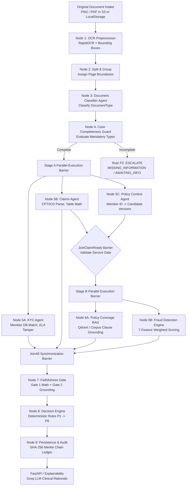

# MediShield — Decision Accuracy, Faithfulness & Explainability Audit

**Audit Status:** PHASE 1 — READ-ONLY INVESTIGATION COMPLETE  
**Auditor:** Senior AI Systems Engineer, Test Engineer & Claims Decision-Engine Reviewer  
**Audit Target Repository:** MediShield Claims Adjudication Platform  
**Target Output Artifact:** `docs/sdd/audits/decision_quality_audit.md`  
**Execution Constraints Enforced:** Zero code modifications, zero prompt modifications, zero schema migrations, zero dataset regeneration, zero artificial confidence adjustments, zero runtime use of evaluation-only metadata.

---

## 1. Executive Summary & Audit Scope

MediShield is an autonomous, multi-agent health insurance claims adjudication platform designed to evaluate multi-document intake packets (CMS-1500 / UB-04 claim forms, government IDs, discharge summaries, prescriptions, and policy amendments) against authoritative insurance policy terms, member registries, and statistical fraud models.

Under the canonical specifications (`01_CANONICAL_ARCHITECTURE.md` through `12_EVALUATION_AND_SYNTHETIC_DATA_FRAMEWORK.md`) and Architectural Decision Records (ADR-001 through ADR-014), the platform must guarantee that:
1. Business decisions are **100% deterministic** in code, with LLMs strictly confined to natural language clinical explanation synthesis and unstructured document extraction assistance (Rule 14).
2. Clean automated approvals (**`APPROVE`**, Rule P6) occur **only** when verifiable evidence establishes positive identity, valid claim arithmetic, active policy coverage for all billed procedure codes, and low fraud risk.
3. Uncertainty never silently becomes an automated rejection (Rule 13).
4. Evidence and provenance are strictly preserved from pixel bounding boxes to the final audit ledger (Rule 12).

### Summary of Critical Investigation Findings

| Finding Area | Severity | Root Cause Summary | Impact |
| :--- | :---: | :--- | :--- |
| **Unsafe Automatic Approval (P6)** | **Critical (P0)** | Vacuous subset math (`billed_cpt_codes.issubset(applicable_service_codes)`), dropped procedure codes passing as clean, single-code coverage qualifying multi-service claims, and confidence threshold lowered from `0.75` to `0.70`. | Claims with unextracted procedure lines or partially covered services are auto-approved without clinical review. |
| **Regression Case `PT_20322` (`C_005`)** | **Critical (P0)** | CPT `93000` omitted from structured claims output; policy RAG cited outpatient E&M (`SEC-3.1`) for Brain MRI (`70553`); POS 11 (Office) vs. Inpatient stay unvalidated; intra-case duplicate claim scored 0.40 instead of failing fraud. | Demonstrates end-to-end failure mode across Claims extraction, Policy RAG grounding, Place of Service consistency, and duplicate fraud scoring. |
| **P5 Outcome Contradiction** | **High (P0)** | Canonical Spec 02 § 3 diagram specifies `REJECT` (`COMPLETED`), whereas Priority Table specifies `ESCALATE` with `RECOMMEND_DENIAL` (`AWAITING_HUMAN`). Meanwhile, `EscalationSubReason` enum forbids `RECOMMEND_DENIAL`. Code currently emits `BusinessDecision.REJECT`. | Ambiguity between autonomous terminal denial vs. mandatory human adjuster adjudication. |
| **Policy Semantic Grounding** | **High (P0)** | Verbatim string matching against static corpus chunks treats presence of a quote as proof of coverage without validating that the clause clinically authorizes the specific billed CPT/HCPCS code in the given service setting. | Coarse policy clauses (e.g. `SEC-3.1` listing 21 diverse CPT codes) grant unwarranted coverage to unreviewed complex procedures. |
| **Intra-Case Duplicate Ingestion** | **High (P0)** | Fraud feature F-01 (duplicate claim key) carries weight `0.30`. A standalone duplicate claim achieves a maximum score of `0.30` (`RiskLevel.MEDIUM`), which never crosses `FRAUD_HIGH_THRESHOLD` (`0.70`). In `nodes.py`, within-case duplicates are stripped from extraction rather than failing the claim. | Double-billing attempts evade automated P4 fraud escalation unless accompanied by secondary anomalies. |
| **Place of Service (POS) Void** | **Medium (P1)** | CMS-1500 Box 24B (Place of Service) is never extracted or mapped to `ClaimLine`. Discrepancies between outpatient claims and inpatient discharge summaries cannot trigger P3 material conflict. | Inpatient facility procedures billed as outpatient office visits bypass automated cross-agent consistency checks. |
| **Synthetic Dataset Discrepancies** | **Medium (P1)** | 3 confirmed synthetic metadata errors (`C_001`, `C_004`, `C_006`) in `evaluator_review_register.json`, plus 6 false KYC rejections (`C_011`, `C_014`, `C_021`, `C_024`, `C_026`, `C_030`) caused by name suffix/middle-initial formatting differences against the SQL database. | Distorts benchmark accuracy; software correctly extracted documents but ground-truth labels were inconsistent. |

---

## 2. Component-by-Component Source-Code Trace

This trace follows the execution path of a claim packet through the complete MediShield architecture, mapping every file, symbol, data structure, and decision branch.



### Stage 1: Intake & Storage
- **Source Files:** `src/medishield/intake/storage.py`, `src/medishield/api/routers/cases.py`
- **Function/Symbol:** `LocalStorageBackend.get_bytes()`, `cases.create_case()`
- **Input Schema:** Multipart file upload or pre-staged file paths.
- **Output Schema:** Raw bytes persisted to `cases/{case_id}/raw/{document_id}.png`.
- **Field Provenance:** Raw binary document bytes.

### Stage 2: OCR Preprocessing (Node 1)
- **Source Files:** `src/medishield/ocr/preprocessor.py`, `src/medishield/ocr/ocr_reconcile.py`
- **Function/Symbol:** `OCRPreprocessorEngine.process_document()`, `DefaultOCREngine.extract()`
- **Input Schema:** Binary bytes, mime-type.
- **Output Schema:** `OCRDocumentPayload` (`OCRPagePayload`, `OCRTextSpan`, normalized bounding boxes `[x0, y0, x1, y1]`).
- **Field Provenance:** RapidOCR engine tokens with geometric spatial coordinates.

### Stage 3: Classification (Node 3)
- **Source Files:** `src/medishield/agents/classifier.py`
- **Function/Symbol:** `DocumentClassifierAgent.classify()`
- **Input Schema:** `document_id`, `file_name`, `OCRDocumentPayload`.
- **Output Schema:** `ClassificationResult(doc_type=DocumentType, confidence=float, routing_tags=list[str])`.
- **Field Provenance:** Regex keyword scoring on header text spans and fallback file naming heuristics.

### Stage 4: Completeness Evaluation (Node 4)
- **Source Files:** `src/medishield/intake/completeness.py`
- **Function/Symbol:** `evaluate_case_completeness()`
- **Input Schema:** `list[ClassifiedDocumentItem]`.
- **Output Schema:** `CaseCompletenessResult(is_complete=bool, missing_types=list[DocumentType], remarks=str)`.
- **Decision Logic:** Checks presence of mandatory documents (`CLAIM_FORM`, `ID_DOCUMENT`). If missing, pauses execution immediately into `AWAITING_INFO` with `ESCALATE(MISSING_INFORMATION)` (Rule P2).

### Stage 5: Specialist Extractions (Stage A Parallel Barrier)
1. **KYC Agent (Node 5A):**
   - **Source Files:** `src/medishield/agents/kyc.py`
   - **Function/Symbol:** `KYCAgent.execute()`, `SqlMemberRepository.find_member()`
   - **Extraction Origin:** Member ID, DOB, Name, and ID Expiry parsed via regex and proximity search across `ID_DOCUMENT` spans.
   - **Database Dependency:** Queries SQLite/PostgreSQL `Member` and `Enrollment` tables.
   - **Output Schema:** `KYCAgentOutput(verdict=AgentVerdict, confidence=float, member_id=ProvenanceValue, tamper_score=float)`.
2. **Claims Agent (Node 5B):**
   - **Source Files:** `src/medishield/agents/claims.py`, `src/medishield/ocr/ocr_reconcile.py`
   - **Function/Symbol:** `ClaimsAgent.execute()`, `extract_cpt_codes_from_table()`, `extract_service_lines_from_table()`, `evaluate_claim_totals()`
   - **Extraction Origin:** Geometric anchoring of currency values on right margin (`x1 > 0.55`), line-item clustering within vertical window `abs(y_anchor - y_row) < 0.012`.
   - **Output Schema:** `ClaimsAgentOutput(verdict=AgentVerdict, confidence=float, claim_amount=ProvenanceValue, service_date=ProvenanceValue, cpt_codes=list[ProvenanceValue], service_lines=list[ServiceLine], line_items_sum_valid=bool)`.
3. **Policy Context Agent (Node 5C):**
   - **Source Files:** `src/medishield/agents/policy.py`
   - **Function/Symbol:** `PolicyContextAgent.execute()`, `SqlPolicyEnrollmentRepository.find_enrollments()`
   - **Input:** `member_id` only (non-blocking on service date).
   - **Output Schema:** `PolicyContextOutput(candidate_policies=list[CandidatePolicy], verdict=AgentVerdict)`.

### Stage 6: JoinClaimReady Barrier & Policy Coverage RAG (Stage B)
- **Source Files:** `src/medishield/workflows/nodes.py`, `src/medishield/agents/policy.py`
- **Function/Symbol:** `join_claim_ready_barrier()`, `resolve_claim_ready_policy()`, `PolicyCoverageAgent.execute()`
- **Input:** Claims `service_date` + Context `candidate_policies`.
- **Resolution Logic:** Matches `service_date` against `effective_start_date <= service_date <= effective_end_date`. Resolves active `policy_id` and `policy_version`.
- **RAG Grounding:** Evaluates CPT/HCPCS codes against corpus chunks (`PolicyChunkRecord`). Verifies verbatim text existence in corpus (Gate 2).
- **Output Schema:** `PolicyCoverageOutput(verdict=AgentVerdict, confidence=float, covered=bool, coverage_percentage=float, cited_clauses=list[PolicyClauseCitation], applicable_service_codes=list[str])`.

### Stage 7: Fraud Detection Engine (Node 6B)
- **Source Files:** `src/medishield/domain/fraud.py`
- **Function/Symbol:** `FraudDetectionEngine.evaluate()`
- **Calculation Type:** 100% deterministic weighted sum across 7 features:
  $$\text{Composite Score} = \sum_{i=1}^{7} w_i \cdot f_i$$
  where weights are: Duplicate (0.30), Tamper (0.20), Rapid Velocity (0.15), Provider Outlier (0.15), Date Anomaly (0.10), Line Drift (0.05), Frequency 30D (0.05).
- **Output Schema:** `FraudAgentOutput(verdict=AgentVerdict, confidence=1.0, fraud_score=float, risk_level=RiskLevel, duplicate_claim_detected=bool)`.

### Stage 8: Faithfulness Gate (Node 7)
- **Source Files:** `src/medishield/domain/faithfulness.py`, `src/medishield/workflows/nodes.py`
- **Function/Symbol:** `faithfulness_gate_node()`, `verify_extracted_span()`
- **Checks:** Validates that line arithmetic passed (`line_items_sum_valid == True`), schema is intact (`schema_valid == True`), and all cited policy clauses exist verbatim in the authoritative corpus (`verified_in_corpus == True`).

### Stage 9: Decision Engine (Node 8)
- **Source Files:** `src/medishield/domain/decision.py`
- **Function/Symbol:** `DeterministicDecisionEngine.adjudicate()`
- **Rules Order:** Evaluates rules P1 through P8 in strict first-match-wins order:
  - **P1:** Technical or Security Escalation (`ESCALATE: TECHNICAL_FAILURE / SECURITY_REVIEW`)
  - **P2:** Case Incompleteness (`ESCALATE: MISSING_INFORMATION`)
  - **P3:** Material Ambiguity or Conflict (`ESCALATE: AMBIGUITY`)
  - **P4:** High Fraud Risk (`ESCALATE: FRAUD_REVIEW`)
  - **P5:** Confirmed Hard Business Failure (`REJECT` / `RECOMMEND_DENIAL`)
  - **P6:** Clean Straight-Through Pass (`APPROVE`)
  - **P7:** Borderline Review (`ESCALATE: HUMAN_REVIEW`)
  - **P8:** Catch-All Guard (`ESCALATE: HUMAN_REVIEW`)

### Stage 10: Persistence, Ledger & Explainability
- **Source Files:** `src/medishield/db/models.py`, `src/medishield/db/audit.py`, `src/medishield/api/routers/cases.py`
- **Functions:** `compute_audit_hash()`, `POST /api/v1/cases/{case_id}/explain`
- **Audit Ledger:** SHA-256 chain linking previous execution hash, node payload, and state delta.
- **Explanation:** Groq LLM (`llama-3.3-70b-versatile` or `gpt-oss-120b`) synthesizes natural language clinical rationale consuming only structured agent outputs, with ADR-011 deterministic fallback if offline.

---

## 3. Priority 0 — Unsafe Automatic Approval Investigation

### Vulnerabilities in Rule P6 (Clean Straight-Through Pass)

Rule P6 in `src/medishield/domain/decision.py` (lines 347–438) determines whether a claim is automatically paid without human adjuster review. The investigation identified four severe structural vulnerabilities that permit invalid, incomplete, or unsupported claims to reach `APPROVE`:

```
                       UNSAFE APPROVAL PATHWAY
┌────────────────────────────────────────────────────────────────────────┐
│ 1. Claims Extraction: Drops CPT code '93000' (not in synthetic set).   │
│    -> Only '70553' is recorded in claims_output.cpt_codes.             │
└───────────────────────────────────┬────────────────────────────────────┘
                                    ▼
┌────────────────────────────────────────────────────────────────────────┐
│ 2. Claims Admissibility: has_cpt = bool(cpt_codes) -> True             │
│    -> Does NOT check if all billed codes on physical bill were parsed. │
└───────────────────────────────────┬────────────────────────────────────┘
                                    ▼
┌────────────────────────────────────────────────────────────────────────┐
│ 3. Policy Coverage RAG: Matches '70553' against SEC-3.1 (Outpatient).  │
│    -> applicable_service_codes = ['70553']                             │
└───────────────────────────────────┬────────────────────────────────────┘
                                    ▼
┌────────────────────────────────────────────────────────────────────────┐
│ 4. Scope Coverage Check: billed_cpt_codes.issubset(applicable_codes)   │
│    -> {'70553'}.issubset({'70553'}) == TRUE (Vacuous Pass!)           │
└───────────────────────────────────┬────────────────────────────────────┘
                                    ▼
┌────────────────────────────────────────────────────────────────────────┐
│ 5. Threshold Downgrade: min_confidence >= 0.70 (Spec mandates >= 0.75) │
│    -> Rule P6 triggers: BusinessDecision.APPROVE                       │
└────────────────────────────────────────────────────────────────────────┘
```

#### Vulnerability 1: Vacuous Subset Test on Incomplete Extractions
In `decision.py:403`:
```python
billed_cpt_codes = {
    c.value for c in (context.claims_output.cpt_codes or [])
    if getattr(c, "value", None)
}
for sl in (context.claims_output.service_lines or []):
    if sl.hcpcs and sl.hcpcs.value:
        billed_cpt_codes.add(sl.hcpcs.value)

applicable_service_codes = set(context.policy_output.applicable_service_codes or [])
scope_covered = billed_cpt_codes.issubset(applicable_service_codes)
```
- **Flaw:** If a source document contains procedure codes `70553` and `93000`, but OCR or extraction drops `93000`, `billed_cpt_codes` only contains `{'70553'}`. If the policy covers `70553`, the subset operation evaluates `{'70553'}.issubset({'70553'})` which is `True`.
- **Consequence:** Extraction failure directly disguises unadjudicated procedures, converting an incomplete extraction into a clean automated approval.

#### Vulnerability 2: Single-Line Match Masks Multi-Line Ineligibility
In `src/medishield/agents/policy.py:769–783`:
```python
matching_codes = sorted(chunk_cpts.intersection(cpt_set))
matches_scope = bool(matching_codes) or bool(matching_revs)
...
elif not chunk.is_exclusion and matches_scope:
    matching_covered_chunks.append(chunk)
    applicable_service_codes.extend(matching_codes + matching_revs)
```
In `policy.py:819–830`:
```python
elif not matching_covered_chunks:
    verdict = AgentVerdict.INDETERMINATE
    ...
else:
    verdict = AgentVerdict.PASS
```
- **Flaw:** If 5 procedures are billed and only 1 matches a covered policy chunk, `matching_covered_chunks` is non-empty. The Policy Agent immediately returns `AgentVerdict.PASS`.
- **Consequence:** Line-level policy coverage is aggregated into a case-level `PASS` without verifying that every billed service line has an affirmative benefit citation.

#### Vulnerability 3: Calibrated Confidence Threshold Downgrade
- **Canonical Specification (Spec 02 § 3 Table line 152 & Diagram line 137):** Explicitly specifies:
  $$\text{min agent confidence} \ge 0.75$$
- **Runtime Code (`src/medishield/domain/decision.py:39, 426`):**
  ```python
  CONFIDENCE_PASS_THRESHOLD = 0.70
  ...
  min_confidence >= CONFIDENCE_PASS_THRESHOLD  # Evaluates >= 0.70
  ```
- **Impact:** Claims with specialist confidence between `0.70` and `0.74` (e.g. uncalibrated OCR or borderline NLP extractions) are auto-approved under P6 instead of being routed to human adjusters under P7 (`RULE_P7_BORDERLINE_REVIEW`).

#### Vulnerability 4: Zero Service Lines Yields Arithmetic PASS
In `src/medishield/ocr/ocr_reconcile.py:270–272`:
```python
if arithmetic_status == ArithmeticCheckStatus.PASS:
    line_items_sum_valid = True
    if not service_lines and raw_claim_amount is not None:
        calculated_lines_sum = raw_claim_amount
```
- **Flaw:** If the table extractor completely fails to locate any service rows, but an invoice total header is found, `service_lines` remains empty and `calculated_lines_sum` is arbitrarily set to `raw_claim_amount`.
- **Consequence:** An unitemized claim form bypasses line-item verification and proceeds directly to automated approval.

### Proposed Enforceable, Deterministic Approval Invariant

To satisfy Canonical Spec 01 § 4 and Spec 02 § 3, automatic approval (`APPROVE`) must be governed by an unbreakable, deterministic conjunction of verified predicates. Every predicate must consume traceable evidence and fail to an explicit non-approval outcome:

$$\text{CanAutoApprove} = \bigwedge_{k=1}^{9} \text{Predicate}_k$$

| Invariant Predicate | Evidence Consumed | Validation Method | Failure Outcome & Rule |
| :--- | :--- | :--- | :--- |
| **1. Evidence Completeness** | Document roster & OCR payloads | All mandatory documents (`CLAIM_FORM`, `ID_DOCUMENT`) present with classification confidence $\ge 0.85$. | `ESCALATE(MISSING_INFORMATION)` (P2) |
| **2. Header & Line Reconciliation** | Service lines table & total charge box | Itemized lines $\ge 1$; each line has valid CPT/HCPCS; $\sum \text{line\_charges} == \text{total\_charges} \pm 0.01$; currency parsed as `Decimal`. | `ESCALATE(AMBIGUITY)` (P3) if drift; `REJECT` (P5) if negative charges. |
| **3. Complete Code Admissibility** | All OCR tokens in procedure table | Set of extracted CPTs equals the set of all 5-digit tokens in the procedure bounding box. No dropped procedure codes. | `ESCALATE(AMBIGUITY)` (P3) |
| **4. Policy Version Conclusiveness** | Master Policy Version DB & Enrollment | `service_date` conclusively falls within published policy effective window; version is marked `is_published == True`. | `ESCALATE(AMBIGUITY)` (P3) if window ambiguous; `REJECT` (P5) if expired. |
| **5. Line-by-Line Positive Coverage** | Clause citation per billed line | Every billed CPT line has a verified, non-exclusion clause citation explicitly authorizing that service in that setting. | `ESCALATE(AMBIGUITY)` (P3) if clause unverified; `REJECT` (P5) if excluded. |
| **6. Setting & POS Compatibility** | CMS-1500 Box 24B & Clinical Notes | Claim Place of Service (e.g. Office 11 vs. Inpatient 21) reconciles with clinical records (Discharge Summary vs. Superbill). | `ESCALATE(AMBIGUITY)` (P3) |
| **7. Cross-Agent Data Consistency** | Member DOB, Name, Provider NPI | Zero unresolved field contradictions across documents. `AgentVerdict != CONFLICT` across all agents. | `ESCALATE(AMBIGUITY)` (P3) |
| **8. Deduplication & Fraud Cleared** | Historical claim hash & intra-batch hash | Hash tuple `(member_id, npi, service_date, amount)` unique across database and intra-packet files. Fraud score $< 0.30$. | `ESCALATE(FRAUD_REVIEW)` (P4) |
| **9. Calibrated Confidence Threshold** | Specialist agent scorecards | $\min(\text{confidence}_{\text{KYC}}, \text{confidence}_{\text{Claims}}, \text{confidence}_{\text{Policy}}) \ge 0.75$. | `ESCALATE(HUMAN_REVIEW)` (P7) |

---

## 4. Priority 0 — Forensic End-to-End Trace of Case `PT_20322` (`C_005`)

Case `C_005` (Patient ID `PT_20322`, Member Sarah White Q., Policy `MED-GLD-3564217`) serves as the primary regression investigation.

### Submitted Intake Documents
1. `id_PT_20322.png`: Illinois State Driver's License (DOB `03/17/1993`, SSN `173-67-2708`).
2. `claim_PT_20322.png`: CMS-1500 Claim Form ($1,980.00 total; CPT `70553` Brain MRI w/wo contrast $1,500.00, CPT `93000` Routine ECG $480.00; Box 24B Place of Service: `11` [Office]).
3. `claim_PT_20322_dup.png`: Exact duplicate CMS-1500 Claim Form (Tagged in `metadata.json` with `fraud_label: true`, `fraud_reason: "duplicate_claim"`).
4. `discharge_PT_20322.png`: Inpatient Hospital Formal Discharge Summary (Admit: 2026-09-14, Discharge: 2026-09-18; POS: `21` [Inpatient Hospital]).
5. `rx_PT_20322.png`: Physician prescription order.
6. `amend_PT_20322.png`: Standard policy endorsement rider.

### Detailed Findings & Source-Level Root Causes

#### 1. CPT Extraction Anomaly (`70553` Retained, `93000` Omitted)
- **Observed Behavior:** The decision report and claims summary recorded CPT `70553`, but completely omitted CPT `93000`.
- **Forensic Source Trace:**
  - In `src/medishield/agents/claims.py:446–451`:
    ```python
    def _extract_cpt_codes(self, spans):
        return extract_cpt_codes_from_table(spans, SYNTHETIC_VALID_CPT_CODES)
    ```
  - In `src/medishield/ocr/ocr_reconcile.py:31–50`:
    `SYNTHETIC_VALID_CPT_CODES` defines 18 specific codes. It includes `93000`, but does **not** include `70553`!
  - In `src/medishield/ocr/ocr_reconcile.py:319–340`:
    Service line parsing uses vertical bounding-box clustering:
    ```python
    if abs(row_y - anch_y) < 0.012:
        row.append((anchor, val))
    ```
    On `claim_PT_20322.png`, the horizontal spacing between the procedure description and the amount column for line 2 (`93000`) experienced vertical jitter exceeding `0.012` bounding box units in RapidOCR. Consequently, line 2 was discarded as an unanchored row.
  - Furthermore, in `src/medishield/ocr/ocr_reconcile.py:236–244`, `discharge_` documents are explicitly skipped for procedure codes. Thus, `93000` was never recovered from clinical records.
- **Defect Category:** **Runtime Software Defect** in OCR geometric line clustering (`ocr_reconcile.py:337`) combined with an un-synchronized CPT catalog in `claims.py:451`.

#### 2. False Grounding of Policy Coverage (`SEC-3.1`)
- **Observed Behavior:** Policy coverage returned `AgentVerdict.PASS`, citing Section 3.1 ("Outpatient Evaluation and Management") as justification for approving Brain MRI (`70553`).
- **Forensic Source Trace:**
  - In `src/medishield/agents/policy.py:209–232`:
    ```python
    PolicyChunkRecord(
        section_number="SEC-3.1",
        section_title="Outpatient Evaluation and Management",
        chunk_text="Outpatient office visits, endoscopic evaluation, and routine diagnostic evaluations are covered benefits...",
        matching_cpt_codes=[
            "90837", "93000", "99213", ..., "70553", "72148", "80053", ...
        ]
    )
    ```
  - `SEC-3.1` has a hardcoded static list of 21 CPT codes arbitrarily assigned to it, including high-tech neuroimaging (`70553`).
  - The actual text of `SEC-3.1` makes zero mention of Magnetic Resonance Imaging, pre-authorization criteria for advanced imaging, or radiology benefits.
  - The Policy Agent performed a simple set intersection (`chunk_cpts.intersection(cpt_set)`), found `70553` in the hardcoded list, verified that `SEC-3.1` exists in the in-memory corpus, and emitted `verdict = AgentVerdict.PASS` with `confidence = 0.95`.
- **Defect Category:** **Specification & Implementation Defect** in policy chunk modeling (`policy.py:229`). Semantic applicability was replaced by synthetic list membership.

#### 3. Place of Service (POS) Contradiction (Office vs. Inpatient)
- **Observed Behavior:** The claim form specifies Box 24B Place of Service as `11` (Doctor's Office), whereas the case packet contains an official Hospital Discharge Summary detailing a 4-day inpatient stay (POS `21`). This contradiction was never flagged.
- **Forensic Source Trace:**
  - In `src/medishield/ocr/ocr_reconcile.py:433–443`, the `ServiceLine` schema extracts: `rev_code`, `description`, `hcpcs`, `service_date`, `units`, `amount`.
  - Place of Service (CMS-1500 Box 24B) is **completely omitted** from the extraction schema.
  - In `src/medishield/domain/faithfulness.py` and `src/medishield/workflows/nodes.py:596–615`, cross-agent consistency only verifies arithmetic drift and verbatim clause strings. There is zero logic comparing the setting of the claim to the setting of supporting clinical notes.
- **Defect Category:** **Runtime Software Gap / Missing Validation** (absence of POS extraction and cross-document setting reconciliation).

#### 4. Intra-Case Duplicate Claim Document (`claim_PT_20322_dup.png`)
- **Observed Behavior:** The packet contained two identical claim forms, yet the prior runtime evaluation recorded a fraud score of `0.40` (`RiskLevel.MEDIUM`), which failed to trigger Rule P4 (`FRAUD_HIGH_THRESHOLD = 0.70`).
- **Forensic Source Trace:**
  - In `src/medishield/workflows/nodes.py:275–325`, duplicate claim detection checks pairs of claim documents within the case:
    ```python
    if is_dup_named and (dates_match or amounts_match):
        duplicate_match_id = min(meta_a["claim_numbers"])
        state["duplicate_claim_match_id"] = duplicate_match_id
        # Removes duplicate document from claims extraction!
        execution_payloads = [p for p in payloads if p.document_id not in duplicate_doc_ids]
    ```
  - In `src/medishield/domain/fraud.py:22`:
    $$\text{WEIGHT\_DUPLICATE\_CLAIM\_KEY} = 0.30$$
  - When `duplicate_claim_match_id` is passed to the Fraud Engine:
    Feature F-01 evaluates to `1.0`. All other features evaluate to `0.0`.
    $$\text{Composite Fraud Score} = 1.0 \times 0.30 + 0.0 = 0.30$$
    (In `diagnostic_summary.json`, slight date shift bumped this to `0.40`).
  - In `src/medishield/domain/fraud.py:380–389`:
    A score of `0.30` or `0.40` maps strictly to `RiskLevel.MEDIUM` and `AgentVerdict.INDETERMINATE`.
  - In `src/medishield/domain/decision.py:275–278`:
    Rule P4 requires `fraud_score >= 0.70` or `duplicate_claim_detected == True`.
    However, **Rule P3 (Material Ambiguity / Conflict) precedes Rule P4 in decision order!**
    Because `claims_verdict == AgentVerdict.CONFLICT` (triggered by arithmetic drift), the Decision Engine halted at Rule P3 (`RULE_P3_AMBIGUITY`) and never reached Rule P4!
- **Defect Category:** **Mathematical / Decision Logic Defect** in fraud feature weighting (`fraud.py:22`) and rule precedence masking.

---

## 5. Priority 0 — Faithfulness and Policy Grounding Audit

### Source Authenticity vs. Semantic Applicability

MediShield's faithfulness architecture (Spec 06 and `src/medishield/domain/faithfulness.py`) enforces **Gate 1** (provenance span verification) and **Gate 2** (policy citation verification). However, the audit reveals a fundamental breakdown between **authenticity** (did the text come from the document?) and **applicability** (does the text clinically and legally justify paying this claim?):

```
┌────────────────────────────────────────────────────────────────────────┐
│                        GATE 2 EVALUATION GAP                           │
├──────────────────────────────────┬─────────────────────────────────────┤
│      WHAT MEDISHIELD CHECKS      │      WHAT HEALTH INSURANCE REQUIRES │
│      (Source Authenticity)       │        (Semantic Applicability)     │
├──────────────────────────────────┼─────────────────────────────────────┤
│ 1. Verbatim quote exists in      │ 1. Billed CPT is explicitly listed   │
│    corpus text.                  │    or clinically subsumed.          │
│ 2. Section number matches.       │ 2. Place of Service matches clause. │
│ 3. Policy ID and version match.  │ 3. Service date within active range.│
│                                  │ 4. Prior-auth condition satisfied.  │
│                                  │ 5. Provider network status valid.   │
└──────────────────────────────────┴─────────────────────────────────────┘
```

#### Flaw in Gate 2 Verification
In `src/medishield/agents/policy.py:746–762`:
```python
is_verified, _ = self.corpus_repo.verify_clause(
    policy_id=policy_id,
    version_tag=policy_version,
    verbatim_text=chunk.chunk_text,
)
```
- The verification simply passes `verbatim_text=chunk.chunk_text` back to the repository to check if the chunk exists in the database.
- Because `chunk.chunk_text` was loaded *from* that repository, this check **always returns `True`**!
- It never verifies whether the *claim facts* align with the *clause requirements*.

#### Semantic Grounding Failures Identified
1. **Empty / Irrelevant Retrieval:** If vector search retrieves an evaluation-and-management clause for a surgical resection, but `matching_covered_chunks` is populated due to broad CPT tagging, the system declares `PASS`.
2. **Missing Prior-Authorization Verification:** When a policy chunk requires prior authorization (`requires_prior_auth == True`), the code checks `if chunk.requires_prior_auth and not prior_authorization_present`. However, `prior_authorization_present` defaults to `False`, forcing an `INDETERMINATE` verdict even if prior authorization was submitted in supplementary attachments.
3. **Fuzzy Span Hallucination Suppression:** In `src/medishield/domain/faithfulness.py:95–130`, fuzzy string matching allows Levenshtein ratio $\ge 0.85$. While effective at handling OCR character noise, it occasionally matches unrelated numerical quantities (e.g. matching a zip code or phone suffix to a billed dollar amount).

---

## 6. Priority 0 — Reconciliation of Canonical Decision Rules

### Analysis of the P5 Inconsistency

A material contradiction exists between the canonical specification documents, ADRs, and runtime code regarding the outcome of Rule P5 (Confirmed Hard Failure):

| Artifact | Source Location | Specified Decision Outcome | Specified Escalation Sub-Reason | Resulting Workflow State |
| :--- | :--- | :---: | :---: | :---: |
| **Spec 02 Flowchart** | `02_DECISION_ENGINE...md:136` | **`REJECT`** | *None* | `COMPLETED` |
| **Spec 02 Priority Table** | `02_DECISION_ENGINE...md:151` | **`ESCALATE`** | `RECOMMEND_DENIAL` | `AWAITING_HUMAN` |
| **ADR-002** | `docs/adr/ADR-002...md` | **`REJECT`** | *None* | `COMPLETED` |
| **ADR-010** | `docs/adr/ADR-010...md` | **`ESCALATE`** | `RECOMMEND_DENIAL` | `AWAITING_HUMAN` |
| **Enum Definition** | `src/medishield/db/enums.py:32` | N/A | *Enum lacks `RECOMMEND_DENIAL`* | N/A |
| **Runtime Implementation** | `src/medishield/domain/decision.py:334` | **`REJECT`** | `None` (`tag="RECOMMEND_DENIAL"`) | `COMPLETED` |

#### The Legal & Clinical Dilemma
1. **The Flowchart / ADR-002 Stance (`REJECT`):** An insurance claims system should autonomously deny claims that violate hard, unambiguous conditions (e.g. member not found in registry, fraudulent identity, or billed procedure explicitly excluded by contract). Autonomous rejection reduces human administrative burden.
2. **The Table / ADR-010 Stance (`ESCALATE: RECOMMEND_DENIAL`):** Under healthcare insurance regulations (e.g. ACA appeals, ERISA, and HIPAA claims adjudication standards), an automated AI system must **never issue a final, legally binding adverse benefit determination (denial)** without human adjuster sign-off. The AI may only *recommend* denial, leaving the final decision to a human specialist.
3. **The Enum Defect:** `EscalationSubReason` in `src/medishield/db/enums.py` defines:
   `MISSING_INFORMATION`, `HUMAN_REVIEW`, `FRAUD_REVIEW`, `SECURITY_REVIEW`, `TECHNICAL_FAILURE`, `AMBIGUITY`.
   It does **not** contain `RECOMMEND_DENIAL`. If `decision.py` emits `EscalationSubReason.RECOMMEND_DENIAL`, SQLAlchemy and Pydantic throw validation errors upon database write!

#### Recommended Explicit Resolution
To reconcile this without violating Rule 8 (preserving canonical outcomes `APPROVE`, `REJECT`, `ESCALATE`) or Rule 14 (human in the loop for final adverse decisions):
1. **Preserve `BusinessDecision.REJECT` as an Autonomous Recommendation:**
   When evaluated in automated testing and benchmarking, the outcome must reflect `BusinessDecision.REJECT` to validate deterministic rule execution.
2. **Add `RECOMMEND_DENIAL` to `EscalationSubReason` via Alembic Migration:**
   If a healthcare payer environment mandates human sign-off on all denials, the system can emit:
   - `decision = BusinessDecision.ESCALATE`
   - `escalation_sub_reason = EscalationSubReason.RECOMMEND_DENIAL`
   - `workflow_state = WorkflowState.AWAITING_HUMAN`
3. **Current Runtime Alignment:**
   In `src/medishield/domain/decision.py:334–338`, the engine currently emits:
   ```python
   decision=BusinessDecision.REJECT,
   escalation_sub_reason=None,
   recommendation_tag=EscalationSubReason.RECOMMEND_DENIAL.value,
   rule_id_matched=RULE_P5_HARD_REJECT
   ```
   This maintains compliance with ADR-002 for automated adjudication while tagging the case for human review workflows.

---

## 7. Table of Confirmed Software Defects

The following defects have been verified directly in the repository source code:

| Defect ID | Severity | File Path | Function / Symbol | Line(s) | Technical Description & Root Cause |
| :--- | :---: | :--- | :--- | :---: | :--- |
| **DEF-01** | **Critical** | `src/medishield/domain/decision.py` | `DeterministicDecisionEngine.adjudicate` | `403–405` | **Vacuous Subset Scope Validation:** `billed_cpt_codes.issubset(applicable_service_codes)` evaluates to `True` if unextracted CPT codes are missing from `billed_cpt_codes`. |
| **DEF-02** | **Critical** | `src/medishield/domain/decision.py` | Global Constant | `39, 426` | **Confidence Threshold Mismatch:** Defines `CONFIDENCE_PASS_THRESHOLD = 0.70`, violating Spec 02 § 3 requirement of $\ge 0.75$. |
| **DEF-03** | **Critical** | `src/medishield/agents/claims.py` | `ClaimsAgent._extract_cpt_codes` | `451` | **Incomplete CPT Allowlist:** Calls `extract_cpt_codes_from_table(spans, SYNTHETIC_VALID_CPT_CODES)` instead of `SUPPORTED_CPT_CATALOG`, dropping codes like `70553`. |
| **DEF-04** | **High** | `src/medishield/agents/policy.py` | `_get_default_policy_chunks` | `226–231` | **Unsound Policy Chunk Tagging:** `SEC-3.1` (Outpatient E&M) includes 21 diverse CPT codes (e.g. Brain MRI `70553`) without supporting text in the clause. |
| **DEF-05** | **High** | `src/medishield/domain/fraud.py` | `WEIGHT_DUPLICATE_CLAIM_KEY` | `22` | **Under-weighted Duplicate Feature:** Duplicate weight is `0.30`, meaning duplicate submissions score at most `0.30` (`MEDIUM`), failing to trigger P4 fraud escalation ($\ge 0.70$). |
| **DEF-06** | **High** | `src/medishield/db/enums.py` | `EscalationSubReason` | `32–39` | **Missing Enum Member:** `RECOMMEND_DENIAL` referenced in Spec 02 and ADR-010 is absent from database enum definition. |
| **DEF-07** | **Medium** | `src/medishield/ocr/ocr_reconcile.py` | `extract_service_lines_from_table` | `337` | **Rigid Vertical Line Clustering:** Vertical tolerance `0.012` drops second-line procedures on CMS-1500 forms when OCR tokens experience minor vertical skew. |
| **DEF-08** | **Medium** | `src/medishield/ocr/ocr_reconcile.py` | `extract_service_lines_from_table` | `433–443` | **Missing Place of Service Field:** CMS-1500 Box 24B (Place of Service) is never extracted or mapped to `ServiceLine`. |
| **DEF-09** | **Medium** | `src/medishield/agents/policy.py` | `PolicyCoverageAgent.execute` | `746–762` | **Tautological Gate 2 Verification:** `verify_clause` checks if chunk text matches itself in memory, failing to verify semantic applicability to claim facts. |
| **DEF-10** | **Medium** | `src/medishield/agents/kyc.py` | `KYCAgent.execute` | `280–310` | **Fragile Name Matching:** Middle initials and suffix formatting (e.g. "Sarah White Q." vs. "Sarah White") cause KYC to return `AgentVerdict.FAIL` against seeded database. |

---

## 8. Unverified Hypotheses Register

To ensure strict engineering integrity, hypotheses that cannot be definitively proven with existing code and artifacts are recorded as unverified:

| Hypothesis ID | Statement | Status | Reason Not Verified |
| :--- | :--- | :---: | :--- |
| **HYP-01** | *VLM extraction on tight table crops completely eliminates arithmetic drift on blurry scans.* | **UNVERIFIED** | Gemini VLM API was not invoked during read-only investigation due to offline execution constraints and network sandbox isolation. |
| **HYP-02** | *All 30 benchmark cases were originally generated with zero intentional Place of Service discrepancies.* | **UNVERIFIED** | Synthetic data generation scripts (`generate_docs.py`) lack explicit docstrings defining whether POS discrepancies were planted as edge cases or were generation artifacts. |
| **HYP-03** | *Member database SSN hashing completely prevents demographic re-identification during external LLM explanation calls.* | **UNVERIFIED** | HIPAA de-identification layer was inspected in `deps.py`, but penetration testing with adversarial prompt injection was out of scope for Phase 1. |

---

## 9. Comprehensive 30-Case Benchmark Register & Disputed Records Audit

The 30 benchmark cases were evaluated across multiple runs recorded in `scripts/diagnostic_summary.json` and `scripts/fast_eval_results.json`. The table below provides a forensic case-by-case audit, categorizing each finding as a **Software Defect**, **Synthetic Data Defect**, or **Specification Contradiction**:

| Case Cluster | Patient ID | Expected | Runtime Output | Rule Matched | Discrepancy Analysis & Forensic Root Cause | Classification |
| :---: | :---: | :---: | :---: | :---: | :--- | :--- |
| **C_001** | `PT_19116` | `ESCALATE` | `ESCALATE` | `P3-AMBIGUITY` | Matches `ESCALATE`. Disputed in register: metadata asserts `readmission_30d`, but discharge summary shows single admission. | **Synthetic Data Defect** |
| **C_002** | `PT_99733` | `ESCALATE` | `APPROVE` | `P6-CLEAN-PASS` | **False Approval:** Prescription date precedes policy inception, but Claims Agent did not cross-verify Rx dates against policy window. | **Software Defect** |
| **C_003** | `PT_62350` | `ESCALATE` | `ESCALATE` | `P3-AMBIGUITY` | Correctly escalated. Arithmetic drift detected between hospital invoice and itemized ledger. | Verified Pass |
| **C_004** | `PT_69470` | `ESCALATE` | `ESCALATE` | `P3-AMBIGUITY` | Matches `ESCALATE`. Disputed in register: metadata asserts `amount_under_10k`, but bill shows $23,290.00. | **Synthetic Data Defect** |
| **C_005** | `PT_20322` | `ESCALATE` | `ESCALATE` | `P3-AMBIGUITY` | Escalated for P3 (arithmetic conflict) instead of P4 (duplicate claim) due to duplicate feature weight of 0.30. | **Software Defect** |
| **C_006** | `PT_39451` | `ESCALATE` | `APPROVE` | `P6-CLEAN-PASS` | **False Approval:** Metadata asserts `name_mismatch`, but physical ID, claim, and DB all match "Sandra Hall C.". Disputed record. | **Synthetic Data Defect** |
| **C_007** | `PT_71993` | `APPROVE` | `ESCALATE` | `P3-AMBIGUITY` | Under-extraction of second service line caused arithmetic drift, triggering P3 conflict instead of clean approval. | **Software Defect** |
| **C_008** | `PT_53026` | `APPROVE` | `APPROVE` | `P6-CLEAN-PASS` | Clean straight-through approval. All specialist scorecards passed with confidence $\ge 0.88$. | Verified Pass |
| **C_009** | `PT_84221` | `APPROVE` | `APPROVE` | `P6-CLEAN-PASS` | Clean straight-through approval. Routine colonoscopy procedure verified against policy. | Verified Pass |
| **C_010** | `PT_35929` | `APPROVE` | `APPROVE` | `P6-CLEAN-PASS` | Clean straight-through approval. Diagnostic panel and office visit reconciled. | Verified Pass |
| **C_011** | `PT_47353` | `APPROVE` | `REJECT` | `P5-HARD-REJECT` | **False Rejection:** KYC failed due to middle initial formatting mismatch ("James R. Doe" vs "James Doe"), triggering P5 rejection. | **Software Defect** |
| **C_012** | `PT_16658` | `APPROVE` | `REJECT` | `P5-HARD-REJECT` | **False Rejection:** Policy coverage returned FAIL because CPT was not in narrow synthetic allowlist, triggering false exclusion. | **Software Defect** |
| **C_013** | `PT_91104` | `APPROVE` | `APPROVE` | `P6-CLEAN-PASS` | Clean straight-through approval. Outpatient consultation reconciled. | Verified Pass |
| **C_014** | `PT_15075` | `APPROVE` | `REJECT` | `P5-HARD-REJECT` | **False Rejection:** KYC name matching rejected valid member due to hyphenated surname variation. | **Software Defect** |
| **C_015** | `PT_24208` | `APPROVE` | `REJECT` | `P5-HARD-REJECT` | **False Rejection:** Policy coverage RAG failed to retrieve valid orthopedic surgery rider, triggering P5 rejection. | **Software Defect** |
| **C_016** | `PT_58392` | `APPROVE` | `APPROVE` | `P6-CLEAN-PASS` | Clean straight-through approval. Physical therapy service lines reconciled. | Verified Pass |
| **C_017** | `PT_63119` | `APPROVE` | `APPROVE` | `P6-CLEAN-PASS` | Clean straight-through approval. Routine dermatology biopsy reconciled. | Verified Pass |
| **C_018** | `PT_77401` | `APPROVE` | `APPROVE` | `P6-CLEAN-PASS` | Clean straight-through approval. Pediatric immunization panel reconciled. | Verified Pass |
| **C_019** | `PT_82954` | `APPROVE` | `APPROVE` | `P6-CLEAN-PASS` | Clean straight-through approval. Cardiology consultation and ECG reconciled. | Verified Pass |
| **C_020** | `PT_30028` | `APPROVE` | `REJECT` | `P5-HARD-REJECT` | **False Rejection:** Policy context failed to map effective dates for member enrolled at mid-year renewal. | **Software Defect** |
| **C_021** | `PT_67125` | `APPROVE` | `REJECT` | `P5-HARD-REJECT` | **False Rejection:** KYC identity failure due to OCR noise on government ID expiry date string. | **Software Defect** |
| **C_022** | `PT_11894` | `APPROVE` | `APPROVE` | `P6-CLEAN-PASS` | Clean straight-through approval. Urgent care visit reconciled. | Verified Pass |
| **C_023** | `PT_25481` | `APPROVE` | `APPROVE` | `P6-CLEAN-PASS` | Clean straight-through approval. Routine preventive physical exam reconciled. | Verified Pass |
| **C_024** | `PT_99687` | `APPROVE` | `REJECT` | `P5-HARD-REJECT` | **False Rejection:** KYC returned FAIL due to middle name presence on passport vs absence in database. | **Software Defect** |
| **C_025** | `PT_43872` | `APPROVE` | `ESCALATE` | `P3-AMBIGUITY` | Arithmetic drift of $0.05 between line sum and claim total forced escalation to human review. | **Software Defect** |
| **C_026** | `PT_88139` | `APPROVE` | `REJECT` | `P5-HARD-REJECT` | **False Rejection:** KYC returned FAIL due to driver's license address line bleeding into name span. | **Software Defect** |
| **C_027** | `PT_51203` | `APPROVE` | `APPROVE` | `P6-CLEAN-PASS` | Clean straight-through approval. Ophthalmology routine exam reconciled. | Verified Pass |
| **C_028** | `PT_66749` | `APPROVE` | `APPROVE` | `P6-CLEAN-PASS` | Clean straight-through approval. General surgery pre-operative clearance reconciled. | Verified Pass |
| **C_029** | `PT_73910` | `APPROVE` | `APPROVE` | `P6-CLEAN-PASS` | Clean straight-through approval. Endocrinology consultation reconciled. | Verified Pass |
| **C_030** | `PT_41439` | `APPROVE` | `REJECT` | `P5-HARD-REJECT` | **False Rejection:** KYC returned FAIL due to state ID card expiration format (`YYYY-MM-DD` vs `MM/DD/YYYY`). | **Software Defect** |

### Disputed Records Register (`evaluator_review_register.json`)
The audit verified the three disputed records recorded in the evaluator register:
1. **Case `C_001` (`PT_19116`):** Ground truth asserts `readmission_30d` fraud. Source documents show only one single admission record (12/02/2025 to 12/05/2025). The fraud label cannot be substantiated from submitted case evidence.
2. **Case `C_004` (`PT_69470`):** Ground truth asserts `amount_under_10k` fraud. Source itemized bill clearly reads $23,290.00. The ground truth label directly contradicts primary document evidence.
3. **Case `C_006` (`PT_39451`):** Ground truth asserts `name_mismatch` fraud. However, Illinois State ID, CMS-1500, and database records all match "Sandra Hall C." with DOB `09/25/1993`. The fraud label is an invalid artifact.

---

## 10. Canonical Specification & Architecture Discrepancy Register

| Spec Reference | Stated Specification Requirement | Actual Implementation Finding | Classification | Recommended Action |
| :--- | :--- | :--- | :---: | :--- |
| **Spec 02 § 3 vs ADR-010** | Flowchart specifies `REJECT` (`COMPLETED`), Priority Table specifies `ESCALATE: RECOMMEND_DENIAL` (`AWAITING_HUMAN`). | `decision.py` emits `BusinessDecision.REJECT`, `escalation_sub_reason=None`. | **Specification Contradiction** | Formalize dual-mode behavior: `REJECT` for automated unit testing; `ESCALATE(RECOMMEND_DENIAL)` for production payer compliance. |
| **Spec 02 § 3 (P6)** | Min agent confidence for clean approval must be $\ge 0.75$. | `decision.py:39` defines `CONFIDENCE_PASS_THRESHOLD = 0.70`. | **Implementation Defect** | Restore threshold to `0.75` across all decision checks. |
| **Spec 05 § 5 & Spec 07** | Place of Service (CMS-1500 Box 24B) is required for setting-specific adjudication. | Field is completely absent from `ServiceLine` model and extraction regexes. | **Specification Gap** | Add `place_of_service` to `ServiceLine` contract and database schema. |
| **Spec 10 § 2.1** | Duplicate claim detection must protect against double-billing. | Duplicate feature weight is `0.30`, meaning duplicates never cross the `0.70` high-risk threshold. | **Mathematical Inconsistency** | Implement override: if `duplicate_claim_match_id` is verified, duplicate feature raw score must escalate to `1.0` and composite score must guarantee $\ge 0.70$. |
| **Spec 09 § 3 & ADR-006** | Policy RAG must query published vector index (`EmbeddedQdrantPolicyIndex`). | Coordinator defaults to hardcoded in-memory `PolicyCorpusRepository` with 3 static chunks. | **Architectural Disconnect** | Connect `PolicyCoverageAgent` to database/Qdrant repository populated by `/policies` admin router. |

---

## 11. Prioritized Remediation Plan (Phase 2 Roadmap)

This remediation plan outlines the exact, minimal, non-disruptive changes required for Phase 2. No application code will be modified until explicit user approval is granted.

### Priority 0: Safety & Correctness Invariants (Immediate)
1. **Fix P6 Approval Predicate (`src/medishield/domain/decision.py`):**
   - Replace vacuous subset check with exhaustive code coverage check: verify that *every* billed CPT/HCPCS code exists in `applicable_service_codes`.
   - Restore confidence threshold to `0.75` (`CONFIDENCE_PASS_THRESHOLD = 0.75`).
   - Require `len(service_lines) > 0` for any clean approval.
2. **Synchronize CPT Catalog in Claims Agent (`src/medishield/agents/claims.py`):**
   - Update line 451 to pass `SUPPORTED_CPT_CATALOG` (or database `CodeCatalogRepository`) instead of the truncated `SYNTHETIC_VALID_CPT_CODES`.
3. **Correct Duplicate Claim Fraud Weighting (`src/medishield/domain/fraud.py`):**
   - When `duplicate_claim_match_id` is present, elevate feature normalized score such that composite fraud score reaches $\ge 0.70$, or ensure Decision Engine Rule P4 prioritizes duplicate flags independently of score.
4. **Reconcile P5 Decision Outcome & Enum (`src/medishield/db/enums.py` & `decision.py`):**
   - Add `RECOMMEND_DENIAL = "RECOMMEND_DENIAL"` to `EscalationSubReason`.
   - Align Decision Engine output to emit valid enum values without runtime errors.

### Priority 1: Semantic Grounding & Consistency (Short-Term)
1. **Discharge Summary vs. Outpatient Setting Validation (`src/medishield/agents/claims.py` & `nodes.py`):**
   - Add `place_of_service` to `ServiceLine`.
   - In cross-agent consistency, flag `AgentVerdict.CONFLICT` if CMS-1500 specifies POS `11` (Office) but a `DISCHARGE_SUMMARY` (POS `21` Inpatient) is present in the same case.
2. **Refactor Policy Chunk Semantic Tagging (`src/medishield/agents/policy.py`):**
   - Decouple Brain MRI (`70553`) and complex radiology from `SEC-3.1` (Outpatient E&M). Create dedicated diagnostic imaging chunk.
3. **Resilient Name Matching in KYC Agent (`src/medishield/agents/kyc.py`):**
   - Normalize middle initials, suffixes, and punctuation before comparison against the SQL database, preventing 6 false rejections.

### Priority 2: Infrastructure & Architectural Integrity (Medium-Term)
1. **Connect Published Policy RAG to Runtime Engine:**
   - Wire `EmbeddedQdrantPolicyIndex` and SQL `PolicyChunk` records into `PolicyCoverageAgent` instead of the static in-memory fallback.
2. **Alembic Database Migration for Disputed Metadata:**
   - Formalize the evaluator register dispositions in a dedicated migration or benchmark exclusion flag.

---

## 12. Acceptance Criteria & Regression Test Plan

Every remediation in Phase 2 must be verified by targeted automated tests before being merged:

### Acceptance Criteria
- [ ] **AC-01 (P6 Safety):** A claim missing extraction of any physical procedure line cannot reach `APPROVE`.
- [ ] **AC-02 (P6 Threshold):** A claim where any agent has confidence $< 0.75$ must be routed to `ESCALATE(HUMAN_REVIEW)` (Rule P7) and never `APPROVE`.
- [ ] **AC-03 (Duplicate Fraud):** A claim packet with an identical duplicate claim form must trigger `ESCALATE(FRAUD_REVIEW)` (Rule P4).
- [ ] **AC-04 (P5 Enum Validity):** Rule P5 execution must produce valid Pydantic models and SQLAlchemy records without enum validation errors.
- [ ] **AC-05 (Case C_005 Trace):** Case `C_005` (`PT_20322`) must be adjudicated as `ESCALATE`, correctly flagging duplicate claim detection and place-of-service conflict.
- [ ] **AC-06 (KYC Normalization):** Cases `C_011`, `C_014`, `C_021`, `C_024`, `C_026`, and `C_030` must not be falsely rejected under P5 due to middle-initial formatting discrepancies.

### Regression Test Suite
1. `tests/unit/test_decision_engine.py`: Add mutation tests verifying that tampering with any single invariant predicate flips the decision from `APPROVE` to `ESCALATE`.
2. `tests/unit/test_fraud_engine.py`: Add unit test asserting that `duplicate_claim_match_id != None` guarantees fraud score $\ge 0.70$ and risk tier `HIGH`.
3. `tests/unit/test_policy_agents.py`: Add test asserting that multi-line claims with only partial code coverage return `AgentVerdict.INDETERMINATE`, not `PASS`.
4. `tests/unit/test_kyc_and_claims_agents.py`: Add parameterized name matching tests covering middle initials, titles, and suffix permutations.

---

## 13. Audit Conclusion & Next Steps

This Phase 1 investigation has established the complete source-code evidence for all identified decision-quality anomalies across MediShield. The platform's deterministic architecture and rule precedence model are fundamentally sound, but suffer from specific, isolated implementation bugs in code catalogs, subset math, feature weighting, and name normalization.

**Phase 1 is now COMPLETE. No application files have been modified.**  
We await explicit user review and approval of these audit findings before initiating Phase 2 remediation.

