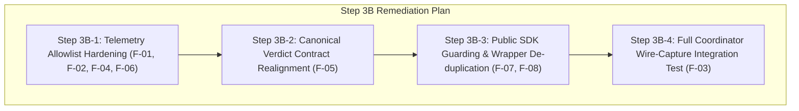

# MediShield LangSmith Tracing — Step 3A: Comprehensive Security, Privacy & Integration Audit Report

**Audit Date**: October 15, 2026  
**Auditor**: Antigravity Autonomous Security & Observability Pair Engineer  
**Scope**: Complete repository audit of LangSmith distributed tracing implementation (Steps 1, 2A–2D, 2E-1 through 2E-4)  
**Authority**: MediShield Engineering Rules (AGENTS.md), Canonical Specs (Spec 01–Spec 11), ADR-001 through ADR-014  

---

## 1. Executive Summary & Verdict

### Verdict: CONDITIONAL PASS

The MediShield LangSmith tracing implementation establishes strong foundational privacy protections:
- **Zero Default Overhead**: Tracing is strictly disabled by default (`settings.LANGSMITH_TRACING = False`). When disabled, no background threads are created, no network connections are opened, and no credentials are required.
- **Fail-Safe Decoupling**: Telemetry transport failures (network drops, 403 Forbidden, rate limits) are caught and logged as warnings; they never abort claim adjudication, alter decision outcomes, or suppress application exceptions.
- **PHI-Minimized Payloads**: Root spans, workflow nodes, specialist agents, OCR pipelines, policy retrieval, and database/storage operations transmit empty inputs (`inputs={}`) or strictly numeric operational counts (`document_count`, `service_line_count`), excluding all clinical narratives, CPT/ICD codes, dates of service, and dollar amounts.
- **Ephemeral Run Correlation**: Persistent case pseudonyms are disabled by default (`settings.LANGSMITH_INCLUDE_CASE_PSEUDONYM = False`), ensuring trace aggregation relies entirely on ephemeral root run UUIDs.

**Conditions Precedent to Enabling Tracing**:
Before enabling live tracing—even in internal test environments with synthetic data—the following High and Medium severity gaps must be remediated:
1. **Model Parameter Allowlist Enforcement**: Eliminate the open fallback regex on `model` in `validate_telemetry_field` that currently permits arbitrary alphanumeric string smuggling.
2. **Component & Operation Name Allowlist**: Transition `component_name` and `operation_name` from open syntax regex matching (`IDENTIFIER_REGEX`) to an explicit domain allowlist to prevent identifier smuggling.
3. **Canonical Verdict Alignment**: Align `VERDICT_ENUM` with canonical `AgentVerdict` (`INDETERMINATE`, `UNAVAILABLE`) and eliminate silent omission of non-matching verdicts.
4. **End-to-End Workflow Wire-Capture Integration Tests**: Complement the existing synthetic micro-benchmark with wire-capture assertions for complete coordinator executions and document processing pipelines.

> [!CAUTION]
> **Real Patient Protected Health Information (PHI) Prohibition**:
> Under HIPAA Privacy Rule 45 CFR § 164.514, transmitting real patient data to an external tracing vendor without an executed Business Associate Agreement (BAA) and formal Expert Determination / Safe Harbor verification is strictly prohibited. Live tracing with real patient data remains **PROHIBITED**.

---

## 2. Complete Inventory of Tracing Paths

The table below documents every instrumented boundary across the MediShield codebase, its run type, component, operation, input/output contract, and existing test coverage.

| Category | Span Name | Run Type | Component | Operation | Inputs | Outputs / Summary Fields | Source File & Line | Unit Test Coverage |
| :--- | :--- | :--- | :--- | :--- | :--- | :--- | :--- | :--- |
| **Root Trace** | `case_workflow_execute` | `chain` | `CaseWorkflowCoordinator` | `execute` | `{"document_count": int}` | `status`, `decision`, `duration_ms` | [`src/medishield/workflows/coordinator.py:100`](file:///Users/AniketB/Desktop/medishield/src/medishield/workflows/coordinator.py#L100) | [`tests/unit/test_coordinator_tracing.py`](file:///Users/AniketB/Desktop/medishield/tests/unit/test_coordinator_tracing.py) |
| **Workflow Node 1** | `ocr_preprocessor_node` | `chain` | `OCRPreprocessor` | `process` | `{"document_count": int}` | `status`, `is_complete`, `duration_ms` | [`src/medishield/workflows/nodes.py:58`](file:///Users/AniketB/Desktop/medishield/src/medishield/workflows/nodes.py#L58) | [`tests/unit/test_intake_node_tracing.py`](file:///Users/AniketB/Desktop/medishield/tests/unit/test_intake_node_tracing.py) |
| **Workflow Node 2** | `split_group_node` | `chain` | `SplitGrouper` | `split_and_group` | `{"document_count": int}` | `status`, `is_complete`, `duration_ms` | [`src/medishield/workflows/nodes.py:98`](file:///Users/AniketB/Desktop/medishield/src/medishield/workflows/nodes.py#L98) | [`tests/unit/test_intake_node_tracing.py`](file:///Users/AniketB/Desktop/medishield/tests/unit/test_intake_node_tracing.py) |
| **Workflow Node 3** | `classifier_node` | `chain` | `DocumentClassifier` | `classify` | `{"document_count": int}` | `status`, `classification_completed`, `duration_ms` | [`src/medishield/workflows/nodes.py:125`](file:///Users/AniketB/Desktop/medishield/src/medishield/workflows/nodes.py#L125) | [`tests/unit/test_intake_node_tracing.py`](file:///Users/AniketB/Desktop/medishield/tests/unit/test_intake_node_tracing.py) |
| **Workflow Node 4** | `case_completeness_node` | `chain` | `CaseCompleteness` | `verify` | `{"document_count": int}` | `status`, `is_complete`, `duration_ms` | [`src/medishield/workflows/nodes.py:182`](file:///Users/AniketB/Desktop/medishield/src/medishield/workflows/nodes.py#L182) | [`tests/unit/test_intake_node_tracing.py`](file:///Users/AniketB/Desktop/medishield/tests/unit/test_intake_node_tracing.py) |
| **Workflow Node 5A**| `kyc_agent_node` | `chain` | `KYCAgent` | `verify_member` | `{"document_count": int}` | `status`, `confidence`, `verdict`, `duration_ms` | [`src/medishield/workflows/nodes.py:244`](file:///Users/AniketB/Desktop/medishield/src/medishield/workflows/nodes.py#L244) | [`tests/unit/test_specialist_node_tracing.py`](file:///Users/AniketB/Desktop/medishield/tests/unit/test_specialist_node_tracing.py) |
| **Workflow Node 5B**| `claims_extraction_node` | `chain` | `ClaimsAgent` | `extract_and_validate` | `{"document_count": int}` | `status`, `service_line_count`, `confidence`, `verdict`, `arithmetic_valid`, `duration_ms` | [`src/medishield/workflows/nodes.py:324`](file:///Users/AniketB/Desktop/medishield/src/medishield/workflows/nodes.py#L324) | [`tests/unit/test_specialist_node_tracing.py`](file:///Users/AniketB/Desktop/medishield/tests/unit/test_specialist_node_tracing.py) |
| **Workflow Node 5C**| `policy_context_node` | `chain` | `PolicyContextAgent` | `discover_context` | `{"document_count": int}` | `status`, `verdict`, `duration_ms` | [`src/medishield/workflows/nodes.py:454`](file:///Users/AniketB/Desktop/medishield/src/medishield/workflows/nodes.py#L454) | [`tests/unit/test_specialist_node_tracing.py`](file:///Users/AniketB/Desktop/medishield/tests/unit/test_specialist_node_tracing.py) |
| **Workflow Node 6** | `policy_coverage_rag_node` | `chain` | `PolicyCoverageAgent` | `evaluate_coverage` | `{"document_count": int}` | `status`, `retrieved_chunk_count`, `provenance_integrity_score`, `verdict`, `duration_ms` | [`src/medishield/workflows/nodes.py:565`](file:///Users/AniketB/Desktop/medishield/src/medishield/workflows/nodes.py#L565) | [`tests/unit/test_evaluation_decision_node_tracing.py`](file:///Users/AniketB/Desktop/medishield/tests/unit/test_evaluation_decision_node_tracing.py) |
| **Workflow Node 7** | `fraud_agent_node` | `chain` | `DeterministicFraudEngine` | `evaluate_risk` | `{"document_count": int}` | `status`, `confidence`, `verdict`, `duration_ms` | [`src/medishield/workflows/nodes.py:672`](file:///Users/AniketB/Desktop/medishield/src/medishield/workflows/nodes.py#L672) | [`tests/unit/test_evaluation_decision_node_tracing.py`](file:///Users/AniketB/Desktop/medishield/tests/unit/test_evaluation_decision_node_tracing.py) |
| **Workflow Node 8** | `faithfulness_gate_node` | `chain` | `FaithfulnessGate` | `validate_grounding` | `{"document_count": int}` | `status`, `confidence`, `verdict`, `duration_ms` | [`src/medishield/workflows/nodes.py:785`](file:///Users/AniketB/Desktop/medishield/src/medishield/workflows/nodes.py#L785) | [`tests/unit/test_evaluation_decision_node_tracing.py`](file:///Users/AniketB/Desktop/medishield/tests/unit/test_evaluation_decision_node_tracing.py) |
| **Workflow Node 9** | `decision_engine_node` | `chain` | `DeterministicDecisionEngine` | `adjudicate` | `{"document_count": int}` | `status`, `decision`, `confidence`, `duration_ms` | [`src/medishield/workflows/nodes.py:825`](file:///Users/AniketB/Desktop/medishield/src/medishield/workflows/nodes.py#L825) | [`tests/unit/test_evaluation_decision_node_tracing.py`](file:///Users/AniketB/Desktop/medishield/tests/unit/test_evaluation_decision_node_tracing.py) |
| **LLM Gateway** | `groq_llm_generate` | `llm` | `groq_llm_client` | `generate_json` / `agenerate_json` | `{}` | `status`, `provider`, `prompt_tokens`, `completion_tokens`, `total_tokens`, `duration_ms` | [`src/medishield/core/llm.py:113, 161`](file:///Users/AniketB/Desktop/medishield/src/medishield/core/llm.py#L113) | [`tests/unit/test_llm_vlm_tracing.py`](file:///Users/AniketB/Desktop/medishield/tests/unit/test_llm_vlm_tracing.py) |
| **VLM Gateway (Gemini)** | `gemini_vision_generate` | `llm` | `gemini_vision_client` | `extract_form` / `call_model` | `{}` | `status`, `provider`, `prompt_tokens`, `completion_tokens`, `total_tokens`, `retry_count`, `duration_ms` | [`src/medishield/ocr/ocr_reconcile.py:701, 802`](file:///Users/AniketB/Desktop/medishield/src/medishield/ocr/ocr_reconcile.py#L701) | [`tests/unit/test_llm_vlm_tracing.py`](file:///Users/AniketB/Desktop/medishield/tests/unit/test_llm_vlm_tracing.py) |
| **VLM Gateway (HF)** | `huggingface_vision_generate` | `llm` | `huggingface_vision_client` | `extract_form` / `call_model` | `{}` | `status`, `provider`, `prompt_tokens`, `completion_tokens`, `total_tokens`, `duration_ms` | [`src/medishield/ocr/ocr_reconcile.py:924, 1013`](file:///Users/AniketB/Desktop/medishield/src/medishield/ocr/ocr_reconcile.py#L924) | [`tests/unit/test_llm_vlm_tracing.py`](file:///Users/AniketB/Desktop/medishield/tests/unit/test_llm_vlm_tracing.py) |
| **VLM Gateway (Groq)** | `groq_vision_generate` | `llm` | `groq_vision_client` | `extract_form` / `call_model` | `{}` | `status`, `provider`, `prompt_tokens`, `completion_tokens`, `total_tokens`, `duration_ms` | [`src/medishield/ocr/ocr_reconcile.py:1119, 1238`](file:///Users/AniketB/Desktop/medishield/src/medishield/ocr/ocr_reconcile.py#L1119) | [`tests/unit/test_llm_vlm_tracing.py`](file:///Users/AniketB/Desktop/medishield/tests/unit/test_llm_vlm_tracing.py) |
| **OCR Pipeline** | `ocr_process_document` | `tool` | `ocr_preprocessor` | `process_document` | `{}` | `status`, `is_complete`, `ocr_span_count`, `retry_count`, `duration_ms` | [`src/medishield/ocr/preprocessor.py:383`](file:///Users/AniketB/Desktop/medishield/src/medishield/ocr/preprocessor.py#L383) | [`tests/unit/test_ocr_pipeline_tracing.py`](file:///Users/AniketB/Desktop/medishield/tests/unit/test_ocr_pipeline_tracing.py) |
| **OCR Table Extraction**| `ocr_extract_service_lines` | `tool` | `ocr_reconciliation` | `extract_service_lines` | `{}` | `status`, `is_complete`, `service_line_count`, `duration_ms` | [`src/medishield/ocr/ocr_reconcile.py:293`](file:///Users/AniketB/Desktop/medishield/src/medishield/ocr/ocr_reconcile.py#L293) | [`tests/unit/test_ocr_pipeline_tracing.py`](file:///Users/AniketB/Desktop/medishield/tests/unit/test_ocr_pipeline_tracing.py) |
| **Policy Corpus RAG**| `policy_corpus_query` | `retriever` | `policy_corpus_repository` | `query_chunks` | `{}` | `status`, `retrieved_chunk_count`, `is_complete`, `duration_ms` | [`src/medishield/agents/policy.py:318`](file:///Users/AniketB/Desktop/medishield/src/medishield/agents/policy.py#L318) | [`tests/unit/test_policy_retrieval_tracing.py`](file:///Users/AniketB/Desktop/medishield/tests/unit/test_policy_retrieval_tracing.py) |
| **Storage Backend** | `storage_put_bytes` | `tool` | `storage_backend` | `put_bytes` | `{}` | `status`, `is_complete`, `duration_ms` | [`src/medishield/intake/storage.py:86, 187`](file:///Users/AniketB/Desktop/medishield/src/medishield/intake/storage.py#L86) | [`tests/unit/test_db_and_storage_tracing.py`](file:///Users/AniketB/Desktop/medishield/tests/unit/test_db_and_storage_tracing.py) |
| **Storage Backend** | `storage_get_bytes` | `tool` | `storage_backend` | `get_bytes` | `{}` | `status`, `is_complete`, `duration_ms` | [`src/medishield/intake/storage.py:99, 201`](file:///Users/AniketB/Desktop/medishield/src/medishield/intake/storage.py#L99) | [`tests/unit/test_db_and_storage_tracing.py`](file:///Users/AniketB/Desktop/medishield/tests/unit/test_db_and_storage_tracing.py) |
| **Member Repository**| `db_member_lookup` | `retriever` | `member_repository` | `find_member` | `{}` | `status`, `member_matched`, `is_complete`, `duration_ms` | [`src/medishield/agents/kyc.py:126, 166`](file:///Users/AniketB/Desktop/medishield/src/medishield/agents/kyc.py#L126) | [`tests/unit/test_db_and_storage_tracing.py`](file:///Users/AniketB/Desktop/medishield/tests/unit/test_db_and_storage_tracing.py) |
| **Enrollment Repository**| `db_policy_enrollment_lookup`| `retriever` | `policy_enrollment_repository` | `find_enrollments` | `{}` | `status`, `retrieved_chunk_count`, `is_complete`, `duration_ms` | [`src/medishield/agents/policy.py:487, 541`](file:///Users/AniketB/Desktop/medishield/src/medishield/agents/policy.py#L487) | [`tests/unit/test_db_and_storage_tracing.py`](file:///Users/AniketB/Desktop/medishield/tests/unit/test_db_and_storage_tracing.py) |
| **Case Persistence** | `db_case_state_persistence` | `tool` | `case_repository` | `persist_case_state` | `{}` | `status`, `is_complete`, `duration_ms` | [`src/medishield/worker/tasks.py:248, 435`](file:///Users/AniketB/Desktop/medishield/src/medishield/worker/tasks.py#L248) | [`tests/unit/test_db_and_storage_tracing.py`](file:///Users/AniketB/Desktop/medishield/tests/unit/test_db_and_storage_tracing.py) |
| **Audit Retrieval** | `db_audit_trail_retrieval` | `retriever` | `audit_repository` | `get_audit_trail` | `{}` | `status`, `retrieved_chunk_count`, `is_complete`, `duration_ms` | [`src/medishield/api/routers/audit.py:49`](file:///Users/AniketB/Desktop/medishield/src/medishield/api/routers/audit.py#L49) | [`tests/unit/test_db_and_storage_tracing.py`](file:///Users/AniketB/Desktop/medishield/tests/unit/test_db_and_storage_tracing.py) |

---

## 3. Detailed Audit Findings

```
Severity Breakdown:
  [CRITICAL]  0
  [HIGH]      3
  [MEDIUM]    4
  [LOW]       2
```

### Finding F-01: Model Validation Fallback Allows Arbitrary Alphanumeric Token Smuggling
- **Severity**: **HIGH**
- **Location**: [`src/medishield/core/tracing.py#L230-L238`](file:///Users/AniketB/Desktop/medishield/src/medishield/core/tracing.py#L230-L238)
- **Code Path**:
  ```python
  if val_clean in ALLOWED_MODELS or (
      MODEL_REGEX.match(val_clean)
      and not any(
          p.search(val_clean)
          for p in (SSN_REGEX, DATE_REGEX, CURRENCY_REGEX, MEMBER_ID_REGEX)
      )
  ):
      return True, val_clean
  ```
- **Vulnerability Analysis**:
  While `ALLOWED_MODELS` defines a strict allowlist of 5 models (`openai/gpt-oss-120b`, `openai/gpt-oss-20b`, `gemini-3.8-flash`, `gemini-3.5-flash`, `mistralai/Pixtral-12B-2409`), the `or` fallback accepts any string satisfying `^[a-zA-Z0-9_\-\./]{1,64}$` that does not trigger the SSN, date, currency, or `MED-` member ID regexes.
  Consequently, concatenated patient names (`AliceMontgomery`), diagnosis tokens (`CarcinomaStageIV`), procedure codes (`CPT99213`), or hospital IDs pass validation and are transmitted to the external tracing service.
- **Potential Exposure**:
  Data exfiltration of patient and clinical identifiers through schema-compliant telemetry fields.
- **Recommended Remediation**:
  Eliminate the second branch entirely. Restrict `model` validation exclusively to membership in `ALLOWED_MODELS`. If dynamic or unknown models are encountered, normalize them to `"unlisted-model"`:
  ```python
  if k_lower == "model":
      if isinstance(value, str):
          val_clean = value.strip()
          if val_clean in ALLOWED_MODELS:
              return True, val_clean
          return True, "unlisted-model"
      return False, None
  ```
- **Proposed Regression Test**:
  Pass adversarial string `"PatientAliceMontgomery"` to `validate_telemetry_field("model", "PatientAliceMontgomery")` and assert it returns `(True, "unlisted-model")` or `(False, None)`.

---

### Finding F-02: Component and Operation Names Rely on Permissive Syntactic Regex Rather than an Allowlist
- **Severity**: **HIGH**
- **Location**: [`src/medishield/core/tracing.py#L245-L248`](file:///Users/AniketB/Desktop/medishield/src/medishield/core/tracing.py#L245-L248)
- **Code Path**:
  ```python
  if k_lower in ("component_name", "operation_name"):
      if isinstance(value, str) and IDENTIFIER_REGEX.match(value.strip()):
          return True, value.strip()
      return False, None
  ```
- **Vulnerability Analysis**:
  `IDENTIFIER_REGEX` allows any alphanumeric string up to 64 characters with underscores, hyphens, and periods (`^[a-zA-Z0-9_\-\.]{1,64}$`).
  Member IDs (`PT_15075`, `MEM-12345`), policy IDs (`POL-CORP-2026`), CPT codes (`99213`), dates (`1985-05-20`), and single-word patient surnames all match this pattern. Although all existing production call sites pass static string literals, any developer error or dynamic helper invocation could smuggle sensitive data into span metadata without failing validation.
- **Potential Exposure**:
  Accidental smuggling of entity IDs or clinical codes via operational metadata.
- **Recommended Remediation**:
  Define explicit allowlists for all known MediShield components and operations:
  ```python
  ALLOWED_COMPONENT_NAMES = {
      "CaseWorkflowCoordinator", "OCRPreprocessor", "SplitGrouper",
      "DocumentClassifier", "CaseCompleteness", "KYCAgent", "ClaimsAgent",
      "PolicyContextAgent", "PolicyCoverageAgent", "DeterministicFraudEngine",
      "FaithfulnessGate", "DeterministicDecisionEngine", "groq_llm_client",
      "gemini_vision_client", "huggingface_vision_client", "groq_vision_client",
      "ocr_preprocessor", "ocr_reconciliation", "policy_corpus_repository",
      "storage_backend", "member_repository", "policy_enrollment_repository",
      "case_repository", "audit_repository",
  }
  ```
- **Proposed Regression Test**:
  Assert `validate_telemetry_field("component_name", "MEM-12345")[0] is False`.

---

### Finding F-03: End-to-End Network Serialization Verification is Missing for Real Workflow Paths
- **Severity**: **HIGH**
- **Location**: [`tests/unit/test_langsmith_tracing.py#L177-L286`](file:///Users/AniketB/Desktop/medishield/tests/unit/test_langsmith_tracing.py#L177-L286)
- **Vulnerability Analysis**:
  The only test capturing raw HTTP wire payloads (`requests.Session.send`) is a synthetic micro-benchmark in `test_langsmith_tracing.py`.
  All workflow node tests (`test_intake_node_tracing.py`, `test_coordinator_tracing.py`, `test_specialist_node_tracing.py`, `test_evaluation_decision_node_tracing.py`, `test_ocr_pipeline_tracing.py`, `test_policy_retrieval_tracing.py`, `test_db_and_storage_tracing.py`) mock `langsmith.trace` using `unittest.mock.MagicMock()`.
  While this verifies local argument sanitization, it completely bypasses:
  1. LangSmith's background serialization thread (`langsmith._internal._background_thread`).
  2. Multipart ingest packaging (`client._multipart_ingest_ops`).
  3. Client-level anonymizer hook executions (`hide_inputs`, `hide_outputs`, `hide_metadata`).
  4. Real child span tree building across deep execution graphs.
- **Potential Exposure**:
  Subtle bugs in client serialization hooks or background batching could leak unscrubbed attributes over the wire without detection in node unit tests.
- **Recommended Remediation**:
  Create an integration test harness in Step 3B that runs an end-to-end coordinator workflow with synthetic data using the real `Client` and captures all multipart network requests sent to `requests.Session.send`.

---

### Finding F-04: Rule Identifier Allows Arbitrary Strings with `RULE-` Prefix
- **Severity**: **MEDIUM**
- **Location**: [`src/medishield/core/tracing.py#L129, L241-L243`](file:///Users/AniketB/Desktop/medishield/src/medishield/core/tracing.py#L129)
- **Code Path**:
  ```python
  RULE_ID_REGEX = re.compile(r"^RULE-[A-Z0-9_-]{1,32}$")
  if k_lower == "rule_id_matched":
      if isinstance(value, str) and RULE_ID_REGEX.match(value.strip()):
          return True, value.strip()
      return False, None
  ```
- **Vulnerability Analysis**:
  Any uppercase string up to 32 characters prefixed with `RULE-` is validated as safe. An adversarial string such as `RULE-ALICE-SMITH` or `RULE-99213-CANCER` passes validation. In Step 2D, `rule_id_matched` was safely omitted from node summaries to honor this deferral.
- **Recommended Remediation**:
  Validate `rule_id_matched` against the registered rule set from `DeterministicDecisionEngine` (e.g. `RULE_APPROVE_CLEAN_AUTO`, `RULE_FRAUD_ESCALATE_CRITICAL`, `RULE_COVERAGE_EXCLUSION`, etc.) rather than an open regex.

---

### Finding F-05: Telemetry Schema Discrepancy with Canonical `AgentVerdict` Causes Telemetry Omission
- **Severity**: **MEDIUM**
- **Location**: [`src/medishield/core/tracing.py#L107`](file:///Users/AniketB/Desktop/medishield/src/medishield/core/tracing.py#L107), [`src/medishield/workflows/nodes.py#L283, L442, L485, L598, L659, L761`](file:///Users/AniketB/Desktop/medishield/src/medishield/workflows/nodes.py#L283)
- **Vulnerability Analysis**:
  - Canonical `AgentVerdict` enum (`src/medishield/db/enums.py`):
    `PASS`, `FAIL`, `INDETERMINATE`, `CONFLICT`, `UNAVAILABLE`.
  - Tracing `VERDICT_ENUM` (`src/medishield/core/tracing.py`):
    `PASS`, `FAIL`, `CONFLICT`, `REVIEW`.
  - In `nodes.py`, every specialist node filters verdicts:
    `if raw_verdict.upper() in ("PASS", "FAIL", "CONFLICT", "REVIEW"): span.set_summary(verdict=raw_verdict.upper())`.
  - When an agent legitimately outputs `INDETERMINATE` (e.g. missing enrollment or non-matching records) or `UNAVAILABLE` (e.g. unreadable OCR), the verdict is silently omitted from telemetry.
  - Furthermore, `"REVIEW"` is included in `VERDICT_ENUM` despite not existing in canonical `AgentVerdict`.
- **Potential Impact**:
  Observability blind spot: telemetry queries in LangSmith cannot distinguish an unclassified node from an `INDETERMINATE` or `UNAVAILABLE` evaluation.
- **Recommended Remediation**:
  Update `VERDICT_ENUM` in `tracing.py` to match `AgentVerdict` exactly:
  ```python
  VERDICT_ENUM = {"PASS", "FAIL", "INDETERMINATE", "CONFLICT", "UNAVAILABLE"}
  ```

---

### Finding F-06: `SECRET_KEY_REGEX` Does Not Match LangSmith API Key Formats
- **Severity**: **MEDIUM**
- **Location**: [`src/medishield/core/tracing.py#L47-L49`](file:///Users/AniketB/Desktop/medishield/src/medishield/core/tracing.py#L47-L49)
- **Code Path**:
  ```python
  SECRET_KEY_REGEX = re.compile(
      r"\b(?:gsk_|sk-|Bearer\s+|AIza)[A-Za-z0-9_\-]{16,}\b", re.IGNORECASE
  )
  ```
- **Vulnerability Analysis**:
  The regex matches OpenAI keys (`sk-`), Groq keys (`gsk_`), Bearer tokens, and Google API keys (`AIza`). LangSmith personal and service keys use prefixes `lsv2_pt_`, `lsv2_sk_`, or `ls__`. If a LangSmith API key appears in unscrubbed free text or an exception, it will not be masked.
- **Recommended Remediation**:
  Add `lsv2_pt_`, `lsv2_sk_`, and `ls__` to `SECRET_KEY_REGEX`:
  ```python
  SECRET_KEY_REGEX = re.compile(
      r"\b(?:gsk_|sk-|lsv2_pt_|lsv2_sk_|ls__|Bearer\s+|AIza)[A-Za-z0-9_\-]{16,}\b", re.IGNORECASE
  )
  ```

---

### Finding F-07: Reliance on Private LangSmith SDK Context Variables
- **Severity**: **MEDIUM**
- **Location**: [`src/medishield/core/tracing.py#L529-L532, L566-L569`](file:///Users/AniketB/Desktop/medishield/src/medishield/core/tracing.py#L529-L532)
- **Code Path**:
  ```python
  rt._CLIENT = client
  rh._context._CLIENT.set(client)
  rh._context._GLOBAL_CLIENT = client
  rh._context._GLOBAL_TRACING_ENABLED = True
  ```
- **Vulnerability Analysis**:
  Accessing `_CLIENT`, `_GLOBAL_CLIENT`, and `_GLOBAL_TRACING_ENABLED` relies on internal, private implementation details of the `langsmith` package (`0.14.8`). Future minor releases (`0.15.0+`) may deprecate or rename these attributes without notice, leading to initialization crashes.
- **Recommended Remediation**:
  Wrap global client injection in defensive `try...except (AttributeError, KeyError)` blocks, and use public tracing contexts where supported.

---

### Finding F-08: Vision Client Wrappers Cause Duplicate Child Spans with Identical Names
- **Severity**: **LOW**
- **Location**: [`src/medishield/ocr/ocr_reconcile.py#L701, L802, L924, L1013, L1119, L1238`](file:///Users/AniketB/Desktop/medishield/src/medishield/ocr/ocr_reconcile.py#L701)
- **Vulnerability Analysis**:
  In `GeminiVisionClient`, both `extract_form` and `_call_gemini_api` are wrapped with `trace_span(name="gemini_vision_generate", ...)`. When `extract_form` calls `_call_gemini_api`, two nested spans with the exact same name are emitted. The same duplication exists in `HuggingFaceVisionClient` and `GroqVisionClient`.
- **Recommended Remediation**:
  Differentiate operation names (e.g. `gemini_vision_extract_form` for the form parsing tool vs `gemini_vision_call_model` for the LLM boundary).

---

### Finding F-09: Unscrubbed Patient Name Logging in Celery and Coordinator Operational Logs
- **Severity**: **LOW**
- **Location**: [`src/medishield/workflows/coordinator.py#L147-L156`](file:///Users/AniketB/Desktop/medishield/src/medishield/workflows/coordinator.py#L147)
- **Vulnerability Analysis**:
  While LangSmith tracing payloads are strictly sanitized, adjacent application loggers record patient names:
  `logger.info("[%s] Phase 2 [KYC Specialist]: ... Name=%s %s ...", case_id, _val(kyc_s.get("first_name")), _val(kyc_s.get("last_name")))`.
  In production, stdout/stderr application logs may be indexed by central logging systems (e.g. Datadog, CloudWatch).
- **Recommended Remediation**:
  Mask patient names in operational logs or scrub via `scrub_dict_phi`.

---

## 4. Formal Disposition of the Five Deferred Items

| Deferred Item | Original Scope | Current Working Tree Status | Audit Disposition |
| :--- | :--- | :--- | :--- |
| **Item 1: Adversarial Telemetry Validation** | Prevent smuggling of freeform clinical text, patient names, dates, amounts through schema-compliant fields (`model`, `rule_id_matched`, `component_name`, `operation_name`). | Open. Fields like `model`, `component_name`, and `operation_name` currently use syntactic regexes rather than explicit allowlists (Findings F-01, F-02, F-04). | **PARTIALLY ADDRESSED / OPEN**. Must enforce strict allowlists for `model`, `component_name`, and `operation_name` in Step 3B before closing. |
| **Item 2: Canonical Verdict Contract Alignment** | Align telemetry verdict enums with canonical agent contracts (`PASS`, `FAIL`, `INDETERMINATE`, `CONFLICT`, `UNAVAILABLE`) without semantic loss. | Open. `VERDICT_ENUM` contains `"REVIEW"` but lacks `"INDETERMINATE"` and `"UNAVAILABLE"`, causing silent omission of non-matching verdicts (Finding F-05). | **OPEN**. Must update `VERDICT_ENUM` to match `AgentVerdict` and remove `"REVIEW"` in Step 3B. |
| **Item 3: Public LangSmith SDK API Verification** | Audit reliance on private SDK attributes (`rt._CLIENT`, `rh._context._CLIENT`) and confirm stability against minor SDK upgrades. | Open. Direct span creation uses public `trace(..., client=client)`, but global monkey-patching relies on private attributes (Finding F-07). | **OPEN**. Guard private attribute access with defensive fallbacks in Step 3B. |
| **Item 4: End-to-End Serialized Wire-Payload Audits** | Mathematically prove zero unscrubbed clinical tokens across multipart serialized wire payloads for all enabled workflow paths. | Open. Wire capture is proven on synthetic micro-benchmarks, but full coordinator workflow paths rely on mocked `langsmith.trace` (Finding F-03). | **OPEN**. Implement full coordinator wire-capture integration test in Step 3B. |
| **Item 5: Cross-Run Case Correlation Review** | Evaluate whether persistent pseudonymization is required or if ephemeral root run UUIDs suffice. | Open. `LANGSMITH_INCLUDE_CASE_PSEUDONYM` is strictly `False` by default. Ephemeral root run UUIDs fully satisfy within-case correlation. | **SATISFIED FOR AUDIT / CLOSURE RECOMMENDED**. Ephemeral correlation is sufficient; persistent pseudonyms should remain permanently disabled. |

---

## 5. Available Verification Evidence vs Missing Evidence

### Available Verified Evidence
- [x] Full unit test suite passes: **443 passed, 1 warning in 27.76s** (`pytest tests/unit/`).
- [x] Dedicated tracing test suites pass: **103 passed out of 103** across all 8 tracing test files.
- [x] Database and storage tracing tests pass: **10 passed out of 10** (`tests/unit/test_db_and_storage_tracing.py`).
- [x] Code quality checks pass: **`ruff check src/ tests/` (All checks passed)**.
- [x] Tracing disabled verification: Zero spans emitted, zero client instantiation, zero network calls when `LANGSMITH_TRACING=False`.
- [x] Transport fault-tolerance: Simulated `ConnectionError` on telemetry does not abort claim adjudication.
- [x] Sensitive canary isolation: Canary patient names, member IDs, policy IDs, storage keys, document bytes, and SQL strings verified absent from telemetry summaries.

### Missing Evidence (To Be Completed in Step 3B)
- [ ] Serialized multipart wire-payload capture for a complete 11-node coordinator workflow execution (`requests.Session.send` capture).
- [ ] Adversarial test verifying rejection of alphanumeric patient names in `validate_telemetry_field("model", ...)`.
- [ ] Adversarial test verifying rejection of member IDs in `validate_telemetry_field("component_name", ...)`.
- [ ] Wire-capture verification of OCR document processing and vector corpus queries.

---

## 6. Prioritized Remediation Plan (Step 3B)

To transition from **CONDITIONAL PASS** to **FINAL PASS**, the following implementation steps are recommended for Step 3B:



### Step 3B-1: Telemetry Allowlist Hardening
1. In `src/medishield/core/tracing.py`:
   - Enforce strict allowlist on `model`: only accept entries in `ALLOWED_MODELS`, normalizing unlisted models to `"unlisted-model"`.
   - Add `ALLOWED_COMPONENT_NAMES` and `ALLOWED_OPERATION_NAMES` allowlists; reject arbitrary identifiers.
   - Add `lsv2_pt_`, `lsv2_sk_`, and `ls__` to `SECRET_KEY_REGEX`.
   - Validate `rule_id_matched` against registered decision engine rules.

### Step 3B-2: Canonical Verdict Realignment
1. In `src/medishield/core/tracing.py`:
   - Update `VERDICT_ENUM = {"PASS", "FAIL", "INDETERMINATE", "CONFLICT", "UNAVAILABLE"}`.
2. In `src/medishield/workflows/nodes.py`:
   - Update span recording in all specialist nodes to record `INDETERMINATE` and `UNAVAILABLE`.

### Step 3B-3: Public SDK Guarding & Wrapper De-duplication
1. In `src/medishield/core/tracing.py`:
   - Wrap internal SDK attribute setting (`rt._CLIENT`, `rh._context._CLIENT`) in defensive `try...except` blocks.
2. In `src/medishield/ocr/ocr_reconcile.py`:
   - Differentiate span names between form extraction (`gemini_vision_extract_form`) and raw API call (`gemini_vision_generate`).

### Step 3B-4: Full Coordinator Wire-Capture Integration Test
1. Create `tests/integration/test_langsmith_wire_audit.py`:
   - Execute complete coordinator workflow with mock storage, OCR, KYC, claims, policy RAG, and fraud engine.
   - Intercept `requests.Session.send` and capture all multipart HTTP request bodies.
   - Assert zero canary tokens across the combined wire byte stream.

---

## 7. Production & Patient Data Recommendations

1. **Synthetic Data Live Tracing**:
   - **PROVISIONAL APPROVAL**: Live tracing against LangSmith cloud with synthetic test datasets is approved **ONLY AFTER** completing Step 3B-1 (Allowlist Hardening) and Step 3B-4 (Wire Audit).
2. **Real Patient PHI Tracing**:
   - **STRICTLY PROHIBITED**: Real patient data must never be processed with tracing enabled.
   - Prior to any real patient data testing, the organization must:
     1. Execute a formal Business Associate Agreement (BAA) with LangChain / LangSmith.
     2. Obtain formal sign-off from compliance, legal, and privacy officers.
     3. Complete an independent Expert Determination or Safe Harbor de-identification audit under 45 CFR § 164.514.

---

*Report generated and archived to [`docs/sdd/audits/langsmith_step3_security_audit.md`](file:///Users/AniketB/Desktop/medishield/docs/sdd/audits/langsmith_step3_security_audit.md).*  
*Per Step 3A instructions, no code or configuration changes have been applied during this audit.*

