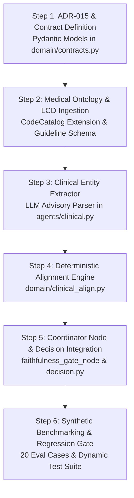

# MediShield — Clinical Alignment and Decision Contract Specification
## Phase 2 Design Document: Per-Claim-Line Clinical Alignment, Evidence Semantics, and Decision Engine Integration

**Document ID:** `DESIGN-CLIN-2026-10-16-REV7`  
**Revision:** Phase 2.7 — Final Contract Closure Review  
**Status:** PROPOSED DESIGN SPECIFICATION (DESIGN-ONLY — NO APPLICATION CODE MODIFIED)  
**Authors:** Senior AI Systems Architect, Clinical Informatics Reviewer & Claims Decision-Engine Specialist  
**Target Specification File:** `docs/sdd/design/clinical_alignment_decision_contract.md`  
**Preceding Audit & Baseline References:**
- [`docs/sdd/audits/clinical_alignment_gap_audit.md`](../audits/clinical_alignment_gap_audit.md)
- [`docs/sdd/audits/mediShield_master_gap_summary.md`](../audits/mediShield_master_gap_summary.md)
- Canonical Specifications: `01_CANONICAL_ARCHITECTURE.md`, `02_DECISION_ENGINE_AND_STATE_MACHINE.md`, `05_AGENT_INTERFACE_CONTRACTS.md`, `06_FAITHFULNESS_PROVENANCE_AND_VERIFICATION.md`
- Architectural Decision Records: ADR-001 (Deterministic Decisions), ADR-002 (Rejection vs Escalation), ADR-005 (Fraud Engine), ADR-012 (Medical Terminology Catalog).

---

## Change Log: Phase 2.7 Revisions (Final Contract Closure)

The table below documents the final contract closure corrections applied in Phase 2.7:

| Correction Made | Section Changed | Risk Addressed | Acceptance Test Needed |
| :--- | :--- | :--- | :--- |
| **Mandatory Guideline Completeness, Authoritative Catalog Set Equality & Service Date Enforcement** | Section 3.1 & Section 5.2 | Guidelines could previously evaluate arbitrary criteria subsets without verifying set equality against authoritative catalog mandatory criterion IDs, or pass without a valid service date. | Direct validator tests asserting `service_date is None` or criteria ID set inequality against authoritative catalog raises `ValidationError`. |
| **Structured Prior Authorization Evidence Contracts** | Section 3.1 & Section 4 | Prior auth requirement was decoupled without typed evidence models for `NOT_REQUIRED` exemption, `VERIFIED_APPROVED` approval, and `VERIFIED_DENIED` denial records. | Model validation tests asserting missing or invalid prior auth evidence raises `ValidationError`; test asserting registry outage (`AUTH_SERVICE_UNAVAILABLE`) yields `UNAVAILABLE`. |
| **Bed-Day Chronological Invariants, Timestamp Integrity & Room-and-Board Direct Line Reconciliation** | Section 3.2, Section 3.3 & Section 5.1 | Bed-day model lacked strict chronological checks (`discharge >= admission`), `timestamps_complete` consistency checks, 4 deterministic convention formulas, and direct claim line unit reconciliation. | Validator tests asserting inverted dates raise `ValidationError`; test asserting room-and-board line units mismatching `BedDayReconciliation` units fails validation. |
| **Strict Spec 06 Canonical Confidence Formula & P6 Gating** | Section 3.3, Section 3.4 & Section 8 | Confidence computation previously lacked explicit failure semantics when calibration inputs are missing, and matrix contained conflicting P6 acceptance criteria. | Test asserting missing calibration inputs produces `confidence=None`, which strictly fails Rule P6 ($\ge 0.75$) and triggers Rule P7 (`ESCALATE(HUMAN_REVIEW)`). |
| **Direct Composite Invariants: Non-Empty Collections & Full Amount/Count Reconciliation** | Section 3.3 | Callers could instantiate empty line assessments or construct outputs with mismatched amount sums across verdict buckets. | Model instantiation tests asserting empty collections or amount sum discrepancies raise `ValidationError`. |
| **Strict Fraud vs. Clinical-Axis Separation & EVAL-CLIN-17/19 Correction** | Section 4, Section 7.5 & Section 8 (`EVAL-CLIN-17`, `19`) | EVAL-CLIN-19 previously mislabeled missing surgery documentation as clinical `FAIL` instead of `INDETERMINATE`, conflating clinical uncertainty with fraud score accumulation. | Matrix correction: missing surgery is `INDETERMINATE` on clinical axis; cumulative fraud score $0.80$ triggers Rule P4 on fraud axis; standalone F-01 ($0.30$) triggers Rule P7 with P4 override marked pending approval. |
| **Expanded 29-Case Synthetic Benchmark Matrix** | Section 8 | Matrix lacked explicit coverage for empty collections, prior auth exemption/outage, bed-day inversions, criteria set mismatches, and amount sum discrepancies. | Expanded synthetic test matrix to 29 exhaustive benchmark cases, clearly distinguishing contract-only validator tests from full pipeline integration tests. |

---

## Change Log: Phase 2.6 Revisions

The table below documents the final targeted contract corrections applied in Phase 2.6:

| Correction Made | Section Changed | Risk Addressed | Acceptance Test Needed |
| :--- | :--- | :--- | :--- |
| **Removed Silent Prior Auth Defaults & Enforced Explicit Determination** | Section 3.1 & Section 4 | In Phase 2.5, `prior_auth_requirement` defaulted to `NOT_REQUIRED` and `prior_auth_verification` defaulted to `NOT_APPLICABLE`, silently implying auth was not required. | Model instantiation asserting missing prior auth fields raises `ValidationError`; test asserting unknown requirement fails closed to `INDETERMINATE`. |
| **Enforced Bed-Day Admission/Discharge Evidence & Rule Applicability** | Section 3.2 & Section 5.1 | Bed-day reconciliation previously evaluated units without strictly verifying both admission and discharge date/timestamp evidence, and lacked facility/claim-type applicability checks. | Model validator asserting `PASS` raises `ValidationError` if admission or discharge date is missing, if facility/claim-type mismatches, or if units are ambiguous. |
| **Eliminated Obsolete `REQUIRES_PRIOR_AUTH` References** | Section 4 | Phase 2.5 retained obsolete `REQUIRES_PRIOR_AUTH` references in the Evidence Semantics table in the Necessity Status column. | Cleanly decoupled table with dedicated columns for `Necessity Status`, `Prior Auth Requirement`, and `Prior Auth Verification`. |
| **Implemented Canonical Spec 06 Composite Confidence Formula** | Section 3.4 & Section 8 | Factory contained a hardcoded fallback of $0.70$ when spans were missing, and lacked exact Spec 06 three-component weighting ($0.40/0.35/0.25$). | Factory test asserting missing calibration inputs produces `confidence=None`; engine test asserting `confidence=None` fails P6 ($\ge 0.75$) gate to P7 (`ESCALATE`). |
| **Separated Schema Invariant Barriers from Clinical FAIL Assessments** | Section 8 (`EVAL-CLIN-06`) | Evaluation matrix previously combined schema validation rejections with clinical assessments returning `FAIL`, creating ambiguity about exception vs verdict flow. | Delineated `EVAL-CLIN-06` as valid clinical assessment with mandatory criterion `NOT_SATISFIED` producing `FAIL`, and `EVAL-CLIN-11`/`15` as schema invariant barriers. |
| **Resolved Canonical Rule P7 Definitiveness for Duplicate Collisions** | Section 7.5 & Section 8 (`EVAL-CLIN-18`) | Tuple collision F-01 score ($0.30$) was ambiguously pending rather than mapped to its definitive canonical rule path. | Test asserting standalone duplicate collision ($0.30 \in [0.30, 0.70)$) triggers canonical Rule P7 (`ESCALATE(HUMAN_REVIEW)`), noting boolean P4 override is pending approval. |

---

## Change Log: Phase 2.5 Baseline Revisions (Historical)

The table below documents the baseline validator consistency corrections, semantic separations, and evaluation matrix expansions applied in Phase 2.5:

| Correction Made | Section Changed | Risk Addressed | Acceptance Test Needed |
| :--- | :--- | :--- | :--- |
| **Separated Prior Auth Requirement vs. Verification Outcome** | Section 3.1 & Section 4 | In Phase 2.4, representing prior authorization requirement inside `MedicalNecessityStatus` prevented medically necessary services from passing even when valid prior authorization was verified approved. | Test asserting line with `prior_auth_requirement=REQUIRED`, `prior_auth_verification=VERIFIED_APPROVED`, and `necessity_status=MET` cleanly receives `AgentVerdict.PASS`. |
| **Enforced Structured Mandatory Guideline Criteria** | Section 3.1 & Section 5.2 | Guidelines could assert `MET` without programmatically validating that each individual mandatory criterion was evaluated and satisfied with evidence provenance. | Schema validator asserting `MedicalNecessityStatus.MET` raises `ValidationError` if any mandatory criterion has outcome other than `SATISFIED` or lacks `supporting_spans`. |
| **Pydantic Model Direct Invariant Enforcement** | Section 3.3 | Callers instantiating or deserializing `ClinicalAlignmentOutput` directly could bypass factory checks and construct passing objects with mismatched line IDs or inconsistent counts. | Direct model instantiation tests asserting `ValidationError` is raised on duplicate expected IDs, duplicate assessed IDs, identifier mismatches, or count discrepancies. |
| **Fail-Closed Factory Pattern for Specialist Output** | Section 3.4 | Malformed extraction inputs previously either raised unhandled exceptions crashing workers or produced incoherent mutations. | Factory tests asserting duplicate or mismatched line IDs are structured into fail-closed `assessment_sufficient=False`, `verdict=INDETERMINATE`, with missing lines stubbed and discrepancies logged. |
| **Bed-Day Reconciliation Integrity Invariants** | Section 3.2 & Section 5.1 | Model previously permitted `reconciliation_verdict=PASS` with `is_reconciled=False` or under unapproved/expired billing rules. | Model validator asserting `PASS` requires `is_reconciled=True`, an approved non-expired billing rule, and zero date-only range ambiguity ($U_{\min} == U_{\max}$). |
| **Ordered vs. Performed vs. Resulted Disambiguation** | Section 3.1 & Section 4 | Equating a physician order with execution allowed billed surgical procedures without operative notes to pass. | Schema validator asserting `PerformanceEvidenceStatus.ORDERED_ONLY` cannot produce `PASS` on procedure or bed-day lines. |
| **Resolution of Missing Documentation Matrix Contradiction** | Section 4 | Matrix previously mapped missing documentation to `FAIL`, contradicting Rule 13 (never silently convert uncertainty into failure). | Realigned matrix: missing documentation maps to `INDETERMINATE`; `FAIL` is strictly reserved for affirmative record evidence of failed mandatory criteria or clinical contraindications. |
| **Derived Calibrated Confidence Definition** | Section 3.3 & Section 3.4 | Factory previously assigned arbitrary hardcoded confidence values ($1.0, 0.50, 0.85$) based solely on final verdict. | Removed arbitrary assignments; confidence must be derived via Spec 06 § 5 calibration formula or set to `None` (calibrated confidence unavailable) for malformed outputs. |
| **Canonical Fraud Score Concordance & Pending Governance** | Section 4 & Section 7.5 | Duplicate claims were previously assigned definitive P4 routing despite standalone F-01 score ($0.30$) falling below high-fraud threshold ($0.70$). | Documented canonical scoring math ($0.30$, Medium Risk); marked boolean duplicate override vs. score-based P7 routing as an open decision pending governance approval. |
| **Expanded 20-Case Synthetic Matrix** | Section 8 | Evaluation matrix lacked test coverage for verified prior authorization, direct model validator rejections, and factory malformed-input handling. | Expanded matrix to 20 exhaustive benchmark cases with exact line verdicts, composite verdicts, rule paths, and decisions. |
| **Dynamic Pytest Discovery** | Section 9 | Fixed historical test count references replaced with dynamic suite execution. | Acceptance criteria requires running all unit tests in `tests/unit/` discovered dynamically by pytest. |

---

## 1. Executive Summary & Architectural Scope

In Phase 1 ([`clinical_alignment_gap_audit.md`](../audits/clinical_alignment_gap_audit.md)), we established that MediShield currently performs **zero line-level clinical verification** between billed claim items (CPT/HCPCS codes, bed days, units) and clinical documentation (discharge summaries, physician orders, lab sheets, progress notes). Consequently, Rule P6 (`RULE-P6-CLEAN-PASS`) auto-approves claims whenever billed codes are a mathematical subset of broad policy terms and arithmetic reconciles, allowing unperformed, unindicated, or inflated procedures to pass straight to approval.

This Phase 2.5 design defines the target architectural contract for **Stage B Clinical Alignment Verification**:
1. **Per-Claim-Line Clinical Assessment:** Granular verification across six service modalities: (a) surgical & medical procedures, (b) laboratory & diagnostic tests, (c) diagnostic imaging (CT/MRI/Ultrasound), (d) pharmaceuticals & high-cost drugs, (e) room-and-board bed days vs. length of stay under approved, versioned billing rules, and (f) repeated services & documented clinical indications.
2. **Multi-Source Clinical Evidence Ingestion:** Evaluates evidence from **all** available documents in the packet (discharge summaries, operative notes, physician orders, prescriptions, pathology/lab reports, and outpatient encounter notes), not merely the discharge summary.
3. **Rigorous Evidence & Uncertainty Semantics:** Formal distinction between:
   - Evidence a service was *ordered*, *performed*, or *resulted*.
   - Evidence a service was *clinically indicated*.
   - Evidence of *medical necessity* under versioned payer Local Coverage Determinations (LCDs) / National Coverage Determinations (NCDs).
   - Evidence of *prior authorization requirement* vs. *authorization verification outcome*.
   - Evidence of *policy coverage*.
   - Evidence of *correct coding & billing*.
4. **Strict Separation of Concerns:**
   - **LLM/VLM Role:** Zero-adjudication structured entity extraction and candidate clinical relationship tagging from unstructured narrative text, backed by bounding-box token provenance.
   - **Deterministic Code Role:** Code validation, date windowing, length-of-stay arithmetic under approved billing conventions, multi-factor guideline evaluation, duplicate detection, and authoritative priority rule evaluation.
5. **Canonical Decision Engine Integration:** Preserves existing enums (`BusinessDecision`: `APPROVE`, `REJECT`, `ESCALATE`; `AgentVerdict`: `PASS`, `FAIL`, `INDETERMINATE`, `CONFLICT`, `UNAVAILABLE`) and priority rules P1–P8 without altering core state machine transitions.

---

## 2. Proposed Component Architecture

The Clinical Alignment Engine executes at **Phase 2B**, synchronizing parallel specialist extractions prior to Policy Coverage RAG and Faithfulness evaluation.

```mermaid
flowchart TD
    subgraph Intake["Phase 1: Multi-Document Intake"]
        Docs[Intake Packet:<br/>Claim Form, Discharge Summary,<br/>Operative Report, Lab Sheets, Rx] --> OCR[OCR Preprocessor Engine<br/>RapidOCR + Token Geometry]
        OCR --> Classify[Document Classifier Agent<br/>Classifies DocumentType per Page]
        Classify --> Completeness[Completeness Guard<br/>Verifies Mandatory Records]
    end

    subgraph Phase2A["Phase 2A: Specialist Fact Extraction"]
        Completeness --> KYC[KYC Specialist<br/>Identity & Member Registry]
        Completeness --> Claims[Claims Extraction Specialist<br/>Table Geometry, CPT, Line Items, Amounts]
        Completeness --> ClinExtract[Clinical Entity Extractor (LLM Advisory)<br/>Extracts Procedures, Diagnoses, Orders, Labs, Dates]
    end

    subgraph Phase2B["Phase 2B: Deterministic Clinical Alignment Engine"]
        Claims --> ClinAlign[Deterministic Clinical Alignment Engine]
        ClinExtract --> ClinAlign
        Catalog[(Authoritative Medical Ontology<br/>CPT/HCPCS, ICD-10-CM, Versioned LCD/NCD Rules)] --> ClinAlign
    end

    subgraph Phase34["Phases 3 & 4: Coverage & Fraud"]
        ClinAlign --> PolicyRAG[Policy Coverage RAG Specialist<br/>Terms, Exclusions, Deductibles]
        ClinAlign --> Fraud[Deterministic Fraud Engine<br/>Duplicates, Velocity, Anomaly]
    end

    subgraph Phase56["Phases 5 & 6: Gates & Adjudication"]
        PolicyRAG --> FaithGate[Faithfulness & Clinical Gate Node]
        Fraud --> FaithGate
        ClinAlign --> FaithGate
        FaithGate --> Decision[Deterministic Decision Engine<br/>Priority Rules P1 - P8]
    end

    Decision --> Audit[Tamper-Evident Audit Ledger & State Persistence]
```

### Component Boundaries & Responsibilities

1. **Clinical Entity Extractor (`ClinicalEntityExtractor`, LLM-assisted, Advisory Only):**
   - **Input:** Normalized text spans and page images from clinical documents (`DISCHARGE_SUMMARY`, `PRESCRIPTION`, `OPERATIVE_REPORT`, `LAB_REPORT`, `PROGRESS_NOTE`).
   - **Output:** Typed Pydantic data contract of extracted clinical events (`admission_datetime`, `discharge_datetime`, `discharge_disposition`, `documented_procedures`, `laboratory_orders_and_results`, `imaging_orders_and_findings`, `administered_medications`, `documented_indications`, `clinical_contraindications`).
   - **Constraint:** Strictly extracts evidence with source document, page number, and bounding-box token provenance. It does **not** evaluate whether a billed claim is approved, denied, or fraudulent.
2. **Deterministic Clinical Alignment Engine (`DeterministicClinicalAlignmentEngine`, Code Only):**
   - **Cross-Document Date Reconciliation:** Verifies each service line date falls within the documented encounter window.
   - **Bed-Day Billing Rule Engine:** Evaluates room-and-board units against documented admission/discharge timestamps under the governing facility billing convention.
   - **Multi-Factor Guideline Verification:** Verifies medical necessity against versioned, authoritative guidelines (CMS LCD/NCD or payer medical policy).
   - **Repeated Service Assessment:** Evaluates whether multiple units or repeated codes of the same modality have documented distinct anatomical sites, distinct sessions, or clinical rationale.
3. **Clinical Gate in Faithfulness Node (`faithfulness_gate_node`):**
   - Verifies line assessment completeness: confirms $100\%$ of billed claim lines have been assessed. If any line is unassessed, or if external clinical references were unavailable, the gate emits `AgentVerdict.INDETERMINATE` or `AgentVerdict.UNAVAILABLE`.
4. **Deterministic Decision Engine (`DeterministicDecisionEngine`):**
   - Adjudicates the case using existing canonical priority rules P1–P8.

---

## 3. Structured Data Contracts

The proposed contracts conform strictly to MediShield's existing domain patterns in `src/medishield/domain/contracts.py` and enforce fail-closed validation.

### 3.1 Line-Item Level Contracts

```python
from datetime import date, datetime
from enum import Enum
from typing import Any
from pydantic import BaseModel, Field, model_validator
from medishield.db.enums import AgentVerdict
from medishield.domain.provenance import FieldProvenance, ProvenanceValue


class ServiceModality(str, Enum):
    """Clinical modality of billed service line."""
    SURGICAL_PROCEDURE = "SURGICAL_PROCEDURE"
    MEDICAL_VISIT_OR_EVAL = "MEDICAL_VISIT_OR_EVAL"
    DIAGNOSTIC_IMAGING = "DIAGNOSTIC_IMAGING"
    LABORATORY_TEST = "LABORATORY_TEST"
    PHARMACEUTICAL = "PHARMACEUTICAL"
    ROOM_AND_BOARD = "ROOM_AND_BOARD"
    OTHER_SERVICE = "OTHER_SERVICE"


class PerformanceEvidenceStatus(str, Enum):
    """Direct clinical documentation that service was physically performed."""
    ORDERED_ONLY = "ORDERED_ONLY"                      # Documented as ordered or requisitioned, but execution unverified
    DIRECTLY_DOCUMENTED_PERFORMANCE = "DIRECTLY_DOCUMENTED_PERFORMANCE"  # Execution verified: operative report, nursing log, medication administration record
    RESULTED = "RESULTED"                              # Diagnostic test result, radiologist interpretation, or lab value documented
    NOT_DOCUMENTED = "NOT_DOCUMENTED"                  # Zero mention across available clinical documentation
    EXPLICITLY_CONTRADICTED = "EXPLICITLY_CONTRADICTED" # Document explicitly states procedure cancelled, refused, or not performed
    CONFIRMED_NON_PERFORMANCE = "CONFIRMED_NON_PERFORMANCE" # Record confirms different procedure performed or discharge prior to service time


class ClinicalIndicationStatus(str, Enum):
    """Documented clinical indication or diagnosis justifying service."""
    EXPLICITLY_INDICATED = "EXPLICITLY_INDICATED"      # Symptoms, diagnosis, or clinical rationale explicitly documented
    POTENTIALLY_RELATED = "POTENTIALLY_RELATED"        # Plausible broad diagnostic category, but specific indication not articulated
    NO_DOCUMENTED_INDICATION = "NO_DOCUMENTED_INDICATION" # Zero documented diagnosis, sign, or symptom supports this service
    CLINICALLY_CONTRAINDICATED = "CLINICALLY_CONTRAINDICATED" # Clinical findings explicitly contraindicated this service


class MedicalNecessityStatus(str, Enum):
    """Evaluation against authoritative guideline (CMS LCD/NCD or Payer Clinical Policy)."""
    MET = "MET"                                      # All mandatory clinical criteria in versioned guideline are satisfied
    NOT_MET = "NOT_MET"                              # Affirmative clinical evidence shows one or more mandatory criteria failed
    CRITERIA_INCOMPLETE = "CRITERIA_INCOMPLETE"      # Guideline found, but clinical evidence is insufficient to evaluate all criteria
    GUIDELINE_UNAVAILABLE = "GUIDELINE_UNAVAILABLE"  # No automated guideline exists in repository catalog for this code


class PriorAuthRequirementStatus(str, Enum):
    """Whether prior authorization is mandated by governing medical policy."""
    NOT_REQUIRED = "NOT_REQUIRED"                    # Policy/guideline explicitly establishes service does not require prior auth
    REQUIRED = "REQUIRED"                            # Policy/guideline mandates affirmative prior authorization before service
    REQUIREMENT_UNKNOWN = "REQUIREMENT_UNKNOWN"      # Guideline or policy unavailable; requirement status cannot be resolved


class PriorAuthVerificationStatus(str, Enum):
    """Verification outcome of prior authorization when required."""
    NOT_APPLICABLE = "NOT_APPLICABLE"                # Prior authorization was not required for this service
    VERIFIED_APPROVED = "VERIFIED_APPROVED"          # Affirmative authorization record found with matching dates, codes, and approval
    VERIFIED_DENIED = "VERIFIED_DENIED"              # Authorization record confirms request was formally denied
    MISSING_OR_UNVERIFIED = "MISSING_OR_UNVERIFIED"  # Prior auth required, but authorization number is missing or unverified
    AUTH_SERVICE_UNAVAILABLE = "AUTH_SERVICE_UNAVAILABLE"  # External authorization verification registry is unreachable


class RepeatServiceStatus(str, Enum):
    """Evaluation of repeated identical codes on the same date of service."""
    NOT_A_REPEATED_SERVICE = "NOT_A_REPEATED_SERVICE"  # Verified as single unique service on this service date
    REPEATED_AND_JUSTIFIED = "REPEATED_AND_JUSTIFIED"  # Repeated CPT detected; distinct anatomical site, distinct session, or modifier verified
    REPEATED_AND_UNJUSTIFIED = "REPEATED_AND_UNJUSTIFIED" # Repeated CPT detected; zero clinical rationale or modifier documented
    UNASSESSED = "UNASSESSED"                          # Repeat status has not been evaluated


class CriterionEvaluationOutcome(str, Enum):
    """Evaluation outcome for an individual mandatory clinical criterion."""
    SATISFIED = "SATISFIED"                          # Affirmative clinical documentation satisfies criterion
    NOT_SATISFIED = "NOT_SATISFIED"                  # Affirmative clinical documentation establishes criterion failed
    UNASSESSED_EVIDENCE_UNAVAILABLE = "UNASSESSED_EVIDENCE_UNAVAILABLE"  # Available records lack information to evaluate criterion
    NOT_APPLICABLE = "NOT_APPLICABLE"                # Criterion conditional on indications not present in this claim


class MandatoryGuidelineCriterion(BaseModel):
    """Granular clinical criterion within an authoritative coverage guideline."""
    criterion_id: str = Field(..., description="Unique criterion identifier (e.g., CRIT-01-CONSERVATIVE-THERAPY)")
    description: str = Field(..., description="Plain-text requirement (e.g., Failure of >=6 weeks conservative physical therapy)")
    is_mandatory: bool = Field(default=True, description="Whether criterion is strictly required for coverage")
    evaluation_outcome: CriterionEvaluationOutcome
    supporting_spans: list[FieldProvenance] = Field(
        default_factory=list,
        description="Bounding box, document ID, and page provenance corroborating outcome",
    )


class PriorAuthExemptionEvidence(BaseModel):
    """Evidence certifying that prior authorization is not required."""
    policy_id: str = Field(..., description="Governing policy or guideline ID certifying exemption")
    policy_version: str = Field(..., description="Version tag of governing policy or guideline")
    clause_reference: str = Field(..., description="Specific clause, rule, or section certifying exemption")
    exemption_reason: str = Field(..., description="Documented rationale (e.g., emergency service, preventive benefit)")
    supporting_spans: list[FieldProvenance] = Field(
        default_factory=list,
        description="Bounding box and document provenance backing exemption",
    )


class PriorAuthApprovalEvidence(BaseModel):
    """Structured affirmative authorization record verified from payer registry."""
    auth_number: str = Field(..., description="Unique payer prior authorization tracking number")
    approved_code: str = Field(..., description="Authorized CPT/HCPCS code or code group")
    approved_units: float = Field(..., ge=1.0, description="Approved quantity of service units")
    effective_start_date: date = Field(..., description="Authorization start date")
    effective_end_date: date = Field(..., description="Authorization expiration date")
    member_id: str = Field(..., description="Matching member/patient ID")
    supporting_spans: list[FieldProvenance] = Field(
        default_factory=list,
        description="Bounding box and document provenance of authorization approval record",
    )


class PriorAuthDenialEvidence(BaseModel):
    """Structured prior authorization denial record from payer registry."""
    denial_reference: str = Field(..., description="Payer formal denial tracking or notice reference")
    denial_date: date = Field(..., description="Date of formal denial notification")
    denial_reason: str = Field(..., description="Documented clinical or administrative denial reason")
    supporting_spans: list[FieldProvenance] = Field(
        default_factory=list,
        description="Bounding box and document provenance of formal denial notice",
    )


class GuidelineCitation(BaseModel):
    """Authoritative guideline metadata supporting a necessity evaluation."""
    guideline_id: str = Field(..., description="Unique identifier (e.g., CMS-LCD-L34212)")
    guideline_version: str = Field(..., description="Version tag (e.g., 2026.1)")
    jurisdiction: str = Field(..., description="Target MAC jurisdiction or payer region")
    payer_product: str = Field(..., description="Applicable commercial/Medicare line of business")
    effective_date: date = Field(..., description="Effective date of the guideline version")
    expiration_date: date | None = Field(default=None, description="Expiration date; None if currently active")
    authoritative_criterion_ids: list[str] = Field(
        default_factory=list,
        description="Exact set of mandatory criterion IDs mandated by the authoritative catalog for this guideline",
    )
    zero_criteria_certified: bool = Field(
        default=False,
        description="True if the authoritative catalog explicitly certifies this code has zero clinical criteria",
    )
    criteria_evaluations: list[MandatoryGuidelineCriterion] = Field(default_factory=list)

    @property
    def all_mandatory_criteria_satisfied(self) -> bool:
        """Returns True if every mandatory criterion is affirmatively SATISFIED."""
        mandatory = [c for c in self.criteria_evaluations if c.is_mandatory]
        if not mandatory and not self.zero_criteria_certified:
            return False
        return all(c.evaluation_outcome == CriterionEvaluationOutcome.SATISFIED for c in mandatory)

    @model_validator(mode="after")
    def validate_criteria_completeness(self) -> "GuidelineCitation":
        """Enforces exact set equality between evaluated mandatory criteria and authoritative catalog definition."""
        if not self.authoritative_criterion_ids and not self.zero_criteria_certified:
            raise ValueError(
                f"Guideline '{self.guideline_id}' has empty authoritative_criterion_ids and is not certified zero-criteria"
            )
        evaluated_mandatory_ids = [c.criterion_id for c in self.criteria_evaluations if c.is_mandatory]
        if len(evaluated_mandatory_ids) != len(set(evaluated_mandatory_ids)):
            raise ValueError(f"Duplicate mandatory criterion IDs evaluated in guideline citation: {evaluated_mandatory_ids}")
        if set(evaluated_mandatory_ids) != set(self.authoritative_criterion_ids):
            missing = set(self.authoritative_criterion_ids) - set(evaluated_mandatory_ids)
            unmapped = set(evaluated_mandatory_ids) - set(self.authoritative_criterion_ids)
            raise ValueError(
                f"Mandatory criteria set mismatch for guideline '{self.guideline_id}': "
                f"missing={sorted(missing)}, unmapped={sorted(unmapped)}"
            )
        return self


class LineClinicalEvidence(BaseModel):
    """Granular per-claim-line clinical alignment finding."""
    line_number: int = Field(..., ge=1)
    service_code: str = Field(..., description="CPT, HCPCS, or Revenue Code")
    modality: ServiceModality
    billed_units: float = Field(..., ge=0.0)
    billed_amount: float = Field(..., ge=0.0)
    service_date: date | None = None

    # Granular Evidence Semantics (No fail-open defaults)
    performance_status: PerformanceEvidenceStatus
    indication_status: ClinicalIndicationStatus
    necessity_status: MedicalNecessityStatus
    prior_auth_requirement: PriorAuthRequirementStatus = Field(
        ...,
        description="Explicit, evidence-backed determination whether prior auth is required (never defaulted)",
    )
    prior_auth_verification: PriorAuthVerificationStatus = Field(
        ...,
        description="Verification outcome of prior auth (never defaulted)",
    )
    prior_auth_evidence: (
        PriorAuthExemptionEvidence
        | PriorAuthApprovalEvidence
        | PriorAuthDenialEvidence
        | None
    ) = Field(
        default=None,
        description="Structured prior authorization evidence record backing requirement and verification status",
    )
    repeat_service_status: RepeatServiceStatus = Field(
        ...,
        description="Explicit determination of repeat service status (never defaulted)",
    )

    # Line-Level Evaluation Outcome
    line_verdict: AgentVerdict  # PASS, FAIL, INDETERMINATE, CONFLICT, UNAVAILABLE

    # Provenance and Traceability
    primary_icd10_codes: list[str] = Field(default_factory=list)
    guideline_citation: GuidelineCitation | None = None
    supporting_spans: list[FieldProvenance] = Field(
        default_factory=list,
        description="Bounding box, document ID, and page provenance of clinical evidence",
    )
    clinical_finding_summary: str = Field(
        ..., description="Brief, factual clinical summary explaining status"
    )
    discrepancy_flag: bool = False
    discrepancy_description: str | None = None

    @model_validator(mode="after")
    def validate_line_verdict_consistency(self) -> "LineClinicalEvidence":
        """Enforces that line verdicts strictly follow evidence semantics without fail-open shortcuts."""
        # 1. Performance contradiction immediately forces CONFLICT
        if self.performance_status in (
            PerformanceEvidenceStatus.EXPLICITLY_CONTRADICTED,
            PerformanceEvidenceStatus.CONFIRMED_NON_PERFORMANCE,
        ):
            if self.line_verdict != AgentVerdict.CONFLICT:
                raise ValueError("Contradicted performance must produce AgentVerdict.CONFLICT")

        # 2. Performance unmentioned or ordered-only cannot receive PASS
        if self.performance_status in (
            PerformanceEvidenceStatus.NOT_DOCUMENTED,
            PerformanceEvidenceStatus.ORDERED_ONLY,
        ):
            if self.line_verdict == AgentVerdict.PASS:
                raise ValueError(
                    f"Performance status '{self.performance_status.value}' is insufficient for AgentVerdict.PASS"
                )

        # 3. Indication status requirements for PASS
        if self.indication_status != ClinicalIndicationStatus.EXPLICITLY_INDICATED:
            if self.line_verdict == AgentVerdict.PASS:
                raise ValueError(
                    f"Indication status '{self.indication_status.value}' cannot produce AgentVerdict.PASS"
                )

        # 4. Medical necessity requirements for PASS
        if self.necessity_status != MedicalNecessityStatus.MET:
            if self.line_verdict == AgentVerdict.PASS:
                raise ValueError(
                    f"Necessity status '{self.necessity_status.value}' cannot produce AgentVerdict.PASS"
                )

        # 5. Service date, Guideline citation criteria, version, applicability, and effective dates for PASS
        if self.line_verdict == AgentVerdict.PASS:
            if self.service_date is None:
                raise ValueError("Line verdict PASS strictly requires service_date to be present")
            if self.guideline_citation is None:
                raise ValueError("Line verdict PASS requires a valid GuidelineCitation")
            if not self.guideline_citation.guideline_id or not self.guideline_citation.guideline_version:
                raise ValueError("GuidelineCitation requires non-empty guideline_id and guideline_version")
            if self.service_date < self.guideline_citation.effective_date:
                raise ValueError(
                    f"Claim service date ({self.service_date}) precedes guideline effective date ({self.guideline_citation.effective_date})"
                )
            if self.guideline_citation.expiration_date and self.service_date > self.guideline_citation.expiration_date:
                raise ValueError(
                    f"Claim service date ({self.service_date}) postdates guideline expiration date ({self.guideline_citation.expiration_date})"
                )
            if not self.guideline_citation.all_mandatory_criteria_satisfied:
                raise ValueError("Line verdict PASS requires all mandatory criteria in GuidelineCitation to be SATISFIED")
            # Verify supporting spans present on mandatory criteria
            for crit in self.guideline_citation.criteria_evaluations:
                if crit.is_mandatory and not crit.supporting_spans:
                    raise ValueError(f"Mandatory criterion '{crit.criterion_id}' requires non-empty supporting_spans")

        # 6. Prior authorization requirements for PASS and structured evidence validation
        if self.prior_auth_requirement == PriorAuthRequirementStatus.REQUIRED:
            if self.prior_auth_verification == PriorAuthVerificationStatus.VERIFIED_APPROVED:
                if self.prior_auth_evidence is None or not isinstance(self.prior_auth_evidence, PriorAuthApprovalEvidence):
                    raise ValueError("Prior authorization VERIFIED_APPROVED requires PriorAuthApprovalEvidence")
                if self.line_verdict == AgentVerdict.PASS:
                    if self.prior_auth_evidence.approved_code != self.service_code:
                        raise ValueError(
                            f"Approved prior auth code ({self.prior_auth_evidence.approved_code}) does not match service code ({self.service_code})"
                        )
                    if self.prior_auth_evidence.approved_units < self.billed_units:
                        raise ValueError(
                            f"Approved prior auth units ({self.prior_auth_evidence.approved_units}) less than billed units ({self.billed_units})"
                        )
                    if self.service_date:
                        if not (self.prior_auth_evidence.effective_start_date <= self.service_date <= self.prior_auth_evidence.effective_end_date):
                            raise ValueError(
                                f"Claim service date ({self.service_date}) outside prior auth approved date window "
                                f"[{self.prior_auth_evidence.effective_start_date}, {self.prior_auth_evidence.effective_end_date}]"
                            )
            elif self.prior_auth_verification == PriorAuthVerificationStatus.VERIFIED_DENIED:
                if self.prior_auth_evidence is None or not isinstance(self.prior_auth_evidence, PriorAuthDenialEvidence):
                    raise ValueError("Prior authorization VERIFIED_DENIED requires PriorAuthDenialEvidence")
                if self.line_verdict != AgentVerdict.FAIL:
                    raise ValueError("Prior authorization VERIFIED_DENIED must produce AgentVerdict.FAIL")
            elif self.prior_auth_verification in (
                PriorAuthVerificationStatus.MISSING_OR_UNVERIFIED,
                PriorAuthVerificationStatus.AUTH_SERVICE_UNAVAILABLE,
            ):
                if self.line_verdict == AgentVerdict.PASS:
                    raise ValueError(
                        f"Prior authorization verification status '{self.prior_auth_verification.value}' cannot produce AgentVerdict.PASS"
                    )
                if self.prior_auth_verification == PriorAuthVerificationStatus.AUTH_SERVICE_UNAVAILABLE:
                    if self.line_verdict not in (AgentVerdict.UNAVAILABLE, AgentVerdict.INDETERMINATE):
                        raise ValueError("AUTH_SERVICE_UNAVAILABLE must produce AgentVerdict.UNAVAILABLE or fail-closed INDETERMINATE")
        elif self.prior_auth_requirement == PriorAuthRequirementStatus.REQUIREMENT_UNKNOWN:
            if self.line_verdict == AgentVerdict.PASS:
                raise ValueError("Line verdict PASS prohibited when prior authorization requirement is REQUIREMENT_UNKNOWN")
        elif self.prior_auth_requirement == PriorAuthRequirementStatus.NOT_REQUIRED:
            if self.prior_auth_verification not in (
                PriorAuthVerificationStatus.NOT_APPLICABLE,
                PriorAuthVerificationStatus.VERIFIED_APPROVED,
            ):
                raise ValueError(
                    f"Prior authorization NOT_REQUIRED cannot have verification status '{self.prior_auth_verification.value}'"
                )
            if self.line_verdict == AgentVerdict.PASS:
                has_exemption_evidence = (
                    self.prior_auth_evidence is not None
                    and isinstance(self.prior_auth_evidence, PriorAuthExemptionEvidence)
                    and bool(self.prior_auth_evidence.supporting_spans)
                )
                has_guideline_citation = self.guideline_citation is not None
                if not has_exemption_evidence and not has_guideline_citation:
                    raise ValueError("Line verdict PASS for prior auth NOT_REQUIRED requires evidence-backed exemption or GuidelineCitation")

        # 7. Repeat service evaluation gate
        if self.repeat_service_status not in (
            RepeatServiceStatus.NOT_A_REPEATED_SERVICE,
            RepeatServiceStatus.REPEATED_AND_JUSTIFIED,
        ):
            if self.line_verdict == AgentVerdict.PASS:
                raise ValueError(
                    f"Repeat service status '{self.repeat_service_status.value}' cannot receive AgentVerdict.PASS"
                )

        # 8. Provenance span requirement for PASS
        if self.line_verdict == AgentVerdict.PASS and not self.supporting_spans:
            raise ValueError("Line verdict PASS requires non-empty supporting_spans provenance")

        return self
```

### 3.2 Configurable Inpatient Bed-Day Billing Contract

Rather than hardcoding a universal `LOS + 1` formula or assuming Midnight Census is universally safe, bed-day reconciliation requires an explicit, approved billing-rule contract:

```python
class FacilityBillingConvention(str, Enum):
    """Payer-approved facility room-and-board billing convention."""
    MIDNIGHT_CENSUS = "MIDNIGHT_CENSUS"              # Standard Inpatient Acute: Day of admit counted, day of discharge excluded
    CALENDAR_DAY_SPAN = "CALENDAR_DAY_SPAN"          # Admit date through discharge date inclusive
    SAME_DAY_OBSERVATION = "SAME_DAY_OBSERVATION"    # Admit and discharge same calendar day; billed as 1 observation day
    FRACTIONAL_HOURLY = "FRACTIONAL_HOURLY"          # Units based on exact elapsed hours divided by 24


class BedDayBillingRuleContract(BaseModel):
    """Approved facility billing-rule specification."""
    rule_id: str = Field(..., description="Unique approved rule ID (e.g., BR-ACUTE-INP-01)")
    rule_version: str = Field(..., description="Version tag")
    facility_type: str = Field(..., description="Applicable facility classification")
    claim_type: str = Field(..., description="Inpatient acute, subacute, or observation")
    effective_date: date
    expiration_date: date | None = None
    is_approved: bool = Field(default=False, description="Must be approved by claims authority")
    convention: FacilityBillingConvention


class BedDayReconciliation(BaseModel):
    """Reconciliation between billed room & board units and documented hospital course."""
    billing_rule: BedDayBillingRuleContract | None = Field(
        default=None,
        description="Explicit approved billing rule; None indicates rule unverified or unavailable",
    )
    claim_facility_type: str | None = Field(
        default=None,
        description="Claim facility classification to verify against billing rule",
    )
    claim_type: str | None = Field(
        default=None,
        description="Claim type to verify against billing rule",
    )
    
    # Documented Timestamps / Dates (Evidence of Admission and Discharge)
    admission_datetime: datetime | None = None
    discharge_datetime: datetime | None = None
    admission_date: date | None = None
    discharge_date: date | None = None
    timestamps_complete: bool = False

    # Quantitative Units
    calendar_days_stayed: int | None = None
    expected_billable_units_min: float | None = None
    expected_billable_units_max: float | None = None
    billed_bed_days: float = Field(..., ge=0.0)
    
    # Reconciliation Outcome (No fail-open default)
    is_reconciled: bool = Field(default=False, description="Must be explicitly evaluated; never defaults to True")
    discrepancy_units: float = 0.0
    uncertainty_flag: bool = False
    reconciliation_verdict: AgentVerdict  # PASS, CONFLICT, INDETERMINATE, UNAVAILABLE
    remarks: str = ""

    @model_validator(mode="after")
    def validate_reconciliation_integrity(self) -> "BedDayReconciliation":
        """Ensures that bed-day reconciliation fails closed when evidence is missing, rules unapproved, or ranges ambiguous."""
        # 1. Admission and discharge evidence requirement for PASS:
        has_admission = self.admission_datetime is not None or self.admission_date is not None
        has_discharge = self.discharge_datetime is not None or self.discharge_date is not None
        if self.is_reconciled or self.reconciliation_verdict == AgentVerdict.PASS:
            if not has_admission or not has_discharge:
                raise ValueError("Bed-day reconciliation PASS strictly requires documented admission and discharge evidence")

        # 2. Rule presence and approval:
        if self.is_reconciled or self.reconciliation_verdict == AgentVerdict.PASS:
            if self.billing_rule is None:
                raise ValueError("Cannot pass bed-day reconciliation without a governing BedDayBillingRuleContract")
            if not self.billing_rule.is_approved:
                raise ValueError("Cannot pass bed-day reconciliation under an unapproved billing rule")

        # 3. Rule applicability (facility, claim type, and effective dates):
        if self.billing_rule:
            if self.is_reconciled or self.reconciliation_verdict == AgentVerdict.PASS:
                if self.claim_facility_type and self.billing_rule.facility_type != self.claim_facility_type:
                    raise ValueError(
                        f"Billing rule facility '{self.billing_rule.facility_type}' does not match claim facility '{self.claim_facility_type}'"
                    )
                if self.claim_type and self.billing_rule.claim_type != self.claim_type:
                    raise ValueError(
                        f"Billing rule claim_type '{self.billing_rule.claim_type}' does not match claim type '{self.claim_type}'"
                    )

            service_d = self.discharge_date or (self.discharge_datetime.date() if self.discharge_datetime else None)
            if service_d:
                if service_d < self.billing_rule.effective_date:
                    if self.is_reconciled or self.reconciliation_verdict == AgentVerdict.PASS:
                        raise ValueError("Billing rule is not yet effective on claim service date")
                if self.billing_rule.expiration_date and service_d > self.billing_rule.expiration_date:
                    if self.is_reconciled or self.reconciliation_verdict == AgentVerdict.PASS:
                        raise ValueError("Cannot pass bed-day reconciliation under an expired billing rule")

        # 4. Reconciliation verdict and flag agreement:
        if self.reconciliation_verdict == AgentVerdict.PASS and not self.is_reconciled:
            raise ValueError("reconciliation_verdict=PASS strictly requires is_reconciled=True")
        if self.is_reconciled and self.reconciliation_verdict != AgentVerdict.PASS:
            raise ValueError("is_reconciled=True strictly requires reconciliation_verdict=PASS")

        # 5. Unambiguous calculation and billed-unit match:
        if self.is_reconciled or self.reconciliation_verdict == AgentVerdict.PASS:
            if self.expected_billable_units_min is None or self.expected_billable_units_max is None:
                raise ValueError("Bed-day reconciliation PASS requires computed expected billable unit bounds")
            if self.expected_billable_units_min != self.expected_billable_units_max:
                raise ValueError("Bed-day reconciliation PASS requires an unambiguous calculation (min == max)")
            if self.billed_bed_days != self.expected_billable_units_min:
                raise ValueError(
                    f"Billed bed days ({self.billed_bed_days}) does not match expected units ({self.expected_billable_units_min})"
                )
            if self.uncertainty_flag:
                raise ValueError("uncertainty_flag=True is incompatible with is_reconciled=True or PASS")

        return self
```

#### Deterministic Bed-Day Evaluation Logic
1. **Evidence Verification:** If documented admission or discharge evidence is absent from the packet, bed-day reconciliation cannot evaluate stay duration:
   $$\text{reconciliation\_verdict} = \text{AgentVerdict.INDETERMINATE}, \quad \text{is\_reconciled} = \text{False}, \quad \text{remarks} = \text{"Missing admission or discharge documentation"}$$
2. **Rule Applicability Verification:** If `billing_rule` is missing, unapproved, mismatched to facility/claim type, or expired on the claim's service date, the reconciliation fails closed:
   $$\text{reconciliation\_verdict} = \text{AgentVerdict.INDETERMINATE}, \quad \text{is\_reconciled} = \text{False}, \quad \text{remarks} = \text{"Applicable approved billing rule unavailable"}$$
3. **Timestamp Complete Evaluation:**
   When admission and discharge timestamps include verified hours and minutes, exact elapsed duration is determined:
   - For `MIDNIGHT_CENSUS`: Billable units equal the number of midnights crossed between admission and discharge.
   - For `SAME_DAY_OBSERVATION`: If admission and discharge occur on the same calendar day, and observation criteria are met, allowable units $= 1.0$.
4. **Date-Only Fallback (Uncertainty Handling):**
   If only dates are present without hour timestamps ($T$ missing), the engine calculates the minimum and maximum possible billable units under the governing convention:
   $$\text{Possible Units Range} = [U_{\min}, U_{\max}]$$
   - If $U_{\min} == U_{\max} == \text{billed\_units}$, then `is_reconciled = True`, `reconciliation_verdict = PASS`, and `uncertainty_flag = False`.
   - If $U_{\min} \ne U_{\max}$ (an ambiguous range, e.g. $[1, 2]$) and billed units equal $2$, the result is uncertain because the discharge may have occurred prior to midnight. The engine **fails closed**:
     $$\text{is\_reconciled} = \text{False}, \quad \text{reconciliation\_verdict} = \text{AgentVerdict.INDETERMINATE}, \quad \text{uncertainty\_flag} = \text{True}, \quad \text{remarks} = \text{"Ambiguous date-only duration range"}$$
     *(This guarantees that ambiguous bed-day claims escalate to human review under `RULE-P3-AMBIGUITY` rather than passing straight-through).*

### 3.3 Composite Specialist Output Contract

```python
class ClinicalAlignmentOutput(BaseModel):
    """Composite output emitted by Stage B Clinical Alignment Specialist."""
    agent_name: str = "clinical_alignment_specialist"
    verdict: AgentVerdict  # PASS, FAIL, INDETERMINATE, CONFLICT, UNAVAILABLE
    confidence: float | None = Field(
        default=None,
        ge=0.0,
        le=1.0,
        description="Calibrated confidence derived from provenance quality; None if uncalibrated",
    )

    # Line Item Alignments
    expected_claim_line_numbers: list[int] = Field(..., description="Unique line identifiers from claim form")
    total_lines_assessed: int = Field(..., ge=0, description="Total service lines evaluated by clinical engine")
    line_assessments: list[LineClinicalEvidence] = Field(default_factory=list)
    bed_day_reconciliation: BedDayReconciliation | None = None

    # Quantitative Breakdown
    lines_fully_supported_count: int = 0
    lines_indeterminate_count: int = 0
    lines_contradicted_count: int = 0
    lines_failed_necessity_count: int = 0
    lines_unavailable_count: int = 0
    unsupported_billed_amount: float = Field(default=0.0, ge=0.0)

    # Document Coverage Context
    clinical_documents_present: list[str] = Field(default_factory=list)
    low_ocr_quality_pages: list[int] = Field(default_factory=list)
    assessment_sufficient: bool = False

    # Summary and Discrepancies
    clinical_summary: str
    blocking_discrepancies: list[str] = Field(default_factory=list)
    latency_ms: int = Field(..., ge=0)

    @model_validator(mode="after")
    def validate_composite_invariants(self) -> "ClinicalAlignmentOutput":
        """Enforces programmatic structural invariants on ClinicalAlignmentOutput."""
        # 1. Expected line identifier uniqueness:
        if len(self.expected_claim_line_numbers) != len(set(self.expected_claim_line_numbers)):
            raise ValueError(f"expected_claim_line_numbers contains duplicate identifiers: {self.expected_claim_line_numbers}")

        # 2. Assessed line identifier uniqueness:
        actual_line_numbers = [l.line_number for l in self.line_assessments]
        if len(actual_line_numbers) != len(set(actual_line_numbers)):
            raise ValueError(f"line_assessments contains duplicate line identifiers: {actual_line_numbers}")

        # 3. Exact identifier set equality:
        if set(actual_line_numbers) != set(self.expected_claim_line_numbers):
            raise ValueError(
                f"Line assessment identifier mismatch: assessed lines {sorted(set(actual_line_numbers))} "
                f"do not match expected claim lines {sorted(set(self.expected_claim_line_numbers))}"
            )

        # 4. Line count agreement:
        if self.total_lines_assessed != len(self.line_assessments):
            raise ValueError("total_lines_assessed must equal len(line_assessments)")

        # 5. Aggregate count agreement:
        calc_pass = sum(1 for l in self.line_assessments if l.line_verdict == AgentVerdict.PASS)
        calc_ind = sum(1 for l in self.line_assessments if l.line_verdict == AgentVerdict.INDETERMINATE)
        calc_con = sum(1 for l in self.line_assessments if l.line_verdict == AgentVerdict.CONFLICT)
        calc_fail = sum(1 for l in self.line_assessments if l.line_verdict == AgentVerdict.FAIL)
        calc_unav = sum(1 for l in self.line_assessments if l.line_verdict == AgentVerdict.UNAVAILABLE)

        if (
            self.lines_fully_supported_count != calc_pass
            or self.lines_indeterminate_count != calc_ind
            or self.lines_contradicted_count != calc_con
            or self.lines_failed_necessity_count != calc_fail
            or self.lines_unavailable_count != calc_unav
        ):
            raise ValueError("Aggregate line counts do not reconcile with line_assessments outcomes")

        # 6. Sufficiency vs. Verdict Invariant:
        if not self.assessment_sufficient and self.verdict == AgentVerdict.PASS:
            raise ValueError("assessment_sufficient=False is strictly incompatible with composite AgentVerdict.PASS")

        # 7. Composite PASS requires unanimous line PASS:
        if self.verdict == AgentVerdict.PASS:
            if any(l.line_verdict != AgentVerdict.PASS for l in self.line_assessments):
                raise ValueError("Composite verdict cannot be PASS when any line verdict is not PASS")

        # 8. Room-and-board reconciliation barrier:
        has_room_and_board = any(l.modality == ServiceModality.ROOM_AND_BOARD for l in self.line_assessments)
        if has_room_and_board:
            if self.bed_day_reconciliation is None:
                if self.verdict == AgentVerdict.PASS:
                    raise ValueError("Claim contains room-and-board charges; bed_day_reconciliation is required for PASS")
            elif self.bed_day_reconciliation.reconciliation_verdict != AgentVerdict.PASS:
                if self.verdict == AgentVerdict.PASS:
                    raise ValueError("Composite verdict cannot be PASS when bed_day_reconciliation did not PASS")

        return self
```

### 3.4 Aggregation Factory and Fail-Closed Workflow Propagation

To prevent runtime unhandled exceptions from crashing worker processes when malformed or mismatched line sets occur, the alignment specialist utilizes an authoritative aggregation factory. This factory detects malformed input before model construction and constructs a valid fail-closed `ClinicalAlignmentOutput` rather than raising:

```python
def build_clinical_alignment_output(
    expected_line_numbers: list[int],
    line_assessments: list[LineClinicalEvidence],
    bed_day_reconciliation: BedDayReconciliation | None,
    clinical_documents_present: list[str],
    low_ocr_quality_pages: list[int],
    latency_ms: int,
) -> ClinicalAlignmentOutput:
    """
    Authoritative factory constructing ClinicalAlignmentOutput with fail-closed error propagation.
    Ensures that validation errors produce a structured INDETERMINATE result routed to human review.
    """
    blocking_discrepancies: list[str] = []
    
    # 1. Deduplicate and Validate Expected Line Numbers
    unique_expected = sorted(set(expected_line_numbers))
    if len(expected_line_numbers) != len(unique_expected):
        blocking_discrepancies.append(
            f"DUPLICATE_EXPECTED_LINE_NUMBERS_DETECTED: input={expected_line_numbers}"
        )

    # 2. Line Identifier Coverage Verification
    actual_line_numbers = [l.line_number for l in line_assessments]
    unique_actual = set(actual_line_numbers)
    expected_set = set(unique_expected)
    
    has_duplicate_assessed = len(actual_line_numbers) != len(unique_actual)
    if has_duplicate_assessed:
        blocking_discrepancies.append(f"DUPLICATE_ASSESSED_LINE_NUMBERS: {actual_line_numbers}")

    missing_lines = expected_set - unique_actual
    unexpected_lines = unique_actual - expected_set

    if missing_lines:
        blocking_discrepancies.append(f"MISSING_CLAIM_LINES_IN_ASSESSMENT: {sorted(missing_lines)}")
    if unexpected_lines:
        blocking_discrepancies.append(f"UNEXPECTED_CLAIM_LINES_IN_ASSESSMENT: {sorted(unexpected_lines)}")

    # 3. Create Structured Fail-Closed Stubs for Missing Lines to Satisfy Contract Invariant
    sanitized_assessments = list(line_assessments)
    if missing_lines or unexpected_lines or has_duplicate_assessed:
        # Keep only valid unique assessed lines that belong to expected set
        seen_ids = set()
        deduped_actual = []
        for l in sanitized_assessments:
            if l.line_number in expected_set and l.line_number not in seen_ids:
                seen_ids.add(l.line_number)
                deduped_actual.append(l)
        
        # Stub missing lines with explicit unassessed fail-closed status
        for missing_id in sorted(missing_lines):
            stub_line = LineClinicalEvidence(
                line_number=missing_id,
                service_code="UNKNOWN",
                modality=ServiceModality.OTHER_SERVICE,
                billed_units=0.0,
                billed_amount=0.0,
                performance_status=PerformanceEvidenceStatus.NOT_DOCUMENTED,
                indication_status=ClinicalIndicationStatus.NO_DOCUMENTED_INDICATION,
                necessity_status=MedicalNecessityStatus.GUIDELINE_UNAVAILABLE,
                prior_auth_requirement=PriorAuthRequirementStatus.REQUIREMENT_UNKNOWN,
                prior_auth_verification=PriorAuthVerificationStatus.MISSING_OR_UNVERIFIED,
                repeat_service_status=RepeatServiceStatus.UNASSESSED,
                line_verdict=AgentVerdict.INDETERMINATE,
                clinical_finding_summary=f"Line {missing_id} missing from extraction payload.",
                discrepancy_flag=True,
                discrepancy_description="Omitted from specialist extraction.",
            )
            deduped_actual.append(stub_line)
        
        sanitized_assessments = sorted(deduped_actual, key=lambda x: x.line_number)

    # 4. Low Document Quality Check
    if bool(low_ocr_quality_pages):
        blocking_discrepancies.append(f"LOW_OCR_QUALITY_ON_PAGES: {low_ocr_quality_pages}")

    # 5. Aggregate Quantitative Counts
    calc_pass = sum(1 for l in sanitized_assessments if l.line_verdict == AgentVerdict.PASS)
    calc_ind = sum(1 for l in sanitized_assessments if l.line_verdict == AgentVerdict.INDETERMINATE)
    calc_con = sum(1 for l in sanitized_assessments if l.line_verdict == AgentVerdict.CONFLICT)
    calc_fail = sum(1 for l in sanitized_assessments if l.line_verdict == AgentVerdict.FAIL)
    calc_unav = sum(1 for l in sanitized_assessments if l.line_verdict == AgentVerdict.UNAVAILABLE)
    unsupported_amt = sum(
        l.billed_amount for l in sanitized_assessments if l.line_verdict != AgentVerdict.PASS
    )

    # 6. Bed-Day Barrier for Facility Claims
    has_room_and_board = any(l.modality == ServiceModality.ROOM_AND_BOARD for l in sanitized_assessments)
    bed_day_ok = True
    if has_room_and_board:
        if bed_day_reconciliation is None or bed_day_reconciliation.reconciliation_verdict != AgentVerdict.PASS:
            bed_day_ok = False
            reconciliation_status = bed_day_reconciliation.reconciliation_verdict.value if bed_day_reconciliation else "MISSING"
            blocking_discrepancies.append(f"BED_DAY_RECONCILIATION_NOT_PASS: status={reconciliation_status}")

    # 7. Composite Verdict Derivation (Fail-Closed)
    had_input_error = bool(blocking_discrepancies)
    ocr_acceptable = len(low_ocr_quality_pages) == 0
    assessment_sufficient = (not had_input_error) and ocr_acceptable and len(sanitized_assessments) > 0

    if not assessment_sufficient:
        verdict = AgentVerdict.INDETERMINATE
    elif calc_unav > 0:
        verdict = AgentVerdict.UNAVAILABLE
    elif calc_con > 0:
        verdict = AgentVerdict.CONFLICT
    elif calc_fail > 0:
        verdict = AgentVerdict.FAIL
    elif calc_ind > 0 or not bed_day_ok:
        verdict = AgentVerdict.INDETERMINATE
    elif calc_pass == len(sanitized_assessments) and bed_day_ok:
        verdict = AgentVerdict.PASS
    else:
        verdict = AgentVerdict.INDETERMINATE

    # Calibrated confidence: exact formula specified by canonical Spec 06 § 5
    # Decision Confidence = 0.40 * Provenance Quality + 0.35 * Validation Completeness + 0.25 * Model Confidence
    calibrated_confidence: float | None = None
    if verdict == AgentVerdict.PASS and assessment_sufficient:
        all_spans = [s for l in sanitized_assessments for s in l.supporting_spans]
        if all_spans:
            prov_quality = sum(s.evidence_quality_score for s in all_spans) / len(all_spans)
            # Validation completeness: 1.0 if zero blocking discrepancies or OCR quality failures, else 0.0
            val_completeness = 1.0 if (not had_input_error and ocr_acceptable) else 0.0
            # Model confidence: min of span/extractor model probabilities
            span_confidences = [getattr(s, "model_confidence", None) for s in all_spans if getattr(s, "model_confidence", None) is not None]
            model_conf = min(span_confidences) if span_confidences else prov_quality
            calibrated_confidence = round(
                0.40 * prov_quality + 0.35 * val_completeness + 0.25 * model_conf, 3
            )
        else:
            # When supporting spans or calibration inputs are unavailable, confidence is None (unavailable)
            # Never invent or default to a numeric fallback (e.g. 0.70)
            calibrated_confidence = None

    return ClinicalAlignmentOutput(
        agent_name="clinical_alignment_specialist",
        verdict=verdict,
        confidence=calibrated_confidence,
        expected_claim_line_numbers=unique_expected,
        total_lines_assessed=len(sanitized_assessments),
        line_assessments=sanitized_assessments,
        bed_day_reconciliation=bed_day_reconciliation,
        lines_fully_supported_count=calc_pass,
        lines_indeterminate_count=calc_ind,
        lines_contradicted_count=calc_con,
        lines_failed_necessity_count=calc_fail,
        lines_unavailable_count=calc_unav,
        unsupported_billed_amount=unsupported_amt,
        clinical_documents_present=clinical_documents_present,
        low_ocr_quality_pages=low_ocr_quality_pages,
        assessment_sufficient=assessment_sufficient,
        clinical_summary=f"Clinical alignment completed with verdict {verdict.value}.",
        blocking_discrepancies=blocking_discrepancies,
        latency_ms=latency_ms,
    )
```

---

## 4. Evidence and Uncertainty Semantics

A critical failure mode identified in audit is the conflation of absence of evidence with evidence of fraud or failure. To ensure clinical fairness, legal compliance, and strict adherence to MediShield Engineering Rules (Rule 12, Rule 13, Rule 14), we establish seven distinct stages of clinical verification:

```
┌───────────────────────────────────────────────────────────────────────────────────┐
│                              SEVEN INDEPENDENT STAGES                             │
├────────────────────┬──────────────────────────────────────────────────────────────┤
│ 1. Performance     │ Was the procedure/test/bed-day physically rendered?          │
│ 2. Indication      │ Did the patient have symptoms or conditions justifying it?   │
│ 3. Guideline Match │ Does an authoritative, active guideline exist for this code? │
│ 4. Criteria Check  │ Were all mandatory clinical criteria fully evaluated?        │
│ 5. Prior Auth Gate │ Was prior authorization required, and if so, approved?      │
│ 6. Policy Coverage │ Is it covered under the member's specific policy terms?     │
│ 7. Billing Accuracy│ Was it billed with correct codes, dates, units, and rates?   │
└────────────────────┴──────────────────────────────────────────────────────────────┘
```

### Semantic Differentiation: Missing Documentation vs. Contradiction vs. Fraud

1. **Missing Documentation ($\to \text{INDETERMINATE}$):**
   - *Definition:* An unmentioned routine test, consultation, or missing clinical sheet where the service is not referenced in available records, but no document asserts it was omitted or cancelled.
   - *Rule:* Absence of mention is **not** evidence of non-performance or fraud. It represents incomplete evidence requiring human review or information request (`RULE-P3-AMBIGUITY` or `RULE-P2-INCOMPLETE`).
2. **Explicit Contradiction ($\to \text{CONFLICT}$):**
   - *Definition:* Available documentation directly contradicts the claim form (e.g., surgeon's operative note explicitly records: *"Procedure aborted prior to incision due to hemodynamic instability"* or *"Patient declined CT scan"*).
   - *Rule:* Contradiction establishes a direct conflict between physical records. It routes to human review under `RULE-P3-AMBIGUITY` (`EscalationSubReason.AMBIGUITY`), **not** automated fraud.
3. **Confirmed Non-Performance Finding ($\to \text{CONFLICT}$):**
   - *Definition:* Clinical record confirms an alternative, mutually exclusive procedure was performed (e.g., open cholecystectomy performed instead of laparoscopic), or discharge occurred hours before a billed procedure's recorded time.
4. **Duplicate Claim vs. Legitimate Resubmission:**
   - A claim tuple collision $(M, NPI, D, A)$ alone is **not** proof of fraud.
   - Frequency Code 7 indicates a replacement/corrected claim, which must be evaluated on its merits.
   - An exact duplicate submission with Frequency Code 1 (Original) represents a potential duplicate payment candidate. In the canonical `DeterministicFraudEngine`, F-01 contributes a weight of $0.30$. Independent fraud escalation under `RULE-P4-HIGH-FRAUD` occurs only if secondary anomaly signals are present or if an approved duplicate hard-stop rule is formally adopted.

### Evidence Semantics Matrix

| Performance Status | Indication Status | Necessity Status | Prior Auth Requirement | Prior Auth Verification | Line Verdict | Decision Engine Path | Rationale / Engineering Rule |
| :--- | :--- | :--- | :--- | :--- | :---: | :--- | :--- |
| `DIRECTLY_DOCUMENTED_PERFORMANCE` or `RESULTED` | `EXPLICITLY_INDICATED` | `MET` | `NOT_REQUIRED` | `NOT_APPLICABLE` | **`PASS`** | Eligible for **`APPROVE`** (P6). | Both performance and medical necessity verified with span provenance; prior auth verified not required. |
| `DIRECTLY_DOCUMENTED_PERFORMANCE` or `RESULTED` | `EXPLICITLY_INDICATED` | `MET` | `REQUIRED` | `VERIFIED_APPROVED` | **`PASS`** | Eligible for **`APPROVE`** (P6). | Performance, medical necessity, and required prior authorization all verified approved with provenance. |
| `ORDERED_ONLY` | `EXPLICITLY_INDICATED` | `MET` | `NOT_REQUIRED` or `REQUIRED` | `NOT_APPLICABLE` or `VERIFIED_APPROVED` | **`INDETERMINATE`** | **`ESCALATE`** (`AMBIGUITY`, P3). | Physician order proves clinical intent, but physical execution/result is unverified in records. |
| Any | Any | Any | `REQUIRED` | `MISSING_OR_UNVERIFIED` | **`INDETERMINATE`** | **`ESCALATE`** (`AMBIGUITY`, P3). | Mandated prior authorization unverified or missing; cannot pass straight-through. |
| Any | Any | Any | `REQUIRED` | `VERIFIED_DENIED` | **`FAIL`** | **`ESCALATE`** (`HUMAN_REVIEW`, P3/P7). | Prior authorization request confirmed denied by payer registry. |
| Any | Any | Any | `REQUIREMENT_UNKNOWN` | Any | **`INDETERMINATE`** | **`ESCALATE`** (`AMBIGUITY`, P3). | Prior authorization mandate cannot be determined; fails closed to human review. |
| Any | Any | Any | Any | `AUTH_SERVICE_UNAVAILABLE` | **`UNAVAILABLE`** | **`ESCALATE`** (`TECHNICAL_FAILURE`, P1). | External authorization verification registry unreachable; technical failure guard. |
| `NOT_DOCUMENTED` (Absence of Mention) | `POTENTIALLY_RELATED` or `NO_DOCUMENTED_INDICATION` | `CRITERIA_INCOMPLETE` | Any | Any | **`INDETERMINATE`** | **`ESCALATE`** (`AMBIGUITY`, P3). | Absence of note mention is uncertain evidence; never converted silently to FAIL (Rule 13). |
| Any | Any | `GUIDELINE_UNAVAILABLE` | Any | Any | **`INDETERMINATE`** | **`ESCALATE`** (`AMBIGUITY`, P3). | Missing or expired guideline catalog entry fails closed to human review. |
| Any | Any | `NOT_MET` (Affirmative Failure) | Any | Any | **`FAIL`** | **`ESCALATE`** (`HUMAN_REVIEW`, P3/P7). | Affirmative record evidence confirms mandatory clinical criteria were not satisfied. |
| `EXPLICITLY_CONTRADICTED` | Any | Any | Any | Any | **`CONFLICT`** | **`ESCALATE`** (`AMBIGUITY`, P3). | Explicit record stating procedure cancelled, refused, or not performed. |
| `CONFIRMED_NON_PERFORMANCE` | Any | Any | Any | Any | **`CONFLICT`** | **`ESCALATE`** (`AMBIGUITY`, P3). | Documented mutually exclusive service or discharge prior to service time. |
| Any | `CLINICALLY_CONTRAINDICATED` | Any | Any | Any | **`FAIL`** | **`ESCALATE`** (`HUMAN_REVIEW`, P3/P7). | Clinically inappropriate or hazardous under published guidelines. |

---

## 5. Division of Responsibilities: LLM vs. Deterministic Code

In strict compliance with **Rule 10** ("Do not put business rules inside prompts"), **Rule 11** ("Do not use an LLM when deterministic logic is sufficient"), and **Rule 14** ("Never let the LLM directly determine the final business decision"), responsibilities are partitioned as follows:

```mermaid
flowchart LR
    subgraph LLMRole["LLM / VLM Responsibilities<br/>(Advisory & Structuring Only)"]
        A1[Extract clinical narrative entities<br/>from unstructured doctor notes]
        A2[Parse surgical descriptions & anatomical sites]
        A3[Locate laboratory values & abnormal flags]
        A4[Identify discharge instructions & medications]
        A5[Associate bounding-box token provenance]
    end

    subgraph DeterministicRole["Deterministic Code Responsibilities<br/>(Authoritative & Binding)"]
        B1[Enforce approved facility bed-day rules]
        B2[Reconcile admission/discharge calendar dates]
        B3[Validate CPT/HCPCS and ICD-10 format]
        B4[Match multi-factor criteria in versioned guidelines]
        B5[Enforce duplicate & frequency thresholds]
        B6[Execute priority rules P1–P8 in Decision Engine]
    end

    LLMRole -->|Structured Typed Events| DeterministicRole
```



### 5.1 Deterministic Date and Bed-Day Rules
- **Encounter Containment:** For any claim line $i$ with service date $D_i$:
  $$D_{\text{admission}} \le D_i \le D_{\text{discharge}}$$
  If $D_i < D_{\text{admission}}$ or $D_i > D_{\text{discharge}}$, the line is flagged `DATE_OUTSIDE_ENCOUNTER_WINDOW` ($\to \text{CONFLICT}$).
- **Bed-Day Reconciliation:** Evaluated via `BedDayReconciliation` against the governing facility billing convention (Section 3.2). If timestamps are date-only and allow multiple possible unit interpretations, straight-through approval is prohibited.

### 5.2 Deterministic Multi-Factor Guideline Verification
To satisfy `MedicalNecessityStatus.MET`, deterministic code must evaluate four distinct criteria rather than relying on a simple code set intersection:
1. **Diagnosis Linkage:** Primary ICD-10 diagnosis code on claim line exists in the versioned guideline's covered indication set.
2. **Mandatory Criteria Evaluation:** Every mandatory clinical criterion in `criteria_evaluations` must have `evaluation_outcome == CriterionEvaluationOutcome.SATISFIED` backed by corroborated `supporting_spans`.
3. **Frequency and Unit Bounds:** Billed units must not exceed guideline-mandated lifetime or periodic maximums.
4. **Active Version Window:** The claim's `service_date` must fall within the guideline's `[effective_date, expiration_date]`.

If any criterion is unsatisfied, `necessity_status` evaluates to `NOT_MET`. If evidence is insufficient, it evaluates to `CRITERIA_INCOMPLETE`. If the guideline does not exist in the catalog or is expired, it evaluates to `GUIDELINE_UNAVAILABLE`.

---

## 6. Decision Engine Integration Table

The table below maps the composite findings of `ClinicalAlignmentOutput` to MediShield's existing canonical priority rules P1–P8, business decisions, and workflow states.

> [!IMPORTANT]
> **Preservation of Canonical Semantics:**
> - Business decisions remain strictly: `APPROVE`, `REJECT`, `ESCALATE`.
> - Agent verdicts remain strictly: `PASS`, `FAIL`, `INDETERMINATE`, `CONFLICT`, `UNAVAILABLE`.
> - The P5 specification conflict (Spec 02 § 3 diagram `REJECT` vs. Priority Table 1 `ESCALATE(RECOMMEND_DENIAL)`) remains **explicitly unresolved** pending formal architecture committee reconciliation. In this design, clinical misalignment does **not** introduce autonomous rejections.
> - The addition of clinical alignment as a guard on Rule P6 is a **proposed specification change** pending formal approval.

| Condition / Clinical Evidence Outcome | Triggered Priority Rule | Business Decision | Workflow State | Escalation Sub-Reason | Rationale / Safeguard |
| :--- | :--- | :---: | :---: | :---: | :--- |
| **Technical Outage:** Medical catalog or clinical extractor raises unhandled error | `RULE-P1-TECH-FAIL` | **`ESCALATE`** | `AWAITING_HUMAN` | `TECHNICAL_FAILURE` | Fail-closed safeguard on infrastructure failure. |
| **Missing Clinical Records:** Inpatient claim missing mandatory discharge summary or operative note | `RULE-P2-INCOMPLETE` | **`ESCALATE`** | `AWAITING_INFO` | `MISSING_INFORMATION` | Case paused for supplemental document upload. |
| **Explicit Clinical Contradiction:** Clinical note states procedure cancelled, or service date outside stay | `RULE-P3-AMBIGUITY` | **`ESCALATE`** | `AWAITING_HUMAN` | `AMBIGUITY` | Discrepancy between claim form and clinical record routed to human reviewer. |
| **Missing Finding (Minor / Uncertainty):** Billed test unmentioned in complete packet, or guideline unavailable | `RULE-P3-AMBIGUITY` | **`ESCALATE`** | `AWAITING_HUMAN` | `HUMAN_REVIEW` | Missing evidence is not assumed to be failure or fraud (Rule 13). |
| **Severe Independent Fraud Indicator:** Clinical mismatch accompanied by independent fraud signals (F-01 collision, F-02 tamper, F-03 velocity) | `RULE-P4-HIGH-FRAUD` | **`ESCALATE`** | `AWAITING_HUMAN` | `FRAUD_REVIEW` | Escalates to Special Investigations Unit (SIU) only when independent fraud indicators exist. |
| **Unsubstantiated Major Procedure:** Major surgery absent from record without independent fraud flags | `RULE-P3-AMBIGUITY` | **`ESCALATE`** | `AWAITING_HUMAN` | `HUMAN_REVIEW` | High-cost discrepancy routed to human medical reviewer without prejudicial fraud label. |
| **Confirmed Policy Exclusion:** Service is explicitly excluded by verified policy clause in corpus | `RULE-P5-HARD-REJECT` | *Under Review* (`REJECT` vs `ESCALATE`) | `COMPLETED` / `AWAITING_HUMAN` | *Pending Spec Reconciliation* | Awaits resolution of P5 specification conflict between ADR-002 and Spec 02 Table 1. |
| **Clean Clinical Concordance (Proposed P6 Guard):** All billed lines `PASS` clinical alignment, bed-days reconciled, zero discrepancies, KYC/Claims/Policy pass | `RULE-P6-CLEAN-PASS` | **`APPROVE`** | `COMPLETED` | `None` | Proposed clean approval gate ensuring medical necessity prior to autonomous payment. |
| **Borderline Clinical Discrepancy:** Billed bed days fall within uncertain date-only boundary | `RULE-P7-BORDERLINE-REVIEW` | **`ESCALATE`** | `AWAITING_HUMAN` | `HUMAN_REVIEW` | Calibrated borderline escalation for human verification. |
| **Unclassified Clinical State:** Fallback guard | `RULE-P8-CATCH-ALL` | **`ESCALATE`** | `AWAITING_HUMAN` | `HUMAN_REVIEW` | Fail-closed catch-all. |

---

## 7. Mandatory Open Business, Clinical, and Legal Decisions

The following six decisions remain unresolved and require formal stakeholder approval before code implementation. None of these decisions are assumed to be settled:

### Decision 1: Authoritative Clinical Guideline Source
- **Options:**
  - *Option A:* CMS National & Local Coverage Determinations (NCD/LCD) as baseline.
  - *Option B:* Commercial Payer Clinical Guidelines (e.g., Milliman Care Guidelines, InterQual).
  - *Option C:* In-house curated synthetic clinical ruleset for benchmark and development testing.
- **Consequences:** Option A provides transparent, public rules but requires state MAC regional mapping; Option B requires commercial licensing; Option C is zero-cost but non-authoritative for production adjudication.
- **Recommended Default:** **Option A** for production baseline, supplemented by Option C for automated testing.
- **Required Approvers:** Chief Medical Officer (CMO) & Healthcare Regulatory Counsel.

### Decision 2: Autonomous Rejection vs. Mandatory Escalation for Clinical Misalignment
- **Options:**
  - *Option A:* Autonomously emit `REJECT` (Rule P5) for ungrounded surgical procedures or phantom bed days.
  - *Option B:* Strictly emit `ESCALATE` (`HUMAN_REVIEW`) to a human medical reviewer.
- **Legal Context:** State healthcare utilization review mandates vary by jurisdiction and line of business. Whether autonomous adverse determinations are legally permissible without qualified professional review is a jurisdiction-specific question requiring formal review by qualified healthcare regulatory legal counsel.
- **Recommended Default:** **Option B** (Strictly `ESCALATE`) until qualified health insurance legal counsel performs a statutory review of target payer jurisdictions.
- **Required Approvers:** Qualified Health Insurance Legal Counsel, CMO, Claims Operations Director.

### Decision 3: Bed-Day Billing Conventions & Allowed Tolerance
- **Options:**
  - *Option A:* Strict Midnight Census Convention (calendar day difference, day of discharge excluded).
  - *Option B:* Facility-Type Specific Contract (configurable per provider agreement, including same-day observation flat allowance).
  - *Option C:* Universal +1 Day Buffer across all claims.
- **Consequences:** Option C creates material overpayment risk; Option A creates false conflicts on legitimate day-cases; Option B requires extracting facility agreement terms.
- **Recommended Default:** **Option B** (Configurable `BedDayBillingRuleContract` requiring rule verification; any default remains pending formal approval).
- **Required Approvers:** Claims Operations Director & Hospital Billing Liaison.

### Decision 4: Full-Claim vs. Partial Line-Item Adjudication
- **Options:**
  - *Option A:* Claim-Level Adjudication: Any unaligned line item escalates the entire claim packet.
  - *Option B:* Line-Level Split Adjudication: Autonomously approve fully supported lines (e.g., office visit, routine labs) while escalating or holding questionable lines (e.g., ungrounded MRI).
- **Consequences:** Option B requires substantial schema migrations across `CaseState`, `ClaimLine`, and API models; Option A preserves current contracts but delays payment on undisputed services.
- **Recommended Default:** **Option A** for initial Phase 3 implementation, establishing the data foundation for Option B in a subsequent phase.
- **Required Approvers:** Chief Technology Officer (CTO) & Product Architect.

### Decision 5: Exact Duplicate vs. Correction / Reversal / Legitimate Resubmission
- **Options:**
  - *Option A:* Pure Tuple Collision Hard-Stop: Any identical `(member_id, provider_npi, service_date, amount)` within 90 days triggers a boolean override to `RULE-P4-HIGH-FRAUD` (`ESCALATE(FRAUD_REVIEW)`).
  - *Option B:* Frequency-Based Resubmission & Canonical Scoring: Inspect claim frequency codes (CMS-1500 Box 22 / UB-04 Box 4: 7 = Replacement, 8 = Void/Cancel, 1 = Original). If Frequency 7, evaluate on merits. If Frequency 1, compute canonical F-01 weight ($0.30$, Medium Risk).
- **Canonical Rule Precedence:** Under existing canonical Spec 02 § 3 (Table 1), an F-01 standalone score of $0.30$ falls into the borderline interval $0.30 \le \text{fraud\_score} < 0.70$. It does **not** reach the high-fraud threshold ($0.70$), so Rule P4 does not fire; it is not clean ($< 0.30$), so Rule P6 does not fire. Instead, **Rule P7 (`RULE-P7-BORDERLINE-REVIEW`) definitively triggers** `BusinessDecision.ESCALATE` with `EscalationSubReason.HUMAN_REVIEW` and workflow state `AWAITING_HUMAN`.
- **Governance Decision Pending:** Adopting an unapproved boolean hard-stop override to Rule P4 (`RULE-P4-HIGH-FRAUD`) remains *Pending Governance Approval*. In the absence of formal governance approval, the existing canonical Rule P7 definitively governs the outcome.
- **Recommended Default:** **Option B**, maintaining canonical Rule P7 dispatch while awaiting governance committee determination.
- **Required Approvers:** Special Investigations Unit (SIU) Director & Claims Operations Director.

### Decision 6: Semantics for Missing Minor Findings (Absence of Mention)
- **Options:**
  - *Option A:* Emit `INDETERMINATE` when a minor diagnostic test is unmentioned in records.
  - *Option B:* Emit `FAIL` whenever a billed service is not documented in available records.
- **Consequences:** Option B directly violates Rule 13 ("Never silently convert uncertainty into failure") and results in high false-rejection rates on outpatient tests; Option A routes uncertainty safely to human review.
- **Recommended Default:** **Option A** (`INDETERMINATE` for unmentioned services lacking contradiction).
- **Required Approvers:** Medical Review Director & Claims Adjudication Committee.

---

## 8. Evaluation Contract: Synthetic Test Matrix

The synthetic evaluation suite must rigorously evaluate clinical alignment, explicit contradiction, uncertainty, and fraud isolation across 20 distinct benchmark cases:

| Test Case ID | Category | Intake Documents | Billed Claim Lines | Clinical Record Content | Expected Line Verdict | Expected Composite Verdict | Expected Rule Path | Expected Final Decision |
| :--- | :--- | :--- | :--- | :--- | :---: | :---: | :---: | :---: |
| **`EVAL-CLIN-01`** | Clean Concordance | Claim Form + Discharge Summary | Line 1: CPT 99214, Line 2: CPT 93000 | Note documents chest pain, ECG performed and resulted, sinus rhythm. | `PASS`, `PASS` | `PASS` | `RULE-P6-CLEAN-PASS` | **`APPROVE`** |
| **`EVAL-CLIN-02`** | Secondary Record Support | Claim Form + Operative Note + Lab Sheet | Line 1: CPT 44970, Line 2: CPT 80053 | Operative note confirms laparoscopy performed; lab sheet confirms blood chemistry resulted. | `PASS`, `PASS` | `PASS` | `RULE-P6-CLEAN-PASS` | **`APPROVE`** |
| **`EVAL-CLIN-03`** | Prior Auth Required & Verified Approved | Claim Form + Auth Sheet | Line 1: CPT 70553 (`REQUIRED`) | MRI performed; prior authorization record verified approved with auth number. | `PASS` | `PASS` | `RULE-P6-CLEAN-PASS` | **`APPROVE`** |
| **`EVAL-CLIN-04`** | Prior Auth Required but Unknown/Missing | Claim Form + Notes | Line 1: CPT 70553 (`REQUIRED`) | MRI performed; prior authorization number missing or unverified. | `INDETERMINATE` | `INDETERMINATE` | `RULE-P3-AMBIGUITY` | **`ESCALATE`** (`AMBIGUITY`) |
| **`EVAL-CLIN-05`** | Prior Auth Required & Verified Denied | Claim Form + Auth Registry | Line 1: CPT 70553 (`REQUIRED`) | MRI performed; payer auth registry confirms request was formally denied. | `FAIL` | `FAIL` | `RULE-P3-AMBIGUITY` | **`ESCALATE`** (`HUMAN_REVIEW`) |
| **`EVAL-CLIN-06`** | Valid Clinical Assessment: Mandatory Criterion Failed | Claim Form + Progress Notes | Line 1: CPT 27447 (Knee Replacement) | Note confirms only 2 weeks conservative therapy (LCD mandates $\ge 6$ weeks); criterion evaluated `NOT_SATISFIED`, producing deterministic `necessity_status=NOT_MET`. | `FAIL` | `FAIL` | `RULE-P3-AMBIGUITY` | **`ESCALATE`** (`HUMAN_REVIEW`) |
| **`EVAL-CLIN-07`** | Missing Document (Incomplete) | Claim Form (Discharge Summary Missing) | Line 1: CPT 99214, Line 2: CPT 70553 | Inpatient packet missing mandatory hospital discharge documentation. | `INDETERMINATE` | `INDETERMINATE` | `RULE-P2-INCOMPLETE` | **`ESCALATE`** (`MISSING_INFO`) |
| **`EVAL-CLIN-08`** | Missing Finding in Complete Packet | Claim Form + Discharge Summary | Line 1: CPT 99214, Line 2: CPT 71045 | Pneumonia treated; chest X-ray unmentioned in complete packet. | `PASS`, `INDETERMINATE` | `INDETERMINATE` | `RULE-P3-AMBIGUITY` | **`ESCALATE`** (`HUMAN_REVIEW`) |
| **`EVAL-CLIN-09`** | Explicit Clinical Contradiction | Claim Form + Operative Report | Line 1: CPT 47562 | Operative note states: *"Patient refused surgery; managed conservatively."* | `CONFLICT` | `CONFLICT` | `RULE-P3-AMBIGUITY` | **`ESCALATE`** (`AMBIGUITY`) |
| **`EVAL-CLIN-10`** | Confirmed Non-Performance | Claim Form + Discharge Summary | Line 1: CPT 70553 (Brain MRI at 18:00) | Hospital record confirms patient was discharged at 11:00 AM. | `CONFLICT` | `CONFLICT` | `RULE-P3-AMBIGUITY` | **`ESCALATE`** (`AMBIGUITY`) |
| **`EVAL-CLIN-11`** | Direct Mismatched Line Identifiers | Direct Model Instantiation | Assessed Lines: [1, 3] vs Expected: [1, 2] | Instantiation with mismatched line IDs raises `ValidationError`. | `N/A` | `N/A` | Pydantic Validator | Raised / Enforced |
| **`EVAL-CLIN-12`** | Duplicate Expected Line Identifiers via Factory | Factory Input with Expected [1, 1, 2] | Lines 1, 2 provided | Factory detects duplicate expected IDs, stubs, and returns fail-closed output. | `INDETERMINATE` | `INDETERMINATE` | `RULE-P3-AMBIGUITY` | **`ESCALATE`** (`AMBIGUITY`) |
| **`EVAL-CLIN-13`** | Unassessed Repeat Service Status | Claim Form + Progress Note | Line 1: CPT 70553, Line 2: CPT 70553 | Repeated CPT on same date with `repeat_service_status=UNASSESSED`. | `PASS`, `INDETERMINATE` | `INDETERMINATE` | `RULE-P3-AMBIGUITY` | **`ESCALATE`** (`AMBIGUITY`) |
| **`EVAL-CLIN-14`** | Date-Only Bed-Day Range Ambiguity | Claim Form + Discharge Summary | Rev 0120, 2 units | Date admit Oct 10, discharge Oct 11; timestamps missing; range [1, 2]. | `INDETERMINATE` | `INDETERMINATE` | `RULE-P3-AMBIGUITY` | **`ESCALATE`** (`AMBIGUITY`) |
| **`EVAL-CLIN-15`** | Bed-Day is_reconciled=False with Proposed PASS | Direct Model Instantiation | Rev 0120, `is_reconciled=False`, `PASS` | Direct instantiation raises `ValidationError`. | `N/A` | `N/A` | Pydantic Validator | Raised / Enforced |
| **`EVAL-CLIN-16`** | Confirmed Bed-Day Excess | Claim Form + Discharge Summary | Rev 0120, 6 units | Admission Oct 10, discharge Oct 11; midnight census = 1 day. | `CONFLICT` | `CONFLICT` | `RULE-P3-AMBIGUITY` | **`ESCALATE`** (`AMBIGUITY`) |
| **`EVAL-CLIN-17`** | Legitimate Resubmission (False-Fraud Guard) | Claim Form (Box 22 Freq 7) + Prev Claim | Line 1: CPT 99214 | Identical tuple to previous claim; Box 22 references prior claim ID. | `PASS` | `PASS` | Evaluated on Merits | Pending Merits |
| **`EVAL-CLIN-18`** | Duplicate Tuple Collision (Canonical Resolution) | Claim Form (Freq 1) + Prev Claim | Line 1: CPT 99214 | Tuple collision F-01 (score 0.30); zero secondary flags. Canonical Spec 02 § 3 definitively triggers Rule P7 ($0.30 \le 0.30 < 0.70$). Proposed boolean override to P4 is pending approval. | `PASS` | `PASS` | `RULE-P7-BORDERLINE-REVIEW` (*P4 Override Pending Approval*) | **`ESCALATE`** (`HUMAN_REVIEW`) |
| **`EVAL-CLIN-19`** | Canonical Fraud Rule Concordance | Claim Form + Previous Claim | Line 1: CPT 49000 | Zero surgery in note + F-01 collision (0.30) + F-02 tamper (0.20) + F-03 velocity (0.15) + F-04 outlier (0.15) = 0.80. | `FAIL` | `FAIL` | `RULE-P4-HIGH-FRAUD` | **`ESCALATE`** (`FRAUD_REVIEW`) |
| **`EVAL-CLIN-20`** | Spec 06 Composite Calibrated Confidence | Claim Form + Notes | Line 1: CPT 99214 | Clean concordance with verified spans; Spec 06 composite confidence $= 0.40(0.92) + 0.35(1.0) + 0.25(0.90) = 0.943 \ge 0.75$. If calibration inputs missing, confidence is `None`, failing P6 gate to Rule P7. | `PASS` | `PASS` | `RULE-P6-CLEAN-PASS` | **`APPROVE`** |

> [!NOTE]
> **Distinction Between Schema Invariant Barriers and Clinical FAIL Assessments:**
> - **Schema Invariant Barriers (e.g. `EVAL-CLIN-11`, `EVAL-CLIN-15`):** Malformed data payloads (such as directly instantiating an output with mismatched line numbers, or asserting `reconciliation_verdict=PASS` with `is_reconciled=False`, or asserting `MedicalNecessityStatus.MET` while mandatory criteria are `NOT_SATISFIED`) are rejected at the Pydantic boundary by raising `ValidationError`. These programmatic barriers prevent invalid objects from ever entering the runtime workflow.
> - **Valid Clinical FAIL Assessments (e.g. `EVAL-CLIN-06`):** Valid extraction payloads where clinical documentation affirmatively fails mandatory coverage criteria execute cleanly through the deterministic alignment engine, emit `AgentVerdict.FAIL`, construct a valid `ClinicalAlignmentOutput`, and route deterministically through the Decision Engine to `BusinessDecision.ESCALATE`.

---

## 9. Implementation Sequence, Dependencies, and Measurable Acceptance Criteria



### Measurable Acceptance Criteria by Step

- **Step 1: Contract Definition**
  - Contracts `LineClinicalEvidence`, `BedDayBillingRuleContract`, `BedDayReconciliation`, and `ClinicalAlignmentOutput` integrated into `src/medishield/domain/contracts.py`.
  - Pydantic validation unit tests pass; model validator raises `ValueError` on unassessed repeat lines, unverified prior auth, identifier mismatch, count divergence, or fail-open sufficiency.
- **Step 2: Medical Ontology & Guideline Ingestion**
  - Versioned CMS LCD/NCD dataset loaded for top 50 high-frequency CPT codes into `CodeCatalogRepository`.
  - Deterministic guideline lookup latency $< 5\,\text{ms}$ per code; missing or expired guideline returns `GUIDELINE_UNAVAILABLE`.
- **Step 3: Clinical Entity Extractor**
  - 100% of extracted clinical event entities must have corroborated substring and bounding-box token existence in the input OCR payload (zero ungrounded entity hallucination).
  - Entity extraction achieves $\ge 95\%$ precision and $\ge 90\%$ recall on annotated clinical benchmark gold set.
- **Step 4: Deterministic Alignment Engine**
  - $100\%$ of billed claim lines are evaluated; line count mismatch fails closed to `INDETERMINATE`.
  - Date-only bed-day evaluation evaluated against configurable facility rule; ambiguous ranges fail closed to `INDETERMINATE`.
- **Step 5: Decision Engine Integration**
  - Proposed Rule P6 Clean Pass guard requires `clinical_output.verdict == AgentVerdict.PASS`.
  - Regression case `PT_20322` escalates to `AWAITING_HUMAN` instead of auto-approving.
- **Step 6: Regression & Benchmark Gate**
  - All 20 synthetic test cases in Section 8 pass with exact expected line verdicts, composite verdicts, and decisions.
  - All existing unit tests in `tests/unit/` discovered dynamically by pytest continue to pass with zero regressions.
  - Ruff linter passes with zero warnings or errors.

---

## 10. Required Human Approvals Before Implementation

In accordance with MediShield Engineering Rules (Rule 2: "Do not modify architecture without an ADR"; Rule 3: "Before implementing a feature: identify source requirement, explain feature, define acceptance criteria"), **the following formal signoffs are required before proceeding to Phase 3 code implementation**:

1. **[ ] Chief Medical Officer (CMO):**
   - Approval of Section 4 Seven-Stage Evidence Semantics.
   - Approval of Section 7 Decision 1 (CMS LCD/NCD guideline baseline).
   - Approval of Section 7 Decision 6 (Indeterminate vs Fail for unmentioned minor findings).
2. **[ ] Healthcare Regulatory & Compliance Legal Counsel:**
   - Statutory review and approval of Section 7 Decision 2 (Adoption of mandatory Escalation rather than autonomous Denial for clinical misalignment under governing jurisdiction utilization review laws).
3. **[ ] Claims Operations Director:**
   - Approval of Section 7 Decision 3 (Bed-Day billing conventions, rule identification, and uncertainty handling).
   - Approval of Section 7 Decision 4 (Claim-level escalation before partial line splitting).
4. **[ ] Special Investigations Unit (SIU) / Fraud Director:**
   - Approval of Section 4 and Section 7 Decision 5 (Decoupling clinical misalignment from fraud; claim frequency code handling for legitimate resubmissions; duplicate hard-stop rule decision).
5. **[ ] Chief Technology Officer (CTO) & Lead Software Architect:**
   - Approval of Section 3 Structured Contracts and fail-closed validation invariants.
   - Approval of Section 5 LLM vs. Deterministic boundary separation.
   - Approval of Section 9 Measurable Acceptance Criteria.

---

*End of Clinical Alignment and Decision Contract Specification (Phase 2.6).*
