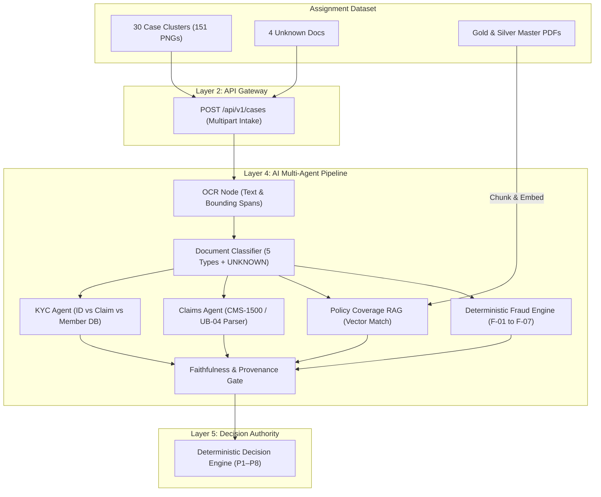

# Feature Specification: F000 Assignment Dataset Understanding & Analysis

## Executive Summary
This document provides a comprehensive, read-only architectural analysis of the supplied `Assignment2_datagen_scripts.zip` synthetic dataset generator. It establishes the authoritative mapping between the generated document artifacts, ground truth metadata, and the MediShield multi-agent processing architecture.

---

## A. What the Assignment Dataset Contains

The generator suite creates **155 document images** and **2 master policy PDFs** organized into 6 distinct categories:

```text
dataset/
├── claim_forms/           (31 PNGs: 20 CMS-1500, 10 UB-04, 1 Duplicate)
├── discharge_summaries/   (30 PNGs: Inpatient clinical summaries)
├── id_documents/          (30 PNGs: Driver's licenses, Passports, State IDs)
├── prescriptions/         (30 PNGs: 3 visual layout styles)
├── policy_amendments/     (30 PNGs: 10 handwritten, 10 with pasted ID support)
├── unknown/               ( 4 PNGs: Out-of-distribution non-medical docs)
├── policies/
│   ├── medishield_gold_plan.pdf    (Gold Tier Policy, 10 bookmarked sections)
│   └── medishield_silver_plan.pdf  (Silver Tier Policy, 10 bookmarked sections)
├── metadata.json          (155 entries: Ground truth metadata)
└── dataset_summary.md     (Auto-generated markdown report)
```

### Breakdown by Generator Script:
1. `generate_docs.py` (133 KB):
   - Generates 151 PNG images representing 30 distinct patient treatment episodes.
   - Outputs to `claim_forms/`, `id_documents/`, `discharge_summaries/`, `prescriptions/`, and `policy_amendments/`.
   - Initializes `metadata.json` with 151 entries.
2. `generate_gold_policy.py` (50 KB):
   - Generates `dataset/policies/medishield_gold_plan.pdf` (MED-GLD-SERIES-2025) using `fpdf2`.
   - Contains 10 sections covering Schedule of Benefits, Inclusions, Exclusions, and HIPAA guidelines.
3. `generate_silver_policy.py` (36 KB):
   - Generates `dataset/policies/medishield_silver_plan.pdf` (MED-SLV-SERIES-2025) using `fpdf2`.
   - Matches the 10-section structure of the Gold Plan with lower coverage limits and higher cost-sharing.
4. `generate_unknown.py` (17 KB):
   - Generates 4 out-of-distribution stress-test documents:
     - `unknown_blurry_scan_001.png`: Severe Gaussian blur with indeterminate content.
     - `unknown_bank_statement_001.png`: Commercial checking account bank statement.
     - `unknown_utility_bill_001.png`: ComEd electric utility statement.
     - `unknown_blank_scan_001.png`: Near-blank scanner artifact with creases and coffee ring.
   - Appends 4 entries to `metadata.json` with `"expected_decision": "ESCALATE"`.

---

## B. How the Generated Documents Relate to Cases

### 30 Patient Case Clusters (`C_001` through `C_030`)
- The core structural unit of the dataset is the **Patient Case Cluster**.
- Each cluster models a single insured individual undergoing a specific medical treatment episode in 2025.
- Exactly 5 documents are generated per cluster (plus 1 duplicate file for cluster `C_001`):
  1. `id_documents/id_{patient_id}.png`
  2. `claim_forms/claim_{patient_id}.png`
  3. `discharge_summaries/discharge_{patient_id}.png`
  4. `prescriptions/rx_{patient_id}.png`
  5. `policy_amendments/amend_{patient_id}.png`
- **Shared Cluster Attributes:**
  - `case_cluster_id`: e.g. `C_001` to `C_030`
  - `patient_id`: e.g. `PT_12345`
  - `name`: e.g. `James T.` (consistent across all 5 documents, except in the `name_mismatch` fraud scenario)
  - `dob`: Date of birth (mm/dd/yyyy)
  - `ssn`: Formatted Social Security Number
  - `policy`: Formatted as `MED-GLD-{7 digits}`
  - `hospital` & `doctor` (with valid 10-digit NPI)
  - `treatment_date`: Constrained strictly to calendar year 2025
  - `icd_code` / `icd_desc` & `cpt_list`

### Out-of-Distribution Documents
- The 4 documents in `unknown/` do **not** belong to any cluster (`case_cluster_id = null`, `patient_id = null`, `policy_number = null`).

---

## C. What Metadata / Ground Truth Contains

The `metadata.json` file contains a list of 155 JSON objects.

### Standard Document Entry Schema:
```json
{
  "doc_id": "claim_PT_28419",
  "category": "claim_forms",
  "claim_form_type": "CMS1500",
  "case_cluster_id": "C_001",
  "fraud_label": false,
  "fraud_reason": null,
  "edge_flags": [],
  "patient_id": "PT_28419",
  "policy_number": "MED-GLD-4820193",
  "blur_simulated": false,
  "file_path": "dataset/claim_forms/claim_PT_28419.png"
}
```

### Unknown Document Entry Schema:
```json
{
  "doc_id": "unknown_bank_statement_001",
  "category": "unknown",
  "case_cluster_id": null,
  "fraud_label": false,
  "fraud_reason": null,
  "edge_flags": [],
  "patient_id": null,
  "policy_number": null,
  "blur_simulated": false,
  "file_path": "dataset/unknown/unknown_bank_statement_001.png",
  "expected_decision": "ESCALATE",
  "note": "Bank account statement — not a medical document"
}
```

---

## D. Information Available to Runtime Inference

During production intake and runtime processing, the agent pipeline has access **only** to:
1. **Raw Document Images:** The uploaded binary image files (`.png`).
2. **Derived OCR Payloads:** Text, tokens, and span coordinates extracted by OCR from the images.
3. **Master Policy Vector Store:** Embeddings and text chunks derived from `medishield_gold_plan.pdf` and `medishield_silver_plan.pdf`.
4. **Relational Database State:** Persisted case metadata, member tables, and enrollment records.

> [!CAUTION]
> `metadata.json` **MUST NEVER** be accessible to the Classifier, KYC, Claims, Policy, Fraud, or Decision agents at runtime. Doing so would constitute fatal data leakage.

---

## E. Information That Is Evaluation-Only

The following fields in `metadata.json` are strictly reserved for post-adjudication evaluation (Spec 12):
- `category`: Ground truth for calculating Classifier confusion matrices.
- `fraud_label` & `fraud_reason`: Ground truth for evaluating Fraud Engine precision, recall, and ROC-AUC.
- `edge_flags`: Ground truth for testing the Faithfulness Gate, KYC Agent verification, and Completeness check.
- `expected_decision`: Ground truth benchmark for evaluating Decision Engine correctness (STP Rate, Auto-Reject accuracy, Escalation rate).

---

## F. Fraud and Edge-Case Scenarios

### 1. Six Injected Fraud Scenarios (Clusters `C_001` through `C_006`)

| Fraud Type | Target Category | Mechanism in Generated Document | Canonical Engine Mapping |
| :--- | :--- | :--- | :--- |
| `duplicate_claim` | `claim_forms` | Generates a 2nd identical claim file (`claim_PT_XXXXX_dup.png`) with identical claim number, dates, and amounts. | **F-01:** Hash collision on `(member, provider, date, amount)` |
| `date_conflict` | `prescriptions` | Prescription issue date is rendered 45+ days after the treatment/discharge date. | **F-05:** Service date inconsistency / temporal impossibility |
| `proc_diag_mismatch` | `claim_forms` | Maternity CPT code (`59400`) billed against a non-maternity diagnosis (diabetes or hypertension). | **F-04:** Clinical procedure/diagnosis outlier |
| `readmission_30d` | `discharge_summaries` | Summary notes prior hospitalization discharge <30 days before current admission. | **F-07:** Readmission frequency anomaly |
| `amount_under_10k` | `claim_forms` | Billed amount set to exactly \$9,875.00 (structuring just under the \$10,000 auto-audit threshold). | **F-04:** Billing threshold anomaly / structuring behavior |
| `name_mismatch` | `id_documents` | ID document renders an altered/mismatched name (e.g. `James T.` vs `Johnathan T.`) while claim form has the original name. | **KYC Agent:** Name mismatch $\rightarrow$ `AgentVerdict.FAIL` |

### 2. Edge-Case Inventory (Clusters `C_007` through `C_030`)

| Edge Case Flag | Count | Physical Manifestation | Expected Pipeline Behavior |
| :--- | :---: | :--- | :--- |
| `expired_id` | 5 | ID expiration date set before the 2025 treatment date. | KYC Agent emits `FAIL` $\rightarrow$ Rule P5 auto-rejects. |
| `expiring_soon_id` | 5 | ID expires within 30 days of treatment date. | KYC Agent emits `PASS` (valid at time of service). |
| `tampered_id` | 3 | Digital photo box artifacting or font tampering on ID. | Fraud Feature F-02 triggers anomaly $\rightarrow$ Escalate (P4). |
| `missing_fields` (Claim) | 4 | Omitted physician signature, NPI, or diagnostic code. | Schema invalid $\rightarrow$ Escalate (P2 or P3). |
| `missing_fields` (Rx) | 4 | Missing DEA number, dosage, refills, or drug name. | Faithfulness Gate flags invalid rx $\rightarrow$ Escalate (P3). |
| `uncovered_procedure` | 5 | Non-covered cosmetic CPT (e.g. Blepharoplasty `15822`). | Policy RAG emits `FAIL` (not covered) $\rightarrow$ Rule P5 auto-rejects. |
| `blur_simulated` | 3 | Gaussian blur filter applied to prescription scans. | Low OCR confidence $\rightarrow$ Escalate (P1 or P7). |
| `claim_type: UB04` | 10 | Institutional inpatient hospital bill layout. | Claims Agent must parse UB-04 form blocks. |
| `claim_type: CMS1500`| 20 | Professional outpatient CMS-1500 red-form layout. | Claims Agent parses CMS-1500 boxes 1–33. |
| Handwritten Amendment| 10 | Script font simulating manual handwriting. | OCR requires handwriting/print dual recognition. |
| ID-backed Amendment | 10 | ID card physically pasted below amendment form. | Boundary splitter must handle composite image. |

---

## G. How the Dataset Maps to Existing Architecture



---

## H. Potential Compatibility Issues & Implementation Gaps

1. **Missing `expected_decision` in `generate_docs.py`:**
   - *Observation:* While `scripts_overview.txt` claims `metadata.json` contains `expected_decision` for every document, in reality only the 4 `unknown` entries include `"expected_decision": "ESCALATE"`. The 151 cluster documents do **not** have an `expected_decision` field in `metadata.json`.
   - *Impact:* The evaluation benchmark runner cannot simply check `row["expected_decision"]` for claim documents.
    - *Evaluation constraint:* `fraud_label` and `edge_flags` describe fraud or document characteristics; they are not a case-level adjudication label. They must not be combined into an expected `APPROVE`, `REJECT`, or `ESCALATE` outcome. Decision-quality metrics require an independently reviewed case-level `adjudication_label`; otherwise the case is unlabelled and excluded from those metrics.

2. **Single-Page PNG Format vs Multi-Page PDF:**
   - *Observation:* The dataset generates individual PNG images rather than bundled multi-page PDFs.
   - *Impact:* The intake API must support both image uploads (`image/png`) and PDF uploads (`application/pdf`), and the test harness should submit cases as a folder/bundle of PNGs representing a cluster.

3. **Dual Claim Form Standard (CMS-1500 and UB-04):**
   - *Observation:* 10 of the 30 clusters use UB-04 forms (inpatient) and 20 use CMS-1500 forms (outpatient).
   - *Impact:* The Claims Extraction Agent cannot rely on a single CMS-1500 schema; it must recognize whether a form is CMS-1500 or UB-04 and map both into the unified canonical `claims` and `claim_lines` database tables.

4. **Policy Tier Assignment:**
   - *Observation:* All 30 generated clusters have policy numbers starting with `MED-GLD-` (Gold Plan). None of the synthetic clusters are assigned to `MED-SLV-` (Silver Plan).
   - *Impact:* The Silver Plan PDF serves primarily to test policy version/tier isolation in RAG retrieval (ensuring Gold claims retrieve Gold clauses, not Silver clauses).

5. **Randomness & Reproducibility:**
   - `generate_docs.py` uses `random.Random(42)` for cluster metadata, but uses unseeded `np.random.normal(0, 3.5, ...)` for scan noise. Minor pixel-level variations may occur if regenerated, but categorical metadata remains 100% deterministic.

---

## I. Recommended Future Integration Steps

1. **Step 1: Dataset Generation Target Directory:**
   - When generating the dataset for testing, output to a dedicated root `dataset/` directory (git-ignored for binary blobs).
2. **Step 2: Dual Form Parser in Claims Agent:**
   - Implement field extraction extractors for both CMS-1500 and UB-04 in `FEAT-003` (Domain & Agents).
3. **Step 3: Ground-Truth Adjudication Benchmark Generator:**
   - Build a lightweight evaluation fixture in `tests/eval/` that aggregates cluster metadata and assigns the canonical expected decision (`APPROVE`, `REJECT`, `ESCALATE`) to each cluster according to Rules P1–P8.
4. **Step 4: Vector Indexing Pipeline for Policies:**
   - Ingest `medishield_gold_plan.pdf` and `medishield_silver_plan.pdf` through an admin script to chunk, embed, and store into the Vector DB under distinct collection names.
