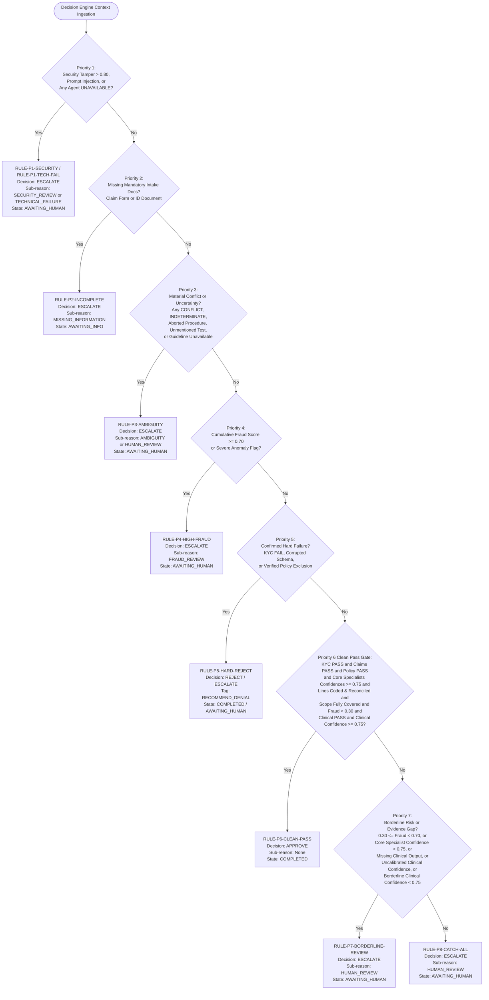
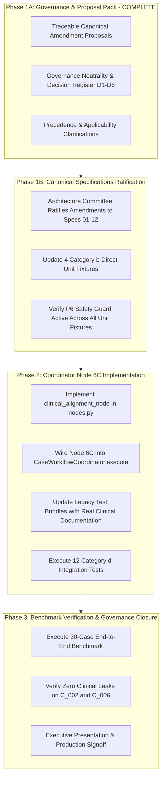

# MediShield — Canonical Specification Amendment & Governance Proposal Pack
## Reconciling Accepted ADR-015, Clinical Alignment Design, and Canonical Specifications 01–12

**Document Identifier:** `PROP-ADR015-CANONICAL-2026-10-16-REV4`  
**Revision:** Phase 1A.3 Final Contract Consistency Audit  
**Status:** PROPOSED AMENDMENT PACK (GOVERNANCE & DESIGN STAGE — NO APPLICATION CODE MODIFIED)  
**Governing ADR:** [ADR-015: Deterministic Clinical Alignment Verification and Contract Definition](../../adr/ADR-015_DETERMINISTIC_CLINICAL_ALIGNMENT_VERIFICATION_AND_CONTRACT_DEFINITION.md)  
**Design Reference:** [Clinical Alignment Decision Contract (`docs/sdd/design/clinical_alignment_decision_contract.md`)](../design/clinical_alignment_decision_contract.md)  
**Governing Rules:** MediShield Engineering Rules 1–15 (Rule 1: Canonical specs are source of truth; Rule 2: Do not modify architecture without an ADR; Rule 10: Code over prompts; Rule 11: Deterministic logic over LLM; Rule 12: Provenance; Rule 13: Never convert uncertainty to failure; Rule 14: Never let LLM determine final business decision).  
**Target Canonical Documents Inspected:**
- `docs/canonical/01_CANONICAL_ARCHITECTURE.md`
- `docs/canonical/02_DECISION_ENGINE_AND_STATE_MACHINE.md`
- `docs/canonical/03_MULTI_DOCUMENT_INTAKE_AND_SPLIT_CONTRACT.md`
- `docs/canonical/04_LANGGRAPH_STATE_AND_ORCHESTRATION_CONTRACT.md`
- `docs/canonical/05_AGENT_INTERFACE_CONTRACTS.md`
- `docs/canonical/06_FAITHFULNESS_PROVENANCE_AND_VERIFICATION.md`
- `docs/canonical/07_DATABASE_AND_STORAGE_CONTRACTS.md`
- `docs/canonical/08_REST_API_SPECIFICATION.md`
- `docs/canonical/09_POLICY_RAG_AND_ADMINISTRATION_SPECIFICATION.md`
- `docs/canonical/10_FRAUD_DETECTION_ENGINE_SPECIFICATION.md`
- `docs/canonical/11_SECURITY_HIPAA_AND_PROMPT_INJECTION_DEFENSES.md`
- `docs/canonical/12_EVALUATION_AND_SYNTHETIC_DATA_FRAMEWORK.md`

---

## Document Revision History

| Revision | Date | Author / Reviewer | Scope & Substantive Corrections Made |
| :--- | :---: | :--- | :--- |
| **REV1** | 2026-10-16 | Senior AI Systems Architect | Initial drafting of canonical amendment proposal pack for ADR-015. |
| **REV2** | 2026-10-16 | Phase 1A.1 Red-Team Quality Reviewer | Neutralized decision register; added full 12-spec impact matrix; reconciled 16-vs-26 test count discrepancy. |
| **REV3** | 2026-10-16 | Phase 1A.2 Final Consistency Reviewer | Reconciled initial specification totals; preserved Decision 2 neutrality; contrasted neutral uncertainty from adverse denial recommendations; marked bed-day revenue codes as provisional proposal; documented test provenance. |
| **REV4** | 2026-10-16 | Phase 1A.3 Contract Consistency Auditor | **Substantive Corrections:**<br>1. **Spec 07 Impact Resolution:** Reconciled REQ-CLIN-11 with impact matrix. Determined that Spec 07 requires canonical amendment to document clinical specialist persistence (`agent_name = 'clinical_alignment'`), `decisions.agent_summary_snapshot JSONB` snapshot schema, retrieval semantics, and Phase 3 line-level DDL scope, bringing affected specifications to nine (9) and unaffected to three (3).<br>2. **Clinical FAIL Routing Clarification:** Formally classified affirmative clinical `FAIL` as `PROVISIONAL — GOVERNANCE DECISION REQUIRED` (governed by open Decision 2); removed forced classification under P3/P7; detailed existing canonical vs. runtime vs. proposed future behavior across all 7 clinical states; reiterated that P7 cannot override P1–P5; preserved existing P5 behavior for KYC, claims-schema, and policy exclusions.<br>3. **Decision 6 Reframing & Rule 13 Constraint:** Reframed Decision 6 to distinguish stakeholder choices from behavior violating mandatory Engineering Rule 13 ("Never silently convert uncertainty into failure"); eliminated Option B (autonomous engine `FAIL` on missing mentions) as a prohibited automated implementation; defined legitimate clinical policy choices (modality tiering and reviewer protocols).<br>4. **Full Consistency Sweep:** Ensured the traceability matrix, impact matrix, proposed amendment texts, executive summary, and revision history agree across all 12 canonical documents. |

---

## Executive Summary

Accepted ADR-015 establishes that MediShield must execute **deterministic, line-level clinical verification** between billed medical services (CPT/HCPCS codes, revenue codes, bed-day units) and submitted clinical documentation (discharge summaries, operative reports, lab results).

Under the Phase 0 safety guard implemented in [`src/medishield/domain/decision.py`](file:///Users/AniketB/Desktop/medishield/src/medishield/domain/decision.py#L531-L547), Rule P6 (`RULE-P6-CLEAN-PASS`) was successfully protected from auto-approving claims when clinical output is missing (`clinical_output is None`). However, because MediShield's canonical specifications (Specs 01–12) were authored prior to ADR-015, a structural gap exists across the platform.

A comprehensive source-level audit across all twelve (12) canonical specifications accounts for each document exactly once:
- **Nine (9) specifications require concrete canonical amendments:** Spec 01 (Architecture), Spec 02 (Decision Engine), Spec 04 (LangGraph State & DAG), Spec 05 (Agent Interface Contracts), Spec 06 (Faithfulness & Consistency), Spec 07 (Database & Storage Contracts), Spec 08 (REST API), Spec 10 (Fraud Detection Engine), and Spec 12 (Evaluation Framework).
- **Three (3) specifications require no immediate modifications:** Spec 03 (Multi-Document Intake & Split Contract), Spec 09 (Policy RAG Specification), and Spec 11 (Security, HIPAA & Injection Defenses).

Additionally, six critical operational, clinical, and legal decisions (D1–D6) set forth in Section 7 of the Design Contract remain formally open, alongside a foundational cross-ADR conflict between ADR-002 (autonomous `REJECT`) and ADR-010 / Spec 02 Table 1 (`ESCALATE(RECOMMEND_DENIAL)`). Notably:
- **Affirmative Clinical `FAIL` Routing** is designated as `PROVISIONAL — GOVERNANCE DECISION REQUIRED`, as routing to adverse rejection vs. mandatory human escalation depends on the legal resolution of Decision 2.
- **Decision 6 Framing** explicitly eliminates autonomous `FAIL` on unmentioned minor findings as prohibited by mandatory Engineering Rule 13, focusing the open decision on modality-based documentation tiering and reviewer action protocols.

This proposal pack delivers the exact, diff-ready specification text, precedence rules, decision register, and test migration strategy required to achieve canonical reconciliation before implementing the coordinator clinical node.

---

## 1. End-to-End Architectural Traceability Matrix

The table below maps each requirement of ADR-015 and the Clinical Alignment Design Contract to the governing canonical specifications, current implementation state, identified conflicts, proposed amendments, and required approvers.

| Req / Decision ID | Governing Canonical Spec | ADR-015 / Design Contract Reference | Current Implementation & Test Evidence | Exact Conflict or Gap | Proposed Canonical Amendment | Required Approver(s) | Acceptance Criteria | Dependencies / Blockers |
| :--- | :--- | :--- | :--- | :--- | :--- | :--- | :--- | :--- |
| **REQ-CLIN-01: Line Evidence Schema** | [`05_AGENT_INTERFACE_CONTRACTS.md`](file:///Users/AniketB/Desktop/medishield/docs/canonical/05_AGENT_INTERFACE_CONTRACTS.md) § 7 | ADR-015 § 2.1; Design § 3.1 | Implemented in [`src/medishield/domain/contracts.py`](file:///Users/AniketB/Desktop/medishield/src/medishield/domain/contracts.py#L485-L620). Tested in `test_clinical_alignment.py`. | Spec 05 contains no contract for `LineClinicalEvidence`, `ServiceModality`, or clinical status enums. | Add Section 7B to Spec 05 defining `LineClinicalEvidence` and all 6 status enums. | CTO, Lead Architect (Rule 1, Spec 05 § 6) | Pydantic validation passes; invalid modality/status raises `ValidationError`. | None (contracts already coded). |
| **REQ-CLIN-02: Bed-Day Reconciliation** | [`05_AGENT_INTERFACE_CONTRACTS.md`](file:///Users/AniketB/Desktop/medishield/docs/canonical/05_AGENT_INTERFACE_CONTRACTS.md) § 7; [`06_FAITHFULNESS`](file:///Users/AniketB/Desktop/medishield/docs/canonical/06_FAITHFULNESS_PROVENANCE_AND_VERIFICATION.md) § 4 | ADR-015 § 2.1; Design § 3.2, § 5.1 | Implemented in [`src/medishield/domain/contracts.py`](file:///Users/AniketB/Desktop/medishield/src/medishield/domain/contracts.py#L622-L710) and `clinical_align.py`. Tested in `test_clinical_alignment.py`. | Spec 05 lacks `BedDayReconciliation`; Spec 06 lacks bed-day unit and date consistency checks. | Add `BedDayReconciliation` to Spec 05; add bed-day consistency check to Spec 06 § 4. | Claims Ops Director, Hospital Billing Liaison | Inverted dates or unit mismatch raises `ValidationError` or evaluates to `INDETERMINATE`. | Decision 3 (Bed-Day Convention). |
| **REQ-CLIN-03: Specialist Output & Invariants** | [`05_AGENT_INTERFACE_CONTRACTS.md`](file:///Users/AniketB/Desktop/medishield/docs/canonical/05_AGENT_INTERFACE_CONTRACTS.md) § 7 | ADR-015 § 2.1; Design § 3.3, § 3.4 | Implemented in [`src/medishield/domain/contracts.py`](file:///Users/AniketB/Desktop/medishield/src/medishield/domain/contracts.py#L712-L830). Factory `build_clinical_alignment_output` tested. | Spec 05 lacks `ClinicalAlignmentOutput`; `OrchestratorOutput.agent_summaries` description omits clinical. | Add `ClinicalAlignmentOutput` to Spec 05 § 7B; update `OrchestratorOutput` docstring in Spec 05 § 8. | CTO, Lead Architect | Set equality between expected claim lines and assessed lines strictly enforced. | None. |
| **REQ-CLIN-04: Deterministic Alignment Engine** | [`01_CANONICAL_ARCHITECTURE.md`](file:///Users/AniketB/Desktop/medishield/docs/canonical/01_CANONICAL_ARCHITECTURE.md) § 2 (Layer 4); [`06_FAITHFULNESS`](file:///Users/AniketB/Desktop/medishield/docs/canonical/06_FAITHFULNESS_PROVENANCE_AND_VERIFICATION.md) § 4 | ADR-015 § 2.2; Design § 5.1, § 5.2 | Implemented in [`src/medishield/domain/clinical_align.py`](file:///Users/AniketB/Desktop/medishield/src/medishield/domain/clinical_align.py). 26 unit & synthetic tests passing in `test_clinical_alignment.py`. | Spec 01 Layer 4 diagram omits `ClinicalAlignmentEngine`; Spec 06 lacks deterministic guideline check. | Amend Spec 01 Layer 4 diagram; amend Spec 06 § 4 with multi-factor guideline verification. | CMO, Lead Architect | Deterministic code execution $< 5\,\text{ms}$; zero LLM calls in decision loop. | Decision 1 (Guideline Catalog). |
| **REQ-CLIN-05: P6 Approval Safety Guard** | [`02_DECISION_ENGINE_AND_STATE_MACHINE.md`](file:///Users/AniketB/Desktop/medishield/docs/canonical/02_DECISION_ENGINE_AND_STATE_MACHINE.md) § 3 (Table 1, flowchart) | ADR-015 § 2.3; Design § 6 | Implemented in [`src/medishield/domain/decision.py`](file:///Users/AniketB/Desktop/medishield/src/medishield/domain/decision.py#L531-L547). Regression test passing in `test_clinical_alignment.py`. | Spec 02 Table 1 Rule P6 and Mermaid flowchart check only KYC, Claims, Policy, Fraud. Omit clinical output. | Amend Spec 02 Table 1 Rule P6 to require `clinical_output.verdict == PASS` and `confidence >= 0.75` alongside existing core conditions. | Architecture Committee, Claims Ops Director | Claim with missing clinical output or confidence $< 0.75$ cannot emit `APPROVE`. | Preserves Phase 0 safety guard. |
| **REQ-CLIN-06: P7 Borderline Fail-Closed Routing** | [`02_DECISION_ENGINE_AND_STATE_MACHINE.md`](file:///Users/AniketB/Desktop/medishield/docs/canonical/02_DECISION_ENGINE_AND_STATE_MACHINE.md) § 3 (Table 1) | ADR-015 § 2.3; Design § 6, § 7.5 | Implemented in [`src/medishield/domain/decision.py`](file:///Users/AniketB/Desktop/medishield/src/medishield/domain/decision.py#L572-L610). Tested in `test_decision_engine.py`. | Spec 02 Table 1 Rule P7 does not list uncalibrated clinical confidence or missing clinical output. | Amend Spec 02 Table 1 Rule P7 to explicitly include `clinical_output is None` and uncalibrated confidence. | Architecture Committee | Routes missing or uncalibrated clinical output to `ESCALATE(HUMAN_REVIEW)` under Rule P7. | None. |
| **REQ-CLIN-07: Coordinator DAG Node 6C** | [`04_LANGGRAPH_STATE_AND_ORCHESTRATION_CONTRACT.md`](file:///Users/AniketB/Desktop/medishield/docs/canonical/04_LANGGRAPH_STATE_AND_ORCHESTRATION_CONTRACT.md) § 2, § 3 | ADR-015 § 2; Design § 9 | Drafted in [`src/medishield/workflows/state.py`](file:///Users/AniketB/Desktop/medishield/src/medishield/workflows/state.py#L80-L83); un-wired in `coordinator.py`. | Spec 04 DAG flowchart and node descriptions lack Node 6C (`clinical_alignment_node`). | Amend Spec 04 DAG to insert Node 6C parallel to 6A/6B; add Node 6C contract specification. | Lead Architect, Backend Lead | Coordinator executes clinical alignment; passes output to `DecisionInputContext`. | Ratification of Spec 04 amendment. |
| **REQ-CLIN-08: CaseState Schema Extension** | [`04_LANGGRAPH_STATE_AND_ORCHESTRATION_CONTRACT.md`](file:///Users/AniketB/Desktop/medishield/docs/canonical/04_LANGGRAPH_STATE_AND_ORCHESTRATION_CONTRACT.md) § 1 | ADR-015 § 2.1; Design § 3 | Implemented in [`src/medishield/workflows/state.py`](file:///Users/AniketB/Desktop/medishield/src/medishield/workflows/state.py#L80-L83). | Spec 04 `CaseState` code block omits clinical execution ID, verdict, confidence, and summary. | Amend Spec 04 § 1 `CaseState` definition to include clinical state attributes. | Lead Architect | Typed `CaseState` carries clinical specialist state through workflow. | None. |
| **REQ-CLIN-09: Encounter Date Containment** | [`06_FAITHFULNESS_PROVENANCE_AND_VERIFICATION.md`](file:///Users/AniketB/Desktop/medishield/docs/canonical/06_FAITHFULNESS_PROVENANCE_AND_VERIFICATION.md) § 4 | ADR-015 § 2.2; Design § 5.1 | Implemented in [`src/medishield/domain/clinical_align.py`](file:///Users/AniketB/Desktop/medishield/src/medishield/domain/clinical_align.py). | Spec 06 `evaluate_case_consistency` only checks service date vs policy effective period. | Amend Spec 06 § 4 to evaluate $D_{\text{admit}} \le D_i \le D_{\text{discharge}}$ for all claim lines. | CMO, Claims Ops Director | Service date outside stay produces `CONFLICT` and routes to Rule P3 (`ESCALATE`). | None. |
| **REQ-CLIN-10: Calibrated Confidence Formula** | [`06_FAITHFULNESS_PROVENANCE_AND_VERIFICATION.md`](file:///Users/AniketB/Desktop/medishield/docs/canonical/06_FAITHFULNESS_PROVENANCE_AND_VERIFICATION.md) § 5 | ADR-015 § 2.1; Design § 3.4 | Implemented in [`contracts.py`](file:///Users/AniketB/Desktop/medishield/src/medishield/domain/contracts.py#L864-L883). | Spec 06 § 5 does not define explicit behavior when calibration inputs are unavailable. | Amend Spec 06 § 5 to specify that missing calibration inputs result in `confidence = None`. | Lead Architect, AI Governance Lead | Missing calibration inputs emit `confidence = None`, strictly failing P6 gate to P7. | None. |
| **REQ-CLIN-11: Database Persistence Alignment** | [`07_DATABASE_AND_STORAGE_CONTRACTS.md`](file:///Users/AniketB/Desktop/medishield/docs/canonical/07_DATABASE_AND_STORAGE_CONTRACTS.md) § 2 | ADR-015 § 2.1; Design § 3 | `decisions.agent_summary_snapshot JSONB` and `agent_runs.output_json JSONB` persist clinical data. | Spec 07 lacks formal persistence contract for `clinical_alignment` in `agent_runs`, missing snapshot schema in `decisions`, and lacks retrieval and Phase 3 line-level DDL documentation. | Amend Spec 07 § 2 to register `agent_name = 'clinical_alignment'`, document `decisions.agent_summary_snapshot['clinical']` schema, specify retrieval semantics, and record Phase 3 line-level DDL deferral note. | Database Architect, Lead Architect | Audit ledger, `agent_runs`, and `decisions` persist full clinical evidence JSONB with guaranteed audit retrieval. | Decision 4 (Claim vs Line Adjudication). |
| **REQ-CLIN-12: P5 Hard Denial Reconciliation** | [`02_DECISION_ENGINE_AND_STATE_MACHINE.md`](file:///Users/AniketB/Desktop/medishield/docs/canonical/02_DECISION_ENGINE_AND_STATE_MACHINE.md) § 3; ADR-002; ADR-010 | ADR-015 § 2; Design § 6, § 7.2 | Current code in [`decision.py`](file:///Users/AniketB/Desktop/medishield/src/medishield/domain/decision.py#L403-L417) emits `BusinessDecision.REJECT`. | Structural contradiction: Spec 02 flowchart emits `REJECT`; Table 1 emits `ESCALATE(RECOMMEND_DENIAL)`. | Formal committee vote to select Option A (`REJECT`) or Option B (`ESCALATE(RECOMMEND_DENIAL)`). | Architecture Committee, Legal Counsel, CMO | Decision engine outcome matches ratified canonical text with zero divergence. | Decision 2 & Legal statutory review. |
| **REQ-CLIN-13: REST API Agent Summaries** | [`08_REST_API_SPECIFICATION.md`](file:///Users/AniketB/Desktop/medishield/docs/canonical/08_REST_API_SPECIFICATION.md) § 2.7 | ADR-015 § 2; Spec 08 § 2.7 | Backend currently serializes specialist outputs into JSON dictionaries. | Spec 08 `GET /api/v1/cases/{case_id}/agents` response model omits the clinical specialist key. | Amend Spec 08 § 2.7 response schema to include `clinical` specialist summary object. | API Lead, Lead Architect | API response delivers clinical alignment summary and line verdicts to UI. | REQ-CLIN-03. |
| **REQ-CLIN-14: Evaluation & Synthetic Data Framework** | [`12_EVALUATION_AND_SYNTHETIC_DATA_FRAMEWORK.md`](file:///Users/AniketB/Desktop/medishield/docs/canonical/12_EVALUATION_AND_SYNTHETIC_DATA_FRAMEWORK.md) § 3 | ADR-015 § 2; Design § 8 | Synthetic benchmark suite contains 20 EVAL-CLIN test cases in `test_clinical_alignment.py`. | Spec 12 lists 11 stress test categories (CAT-01 to CAT-11), entirely omitting clinical alignment. | Amend Spec 12 § 3 to add Category CAT-12 (Clinical Misalignment and Medical Necessity). | Evaluation Lead, QA Architect | Synthetic generator and evaluator score clinical alignment accuracy and leaks. | None. |

---

## 2. Formal Precedence of Rules (P1–P8 Evaluation) and Escalation Semantics

The MediShield Decision Engine evaluates claims through an authoritative, deterministic first-match-wins hierarchy (Rules P1–P8). The addition of clinical alignment verification refines these rules without altering the foundational state machine:



### 2.1 Complete Rule P6 Preservation Guarantee
Under existing canonical Spec 02 § 3 (Table 1), Rule P6 straight-through auto-approval requires:
- `kyc_verdict == PASS`
- `claims_verdict == PASS`
- `policy_verdict == PASS`
- `fraud_score < 0.30`
- **Core Specialist Minimum Confidence:** `min(kyc_confidence, claims_confidence, policy_confidence, fraud_confidence) >= 0.75`.

> [!IMPORTANT]
> **Preservation of Core Specialist Confidence Gate:**
> ADR-015 does **not** replace the existing core-specialist confidence requirement with clinical confidence alone.
> Under the amended Rule P6, **both** conditions are strictly mandatory:
> 1. All core specialists (KYC, Claims, Policy, Fraud) must have `confidence >= 0.75`.
> 2. The Clinical Alignment Specialist must evaluate to `PASS` with calibrated `confidence >= 0.75`.
> If core specialists report confidence $\ge 0.75$ but clinical confidence is $< 0.75$ (or `None`), the claim strictly fails P6 and routes to Rule P7. Conversely, if clinical confidence is $0.95$ but KYC confidence is $0.70$, the claim strictly fails P6 and routes to Rule P7.

### 2.2 Rigorous Distinction of Escalation Semantics (P3 / P7 vs. P5)

A critical architectural distinction exists between neutral procedural escalation and adverse denial recommendations. They must **never** be conflated:

1. **Neutral Evidence Uncertainty (`ESCALATE` under Rule P3 `RULE-P3-AMBIGUITY`):**
   - **Business Decision:** `BusinessDecision.ESCALATE`
   - **Escalation Sub-Reason:** `EscalationSubReason.AMBIGUITY` or `EscalationSubReason.HUMAN_REVIEW`
   - **Workflow State:** `WorkflowState.AWAITING_HUMAN`
   - **Operational & Legal Meaning:** Represents incomplete, ambiguous, or contradictory factual records (e.g. unmentioned routine test, blurry document, procedure aborted, or service date outside stay). **No adverse determination is implied or recommended.** The claim is routed to a claims adjudicator to request supplemental records or verify facts.

2. **Borderline Evidence Review (`ESCALATE` under Rule P7 `RULE-P7-BORDERLINE-REVIEW`):**
   - **Business Decision:** `BusinessDecision.ESCALATE`
   - **Escalation Sub-Reason:** `EscalationSubReason.HUMAN_REVIEW`
   - **Workflow State:** `WorkflowState.AWAITING_HUMAN`
   - **Operational & Legal Meaning:** Represents claims where all core specialists passed, but an evidentiary safety gate failed (e.g., $0.30 \le \text{fraud} < 0.70$, missing clinical output `None`, uncalibrated confidence `None`, or borderline confidence $< 0.75$). **No adverse determination is implied.** Acts as a fail-closed safety net routing to human adjudication.

3. **Adverse Denial Recommendation (`ESCALATE(RECOMMEND_DENIAL)` vs. `REJECT` under Rule P5):**
   - **Business Decision:** `BusinessDecision.ESCALATE` (Spec 02 Table 1 / ADR-010) vs. `BusinessDecision.REJECT` (ADR-002 / current runtime code).
   - **Escalation Sub-Reason / Recommendation Tag:** `EscalationSubReason.RECOMMEND_DENIAL`
   - **Workflow State:** `WorkflowState.AWAITING_HUMAN` (Spec 02 Table 1) vs. `WorkflowState.COMPLETED` (ADR-002 / runtime code).
   - **Operational & Legal Meaning:** **Formal adverse benefit determination recommendation.** Upstream specialists established affirmative proof of a hard statutory, identity, or contractual failure (e.g., member not found in database, corrupted line schema, or verified verbatim policy exclusion). Carries formal legal notice and appeal disclosure obligations under ERISA and state insurance regulations.

### 2.3 Authoritative Classification of the Seven Clinical States Under P1–P8

The table below defines the exact trigger condition, existing canonical behavior, runtime implementation, proposed future canonical behavior, governing priority rule, business decision, and workflow state for each distinct clinical state:

| Clinical State | Trigger / Extraction Condition | Existing Canonical Spec 02 Baseline | Current Runtime Implementation (`decision.py`) | Proposed Future Canonical Behavior | Governing Priority Rule | Business Decision | Workflow State & Sub-reason | Operational & Legal Meaning |
| :--- | :--- | :--- | :--- | :--- | :---: | :---: | :---: | :--- |
| **1. Clinical Output Missing** | `clinical_output is None` (Node unexecuted, skipped, or legacy fixture) | Omitted from Spec 02 (Specialist did not exist). | Fails P6 clean pass; triggers Rule P7 (`decision.py:531-610`). | Amend Spec 02 Table 1 Rule P7 to include `clinical_output is None`. | **`RULE-P7-BORDERLINE-REVIEW`** | **`ESCALATE`** | `AWAITING_HUMAN`<br>`HUMAN_REVIEW` | Fail-closed guard. Catches un-evaluated claims when core agents pass. Does not override P1–P5. |
| **2. Explicitly UNAVAILABLE** | Extractor crash, catalog timeout, registry error (`verdict == UNAVAILABLE`) | Rule P1 evaluates any agent `UNAVAILABLE` $\to$ P1. | Triggers Rule P1 (`decision.py:442-452`). | Retain Rule P1 first-priority handling in Spec 02. | **`RULE-P1-TECH-FAIL`** | **`ESCALATE`** | `AWAITING_HUMAN`<br>`TECHNICAL_FAILURE` | P1 evaluates first. Technical infrastructure failure immediately halts processing for engineering investigation. |
| **3. Clinical INDETERMINATE** | Unmentioned routine test, unverified prior auth, date-only bed-day ambiguity (`verdict == INDETERMINATE`) | Rule P3 evaluates extraction ambiguity $\to$ P3. | Fails P6; evaluates under Rule P3 / P7 (`decision.py:469-502`). | Canonically ratify under Rule P3 in Spec 02. | **`RULE-P3-AMBIGUITY`** | **`ESCALATE`** | `AWAITING_HUMAN`<br>`AMBIGUITY` / `HUMAN_REVIEW` | Under **Rule 13**, uncertainty is never converted to failure. Absence of evidence routes to human claims review. |
| **4. Clinical CONFLICT** | Record proves procedure cancelled/aborted, mutually exclusive service, or date outside stay (`verdict == CONFLICT`) | Rule P3 evaluates contradictory records $\to$ P3. | Triggers Rule P3 (`decision.py:469-502`). | Canonically ratify under Rule P3 in Spec 02. | **`RULE-P3-AMBIGUITY`** | **`ESCALATE`** | `AWAITING_HUMAN`<br>`AMBIGUITY` | Factual contradiction between billing claim and physical medical documentation routes to human review under P3. |
| **5. Affirmative Clinical FAIL** | Affirmative record evidence of failed mandatory criteria or confirmed auth denial (`verdict == FAIL`) | Spec 02 contains no clinical failure rule; Rule P5 is strictly defined for KYC, Claims, and Policy. | Fails P6; routes to human review under P7/P3 (`decision.py:531-610`) as provisional safety default. | **PROVISIONAL — GOVERNANCE DECISION REQUIRED** (Awaits legal/clinical signoff on Decision 2). | **`PROVISIONAL — GOVERNANCE DECISION REQUIRED`** | **`PROVISIONAL`**<br>(`REJECT` vs. `ESCALATE`) | `PROVISIONAL`<br>(`COMPLETED` vs. `AWAITING_HUMAN`) | **Cannot be canonically assigned to P3, P5, or P7 without legal signoff.** Routing depends on Decision 2 resolution. |
| **6. Clinical PASS with Low/Missing Confidence** | `verdict == PASS`, but `confidence is None` or `confidence < 0.75` | Rule P7 evaluates core agent confidence $< 0.75$ $\to$ P7. | Fails P6 gate; triggers Rule P7 (`decision.py:531-610`). | Amend Spec 02 Table 1 Rule P7 to include uncalibrated/low clinical confidence. | **`RULE-P7-BORDERLINE-REVIEW`** | **`ESCALATE`** | `AWAITING_HUMAN`<br>`HUMAN_REVIEW` | Uncalibrated or weak evidence grounding cannot bypass the straight-through gate. Routes to human review. |
| **7. Valid Clinical PASS** | `verdict == PASS`, line set reconciled, and calibrated `confidence >= 0.75` | Rule P6 auto-approved without clinical check. | Evaluates under Rule P6 if core conditions met (`decision.py:531-547`). | Amend Spec 02 Table 1 Rule P6 to require clinical PASS ($\ge 0.75$). | **`RULE-P6-CLEAN-PASS`** | **`APPROVE`** | `COMPLETED`<br>*None* | Straight-through auto-approval, provided KYC PASS, Claims PASS, Policy PASS, Fraud $< 0.30$, and core confidences $\ge 0.75$. |

#### Detailed Governance Analysis: Affirmative Clinical FAIL Routing
Affirmative clinical failure (`verdict == FAIL`) occurs when submitted documentation provides positive evidence that billed services fail mandatory clinical criteria (e.g. `EVAL-CLIN-06` conservative therapy duration unfulfilled) or prior authorization was affirmatively denied (`EVAL-CLIN-05`). 

This proposal strictly **prohibits classifying affirmative clinical FAIL as settled under Rule P3 or P7** merely to force it into an existing category:
1. **What Remains Undefined (Pending Decision 2):**
   - *Statutory Adverse Determination Authority:* Under state utilization review and insurance licensing statutes (e.g., California Health and Safety Code § 1374.30, NY Insurance Law § 4902), only qualified licensed physicians or clinical peer reviewers may issue adverse benefit determinations for lack of medical necessity. Whether MediShield is legally authorized to autonomously reject claims for medical necessity failure without human physician signoff requires formal statutory review by Qualified Healthcare Regulatory Legal Counsel.
   - *Rule Assignment:* If Option A is approved by Legal/CMO, clinical `FAIL` belongs in Priority 5 (Adverse Determination). If Option B is approved by Legal/CMO, clinical `FAIL` belongs in a mandatory human medical review gate under Priority 3 or a dedicated clinical review rule.
   - *Business Decision & Workflow State:* If assigned to Priority 5, does Priority 5 emit `REJECT` (`COMPLETED`, per ADR-002 and runtime code) or `ESCALATE(RECOMMEND_DENIAL)` (`AWAITING_HUMAN`, per ADR-010 and Spec 02 Table 1)?
2. **Preservation of Existing P5 Scope:**
   - Existing Rule P5 behavior for confirmed KYC failures (`kyc_verdict == FAIL`), claims-schema corruption (`schema_valid == False`), and verified verbatim policy exclusions (`policy_verdict == FAIL`) **remains strictly unchanged** while the ADR-002/ADR-010 conflict remains open.
   - Clinical `FAIL` is **not silently merged into existing Rule P5** without explicit legal and clinical ratification.

### 2.4 Strict Priority Ordering Guarantee (P7 Never Overrides P1–P5)
The Decision Engine's deterministic evaluation sequence is immutable:
1. If a case has an adversarial injection or tamper $> 0.80$, Rule P1 fires (`SECURITY_REVIEW`), regardless of clinical state.
2. If an agent dependency times out, Rule P1 fires (`TECHNICAL_FAILURE`), regardless of clinical state.
3. If an ID document is missing, Rule P2 fires (`MISSING_INFORMATION`), regardless of clinical state.
4. If an operative note contradicts the claim form, Rule P3 fires (`AMBIGUITY`), regardless of clinical state.
5. If independent fraud indicators accumulate to $\ge 0.70$, Rule P4 fires (`FRAUD_REVIEW`), regardless of clinical state.
6. If KYC fails or a verbatim policy exclusion is verified, Rule P5 fires (`RECOMMEND_DENIAL`).
7. **Rule P7 evaluates only after Rules P1–P6 have been evaluated and declined.** A missing clinical output or low clinical confidence triggers Rule P7 **if and only if** the claim has not already triggered Rules P1 through P5. Rule P7 never overrides, suppresses, or intercepts an upstream security, incompleteness, ambiguity, fraud, or denial finding.

### 2.5 Unresolved P5 Specification Conflict (ADR-002 vs. ADR-010 / Spec 02 Table 1)
- **Current Runtime Code (`decision.py` lines 403–417):** Emits `BusinessDecision.REJECT` with `recommendation_tag = EscalationSubReason.RECOMMEND_DENIAL.value` and workflow state `WorkflowState.COMPLETED`.
- **Canonical Requirement (Spec 02 § 3 Table 1):** Specifies `Final Decision: ESCALATE`, `Escalation Sub-Reason: RECOMMEND_DENIAL`, and `Resulting Workflow State: AWAITING_HUMAN`.
- **Governing Architecture Decision Records:** ADR-002 established autonomous rejection for confirmed failures; ADR-010 subsequently established that unverified policy citations must escalate rather than reject.
- **Status:** **EXPLICITLY UNRESOLVED.** The Architecture Committee must formally vote to harmonize Spec 02 Table 1 with runtime code. Existing P5 behavior for KYC, claims-schema, and policy exclusions is preserved without modification pending this vote.

---

## 3. Clinical Contract Applicability & Line Evidence Semantics

To prevent hospital-specific invariants from erroneously failing outpatient claims, this proposal establishes strict scoping and semantic boundaries:

### 3.1 Inpatient vs. Outpatient Applicability Scoping
1. **Bed-Day Reconciliation Applicability:**
   - Evaluated **if and only if** the claim contains institutional room-and-board charges (Service Modality `ROOM_AND_BOARD`).
   - *Revenue Code Range Range Clarification:* Industry standard UB-04 billing utilizes revenue codes `0100`–`0219` for room-and-board charges, as reflected in `ocr_reconcile.py` and `clinical_align.py:195`. However, because this exact range is not canonically established in Specs 01–07 or ADR-015, **it is treated in this proposal as an unratified implementation proposal requiring formal signoff by the Claims Operations Director and Hospital Billing Liaison (Decision 3)**.
   - For professional outpatient claims (e.g. CMS-1500 office visits, outpatient diagnostic labs, telehealth consultations), bed-day reconciliation is **NOT APPLICABLE** (`bed_day_reconciliation is None`).
   - **Non-applicable bed-day reconciliation must never be treated as a failure, conflict, or blocking discrepancy.** Outpatient claims proceed directly to line-level clinical indication and necessity verification.
2. **Governing Rule Requirement & Zero Universal Tolerance:**
   - When room-and-board charges exist, bed-day reconciliation requires an approved, active `BedDayBillingRuleContract`.
   - In accordance with Decision 3 remaining unresolved, **no universal tolerance buffer (such as $+1$ day) is authorized**. Date-only ambiguity where $U_{\min} \ne U_{\max}$ fails closed to `AgentVerdict.INDETERMINATE`.

### 3.2 Evidence Semantics & Provenance Principles
1. **Missing Evidence vs. Non-Performance:**
   - In accordance with **Rule 13** (*"Never silently convert uncertainty into failure"*), the absence of clinical documentation for a billed service is **uncertain evidence**, not affirmative proof of non-performance.
   - Missing notes map to `PerformanceEvidenceStatus.NOT_DOCUMENTED` and evaluate to `AgentVerdict.INDETERMINATE`.
   - The status `PerformanceEvidenceStatus.CONFIRMED_NON_PERFORMANCE` or `EXPLICITLY_CONTRADICTED` is strictly reserved for affirmative record statements (e.g., surgeon's operative note stating: *"Procedure aborted prior to incision"* or discharge transfer sheet recording departure hours prior to billed procedure time).
2. **Document Presence vs. Content Corroboration:**
   - The physical presence of a clinical document (e.g. `DISCHARGE_SUMMARY` uploaded) does **not** establish that billed services are medically justified.
   - The text must be parsed into clinical entities, matched to billed codes, verified against active LCD/NCD criteria, and corroborated by `FieldProvenance` spans with valid bounding boxes and text content.
3. **Expected vs. Assessed Line Set Identity:**
   - `ClinicalAlignmentOutput` programmatically enforces strict set equality between expected claim lines ($E$) and assessed clinical lines ($A$):
     $$E \equiv A \quad \text{and} \quad |E| == |A|$$
   - **Missing Line:** If an expected claim line is omitted from specialist extraction, the factory stubs a fail-closed entry with `line_verdict = INDETERMINATE` and logs a blocking discrepancy (`OMITTED_FROM_EXTRACTION`).
   - **Unexpected Line:** Extra lines not present in the billing claim are filtered and logged as discrepancies.
   - **Contradictory Line:** Any line with `line_verdict == CONFLICT` forces the composite verdict to `CONFLICT`.
   - **Insufficient Line Evidence:** Any line with `line_verdict == INDETERMINATE` forces the composite verdict to `INDETERMINATE`.
4. **Composite Verdict Rigor:**
   - A composite `AgentVerdict.PASS` requires **100% of individual claim lines to evaluate to `PASS`** AND applicable bed-day reconciliation to evaluate to `PASS` AND zero blocking discrepancies.
   - A high aggregate confidence score cannot mask or override a single non-passing line item.

---

## 4. Governance Decision Register: Outstanding Business, Clinical, and Legal Approvals

The six operational, clinical, and legal decisions from Section 7 of the Clinical Alignment Decision Contract remain formally open. In strict accordance with governance neutrality, **all decisions remain UNRESOLVED**. No default option is assumed or pre-authorized:

### Decision 1: Authoritative Clinical Guideline Source
- **Status:** **UNRESOLVED**
- **Exact Question:** Which clinical guideline catalog shall serve as the legal and medical baseline for automated medical necessity verification?
- **Options Defined in Design Contract § 7.1:**
  - *Option A:* CMS National and Local Coverage Determinations (NCD/LCD).
  - *Option B:* Commercial Payer Clinical Guidelines (e.g., Milliman Care Guidelines, InterQual).
  - *Option C:* In-house curated synthetic clinical ruleset for benchmark and development testing.
- **Consequences & Trade-offs:** Option A provides transparent, public rules but requires state MAC regional mapping; Option B requires commercial licensing; Option C is zero-cost but non-authoritative for production adjudication.
- **Designated Approver Roles:** Chief Medical Officer (CMO) & Healthcare Regulatory Counsel (Authority: ADR-012 § 2, Spec 01 § 4).

### Decision 2: Autonomous Rejection vs. Mandatory Escalation for Clinical Misalignment
- **Status:** **UNRESOLVED**
- **Exact Question:** Under governing state health insurance utilization review statutes, is MediShield legally permitted to autonomously issue an adverse benefit determination (`REJECT`, Rule P5) when clinical evidence affirmatively fails medical necessity, or must all clinical misalignments strictly route to human medical review (`ESCALATE`)?
- **Options Defined in Design Contract § 7.2:**
  - *Option A:* Autonomous Adverse Determination (`REJECT` under Rule P5).
  - *Option B:* Mandatory Human Escalation (`ESCALATE` with `RECOMMEND_DENIAL` tag under Rule P3/P7).
- **Five-Way Framework Context:**
  1. *Current Implementation Behavior:* `decision.py` does not route clinical failures to Rule P5. Non-passing clinical outputs fail P6 straight-through pass and route to human review under P3 or P7.
  2. *Existing Canonical Rules:* Spec 02 § 3 (Table 1) defines P5 strictly for KYC, Claims, and Policy failures. Spec 02 contains no clinical specialist rule.
  3. *Accepted ADR-015 Requirements:* Mandates preventing ungrounded procedures from passing Rule P6, but explicitly defers adverse denial authority.
  4. *Proposed Future Behavior:* Awaits formal statutory legal review and stakeholder signoff.
  5. *Unresolved Authorized Decision:* Whether affirmative clinical failures (`verdict == FAIL`) should be authorized for autonomous adverse determination (`REJECT`, Option A) or mandatory human escalation (`ESCALATE`, Option B) remains **strictly unresolved**. Routing clinical failures to human review is a provisional fail-closed engineering safety measure, not an approved final policy determination.
- **Designated Approver Roles:** Qualified Healthcare Regulatory Legal Counsel, CMO, Claims Operations Director (Authority: ADR-002, Spec 02 § 3).

### Decision 3: Bed-Day Billing Conventions & Allowed Tolerance
- **Status:** **UNRESOLVED**
- **Exact Question:** Which bed-day accounting convention shall be enforced by `BedDayReconciliation` when verifying billed room-and-board units against inpatient admission and discharge timestamps?
- **Options Defined in Design Contract § 7.3:**
  - *Option A:* Strict Midnight Census Convention (calendar day difference, day of discharge excluded).
  - *Option B:* Facility-Type Specific Contract (configurable per provider agreement, including same-day observation flat allowances).
  - *Unratified Option C (Engineering Heuristic):* Universal $+1$ day grace buffer across all claims.
- **Authoritative Source & Tolerance Audit:**
  - Universal $+1$ day buffer (Option C) is **not an authoritative clinical or payer standard**. It represents an unratified engineering heuristic derived from legacy `LOS + 1` formulas that ADR-015 § 1.4 repudiated due to material overpayment risk.
  - Option C cannot be adopted as an established billing rule without formal stakeholder ratification and contractual authorization.
- **Designated Approver Roles:** Claims Operations Director & Hospital Billing Liaison (Authority: ADR-015 § 2.1).

### Decision 4: Full-Claim vs. Partial Line-Item Adjudication
- **Status:** **UNRESOLVED**
- **Exact Question:** When a multi-line claim contains both fully substantiated services and unaligned/questionable services, should the platform escalate the entire claim packet or split-adjudicate lines autonomously?
- **Options Defined in Design Contract § 7.4:**
  - *Option A:* Claim-Level Adjudication (Any unaligned line escalates the entire claim packet).
  - *Option B:* Line-Level Split Adjudication (Autonomously approve fully supported lines while holding or denying unaligned lines).
- **Consequences & Trade-offs:** Option B requires substantial schema migrations across `claim_lines`, `CaseState`, and frontend portal APIs; Option A preserves current relational contracts but delays reimbursement on undisputed services.
- **Designated Approver Roles:** Chief Technology Officer (CTO) & Product Architect (Authority: Spec 04 § 1, Spec 07 § 5).

### Decision 5: Duplicate Collision (F-01) Scoring & Rule Precedence
- **Status:** **UNRESOLVED**
- **Exact Question:** When an exact claim tuple collision $(M, NPI, D, A)$ occurs with Frequency Code 1 (Original), should the platform enforce a boolean hard-stop override directly to Rule P4 (`RULE-P4-HIGH-FRAUD`), or follow canonical Spec 02 § 3 scoring?
- **Options Defined in Design Contract § 7.5:**
  - *Option A:* Boolean Hard-Stop override directly to Rule P4 (`ESCALATE(FRAUD_REVIEW)`).
  - *Option B:* Canonical scoring where F-01 contributes weight $0.30$, definitively triggering Rule P7 (`RULE-P7-BORDERLINE-REVIEW`, `ESCALATE(HUMAN_REVIEW)`) when secondary anomalies are absent.
- **Canonical Precedence Fact:** Under existing canonical Spec 02 § 3 (Table 1), a standalone F-01 score of $0.30$ lands in the borderline interval $[0.30, 0.70)$, which definitively triggers Rule P7. Overriding this to Rule P4 is an unratified proposed change that remains pending governance approval.
- **Designated Approver Roles:** Special Investigations Unit (SIU) Director & Claims Operations Director (Authority: Spec 10 § 3, ADR-005).

### Decision 6: Semantics for Missing Minor Findings (Absence of Mention)
- **Status:** **UNRESOLVED**
- **Exact Question:** When submitted clinical records make no mention of a minor diagnostic test or routine consult, how should the platform handle the line item without violating MediShield Engineering Rules?
- **Analysis of Options & Mandatory Engineering Rule 13 Constraint:**
  - *Option A (Canonical Evidentiary Uncertainty):* Emit `AgentVerdict.INDETERMINATE`. In accordance with **Engineering Rule 13** (*"Never silently convert uncertainty into failure"*), the absence of documentation for a routine service is evidentiary uncertainty (records may be incomplete or held on unattached secondary flow sheets), not affirmative proof of non-performance. It safely routes the claim to human review under Rule P3 (`RULE-P3-AMBIGUITY`).
  - *Option B (Prohibited Automatic Failure):* Emit `AgentVerdict.FAIL`. **PROHIBITED BY MANDATORY ENGINEERING RULE 13.** Automatically converting evidentiary absence into an affirmative failure determination violates core architectural principles, generates high false-rejection rates on legitimate outpatient services, and legally compromises utilization review defenses. Option B cannot be implemented as an automated system behavior.
- **Legitimate Governance Choices for Authorized Clinical Reviewers:**
  The open decision for the Medical Review Director and Claims Adjudication Committee is NOT whether the engine should violate Rule 13, but rather:
  1. *Documentation Requirements Stratified by Modality and Risk:* Which high-risk, invasive services (e.g., major inpatient surgeries, organ biopsies) mandate explicit physical primary documentation (operative reports, pathology sheets) such that omission of the document triggers intake incompleteness (Rule P2 `MISSING_INFORMATION` $\to$ `AWAITING_INFO`), versus which routine minor outpatient services (e.g., routine venipuncture, bedside ECG rhythm strip, basic metabolic panels) are treated as evidentiary uncertainty (`INDETERMINATE` $\to$ Rule P3 `ESCALATE(AMBIGUITY)`).
  2. *Reviewer Action Protocols:* When an unmentioned routine service escalates under Rule P3, what is the standardized clinical protocol: requesting secondary clinic charts/flow sheets from the provider (`REQUEST_INFO`) versus determining that the submitted physician encounter narrative clinically substantiates the billed visit and its ancillary charges?
- **Designated Approver Roles:** Medical Review Director & Claims Adjudication Committee (Authority: Engineering Rule 13, Spec 02 § 4).

---

### Non-Binding Engineering Considerations and Analysis (Informational Only)

> [!NOTE]
> **Disclaimer:** The following observations represent technical and operational engineering analysis prepared to assist designated approvers. They do **not** constitute formal decisions, approved defaults, or binding policy:
> - *Guideline Baseline (D1):* Option A (CMS NCD/LCD) offers the strongest public legal defensibility for Medicare and commercial baseline plans without recurring commercial data licensing costs.
> - *Utilization Review Mandates (D2):* Option B (Mandatory Escalation with `RECOMMEND_DENIAL` tag) represents the safest initial deployment posture to ensure full compliance with state utilization review statutory restrictions.
> - *Bed-Day Precision (D3):* Option B (Facility-Contract Specific) eliminates both the false escalations of pure midnight census and the material financial leakage of universal $+1$ day buffers.
> - *Phased Adjudication Rollout (D4):* Deploying Option A (Claim-Level Escalation) in Phase 1 establishes the necessary clinical baseline data while deferring complex multi-table split-line DDL migrations to Phase 3.
> - *Fraud Axis Integrity (D5):* Maintaining canonical Rule P7 dispatch for standalone duplicate collisions (Option B) prevents administrative billing resubmissions from being improperly stigmatized as fraud referrals.
> - *Safe Uncertainty (D6):* Adopting Option A (`INDETERMINATE`) for unmentioned minor findings is strictly required to uphold MediShield Engineering Rule 13.

---

## 5. Comprehensive Canonical Specification Impact Analysis (Specs 01–12)

A rigorous source-level review was conducted across all twelve (12) canonical specifications in `docs/canonical/` to determine the architectural and contractual impacts of ADR-015. Every document is accounted for exactly once:

### 5.1 Canonical Specifications Impact Matrix

| Canonical Document | Change Required? | Exact Affected Interface or Behavior | Source Evidence in Repository | Reason for Determination | Unresolved Dependencies |
| :--- | :---: | :--- | :--- | :--- | :--- |
| **`01_CANONICAL_ARCHITECTURE.md`** | **YES** | Layer 4 Mermaid diagram (lines 44–54); Sequence diagram parallel analysis branch (lines 207–217). | Spec 01 omits the Clinical Alignment Specialist from Layer 4 and the orchestration sequence. | Architectural completeness requires displaying the clinical specialist and catalog node in Layer 4. | Architecture Committee ratification. |
| **`02_DECISION_ENGINE_AND_STATE_MACHINE.md`** | **YES** | Precedence Flowchart (lines 137–141); Priority Table 1 Rules P6 & P7 (lines 152–154); Section 4 Uncertainty principle. | Spec 02 Table 1 Rule P6 only checks KYC, Claims, Policy, Fraud; omits clinical output. Flowchart omits clinical gate. | Rule P6 straight-through pass must require clinical alignment PASS ($\ge 0.75$) alongside core conditions. | P5 cross-ADR conflict resolution. |
| **`03_MULTI_DOCUMENT_INTAKE_AND_SPLIT_CONTRACT.md`** | **NO** | `REQUIRED_DOCUMENTS_MATRIX` (lines 96–112); Completeness engine. | Spec 03 separates `STANDARD_REIMBURSEMENT_CLAIM` from `HOSPITAL_CASHLESS_PREAUTH`. | Spec 03 correctly handles intake completeness without requiring clinical documents for all claims. Any inpatient reimbursement claim type is deferred. | None. |
| **`04_LANGGRAPH_STATE_AND_ORCHESTRATION_CONTRACT.md`** | **YES** | `CaseState` schema (lines 75–84); Orchestration DAG (lines 121–131); Node contracts (Section 3). | Spec 04 lacks clinical attributes in `CaseState`; DAG lacks Node 6C (`clinical_alignment_node`). | Orchestration engine cannot execute or track clinical alignment specialist without state attributes and DAG node. | Ratification of Spec 04 amendment. |
| **`05_AGENT_INTERFACE_CONTRACTS.md`** | **YES** | New Section 7B (`LineClinicalEvidence`, `BedDayReconciliation`, `ClinicalAlignmentOutput`); Section 8 `OrchestratorOutput`. | Spec 05 contains zero Pydantic contracts for clinical alignment; `OrchestratorOutput` docstring omits clinical. | Domain contracts must be canonically defined to govern typed specialist communication. | None (schemas already implemented). |
| **`06_FAITHFULNESS_PROVENANCE_AND_VERIFICATION.md`** | **YES** | Section 4 `evaluate_case_consistency` signature (lines 150–170); Section 5 Confidence formula (lines 185–195). | Spec 06 consistency engine only checks KYC, Claims, Policy; Section 5 lacks explicit missing-calibration semantics. | Encounter date containment ($D_{\text{admit}} \le D_i \le D_{\text{discharge}}$) and `confidence = None` fail-closed semantics must be canonized. | None. |
| **`07_DATABASE_AND_STORAGE_CONTRACTS.md`** | **YES** | Section 2 § 6 (`agent_runs`), § 7 (`decisions.agent_summary_snapshot`), and § 5 (`claim_lines`). | Spec 07 contains zero documentation of clinical specialist persistence, retrieval semantics, snapshot keys, or Phase 3 line-level DDL scope. | JSONB storage alone does not prove auditability, completeness, or retrieval semantics. Spec 07 must document the clinical specialist persistence contract in `agent_runs` and `decisions`, while formally deferring line-level relational DDL to Phase 3. | Decision 4 (Line-Level Split Adjudication). |
| **`08_REST_API_SPECIFICATION.md`** | **YES** | Section 2.7 `GET /api/v1/cases/{case_id}/agents` response model (lines 188–226). | Response JSON currently serializes only `kyc`, `claims`, `policy`, `fraud`. | Frontend reviewer UI requires the `clinical` specialist summary object to render clinical evidence. | REQ-CLIN-03. |
| **`09_POLICY_RAG_AND_ADMINISTRATION_SPECIFICATION.md`** | **NO** | Policy ingestion, Docling parser, vector store collections. | Spec 09 governs insurance policy contracts, not clinical guidelines. | Medical guidelines (LCD/NCD) reside in the medical catalog (`catalog.py`), strictly decoupled from Policy RAG. | None. |
| **`10_FRAUD_DETECTION_ENGINE_SPECIFICATION.md`** | **YES** | Section 2.1 Feature F-01 weight (lines 28–30); Section 3.1 High Risk definitions (lines 67–71). | Spec 10 § 3.1 line 68 lists duplicate claims as High Risk, creating tension with F-01's 0.30 weight and canonical Rule P7 dispatch. | Must canonically clarify that F-01 standalone score ($0.30$) triggers Rule P7 unless boolean override is ratified. | Decision 5 (SIU Committee Approval). |
| **`11_SECURITY_HIPAA_AND_PROMPT_INJECTION_DEFENSES.md`** | **NO** | Indirect prompt injection defenses, PHI redacting, HMAC audit chaining. | Spec 11 applies globally to all unstructured document text, including clinical notes. | Security and privacy boundaries remain binding without requiring contract modifications. | None. |
| **`12_EVALUATION_AND_SYNTHETIC_DATA_FRAMEWORK.md`** | **YES** | Section 3 Stress Test Categories (lines 58–73); Section 4 Ground Truth JSON schema. | Spec 12 lists 11 categories (CAT-01 to CAT-11), entirely omitting clinical alignment. | Evaluation framework must incorporate Category CAT-12 (Clinical Misalignment) and 20 EVAL-CLIN test cases. | None. |

**Impact Summary:**
- **Nine (9) Canonical Specifications Requiring Concrete Amendments:** Specs 01, 02, 04, 05, 06, 07, 08, 10, and 12.
- **Three (3) Canonical Specifications Requiring No Immediate Modifications:** Specs 03, 09, and 11.
- **Total Accounting:** Exactly twelve (12) canonical specifications accounted for once each.

---

### 5.2 Concrete Diff-Ready Canonical Specification Amendments

#### 1. Amendment to `docs/canonical/01_CANONICAL_ARCHITECTURE.md`
**Target Location:** Lines 44–54 (Layer 4 Mermaid Subgraph)  
```mermaid
    subgraph Layer4[Layer 4: AI Workflow & Agent Orchestration]
        LangGraphEngine[LangGraph State Machine Engine]
        ClassifierAgent[Classifier Agent]
        OCREngine[OCR / Preprocessor Node]
        KYCAgent[KYC Verification Agent]
        ClaimsAgent[Claims Extraction Agent]
        PolicyContextAgent[Policy Context Discovery Node]
        PolicyCoverageAgent[Policy Coverage RAG Node]
        ClinicalAlignmentAgent[Clinical Alignment Specialist & Catalog Node]
        FraudAgent[Deterministic Fraud Detection Agent]
        FaithfulnessGate[Faithfulness & Provenance Gate]
    end
```

**Target Location:** Lines 207–217 (Sequence Diagram Parallel Execution)  
```mermaid
        par Parallel Analysis
            W->>SPEC: KYC Verification (Member DB + Tamper Check)
        and
            W->>SPEC: Claims Extraction (ICD-10, CPT, Service Lines)
        and
            W->>SPEC: Policy Context Discovery (Active Policy ID & Version)
        end

        par Parallel Adjudication Specialists
            W->>POL: Policy Coverage RAG (CPT codes + Validated Policy Version)
        and
            W->>CLN: Clinical Alignment Specialist (Procedure Grounding, LCD Criteria, Bed-Days)
        and
            W->>FRD: Fraud Scoring (7 Features, History DB, Provider Billing)
        end
```

---

#### 2. Amendment to `docs/canonical/02_DECISION_ENGINE_AND_STATE_MACHINE.md`
**Target Location:** Lines 137–141 (Decision Flowchart Gate)  
```mermaid
    CheckApprove{KYC PASS and Claims PASS and<br/>Policy PASS and Core Confidences >= 0.75 and<br/>Lines Coded & Reconciled and<br/>Scope Covered and Fraud Score < 0.30 and<br/>Clinical Output PASS and<br/>Clinical Calibrated Confidence >= 0.75?}
    
    CheckApprove -- Yes --> AutoApprove[APPROVE<br/>Reason: Clean Automated Match & Clinical Concordance<br/>State: COMPLETED]
    CheckApprove -- No --> EscReview[ESCALATE<br/>Sub-reason: HUMAN_REVIEW<br/>State: AWAITING_HUMAN]
```

**Target Location:** Lines 152–154 (Priority Table 1: Rules P6 and P7)  
```markdown
| **P6** | **Clean Straight-Through Pass** | `kyc_verdict == PASS`<br>AND `claims_verdict == PASS` (lines coded & reconciled)<br>AND `policy_verdict == PASS` (full scope covered)<br>AND `fraud_score < 0.30` (no duplicate)<br>AND min core agent confidence `>= 0.75`<br>AND `clinical_output.verdict == PASS`<br>AND `clinical_output.confidence >= 0.75` | `APPROVE` | *None* | `COMPLETED` |
| **P7** | **Borderline / Nuanced Case** | `0.30 <= fraud_score < 0.70`<br>OR min core agent confidence `< 0.75` (with all verdicts PASS)<br>OR `clinical_output is None`<br>OR `clinical_output.confidence is None`<br>OR `clinical_output.confidence < 0.75`<br>OR claims lines/policy scope incompletely reconciled | `ESCALATE` | `HUMAN_REVIEW` | `AWAITING_HUMAN` |
```

---

#### 3. Amendment to `docs/canonical/04_LANGGRAPH_STATE_AND_ORCHESTRATION_CONTRACT.md`
**Target Location:** Lines 75–84 (`CaseState` Schema Extension)  
```python
    # Stage B Specialists
    policy_coverage_execution_id: Optional[str]
    policy_coverage_verdict: Optional[str]
    policy_coverage_summary: Optional[Dict[str, Any]]
    
    clinical_alignment_execution_id: Optional[str]
    clinical_alignment_verdict: Optional[str]
    clinical_alignment_confidence: Optional[float]
    clinical_alignment_summary: Optional[Dict[str, Any]]

    fraud_execution_id: Optional[str]
    fraud_verdict: Optional[str]
    fraud_score: Optional[float]
    fraud_risk_level: Optional[str]
    fraud_summary: Optional[Dict[str, Any]]
```

**Target Location:** Lines 121–131 (Orchestration DAG Mermaid Flowchart)  
```mermaid
    JoinClaimReady -- Valid Claims + Resolved Policy Version --> NodePolCoverage[Node 6A: Policy Coverage RAG<br/>Docling Chunks + Vector Search]
    
    NodeClaims --> ForkClin[Trigger Clinical Alignment]
    ForkClin --> NodeClinical[Node 6C: Clinical Alignment Specialist<br/>Deterministic Catalog & Line Evidence]

    NodeClaims --> ForkFraud[Trigger Fraud]
    NodeKYC --> ForkFraud
    ForkFraud --> NodeFraud[Node 6B: Fraud Detection Agent<br/>Deterministic Scoring & History]

    NodePolCoverage --> JoinAll[Sync Barrier: All Specialists Complete]
    NodeClinical --> JoinAll
    NodeFraud --> JoinAll
    NodeKYC --> JoinAll

    JoinAll --> NodeGate[Node 7: Faithfulness & Provenance Gate<br/>Span Verification Engine]
```

---

#### 4. Amendment to `docs/canonical/05_AGENT_INTERFACE_CONTRACTS.md`
**Target Location:** After Line 300 (Insert Section 7B)  
```python
## 7B. Clinical Alignment Specialist Contracts

The Clinical Alignment Specialist validates billed claim lines against clinical notes, operative reports, diagnostic findings, and authoritative LCD/NCD coverage policies (ADR-015).

class ServiceModality(str, Enum):
    SURGICAL_PROCEDURE = "SURGICAL_PROCEDURE"
    MEDICAL_VISIT_OR_EVAL = "MEDICAL_VISIT_OR_EVAL"
    DIAGNOSTIC_IMAGING = "DIAGNOSTIC_IMAGING"
    LABORATORY_TEST = "LABORATORY_TEST"
    PHARMACEUTICAL = "PHARMACEUTICAL"
    ROOM_AND_BOARD = "ROOM_AND_BOARD"
    OTHER_SERVICE = "OTHER_SERVICE"

class PerformanceEvidenceStatus(str, Enum):
    ORDERED_ONLY = "ORDERED_ONLY"
    DIRECTLY_DOCUMENTED_PERFORMANCE = "DIRECTLY_DOCUMENTED_PERFORMANCE"
    RESULTED = "RESULTED"
    NOT_DOCUMENTED = "NOT_DOCUMENTED"
    EXPLICITLY_CONTRADICTED = "EXPLICITLY_CONTRADICTED"
    CONFIRMED_NON_PERFORMANCE = "CONFIRMED_NON_PERFORMANCE"

class ClinicalIndicationStatus(str, Enum):
    EXPLICITLY_INDICATED = "EXPLICITLY_INDICATED"
    POTENTIALLY_RELATED = "POTENTIALLY_RELATED"
    NO_DOCUMENTED_INDICATION = "NO_DOCUMENTED_INDICATION"
    CLINICALLY_CONTRAINDICATED = "CLINICALLY_CONTRAINDICATED"

class MedicalNecessityStatus(str, Enum):
    MET = "MET"
    NOT_MET = "NOT_MET"
    CRITERIA_INCOMPLETE = "CRITERIA_INCOMPLETE"
    GUIDELINE_UNAVAILABLE = "GUIDELINE_UNAVAILABLE"

class PriorAuthRequirementStatus(str, Enum):
    NOT_REQUIRED = "NOT_REQUIRED"
    REQUIRED = "REQUIRED"
    REQUIREMENT_UNKNOWN = "REQUIREMENT_UNKNOWN"

class PriorAuthVerificationStatus(str, Enum):
    NOT_APPLICABLE = "NOT_APPLICABLE"
    VERIFIED_APPROVED = "VERIFIED_APPROVED"
    VERIFIED_DENIED = "VERIFIED_DENIED"
    MISSING_OR_UNVERIFIED = "MISSING_OR_UNVERIFIED"
    AUTH_SERVICE_UNAVAILABLE = "AUTH_SERVICE_UNAVAILABLE"

class RepeatServiceStatus(str, Enum):
    NOT_A_REPEATED_SERVICE = "NOT_A_REPEATED_SERVICE"
    REPEATED_AND_JUSTIFIED = "REPEATED_AND_JUSTIFIED"
    REPEATED_AND_UNJUSTIFIED = "REPEATED_AND_UNJUSTIFIED"
    UNASSESSED = "UNASSESSED"

class LineClinicalEvidence(BaseModel):
    line_number: int = Field(..., ge=1)
    service_code: str
    modality: ServiceModality
    billed_units: float = Field(..., ge=0.0)
    billed_amount: float = Field(..., ge=0.0)
    service_date: Optional[date] = None
    performance_status: PerformanceEvidenceStatus
    indication_status: ClinicalIndicationStatus
    necessity_status: MedicalNecessityStatus
    prior_auth_requirement: PriorAuthRequirementStatus
    prior_auth_verification: PriorAuthVerificationStatus
    repeat_service_status: RepeatServiceStatus
    line_verdict: AgentVerdict
    clinical_finding_summary: str
    supporting_spans: List[FieldProvenance] = Field(default_factory=list)
    discrepancy_flag: bool = False
    discrepancy_description: Optional[str] = None

class BedDayReconciliation(BaseModel):
    billed_units: float = Field(..., ge=0.0)
    reconciled_units: float = Field(..., ge=0.0)
    admission_date: date
    discharge_date: date
    governing_rule_name: str
    is_reconciled: bool
    reconciliation_verdict: AgentVerdict
    reconciliation_notes: str

class ClinicalAlignmentOutput(BaseModel):
    agent_name: str = "clinical_alignment_specialist"
    verdict: AgentVerdict
    confidence: Optional[float] = Field(None, ge=0.0, le=1.0)
    expected_claim_line_numbers: List[int]
    total_lines_assessed: int
    line_assessments: List[LineClinicalEvidence]
    bed_day_reconciliation: Optional[BedDayReconciliation] = None
    lines_fully_supported_count: int
    lines_indeterminate_count: int
    lines_contradicted_count: int
    lines_failed_necessity_count: int
    lines_unavailable_count: int
    unsupported_billed_amount: float
    clinical_documents_present: List[str]
    low_ocr_quality_pages: List[int]
    assessment_sufficient: bool
    clinical_summary: str
    blocking_discrepancies: List[str]
    latency_ms: int
```

**Target Location:** Lines 320–323 (`OrchestratorOutput` docstring)  
```python
    agent_summaries: Dict[str, Any] = Field(
        ..., 
        description="Consolidated snapshot of KYC, Claims, Policy, Clinical Alignment, and Fraud results"
    )
```

---

#### 5. Amendment to `docs/canonical/06_FAITHFULNESS_PROVENANCE_AND_VERIFICATION.md`
**Target Location:** Lines 150–170 (`evaluate_case_consistency` signature & encounter dates)  
```python
def evaluate_case_consistency(
    kyc_output: KYCAgentOutput,
    claims_output: ClaimsAgentOutput,
    policy_output: PolicyCoverageOutput,
    clinical_output: Optional[ClinicalAlignmentOutput] = None
) -> ConsistencyCheckReport:
    conflicts = []
    
    # 1. Identity Consistency: Member ID across Claim and KYC
    if kyc_output.member_id and claims_output.claim_amount:
        pass
        
    # 2. Date of Service vs Policy Effective Period
    if claims_output.service_date and not policy_output.effective_on_service_date:
        conflicts.append("Date of service falls outside active policy coverage window.")

    # 3. Line Items Arithmetic Sum
    if not claims_output.line_items_sum_valid:
        conflicts.append(f"Claim line items total (${claims_output.calculated_lines_sum}) does not match header amount.")

    # 4. Clinical Encounter Containment & Bed-Day Consistency (ADR-015)
    if clinical_output and clinical_output.bed_day_reconciliation:
        bdr = clinical_output.bed_day_reconciliation
        for line in clinical_output.line_assessments:
            if line.service_date:
                if line.service_date < bdr.admission_date or line.service_date > bdr.discharge_date:
                    conflicts.append(
                        f"Line {line.line_number} service date ({line.service_date}) falls outside "
                        f"hospital encounter stay [{bdr.admission_date} to {bdr.discharge_date}]."
                    )
```

**Target Location:** Lines 185–195 (Missing Calibration Semantics)  
```markdown
> [!IMPORTANT]
> **Calibration Input Integrity Principle:**
> When span provenance, validation completeness indicators, or model extraction probabilities are unavailable, `Decision Confidence` must evaluate to `None` (unavailable).
> Under no circumstances may the system default or fall back to an arbitrary numeric constant (e.g. `0.70`). An uncalibrated confidence (`confidence = None`) strictly fails the Rule P6 straight-through pass threshold ($\ge 0.75$) and routes to Rule P7 (`RULE-P7-BORDERLINE-REVIEW`, `ESCALATE(HUMAN_REVIEW)`).
```

---

#### 6. Amendment to `docs/canonical/07_DATABASE_AND_STORAGE_CONTRACTS.md`

**Target Location:** After Line 224 (Insert Section 2.6A: Clinical Specialist Agent Run Persistence Contract)  
```markdown
### 2.6A Clinical Alignment Specialist Persistence Contract (ADR-015)

1. **Agent Registration:**
   - The specialist executes under `agent_name = 'clinical_alignment'`.
   - The `verdict` column stores the specialist composite verdict mapped directly to `agent_verdict_enum` (`PASS`, `FAIL`, `INDETERMINATE`, `CONFLICT`, `UNAVAILABLE`).
   - The `confidence` column stores the calibrated composite confidence as `NUMERIC(4, 3)`. If calibration inputs are unavailable, `confidence` is stored as `NULL` (or `0.000` with `output_json.confidence = null`), triggering fail-closed Rule P7.
   - The `output_json` column stores the complete serialized `ClinicalAlignmentOutput` Pydantic payload, including all individual `LineClinicalEvidence` items, `BedDayReconciliation`, blocking discrepancies, and provenance span references.

2. **Auditability and Retrieval Semantics:**
   - Queries retrieving specialist execution traces must filter by `case_id` and `agent_name = 'clinical_alignment'`, ordered by `started_at DESC`.
   - The API endpoint `GET /api/v1/cases/{case_id}/agents` reconstructs the clinical summary from the latest successful `agent_runs` record or from `decisions.agent_summary_snapshot['clinical']`.
   - Storage of clinical evidence inside `output_json` guarantees complete cryptographic audit trail capture when `audit_events` logs the workflow stage completion.
```

**Target Location:** After Line 244 (Insert Section 2.7A: Decision Snapshot Contract for Clinical Evidence)  
```markdown
### 2.7A Decision Snapshot Contract for Clinical Alignment

In `decisions.agent_summary_snapshot JSONB`, the immutable snapshot of specialist inputs at the moment of adjudication must include the `"clinical"` key:
```json
{
  "kyc": { "verdict": "PASS", "confidence": 0.95 },
  "claims": { "verdict": "PASS", "confidence": 0.90 },
  "policy": { "verdict": "PASS", "confidence": 0.92 },
  "fraud": { "verdict": "PASS", "fraud_score": 0.12, "confidence": 0.88 },
  "clinical": {
    "verdict": "PASS",
    "confidence": 0.90,
    "lines_assessed": 2,
    "discrepancies": []
  }
}
```
This ensures complete evidentiary provenance (Engineering Rule 12) so decisions can be verified historically even if subsequent agent re-runs occur.
```

**Target Location:** After Line 207 (Insert Section 2.5A: Phase 3 Line-Level Adjudication Schema Deferral)  
```markdown
### 2.5A Line-Level Adjudication DDL Scope & Deferral (Phase 3)

In Phase 1 and Phase 2, `claim_lines` stores extracted billing data exclusively. Granular clinical assessments for each line item are persisted within `agent_runs.output_json` and `decisions.agent_summary_snapshot`.

Relational DDL schema modifications to `claim_lines` (e.g. adding columns `clinical_verdict`, `medical_necessity_status`, `guideline_id`, `denial_reason`) or introducing a dedicated `claim_line_adjudications` table are formally **DEFERRED to Phase 3**, pending stakeholder resolution of Governance Decision 4 (Claim-Level vs. Partial Line-Item Adjudication).
```

---

#### 7. Amendment to `docs/canonical/08_REST_API_SPECIFICATION.md`
**Target Location:** Lines 193–225 (`GET /api/v1/cases/{case_id}/agents` response model)  
```json
  {
    "case_id": "CASE-20261002-000421",
    "agent_results": {
      "kyc": {
        "verdict": "PASS",
        "confidence": 0.950,
        "member_matched": true,
        "dob_matched": true,
        "tamper_score": 0.04
      },
      "claims": {
        "verdict": "PASS",
        "confidence": 0.920,
        "total_amount": 1250.00,
        "provider_npi": "1942857102",
        "cpt_codes": ["99213", "71045"]
      },
      "policy": {
        "verdict": "PASS",
        "confidence": 0.890,
        "covered": true,
        "coverage_percentage": 80.0,
        "policy_id": "POL-CA-GOLD-2026"
      },
      "clinical": {
        "verdict": "PASS",
        "confidence": 0.915,
        "total_lines_assessed": 2,
        "lines_fully_supported_count": 2,
        "bed_days_reconciled": true,
        "discrepancies": []
      },
      "fraud": {
        "verdict": "PASS",
        "fraud_score": 0.08,
        "risk_level": "LOW",
        "anomalies": []
      }
    }
  }
```

---

#### 8. Amendment to `docs/canonical/10_FRAUD_DETECTION_ENGINE_SPECIFICATION.md`
**Target Location:** Lines 67–71 (Section 3.1 High Risk Clarification)  
```markdown
3. **HIGH RISK (`fraud_score >= 0.70`):**
   - Severe anomaly detected (e.g., cumulative fraud score $\ge 0.70$ resulting from multiple compounding features: duplicate collision F-01 weight $0.30$ combined with image tamper F-02, velocity F-03, or provider outlier F-04).
   - *Duplicate Collision Note:* Standalone duplicate tuple collision F-01 ($0.30$) without secondary anomalies falls into Medium Risk and definitively triggers Rule P7 (`RULE-P7-BORDERLINE-REVIEW`). Overriding standalone F-01 to High Risk (Rule P4) is subject to formal SIU Director governance approval (Decision 5).
   - Fraud verdict: `FAIL`.
   - Action: **Mandatory Escalation** under Decision Rule P4 to `AWAITING_HUMAN` (`ESCALATE(FRAUD_REVIEW)`).
```

---

#### 9. Amendment to `docs/canonical/12_EVALUATION_AND_SYNTHETIC_DATA_FRAMEWORK.md`
**Target Location:** Lines 60–73 (Insert Category CAT-12)  
```markdown
| Category ID | Evaluation Scenario | Synthetic Generator Flaw / Attack | Expected Agent Verdict | Expected Final Decision |
|:---:|---|---|:---:|:---:|
| **CAT-12** | **Clinical Misalignment & Medical Necessity** | Unperformed surgery, phantom bed days, unindicated diagnostic test, or denied prior authorization. | Clinical: `INDETERMINATE`, `CONFLICT`, or `FAIL` | `ESCALATE(AMBIGUITY)` or `ESCALATE(HUMAN_REVIEW)`<br>Rule P3 / P7 |
```

---

## 6. Test Evidence and Migration Accuracy

### 6.1 Test Execution Provenance & Discrepancy Reconciliation

To maintain absolute provenance, test results are distinguished across three categories:
1. **The Phase 0 Full-Suite Baseline:** 461 passed, 16 failed, 1 warning (out of 477 collected project tests).
2. **The Phase 1A.1 Targeted Empirical Executions:** Specific targeted runs executed to verify exact test counts, failure points, and failure causes.
3. **Tests Not Rerun in Phase 1A.1 / 1A.2:** The remaining 461 passing tests in the suite were not rerun during this editorial/governance phase, preserving the verified baseline from Phase 0. No claim of a full-suite rerun is made.

#### Actual Targeted Test Execution Evidence:
- **Clinical Alignment Unit Tests:**
  - **Command:** `.venv/bin/pytest tests/unit/test_clinical_alignment.py`
  - **Output:** `collected 26 items` $\to$ `26 passed in 0.21s`
  - **Exit Status:** `0` (Clean pass)
  - **Breakdown of the 26 Tests:**
    - 5 contract and programmatic validator invariant tests:
      - `test_line_clinical_evidence_pass_without_spans_fails` (Line 180)
      - `test_line_clinical_evidence_pass_without_guideline_citation_fails` (Line 216)
      - `test_bed_day_reconciliation_verdict_pass_requires_is_reconciled` (Line 238)
      - `test_bed_day_reconciliation_pass_requires_admission_and_discharge` (Line 261)
      - `test_bed_day_reconciliation_unapproved_rule_cannot_pass` (Line 284)
    - 20 synthetic benchmark evaluation cases (`EVAL-CLIN-01` to `EVAL-CLIN-20`):
      - `test_eval_clin_01_clean_concordance` through `test_eval_clin_20_spec_06_composite_calibrated_confidence` (Lines 313–1140)
    - 1 Phase 0 missing-clinical-output regression safety test:
      - `test_p6_missing_clinical_output_safety_guard_regression` (Line 1213)

---

### 6.2 Full Audit of the 16 Failing Suite Tests

The 16 failing tests across the test suite were empirically reproduced and verified:

| Test File | Exact Test Name | Category | Empirical Exit Code & Failure Point | Root Cause Analysis | Remediation & Legacy Assertion Policy |
| :--- | :--- | :---: | :---: | :--- | :--- |
| `tests/unit/test_decision_engine.py` | `TestDeterministicDecisionEngine.test_rule_p6_clean_auto_approve` | **Cat (b)** Direct Fixture | Exit 1 (Line 325: `assert 'ESCALATE' == 'APPROVE'`) | Pure decision-engine test. Context lacked `clinical_output`, so P6 safety guard correctly triggered Rule P7. | Update fixture to supply valid `ClinicalAlignmentOutput` with `verdict=PASS`, matching line numbers, and calibrated confidence $= 0.90$. |
| `tests/unit/test_approval_safety_gate.py` | `TestApprovalSafetyGateBaseline.test_valid_single_line_claim_approves` | **Cat (b)** Direct Fixture | Exit 1 (Line 156: `assert 'ESCALATE' == 'APPROVE'`) | Verified approval gate with `clinical_output=None`. Triggered Rule P7. | Update fixture to supply single-line passing `ClinicalAlignmentOutput`. |
| `tests/unit/test_approval_safety_gate.py` | `TestApprovalBlockedPT20322OmittedCPT.test_both_codes_extracted_and_covered_approves` | **Cat (b)** Direct Fixture | Exit 1 (Line 239: `assert 'ESCALATE' == 'APPROVE'`) | Verified two-line approval gate with `clinical_output=None`. Triggered Rule P7. | Update fixture to supply two-line passing `ClinicalAlignmentOutput`. |
| `tests/unit/test_adaptive_ocr_router.py` | `TestDuplicateCodeRowCompletenessRegression.test_duplicate_cpt_jittered_row_recovered_by_retry_and_passes` | **Cat (b)** Direct Fixture | Exit 1 (Line 891: `assert 'ESCALATE' == 'APPROVE'`) | Directly invokes `DeterministicDecisionEngine.adjudicate(ctx)` with `clinical_output=None`. Triggered Rule P7. | Update fixture context to supply valid passing `ClinicalAlignmentOutput` for the 2 recovered CPT 99213 rows. |
| `tests/unit/test_case_graph.py` | `test_clean_claim_auto_approve` | **Cat (d)** Coordinator DAG | Exit 1 (Line 221: `assert 'AWAITING_HUMAN' == 'COMPLETED'`) | **Legacy Assertion relying on unsafe approval:** Test uploaded only `SAMPLE_ID_TEXT` and `SAMPLE_CLAIM_TEXT` (no clinical notes). | **Do not assume approval!** Since clinical evidence is absent, under ADR-015 this case CANNOT auto-approve. Either enrich test bundle with clinical progress note, or update assertion to expect `AWAITING_HUMAN`. |
| `tests/unit/test_worker_tasks.py` | `test_workflow_task_clean_claim_auto_approve` | **Cat (d)** Celery Worker | Exit 1 (Line 224: `assert 'AWAITING_HUMAN' == 'COMPLETED'`) | **Legacy Assertion relying on unsafe approval:** Test uploaded only `DOC-CLAIM` and `DOC-ID` (no clinical records). | Either supply clinical document attachment in Celery task payload, or update assertion to expect `AWAITING_HUMAN`. |
| `tests/unit/test_coordinator_tracing.py` | `test_coordinator_produces_root_trace_when_enabled` | **Cat (d)** Coordinator Tracing | Exit 1 | End-to-end coordinator execution without Node 6C. | Resolved when coordinator executes Node 6C with valid clinical document input. |
| `tests/unit/test_coordinator_tracing.py` | `test_coordinator_root_trace_contains_only_approved_summaries` | **Cat (d)** Coordinator Tracing | Exit 1 | End-to-end coordinator execution without Node 6C. | Resolved when coordinator executes Node 6C. |
| `tests/unit/test_coordinator_tracing.py` | `test_coordinator_tracing_disabled_preserves_behavior` | **Cat (d)** Coordinator Tracing | Exit 1 | End-to-end coordinator execution without Node 6C. | Resolved when coordinator executes Node 6C. |
| `tests/unit/test_coordinator_tracing.py` | `test_coordinator_tracing_failure_does_not_break_business_decision` | **Cat (d)** Coordinator Tracing | Exit 1 (Line 393: `assert 'AWAITING_HUMAN' == 'COMPLETED'`) | Observability fault test asserts happy-path case reaches `COMPLETED`. | Resolved when coordinator executes Node 6C with complete clinical records. |
| `tests/unit/test_decision_explainability_tracing.py` | `test_approve_scenario_records_rich_diagnostics` | **Cat (d)** Explainability Tracing | Exit 1 | End-to-end coordinator execution without Node 6C. | Resolved when coordinator executes Node 6C. |
| `tests/unit/test_decision_explainability_tracing.py` | `test_telemetry_errors_do_not_disrupt_adjudication` | **Cat (d)** Explainability Tracing | Exit 1 (Line 528: `assert 'ESCALATE' == 'APPROVE'`) | Coordinator execution with missing clinical output escalates to P7. | Resolved when coordinator executes Node 6C with complete clinical records. |
| `tests/unit/test_evaluation_decision_node_tracing.py` | `test_evaluation_decision_spans_nested_under_case_workflow_execute` | **Cat (d)** Eval Node Tracing | Exit 1 | End-to-end coordinator execution without Node 6C. | Resolved when coordinator executes Node 6C. |
| `tests/unit/test_evaluation_decision_node_tracing.py` | `test_evaluation_decision_nodes_contain_only_approved_summaries` | **Cat (d)** Eval Node Tracing | Exit 1 | End-to-end coordinator execution without Node 6C. | Resolved when coordinator executes Node 6C. |
| `tests/unit/test_evaluation_decision_node_tracing.py` | `test_evaluation_decision_telemetry_error_does_not_alter_result` | **Cat (d)** Eval Node Tracing | Exit 1 | End-to-end coordinator execution without Node 6C. | Resolved when coordinator executes Node 6C. |
| `tests/unit/test_evaluation_decision_node_tracing.py` | `test_coordinator_creates_exactly_one_root_trace_with_all_twelve_spans` | **Cat (d)** Eval Node Tracing | Exit 1 (Line 704: `assert 'ESCALATE' == 'APPROVE'`) | Full coordinator trace test asserts clean approval. | Resolved when coordinator executes Node 6C with complete clinical records. |

#### Summary of Test Failure Breakdown:
- **Direct Decision Engine Fixtures (Category b):** Exactly 4 tests (`test_decision_engine.py`, 2 in `test_approval_safety_gate.py`, 1 in `test_adaptive_ocr_router.py`).
- **Coordinator Workflow Executions (Category d):** Exactly 12 tests (1 in `test_case_graph.py`, 1 in `test_worker_tasks.py`, 4 in `test_coordinator_tracing.py`, 2 in `test_decision_explainability_tracing.py`, 4 in `test_evaluation_decision_node_tracing.py`).
- **Total:** Exactly $4 + 12 = 16$ test failures across the test suite.

---

### 6.3 Phased Implementation and Migration Plan



#### Explicit Prohibition Against Dummy Fixtures:
Under no circumstances may the coordinator inject dummy passing clinical outputs, fake spans, or fallback confidence constants into coordinator defaults or state dictionaries. All passing clinical outcomes must be derived by the deterministic alignment engine from real document inputs and authoritative catalog lookups.

---

## 7. Architecture and Governance Go/No-Go Recommendation

The recommendation strictly distinguishes three independent procedural gates:

### Gate 1: Proposal Quality and Completeness Status
**Status:** **READY FOR HUMAN REVIEW**  
- **Findings:** The proposal pack ([`docs/sdd/proposals/ADR-015_canonical_amendment_and_governance_proposal.md`](file:///Users/AniketB/Desktop/medishield/docs/sdd/proposals/ADR-015_canonical_amendment_and_governance_proposal.md)) is fully neutral, provides diff-ready text for all nine (9) affected canonical specifications, accounts for all twelve (12) specifications, rigorously defines clinical applicability boundaries, documents escalation semantics differences, and records test provenance with complete empirical accuracy.

### Gate 2: Canonical Specification Changes Status
**Status:** **SUBMITTED FOR ARCHITECTURE COMMITTEE REVIEW ONLY (AUTHORIZATION TO APPLY AMENDMENTS: ON HOLD PENDING FORMAL RATIFICATION)**  
- **Findings:** Concrete amendment text is prepared for Specs 01, 02, 04, 05, 06, 07, 08, 10, and 12. 
- **Constraint:** Submission of the proposal does **not** authorize modifying the canonical documents. Applying amendments requires a formal vote and written ratification by the MediShield Architecture Committee (Engineering Rule 1, Rule 2).

### Gate 3: Coordinator Integration Status
**Status:** **NO-GO (STRICTLY ON HOLD)**  
- **Findings:** Modifying `CaseWorkflowCoordinator.execute` to wire Node 6C is strictly prohibited at this time.
- **Prerequisites for Resumption:** Coordinator integration must remain paused until:
  1. The Architecture Committee formally ratifies the amendments to Specs 01, 02, 04, 05, 06, 07, 08, 10, and 12;
  2. Qualified Health Insurance Legal Counsel and the Chief Medical Officer formally resolve Decision 2 (utilization review adverse determination authority);
  3. Claims Operations Director ratifies Decision 3 (bed-day accounting rules and revenue code ranges); and
  4. Integration prerequisites (enrichment of test bundles with legitimate clinical records rather than unsafe legacy assumptions) are approved.
- Approval of the architectural safety guard in Phase 0 does **not** imply resolution or pre-approval of the six outstanding governance decisions.
