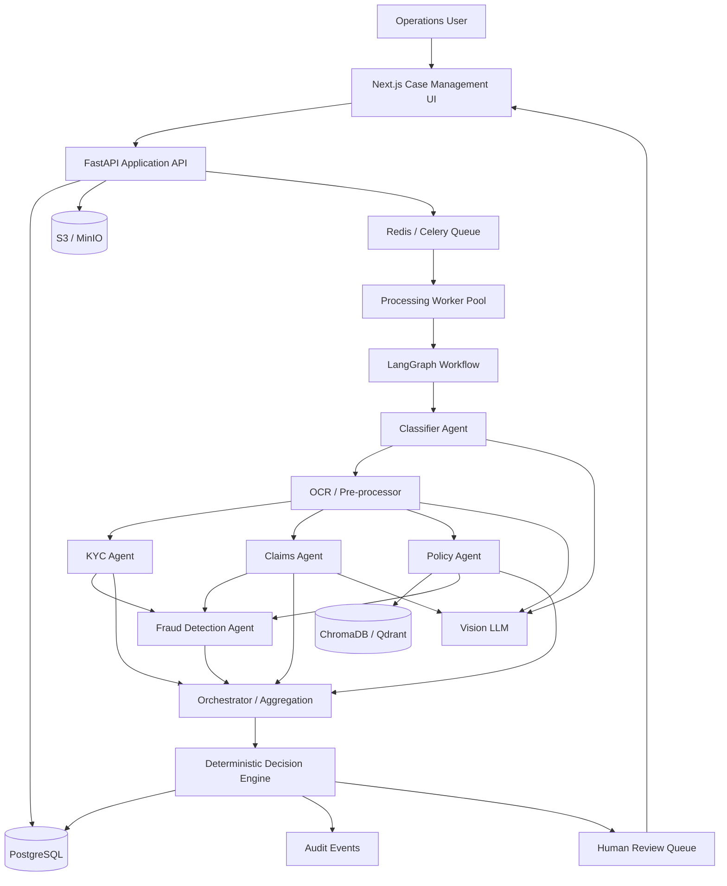

# Detailed Project Solution Architecture
## MediShield Insurance — AI-Powered Multi-Agent Document Intake System

**Architecture Status:** Proposed Production Architecture  
**Design Focus:** Secure, scalable, resilient, observable and auditable

---

# 1. Architecture Vision

The platform is designed as a layered system rather than a monolithic “LLM application.”

The architecture separates:

1. Presentation
2. API / control plane
3. Asynchronous processing
4. Agent workflow
5. Deterministic decisioning
6. Transactional storage
7. Document storage
8. Policy retrieval
9. External data dependencies
10. Audit and observability

This allows AI components to evolve independently from the case-management application and provides controlled failure boundaries.

# 2. Target Architecture



# 3. Why the Architecture Is Layered

A document-processing platform can fail at multiple points:
- file upload;
- parsing;
- OCR;
- model availability;
- internal data lookup;
- vector retrieval;
- fraud calculation;
- decision policy;
- UI.

Separating layers ensures that:
- a model failure does not bring down the API;
- a worker failure does not lose the original document;
- a UI failure does not destroy processing state;
- a policy-store issue does not erase case data.

# 4. Logical Architecture

## Layer 1 — Presentation

**Next.js**

Responsibilities:
- dashboard;
- case list;
- case detail;
- agent evidence;
- review queue;
- audit log;
- decision display.

The browser never receives database or object-storage master credentials.

## Layer 2 — API / Control Plane

**FastAPI**

Responsibilities:
- upload;
- case creation;
- case retrieval;
- case status;
- review/override;
- audit retrieval;
- job trigger.

It should not perform long-running agent execution in the request thread.

## Layer 3 — Processing Control

**Redis or Celery**

Responsibilities:
- enqueue work;
- decouple API from workers;
- support retry;
- enable multiple workers.

## Layer 4 — AI Workflow

**LangGraph**

Responsibilities:
- state transitions;
- routing;
- conditional edges;
- specialist fan-out;
- aggregation;
- error branch;
- human-review branch.

## Layer 5 — Agent Layer

Specialized components:
- Classifier;
- OCR / Preprocessor;
- KYC;
- Claims;
- Policy;
- Fraud;
- Orchestrator.

# 5. End-to-End Runtime Sequence

```text
1. User uploads document.
2. FastAPI validates request.
3. Case ID is created.
4. Original document is persisted.
5. Processing job is queued.
6. Worker claims job.
7. Classifier identifies document type.
8. OCR / preprocessing executes where required.
9. Specialist agents execute.
10. Fraud check executes after required upstream results.
11. Orchestrator aggregates outputs.
12. Decision engine evaluates deterministic rules.
13. Result is stored.
14. Audit event is written.
15. UI reads updated state.
16. Escalated cases enter human review.
```

# 6. Trust Boundaries

```text
TRUST ZONE A — Browser
       |
       | HTTPS + Auth
       v
TRUST ZONE B — FastAPI
       |
       +--------------------+
       |                    |
       v                    v
TRUST ZONE C            TRUST ZONE D
Data/Queue              AI/Workers
       |                    |
       +---------+----------+
                 |
                 v
         External Services
```

Each boundary should have:
- authentication;
- authorization;
- network restrictions;
- logging;
- timeout controls.

# 7. Data Classification

The platform may process:
- identity information;
- policy information;
- claims data;
- provider information;
- potentially sensitive financial/medical information.

Recommended design consequence:
- minimize the data sent to external model providers;
- restrict document access;
- mask data in logs;
- encrypt storage;
- apply retention rules once business/legal requirements are finalized.

# 8. Document Ingestion Architecture

```text
Multipart HTTP
      ↓
MIME + Size Validation
      ↓
Checksum
      ↓
Case Registration
      ↓
Private Object Storage
      ↓
Queue
```

Recommended controls:
- validate actual file type rather than trusting extension;
- limit document dimensions/pages where feasible;
- scan files before processing;
- generate non-guessable object keys;
- never use user-supplied path fragments directly.

# 9. Classification Architecture

Input:
- image/page representation;
- metadata.

Output:
- doc_type;
- confidence;
- routing_tags.

The model output must be schema constrained.

Low confidence or UNKNOWN transitions to human review.

# 10. OCR Architecture

```text
Document
 ↓
Document type / page analysis
 ↓
Text extraction
 ├── text-native PDF → direct extraction
 └── image/scanned → OCR / vision
 ↓
Normalization
 ↓
Structured fields + raw text + bounding boxes
```

The exact OCR engine is not mandated by the source. Tesseract and vision LLMs are source-specified options.

# 11. KYC Architecture

KYC combines:
- extracted identity values;
- member database verification;
- document validity;
- visual anomaly signal.

The KYC result should remain structured.

```text
Document
  ↓
OCR/Visual features
  ↓
Extract member details
  ↓
Member DB lookup
  ↓
Expiry check
  ↓
Visual anomaly check
  ↓
KYC result
```

# 12. Claims Architecture

```text
Claim Document
     ↓
OCR / Vision
     ↓
Field Extraction
     ↓
Schema Validation
     ↓
Claims Result
```

Required fields from the source:
- amount;
- ICD-10;
- CPT;
- NPI;
- service date.

# 13. Policy RAG Architecture

```text
             POLICY INGESTION
                    |
                 PDF Upload
                    |
                 Docling
                    |
                Chunking
                    |
                Embedding
                    |
          ChromaDB / Qdrant
                    |
                    |
CLAIM PROCEDURE ---> Retriever
                    |
             Top relevant clauses
                    |
              Policy Agent
                    |
       Coverage + exclusions + clause
```

Critical traceability metadata:
- policy document ID;
- policy version;
- chunk ID;
- retrieval timestamp.

# 14. Fraud Architecture

The Fraud Detection Agent compares the current claim against patient history and statistical baselines.

```text
Current Claim
     +
Patient History
     +
Provider Patterns
     +
Duplicate Checks
     +
Frequency Checks
     ↓
Anomaly Scoring
     ↓
fraud_score + anomalies + risk_level
```

The source does not specify the statistical model, feature engineering method, or training data. Those are implementation decisions.

# 15. Orchestration Architecture

LangGraph is used as the workflow state manager.

The orchestration responsibility is:
- ensure dependencies are satisfied;
- maintain state;
- coordinate specialist nodes;
- collect outputs;
- invoke the decision engine;
- route escalation.

Avoid allowing free-form model output to directly bypass the state machine.

# 16. Decision Architecture

Decision policy:

```text
                    INPUT EVIDENCE
                         |
          +--------------+--------------+
          |              |              |
          v              v              v
        KYC           Claims          Policy
          \              |              /
           \             |             /
            +------------+------------+
                         |
                       Fraud
                         |
                         v
                  Decision Engine
                 /       |        \
                /        |         \
           APPROVE     REJECT     ESCALATE
                                      |
                                      v
                                Human Review
```

The decision engine is separate from the Orchestrator so business rules can be versioned and tested independently.

# 17. Decision Rule Precedence

The source provides:
- Approve if KYC passed + claim valid + covered + fraud < 0.3;
- Reject if KYC failed OR not covered OR schema invalid;
- Escalate if fraud ≥ 0.3 OR any agent confidence < 0.6.

Because these conditions may overlap at boundary cases, implementation must establish and test rule precedence explicitly.

Recommended implementation order:

```text
Hard Reject
   ↓
Escalation
   ↓
Approve
```

This is an implementation recommendation; the assignment itself does not explicitly state precedence.

# 18. Human-in-the-Loop Architecture

Cases route to human review when:
- unknown;
- low confidence;
- fraud threshold;
- agent error;
- business rule exception.

UI should expose:
- original document;
- extracted fields;
- source evidence;
- agent results;
- escalation reason;
- decision;
- reviewer action.

Recommended:
- reason code mandatory for override;
- reviewer identity recorded;
- timestamp recorded.

# 19. Data Architecture

```text
                    ┌─────────────┐
                    │ PostgreSQL  │
                    └──────┬──────┘
                           │
          ┌────────────────┼────────────────┐
          ▼                ▼                ▼
        Cases          Agent Runs        Audit
          |
          +---- Decisions
          |
          +---- Human Reviews

                    ┌─────────────┐
                    │Object Store │
                    └──────┬──────┘
                           |
                    Original / Derived

                    ┌─────────────┐
                    │  Vector DB  │
                    └──────┬──────┘
                           |
                     Policy Chunks
```

# 20. Deployment Topology

A logical production topology:

```text
                 Internet / Corporate Network
                           |
                    Load Balancer
                           |
                +----------+----------+
                |                     |
             Next.js                FastAPI
                                      |
                         +------------+------------+
                         |            |            |
                      Queue       PostgreSQL   Object Store
                         |
                     Workers
              +----------+----------+
              |          |          |
           Worker 1   Worker 2   Worker N
              |
          LangGraph
              |
       AI + Policy + Fraud
```

# 21. Scaling Strategy

The source expects future multiple-worker support.

Scale:
- API horizontally for request load;
- workers horizontally for document processing;
- object storage independently;
- vector store independently.

Worker concurrency should be limited according to:
- model rate limits;
- CPU/memory;
- OCR resource usage;
- document size;
- database connection capacity.

# 22. Availability and Resilience

Recommended controls:
- stateless API instances;
- queue-backed work;
- database transactions;
- worker heartbeat;
- job lease;
- checkpoint after major nodes;
- bounded retries;
- dead-letter or exception queue;
- health/readiness endpoints.

# 23. Failure Matrix

| Failure | Expected Handling |
|---|---|
| Upload failure | Return validation/transport error; no partial case |
| Object-store failure | Retry intake persistence or fail safely |
| Queue unavailable | Do not claim case ready for processing until enqueue confirmed |
| Model timeout | Retry according to policy |
| OCR failure | Retry/fallback or human review |
| Member DB unavailable | Retry; do not invent KYC result |
| Policy vector store unavailable | Retry or human review |
| Fraud dependency failure | Retry; escalate when safe decision impossible |
| Worker crash | Lease expiry and recovery |
| UI outage | Processing continues; UI later reads durable state |

# 24. Security Architecture

## Identity
Use organization-approved authentication.

## Access Control
At minimum define permissions for:
- reviewer;
- manager;
- administrator.

## Case Access
Server-side authorization is mandatory.

## Secrets
Use secret management rather than source control.

## Encryption
Use encrypted transport and encrypted storage.

## File Security
Use private object storage and controlled document access.

## Logging
Log metadata and events, not entire sensitive documents.

# 25. AI/ML Governance

Every agent execution should record:
- model identifier;
- model version when available;
- prompt/config version;
- agent version;
- workflow version;
- confidence;
- latency;
- policy version for RAG decisions.

This enables post-incident analysis and evaluation.

# 26. Prompt and Model Management

Production model configuration should be externalized.

Recommended:

```text
agent_config/
  classifier
  claims
  policy
  fraud
  orchestrator
```

Version:
- prompt template;
- output schema;
- threshold;
- model identifier.

# 27. Observability

## Metrics

### System
- API request count;
- error rate;
- latency;
- queue depth.

### Workflow
- cases received;
- active jobs;
- completed jobs;
- retries;
- failed jobs.

### Agents
- per-agent latency;
- confidence;
- error rate.

### Business
- approve rate;
- reject rate;
- escalation rate;
- manual override rate.

## Tracing

The assignment's bonus explicitly proposes LangSmith tracing for:
- agent calls;
- token count;
- latency.

# 28. Audit Architecture

Audit event example:

```json
{
  "case_id": "CASE-123",
  "execution_id": "EXEC-456",
  "event_type": "CLAIMS_COMPLETED",
  "actor_type": "SERVICE",
  "actor_id": "claims-agent",
  "created_at": "2026-09-28T10:00:00Z"
}
```

Use append-oriented event recording.

# 29. Disaster Recovery

Recovery must account for:
- PostgreSQL;
- original documents;
- policy documents;
- vector data or rebuild capability;
- configuration/model versions;
- audit records.

The source does not provide RPO/RTO values. These must be established by business owners.

# 30. Environment Strategy

```text
DEV
 ↓
TEST
 ↓
STAGING
 ↓
PRODUCTION
```

Do not reuse production credentials in non-production.

Use synthetic datasets for development and testing.

# 31. Performance Strategy

The target “within minutes” is a business expectation in the source rather than a measured SLO.

Baseline and monitor:
- upload latency;
- queue latency;
- OCR latency;
- model latency;
- vector retrieval latency;
- total case processing time.

# 32. Security Threat Model

### Threat: malicious file upload
Controls:
- type validation;
- size limits;
- content scanning;
- isolated processing.

### Threat: unauthorized case access
Controls:
- server-side authorization;
- non-sequential external identifiers;
- access audit.

### Threat: prompt/data leakage
Controls:
- minimize context;
- provider access controls;
- avoid unnecessary sensitive content;
- log model metadata rather than content.

### Threat: model hallucination
Controls:
- structured output;
- schema validation;
- evidence-backed policy retrieval;
- deterministic decision engine;
- human review.

### Threat: duplicate processing
Controls:
- checksum;
- idempotency;
- execution key;
- durable job state.

# 33. Architecture Decision Records

## ADR-001 — Asynchronous Processing
**Decision:** Use queue-backed workers.  
**Reason:** Decouples API request lifecycle from model/OCR processing and enables horizontal scaling.

## ADR-002 — LangGraph for Workflow State
**Decision:** Use LangGraph for state-machine orchestration.  
**Reason:** The assignment explicitly specifies LangGraph and conditional/parallel routing.

## ADR-003 — Deterministic Decision Engine
**Decision:** Keep final business decision rules outside the free-form LLM prompt.  
**Reason:** Makes decision logic testable and auditable.

## ADR-004 — Object Storage for Documents
**Decision:** Store original documents in S3 or MinIO.  
**Reason:** Separates large binary objects from transactional case data.

## ADR-005 — Human Review for Uncertainty
**Decision:** Route unknown/low-confidence/high-risk cases to human review.  
**Reason:** Explicitly required for low-confidence classification and necessary for uncertain outcomes.

# 34. Recommended MVP Architecture

```text
Next.js
   ↓
FastAPI
   ↓
Redis/Celery
   ↓
Single Worker
   ↓
LangGraph
   ↓
Classifier → OCR → KYC/Claims/Policy → Fraud → Decision
   ↓
PostgreSQL + S3/MinIO + Chroma/Qdrant
```

This is the smallest architecture that still preserves the assignment's major boundaries.

# 35. Scale-Out Architecture

```text
FastAPI x N
    ↓
Queue
    ↓
Worker x N
    ↓
LangGraph executions
    ↓
Shared PostgreSQL
Shared Object Store
Shared Vector Store
```

# 36. Production Readiness Checklist

### Architecture
- [ ] API separated from workers
- [ ] Queue configured
- [ ] Stateful workflow checkpoints
- [ ] Durable object storage
- [ ] Durable transactional database

### Security
- [ ] Auth enabled
- [ ] RBAC enabled
- [ ] Secrets externalized
- [ ] TLS enabled
- [ ] Private document storage
- [ ] Sensitive logging minimized

### AI
- [ ] Structured outputs
- [ ] Versioned prompts
- [ ] Model IDs captured
- [ ] Thresholds configurable
- [ ] Deterministic decision rules
- [ ] Human review path

### Operations
- [ ] Health checks
- [ ] Metrics
- [ ] Logs
- [ ] Retry
- [ ] Crash recovery
- [ ] Audit trail

### Evaluation
- [ ] 20+ synthetic dataset
- [ ] Ground-truth labels
- [ ] Classification metric
- [ ] Extraction metric
- [ ] Retrieval assessment
- [ ] Decision correctness
- [ ] UI tests
